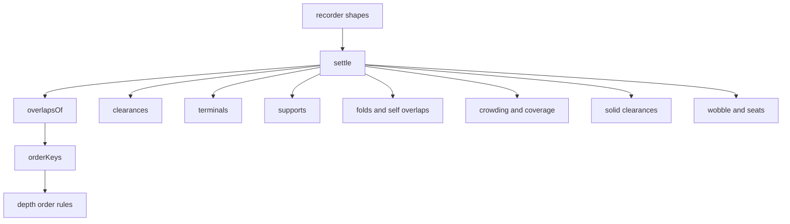
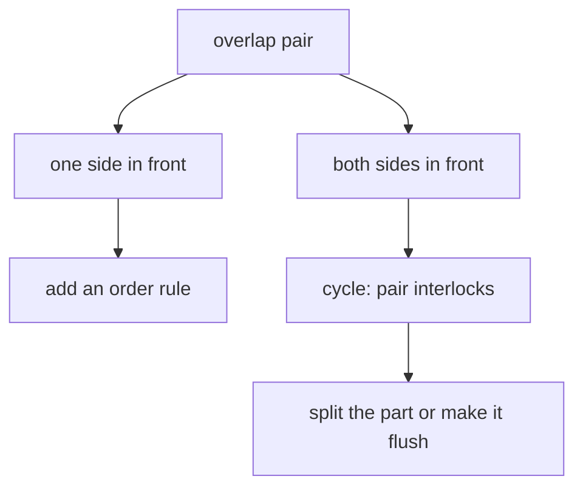

# 05 -- Audit: geometry proof with signed distance fields

`kit/audit.mjs` is the proof. It is a signed distance field (SDF) engine. A builder records the true shape of every solid, tube and route. The audit then checks clearance, ends, support, folds, crowding, coverage, wobble and seating. It also solves the painter's order for every overlapping pair. The build fails when any check fails.

The module is the largest of the non-turn modules, about 1900 lines. Its entry point is the recorder.

## The recorder

```js
// kit/audit.mjs, lines 1817-1836
export function recorder(P, { order = [], spring = {}, ground = grounded } = {}) {
  const V = cameraBasis(P).V;
  const counts = new Map();
  const R = { P, V, order, spring, ground, items: [], solids: [], tubes: [], routes: [], settled: null };
  R.nameFor = (base) => { /* unique names */ };
  R.solid = (shape) => {
    R.solids.push(shape);
    return shape;
  };
  R.put = ({ at = null, bias = 0, key, name, piece = "", move = [0, 0, 0], ride, shapes = [], ...rest } = {}) => {
    const item = { ...rest, piece, ride: ride ?? piece, key: key ?? (at ? dot3(at, V) : 0) + bias, move, shapes, name: name ?? R.nameFor(`${piece || "item"}.item`) };
    for (const shape of shapes) (shape.move = item.move), (shape.ride = item.ride), (shape.piece = piece);
    R.items.push(item);
    return item;
  };
  R.route = (name, points, radius, { owner = name, touch, bundle, limp = false, gaps = [], closed = false, ends = [true, true], rims, free = [false, false], piece = "", move = [0, 0, 0], ride = piece } = {}) => { /* ... */ };
  // ...
}
```

The shapes are the truth. `A.body`, `A.prism`, `A.solid`, `A.slab`, `A.cylinder`, `A.box`, `A.ball` and `A.tube` build them. `A.slide` and `A.moved` describe motion. A stand-in shape that silences the audit is a bug, and the audit fails one.

## What the audit checks



`clearances` checks that tubes keep their distance from solids. `terminals` checks that every end lands on a mount. `supports` finds loose and hanging parts. `folds` finds bends that pinch on screen. `crowding` finds outlines that touch. `coverage` finds parts whose drawing covers their shapes. `solidClearances` checks solids against solids. `wobble` checks for rocking parts and `seats` checks that parts sit.

## Solving the depth order

The depth order is a constraint problem, not a sort. `orderKeys` solves it and drops impossible cycles:

```js
// kit/audit.mjs, lines 657-696
export function orderKeys(items, overlaps, { gap = 0.02, rounds = 0 } = {}) {
  const { pairs, least, V } = overlaps;
  const start = items.map((item) => item.key);
  const strongest = new Map();
  const cycles = [];
  for (const pair of pairs) {
    const aFront = pair.front[0].area >= least;
    const bFront = pair.front[1].area >= least;
    if (aFront && bFront) {
      cycles.push(pair);
      continue;
    }
    const [front, back] = aFront ? [pair.a, pair.b] : [pair.b, pair.a];
    const weight = pair.front[aFront ? 0 : 1].area;
    const need = gap + shareOf(items[back], pair.state) * liftOf(items[back], V) - shareOf(items[front], pair.state) * liftOf(items[front], V);
    // keep the strongest rule per pair
  }
  // iterate rules; drop a cycle when no key order can satisfy it
}
```

`overlapsOf` finds the pairs by ray-casting a raster of the shapes. When both sides of a pair are in front across the overlap, the pair cannot be ordered. The fix is a cut or a tangent contact, never a key bias.



## The gate

The build ends with `auditOrExit`:

```js
// kit/audit.mjs, lines 1902-1913
export function auditOrExit(R, P = R.P, { flag = "--audit", argv = process.argv, ...options } = {}) {
  if (!argv.includes(flag)) return null;
  const started = Date.now();
  const result = audit(R, P, options);
  const { overlaps, solved, states } = R.settled;
  console.log(report(result));
  console.log(`audit · ${R.tubes.length} tubes · ${R.solids.length} solids · ${R.items.length} items · ${states.length} depth states · ${overlaps.pairs.length} overlaps · ${solved.rules} order rules · ${((Date.now() - started) / 1000).toFixed(1)} s`);
  const count = failures(result);
  console.log(count ? `audit failed: ${count} problem${count === 1 ? "" : "s"}` : "audit passed");
  if (count) process.exitCode = 1;
  return result;
}
```

The gate runs only with the flag `--audit`, so normal builds stay fast. When the flag is present and any check fails, the process exits with a non-zero code.

The checks cover the parts from every other module: the tubes and routes in [04-tube.md](./04-tube.md), the curved profiles of [03-lathe.md](./03-lathe.md) and the solids of [02-isometric-core.md](./02-isometric-core.md). The same proof idea is extended to moving parts in [07-turn.md](./07-turn.md).

## The Aha Moment

**Aha:** the drawing is proved, not eyeballed.

Depth order and clearance are geometry problems. The audit turns them into constraint and distance problems and solves them exactly. When the audit passes, the reader cannot find a part through another part or a line that ends in the air. That proof is what makes a crafted figure different from a picture.

Continue to [06-webgl.md](06-webgl.md).
