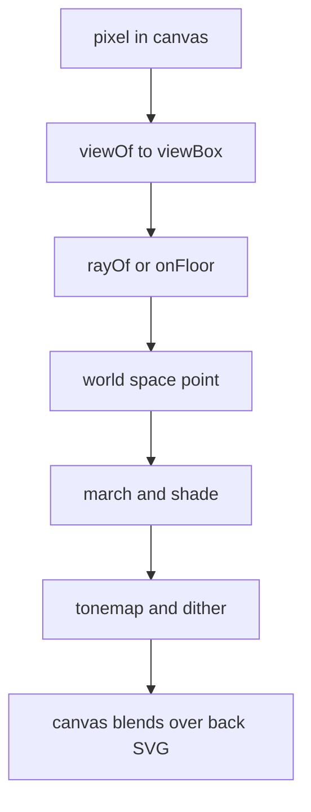
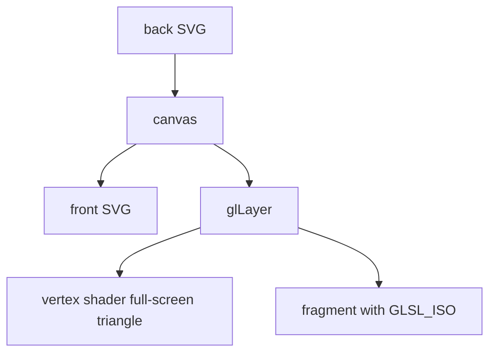

# 06 -- WebGL: shaders inside the drawing

`kit/gl.mjs` puts a WebGL shader inside the isometric drawing; `kit/gl-shared.mjs` is an experimental, undocumented variant. The shader lives in world space, in the same camera as the SVG. The SVG draws the object. The shader draws the effect: a flame, a plume, water or sparks. The two register exactly.

The layer stack is three parts: a back SVG, a canvas and a front SVG. The canvas has `pointer-events: none`. Whatever the effect covers goes in the back SVG. Whatever covers the effect goes in the front SVG.

## The camera contract

The shader gets the camera through uniforms. `GLSL_ISO` holds the functions:

```glsl
// kit/gl.mjs, lines 8-16
vec2 viewOf(vec2 frag){return vec2(frag.x,uCanvas.y-frag.y)*(uView.x/uCanvas.x);}
vec2 project(vec3 p){return uOrigin+uK*vec2(p.x*uCam.x-p.y*uCam.y,(p.x*uCam.y+p.y*uCam.x)*uCam.z-p.z*uCam.w);}
vec3 towardViewer(){return vec3(uCam.y*uCam.w,uCam.x*uCam.w,uCam.z);}
vec3 rayOf(vec2 vb){vec2 q=(vb-uOrigin)/uK;return vec3(q.x*uCam.x,-q.x*uCam.y,-q.y/uCam.w);}
float pixelOf(){return (uView.x/uCanvas.x)/uK;}
vec3 lightDir(){return normalize(vec3(-uCam.x,uCam.y,1.2));}
vec3 onFloor(vec2 vb,float h){vec2 q=(vb-uOrigin)/uK;float b=(q.y+h*uCam.w)/uCam.z;return vec3(q.x*uCam.x+b*uCam.y,-q.x*uCam.y+b*uCam.x,h);}
vec3 onWallY(vec2 vb,float y){vec2 q=(vb-uOrigin)/uK;float x=(q.x+y*uCam.y)/uCam.x;return vec3(x,y,((x*uCam.y+y*uCam.x)*uCam.z-q.y)/uCam.w);}
vec3 onWallX(vec2 vb,float x){vec2 q=(vb-uOrigin)/uK;float y=(x*uCam.x-q.x)/uCam.y;return vec3(x,y,((x*uCam.y+y*uCam.x)*uCam.z-q.y)/uCam.w);}
```

`project` is the shader twin of `iso` in [02-isometric-core.md](./02-isometric-core.md). `rayOf` rebuilds a world ray from a pixel, so an effect can be ray-marched. `onFloor`, `onWallY` and `onWallX` place a pixel on a world plane. Anything lying on a plane registers exactly with that plane's SVG lines.



## The layer stack



`glLayer` compiles the fragment and sets up the full-screen triangle:

```js
// kit/gl.mjs, lines 64-93
export function glLayer({ canvas, fragment, view, camera, uniforms = [], fixed = {}, extensions = [], maxRatio = 1.5, onError = (message) => console.error(message) }) {
  const gl = canvas.getContext("webgl", { premultipliedAlpha: true, alpha: true, antialias: false, preserveDrawingBuffer: false });
  if (!gl) return null;
  // ... compile the shaders, link the program ...
  gl.useProgram(program);
  const buffer = gl.createBuffer();
  gl.bindBuffer(gl.ARRAY_BUFFER, buffer);
  gl.bufferData(gl.ARRAY_BUFFER, new Float32Array([-1, -1, 3, -1, -1, 3]), gl.STATIC_DRAW);
  const position = gl.getAttribLocation(program, "p");
  gl.enableVertexAttribArray(position);
  gl.vertexAttribPointer(position, 2, gl.FLOAT, false, 0, 0);
```

The triangle covers the canvas. The device ratio is capped at 1.5 for restraint. `glCamera(projection)` builds the camera uniforms from the same projection the SVG uses. `glslPose` and `GLSL_TURN` anchor a shader to a 3D turning group in [07-turn.md](./07-turn.md). The light-theme and ink rules that verify a shader are in `references/webgl.md` section 8 and the full checklist in [10-capture-verify.md](./10-capture-verify.md).

## Envelopes

Nothing may pop or cut off. Every uniform rides an envelope with an attack and a decay:

```js
// kit/gl.mjs, lines 166-183
export function settle(state, target, dt, seconds, calm = false) {
  if (calm) {
    state.x = target;
    state.v = 0;
    return false;
  }
  const w = 1 / seconds;
  for (let index = 0; index < 4; index++) {
    const h = dt / 4;
    state.v += (w * w * (target - state.x) - 2 * w * state.v) * h;
    state.x += state.v * h;
  }
  if (Math.abs(target - state.x) < 1e-4 && Math.abs(state.v) < 1e-4) {
    state.x = target;
    state.v = 0;
    return false;
  }
  return true;
}
```

`smooth` is a smoothstep. `burst` builds an event envelope. The examples use them for lighting and turning off. In the light theme the shader is designed for paper: normal premultiplied alpha, never screen, and the ink colour is solved from the paper colour. `tonemap` (in `gl.mjs`) and a per-example `dither` (e.g. `examples/ripple-tank/live.js`) end every fragment.

## The Aha Moment

**Aha:** the shader and the SVG share one camera, so they can never disagree.

A flame's base lands on the barrel rim because both read the same world numbers. The two renderers are different engines with the same contract. The contract is the projection, and it is inlined into both the page and the shader.

Continue to [07-turn.md](07-turn.md).
