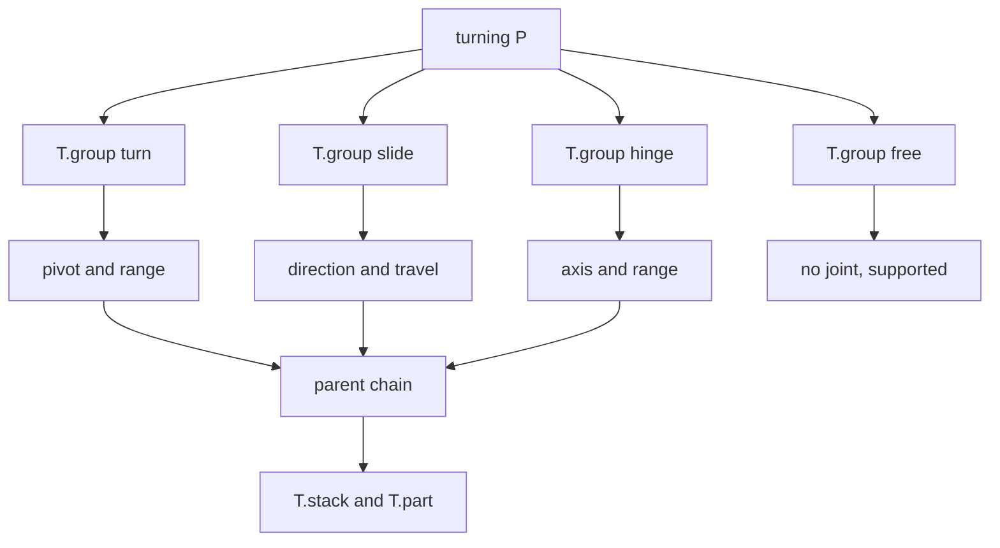
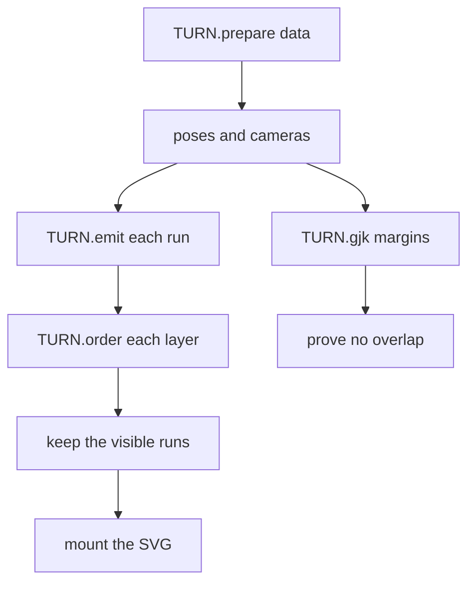

# 07 -- Turn: parts that really move

`kit/turn-build.mjs`, `kit/turn.mjs` and `kit/turn-audit.mjs` make a 3D figure that turns, slides and hinges. This is the beta "turn" mode. The builder describes parts as kinematic groups. The runtime solves their poses, their depth order and their separating planes every frame. A reader can drag a handle and watch the machine move without parts passing through each other.

The same discipline applies: nothing is a picture. A part that moves must prove it can move.

## Groups: the joints

`turning(P, { recorder, scale })` opens a turn build. Every moving part belongs to a group, and every group has one of four joint kinds:

```js
// kit/turn-build.mjs, lines 302-330
export function turning(P, { recorder = null, scale = 1 } = {}) {
  const T = { P, R: recorder, scale, groups: [], layers: [], order: [], parts: [], built: null };
  const groupOf = (g) => { /* resolve a group by name */ };
  const layerOf = (l) => (typeof l === "string" ? T.layers.find((x) => x.name === l) : l);
  T.group = (name, options = {}) => {
    if (T.groups.some((group) => group.name === name)) throw new Error(`turning: duplicate group ${name}`);
    const parent = groupOf(options.parent);
    const po = origin(parent);
    let kind;
    let spec;
    if (options.turn) {
      kind = "turn";
      const pivot = options.turn.pivot ?? [0, 0];
      spec = { origin: [pivot[0], pivot[1], 0], pivot: [pivot[0], pivot[1]], range: options.turn.range ?? null };
    } else if (options.slide) {
      kind = "slide";
      spec = { origin: po.slice(), direction: G.unit3(options.slide.direction), travel: options.slide.travel ?? 0, range: [0, options.slide.travel ?? 0] };
    } else if (options.hinge) {
      kind = "hinge";
      spec = { origin: options.hinge.point.slice(), point: options.hinge.point.slice(), axis: G.unit3(options.hinge.axis), range: options.hinge.range ?? [0, 0] };
    } else if (options.free) {
      kind = "free";
      spec = { origin: (options.free.origin ?? po).slice(), range: null };
    } else throw new Error(`turning: group ${name} needs turn, slide, hinge or free`);
    // ...
    T.groups.push(group);
    return group;
  };
```

A `turn` rotates around a pivot in the page plane. A `slide` moves along a world direction. A `hinge` rotates around a world axis. A `free` group has no joint and must be supported by the others. Each group has a `parent`, so motion composes. A group is `upright` when it stays vertical under its parent's motion, and `loose` when it is not rigidly driven.



`T.stack` puts parts into a stack, `T.layer` opens a layer and `T.part` (with `T.prism`, `T.round`, `T.ball`, `T.lathe`, `T.tube`, `T.fixed`, `T.plane`) adds geometry. `T.build()` packs the result with planes, framed pairs, group pairs, dynamic runs and free runs.

## Separating planes

Every pair of parts must have a plane that separates them. `gjk` finds the closest witness direction, and `quickSeparate` refines it into a separating plane with margin:

```js
// kit/turn-build.mjs, lines 169-177
export function gjk(A, B, warm = null) {
  const w = warm && G.len3(warm) > 1e-9 ? warm : closest(A, B);
  const n = G.unit3(G.len3(w) > 1e-12 ? w : [0, 0, 1]);
  const { margin, d } = marginOf(n, A, B);
  return { n, d, margin };
}
```

A negative margin means the pair overlaps in that pose. `convexOrThrow` rejects a non-convex ring before it reaches the solver. `statesOf`, `sweptGroups` and `proveLayers` validate the layer structure so a part cannot be in two layers at once.

## The runtime loop



`TURN.prepare` unpacks the built data. `TURN.emit` computes each part's path in the current pose. `TURN.order` solves the depth order with the same planar witnesses as the audit. `TURN.cams` builds a camera per group so nested motion composes. The export object at the end of `kit/turn.mjs` binds them all:

```js
// kit/turn.mjs, line 3609
export const TURN = { materials: Object.keys(T3_MATERIALS), materialCss: t3MaterialCss, rotation: (axis, degrees) => Array.from(t3Rot(axis, degrees)), quat: (q) => Array.from(t3Quat(q)), compose: t3Compose, floorOf: t3FloorOf, anchor: t3Anchor, camera: t3Camera, poses: t3PosesMap, prepare: t3Prepare, emit: t3Emit, order: t3Order, mount: t3Mount, cover: t3Cover, poseUniforms: t3PoseUniforms, css: t3Css, frame: t3Frame, cams: t3Cams, gjk: t3Gjk, ... };
```

## The orbit audit

`kit/turn-audit.mjs` runs `orbit` to sweep the joints and prove the machine never breaks:

```js
// kit/turn-audit.mjs, line 326
export function orbit(T, R, P, options = {}) {
  const { sweep = null, clips = [], poses = null, random = 2000, step = 0.05, crowd = [], cover = [], fittings = [], depthAngles = 36, depthEvents = 36, quick = false, log = null, routeStates = 240, posedStep = null, only = null } = options;
  // ...
  const result = { separation: [], unseparated: [], cycles: [], forced: [], swaps: [], layers: [], rigid: [], swept: [], posed: [], folds: [], self: [], crowding: [], endon: [], coverage: [], depth: [], continuity: [], notes: [], stats: {}, quick, skipped: ... };
```

The checks are `separation`, `unseparated`, `cycles`, `forced`, `swaps`, `layers`, `rigid`, `swept`, `posed`, `folds`, `self`, `crowding`, `endon`, `coverage`, `depth` and `continuity`. `orbitReport` turns the result into text and `orbitOrExit` runs it with the `--audit` flag. Two experimental modules sit beside the turn kit: `turn-fixed.mjs` produces a fixed picture of a pose, and `canvas-painter.mjs` paints it with the 2D canvas. They are the bridge toward a printable, non-interactive 3D figure.

## The Aha Moment

**Aha:** a moving figure is proved over the whole range, not at one pose.

A static figure needs one correct depth order. A turning figure needs every pose to be correct. The same separating-plane idea that orders a static drawing is re-run across the joint sweep, so the machine's motion is checked the way its shape is checked. When the orbit audit passes, a reader can turn any handle and no part will ever pass through another.

The turn mode builds on the 2D audit in [05-audit.md](./05-audit.md) and shares camera ideas with the shaders in [06-webgl.md](./06-webgl.md). The tooling that verifies it is in [13-tests-evals.md](./13-tests-evals.md).

Continue to [08-react.md](08-react.md).
