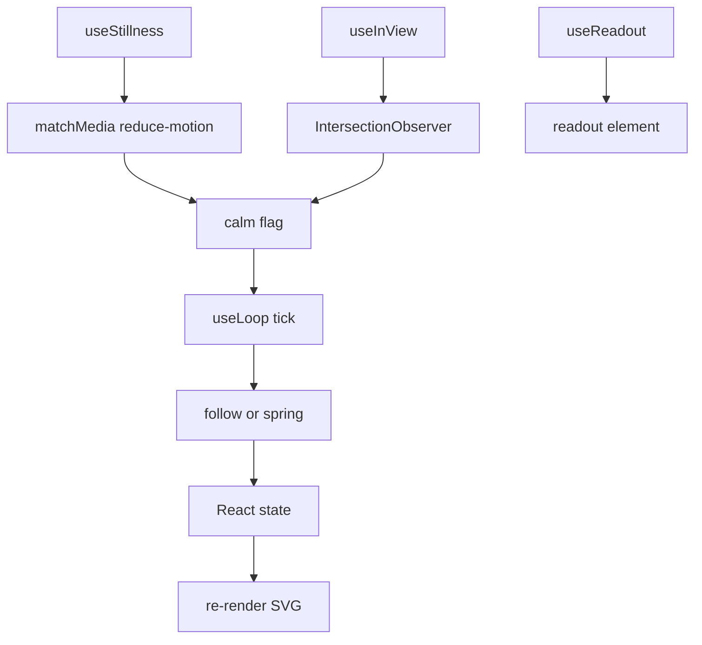
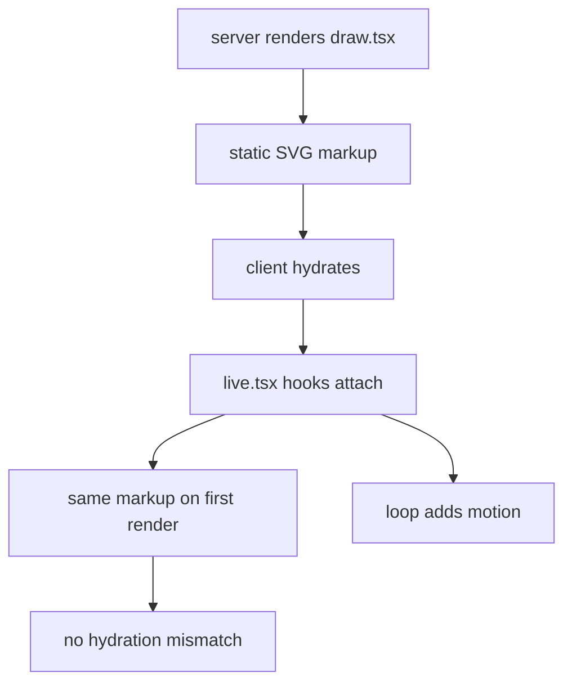

# 08 -- React: server markup and client motion

`kit/react/draw.tsx` and `kit/react/live.tsx` give the kit a React interface. The two files are split on one rule: server or client. `draw.tsx` is server-safe. It renders static SVG components with no hooks and no browser calls. `live.tsx` opens with `"use client"` and holds the interactivity, the loop and the easing.

The split matters for Next.js. A server component can render the whole figure to static markup. The client hydrates it and adds motion without re-rendering from scratch.

## Server-safe components

`draw.tsx` mirrors the core's string builders as React components. `Solid` maps the `SolidPaths` object to `<path>` elements:

```tsx
// kit/react/draw.tsx, lines 17-31
export function Solid({ paths, tone = "hi", crease = "faint", halo = false, lit = false, flat = false, className, inner, children }: SolidProps) {
  return (
    <g className={className ? `iso-solid ${className}` : "iso-solid"} data-lit={lit ? "" : undefined} data-seamless={paths.seamless ? "" : undefined}>
      {halo ? <path className="iso-halo" d={paths.fill} /> : null}
      <path className="iso-fill" d={paths.fill} />
      {flat ? null : paths.shades.map((d, shade) => (d ? <path key={shade} className="iso-shade" data-shade={shade} d={d} /> : null))}
      {flat ? null : <path className="iso-top" d={paths.top} />}
      {crease === "none" || !paths.crease ? null : <path className="iso-line iso-crease" data-tone={crease} d={paths.crease} />}
      {crease === "none" || !paths.bevel ? null : <path className="iso-line iso-bevel" data-tone={crease} d={paths.bevel} />}
      {inner}
      <path className="iso-line iso-edge" data-tone={tone} d={paths.outline} />
      {children}
    </g>
  );
}
```

The `SolidPaths` structure is the same one `extrude` returns in [02-isometric-core.md](./02-isometric-core.md). `Line`, `Wire`, `Dots` and `FaceText` cover the flat marks. `IsoFigure` is the viewport wrapper:

```tsx
// kit/react/draw.tsx, lines 128-136
export function IsoFigure({ width, height, label, className, children }: IsoFigureProps) {
  return (
    <Stage className={className ? `iso-stage ${className}` : "iso-stage"}>
      <svg className="iso-svg" viewBox={`0 0 ${width} ${height}`} role="img" aria-label={label} focusable="false">
        {children}
      </svg>
    </Stage>
  );
}
```

`Plate` adds the plate chrome: title, hint, readout, key legend and caption. `Swatch` (internal, used by `Plate`) draws the raised, flat or lit mark for a legend key.

## Client hooks

`live.tsx` starts with `"use client"`. Its hooks gate, observe and animate:



`useStillness` reads the `prefers-reduced-motion` media query, but only on the client. `useInView` watches the figure with an `IntersectionObserver` and stops the loop while off-screen. `useReadout` grabs the readout element. `useLoop` drives the ticking. The two easing helpers are deterministic:

```js
// kit/react/live.tsx, lines 98-122
export function follow(current: number, target: number, dt: number, seconds: number, calm = false) {
  if (calm) return target;
  const next = current + (target - current) * (1 - Math.exp(-dt / seconds));
  return Math.abs(target - next) < 1e-3 ? target : next;
}

export interface Spring {
  at: number;
  rate: number;
}

export function spring(state: Spring, target: number, dt: number, stiffness: number, damping: number, calm = false) {
  const drag = calm ? 2 * Math.sqrt(stiffness) : damping;
  const steps = Math.max(Math.ceil(dt * 240), 1);
  const slice = dt / steps;
  for (let step = 0; step < steps; step++) {
    state.rate += (target - state.at) * stiffness * slice - state.rate * drag * slice;
    state.at += state.rate * slice;
  }
  if (Math.abs(target - state.at) < 5e-4 && Math.abs(state.rate) < 5e-4) {
    state.at = target;
    state.rate = 0;
  }
  return state.at === target && state.rate === 0;
}
```

`follow` is an exponential approach. `spring` is a stiffness and damping integrator. `useEased(target, seconds)` wraps `follow` in a `useLoop` and React state, so a component can track a target with a smooth catch-up. In a calm run every helper snaps to the target, so the first server render and the first client render agree.



## The key trap

React consumes `key` and does not forward it as a prop. A component that destructures `key` gets `undefined`, and React logs a warning. Put `key` on the JSX element in the map, as `Solid` does with `key={shade}`, never in a component's own props. The same split keeps hydration safe: the server markup is static, and every hook's first value equals its target, so the client's first render matches the server's.

The two React examples are [12-examples.md](./12-examples.md)'s spot-plate and test-rig. The gallery pages they produce are published with the toolchain in [11-publish-print.md](./11-publish-print.md).

## The Aha Moment

**Aha:** the server draws the figure, the client only animates it.

The drawing logic has no hooks, so it runs anywhere. The motion logic is quarantined behind `"use client"`, so it hydrates cleanly. The contract between them is the markup: if the client's first render matches the server's, hydration is free. That is why every easing helper is calm-first.

Continue to [09-references.md](09-references.md).
