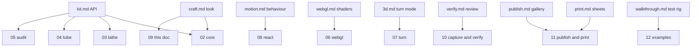
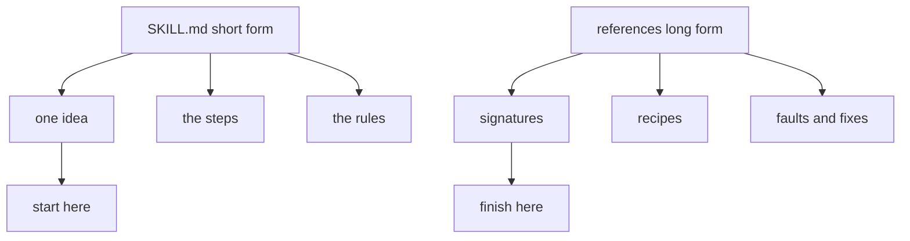

# 09 -- References: the rulebooks

The `references/` directory holds ten rulebooks. Each one goes deep on one part of the craft. The SKILL.md file is the short form. The references are the long form. A builder reads the short form to start and the right rulebook to finish.

The ten files are `kit.md`, `craft.md`, `verify.md`, `webgl.md`, `3d.md`, `motion.md`, `react.md`, `print.md`, `publish.md` and `walkthrough.md`. They are markdown, but most of their content is code.

## The API book

`references/kit.md` is the API with signatures and examples. It starts with the type table that the whole kit shares:

```ts
// references/kit.md, lines 24-31
type Flat = [number, number];            // screen point
type Point3 = [number, number, number];  // world point
type Plane = [number, number];           // floor point (x, y)
interface Plan { x: number; y: number; w: number; d: number; r: number }   // rounded rectangle on the floor
interface Projection { origin: Flat; scale: number; azimuth?: number; elevation?: number }
interface SolidPaths { fill; outline; crease; top; shades: string[4]; bevel?; seamless? }
type Tone = "hi" | "mid" | "lo" | "faint";
type LineTone = Tone | "lit" | "red" | "green" | "blue";
```

The same types appear throughout the docs in this series: `Projection` and `SolidPaths` in [02-isometric-core.md](./02-isometric-core.md), `Tone` in the shading rules there, and the same structure in the React `Solid` in [08-react.md](./08-react.md).

## The craft book

`references/craft.md` is the look in depth. It holds the parts vocabulary with recipes, the tone tables, painter's order patterns, round parts, pipes, exploded views, screens and the anti-patterns that got figures rejected. A recipe reads like this:

```js
// references/craft.md, lines 54-64
const PLATE = { x: -128, y: -64, w: 262, d: 128, r: 8 };
halo:  `<path class="iso-halo" d="${k.haloOf(PLATE, -17, 12, P)}"/>`
feet:  for (const [x, y] of byDepth(k.corners(PLATE, 22))) {
         k.cylinder(x, y, 7, -17, 1.6, P, 28)            // flange, tone lo
         k.cylinder(x, y, 5.4, -15.4, 3.4, P, 28)        // foot, tone mid
       }
slab:  k.slabOf(PLATE, -12, 12, P, 8, 1.6)                // tone mid, bevel 1.6
groove: k.planOutline(k.insetPlan(PLATE, 5), 0, P)         // line lo
screws: k.corners(PLATE, 10) → k.ring(x, y, 2.2, 0, P, 16) (line lo) + dots size .5
```

The craft book is the source for the four-tone system and painter's order covered in [02-isometric-core.md](./02-isometric-core.md).

## The behaviour book

`references/motion.md` covers live behaviour: loops, springs, tours, pointer, keyboard, accessibility and reduced motion. The core pattern is one `tick` that writes to refs and never re-renders per frame:

```js
// references/motion.md, lines 27-42
let frame = 0, last = 0, visible = false, touring = !still.matches, clock = 0;
function tick(now) {
  const dt = last ? Math.min((now - last) / 1000, 1 / 30) : 1 / 60;
  last = now;
  const calm = still.matches;
  if (touring) { clock += dt; target = tourAt(clock); }
  x = calm ? target : x + (target - x) * (1 - Math.exp(-dt / 0.28));
  springTo(tip, heightUnder(x), dt, 420, 26, calm);
  draw();                                   // setAttribute on refs, readout.textContent = ...
  const settled = !touring && x === target && tip.rate === 0;
  frame = visible && !settled ? requestAnimationFrame(tick) : 0;
}
const run = () => { if (!frame && visible) { last = 0; frame = requestAnimationFrame(tick); } };
new IntersectionObserver((entries) => { visible = entries[entries.length - 1].isIntersecting; if (visible) run(); }, { rootMargin: "120px 0px" }).observe(stage);
```

This is the same loop the React hooks in [08-react.md](./08-react.md) wrap, and the same calm-first rule that keeps hydration safe.

## The map



The remaining books map to the pipeline: `verify.md` feeds the capture and review step in [10-capture-verify.md](./10-capture-verify.md). `print.md` and `publish.md` feed the print and publish step in [11-publish-print.md](./11-publish-print.md). `walkthrough.md` is the design story of the test rig, one of the worked examples in [12-examples.md](./12-examples.md). `3d.md` is the rulebook for the turn mode in [07-turn.md](./07-turn.md) and `webgl.md` is the rulebook for the shaders in [06-webgl.md](./06-webgl.md). `react.md` is the split documented in [08-react.md](./08-react.md).

## How the books differ from SKILL.md



SKILL.md states the rules. The references give the recipes and the faults that taught each rule. The two together are the specification: SKILL.md for the gate, the reference for the reasoning.

## The Aha Moment

**Aha:** the references are not extra reading, they are the specification at full resolution.

SKILL.md says what to do. A reference says how and why, with the rejected attempt next to the accepted one. When the docs in this series compress a rule to one paragraph, the reference behind it holds the full proof. The rulebooks are the project's memory.

Continue to [10-capture-verify.md](10-capture-verify.md).
