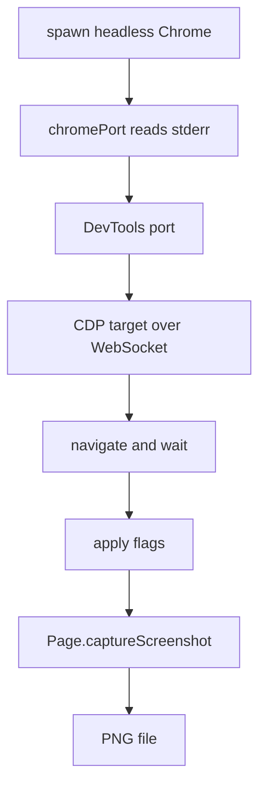
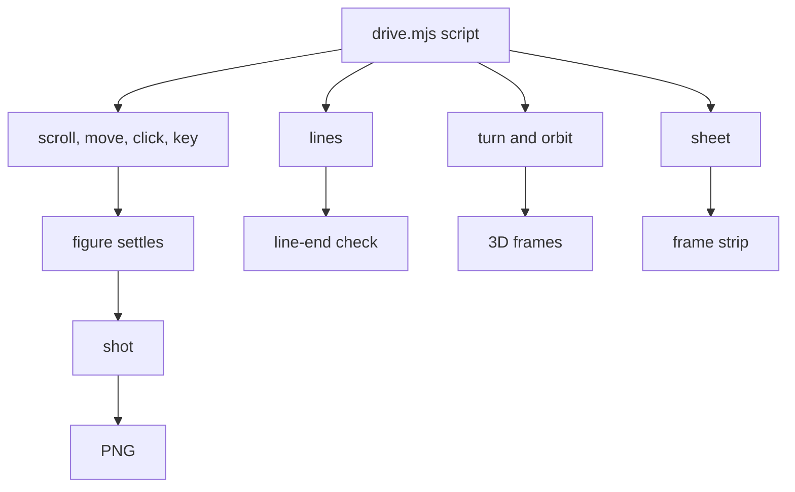

# 10 -- Capture and verify: the figure must pass in a real browser

The toolchain captures the figure in a real headless Chrome and checks it the way a reader would see it. `scripts/capture.mjs` takes screenshots. `scripts/drive.mjs` drives the page with scripted actions. `scripts/lines.mjs` checks that every line ends on something. `scripts/turn-check.mjs` checks the 3D mode. `references/verify.md` holds the review checklist.

The toolchain does not trust the builder's eye. It trusts pixels.

## Capturing a page

`capture.mjs` opens headless Chrome and talks to it with the Chrome DevTools Protocol (CDP). It spawns Chrome with a fresh profile and a random debug port, then screenshots:

```js
// scripts/capture.mjs, lines 107-135
async function main() {
  const options = parse(process.argv.slice(2));
  // ... resolve the URL and output path ...
  const binary = chromePath();
  if (!binary) {
    console.error("No Chrome found. Set CHROME_PATH to a Chrome or Chromium binary.");
    process.exit(1);
  }
  const profile = mkdtempSync(join(tmpdir(), "iso-capture-"));
  const chrome = spawn(binary, [
    "--headless=new", ...(process.platform === "linux" ? ["--no-sandbox"] : []),
    "--remote-debugging-port=0",
    `--user-data-dir=${profile}`,
    "--no-first-run",
    "--no-default-browser-check",
    "--hide-scrollbars",
    "--allow-file-access-from-files",
    "--enable-unsafe-swiftshader",
    "--ignore-gpu-blocklist",
    "about:blank",
  ]);
  const port = await chromePort(chrome, profile);
  // ... open a CDP target and capture ...
```

The flags let a builder zoom into a region, hover first, press keys, wait extra times, emulate reduced motion and emulate the light or dark theme. The script records every console error and exception from the page, so a broken figure fails loudly.

`chromePort` waits for the DevTools port instead of guessing:

```js
// scripts/chrome-port.mjs, lines 1-36
import { rmSync } from "node:fs";

export async function chromePort(chrome, profile) {
  try {
    return await new Promise((done, fail) => {
      let text = "";
      const clean = () => { /* clear listeners */ };
      const error = (cause) => { clean(); fail(cause); };
      const exited = (code, signal) => error(new Error(`Chrome exited before startup: ${code ?? signal}`));
      const data = (chunk) => {
        text += chunk;
        const match = text.match(/DevTools listening on ws:\/\/[^:]+:(\d+)\//);
        if (match) {
          clean();
          done(Number(match[1]));
        }
      };
      const timer = setTimeout(() => error(new Error("Chrome did not start")), 20000);
      chrome.stderr.on("data", data);
      chrome.on("error", error);
      chrome.on("exit", exited);
    });
  } catch (error) {
    chrome.kill("SIGKILL");
    rmSync(profile, { recursive: true, force: true });
    throw error;
  }
}
```



## Driving the page

`drive.mjs` runs a script of actions in order. Each action either moves the page, reads it or shoots it:

```js
// scripts/drive.mjs, lines 31-57
["scroll", sel]                         scroll an element into the middle of the viewport
["wait", ms]                            wait
["move", sel, fx, fy]                   glide the mouse to a point of the element (fires pointermove)
["click", sel, fx?, fy?]                click a point of the element (centre by default)
["drag", sel, fx0, fy0, fx1, fy1, steps?]
["key", key, sel?, code?]               focus sel (default [tabindex="0"]) and press a key
["slow", factor]                        run the page's clock at factor x real time (0.05 = 20x slow motion)
["until", js, timeoutMs?]               poll a JS expression until it is truthy
["eval", js]                            run JS in the page and print the result
["shot", out.png, sel?, scale?, [x,y,w,h]?]   screenshot an element or a region
["lines", out.png?, sel?, options?]     check every texture line's two ends land on a stroke, a dot or an outline
["turn", value, group?]                 set a 3D figure's turn through window.__isoTurn
["orbit", out.png, from, to, step, ...] screenshot a 3D figure around its orbit
["sheet", out.png, every, count, ...]   capture a sheet of frames
```

`slow` lets a sheet catch a 100 millisecond event by running the page clock at 0.05 times real time. `until` polls an expression so the script waits for the figure to settle. The `lines` action is the line-end check: every texture line's two ends must land on a stroke, a dot or an outline. `lines.mjs` wraps it as a small command and `line-ends.mjs` holds the geometry.



## Checking the 3D mode

`turn-check.mjs` checks a turning figure with flags: `--fidelity` for visual fidelity, `--order` for depth order, `--pops` for pops across poses, `--lines` for line ends, `--perf` for performance and `--states` for a saved pose file. `turn-fidelity.mjs` compares frames and `turn-bench.mjs` times the Node-side emit and order over 360 angles. The full review checklist lives in `references/verify.md`, including the light-theme shader rules: ink per frame must follow the light monotonically and strokes must crop clean at high zoom. That connects to the shader contract in [06-webgl.md](./06-webgl.md).

## The Aha Moment

**Aha:** verification is a real browser session, not a unit test.

A unit test checks a function. A crafted figure must also check how it paints, how it moves under the pointer, and how it looks in both themes. The toolchain drives Chrome the way a reader would, then compares what it sees against the rules. The review checklist is the same standard the maintainers use to reject a figure.

The step sits between the build and the publish: it is stage three of the pipeline in [01-pipeline.md](./01-pipeline.md). The test suite that protects the tooling itself is in [13-tests-evals.md](./13-tests-evals.md).

Continue to [11-publish-print.md](11-publish-print.md).
