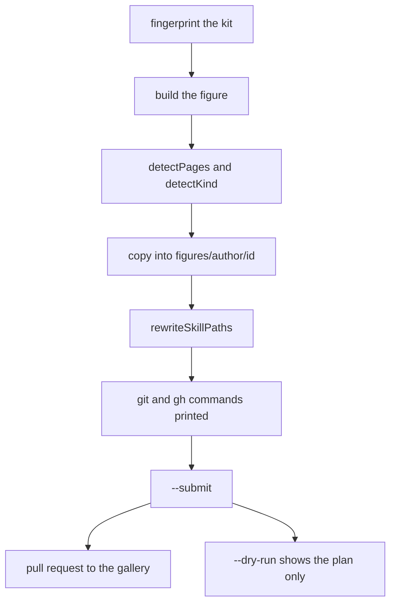
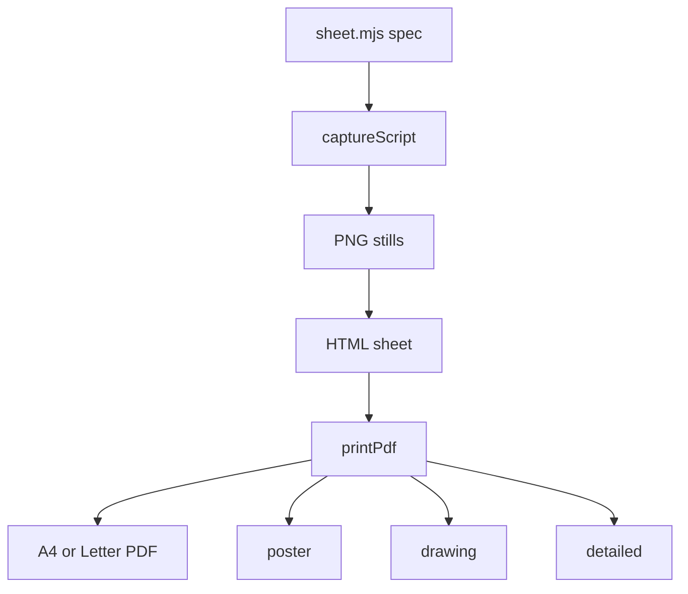

# 11 -- Publish and print: from a private figure to a gallery page

The toolchain ends in two places: a printable PDF sheet and a community gallery page. `scripts/print.mjs` and `scripts/print-sheet.mjs` make the sheet. `scripts/publish.mjs`, `scripts/session.mjs` and `scripts/fingerprint.mjs` publish the gallery page. Publishing only happens when the user asks. Nothing is pushed for them.

## The fingerprint

A gallery page must say which version of the kit built it. `fingerprint.mjs` hashes every kit file:

```js
// scripts/fingerprint.mjs, lines 5-16
export const KIT_FILES = (path) => path === "scripts/inline-kit.mjs" || (path.startsWith("kit/") && !path.split("/").some((part) => part.startsWith(".")));

const sha256 = (data) => createHash("sha256").update(data).digest("hex");

export function fingerprintOf(entries) {
  const lines = entries
    .filter(([path]) => KIT_FILES(path))
    .map(([path, content]) => `${path}\0${sha256(content)}\n`)
    .sort();
  if (!lines.length) throw new Error("fingerprint: no kit files found");
  return `sha256:${sha256(lines.join(""))}`;
}
```

The result is a single `sha256:` string. It pins the exact kit code that produced the figure, so a later reviewer can tell whether a page was built with a kit that had a known bug.

## Publishing a figure

`publish.mjs` copies the figure into a clone of the gallery repo and rewrites its paths:

```js
// scripts/publish.mjs, lines 116-132
export function rewriteSkillPaths(text, { fromDir, toDir, source, skill, skillLink }) {
  const outside = [];
  const rewritten = text.replace(/(["'])((?:\.{1,2}\/|\/)[^"'\n]*)\1/g, (literal, quote, path) => {
    const target = resolve(fromDir, path);
    const dotted = (from, to) => {
      const r = posix(relative(from, to));
      return r.startsWith(".") ? r : `./${r}`;
    };
    if (!/\.[a-z]+$/i.test(path) && !inside(skill, target)) return literal;
    if (inside(source, target)) return isAbsolute(path) ? `${quote}${dotted(fromDir, target)}${quote}` : literal;
    if (inside(skill, target)) return `${quote}${dotted(toDir, join(skillLink, relative(skill, target)))}${quote}`;
    if (/\.(m?js|css|json|html|svg)$/.test(path)) outside.push(path);
    return literal;
  });
  return { text: rewritten, outside };
}
```

The rewrite keeps the page working at its new gallery URL: links that pointed at the skill now point at the skill link, and links inside the figure stay as they are. The publish call validates the layout, rejects a figure folder inside the skill itself, checks the author name and the destination. The flags are `--submit` to actually send a pull request, `--yes` to skip the question, `--dry-run` to show the plan only, and `--force` to replace an existing figure. `detectPages` finds the pages and `detectKind` labels the kind, for example "SVG + WebGL".



## Measuring the session

The pull request description reports how long the figure took and how many tokens it cost. `session.mjs` reads the session transcript:

```js
// scripts/session.mjs, lines 64-76
export function measure(files, { prompt = "" } = {}) {
  if (!files.length) return null;
  const [main, ...side] = files;
  const mainEntries = entriesOf(main).sort((a, b) => a.timestamp.localeCompare(b.timestamp));
  const asks = mainEntries.filter((entry) => entry.type === "user" && !entry.isSidechain && textOf(entry));
  const head = squash(prompt).slice(0, 48);
  const start =
    (head && asks.find((entry) => squash(textOf(entry)).includes(head))) ??
    asks.find((entry) => /\/anatomy\b|\banatomy\b/i.test(textOf(entry))) ??
    mainEntries[0];
  if (!start) return null;
  const end = asks.find((entry) => entry.timestamp > start.timestamp && /\bpublish\b/i.test(textOf(entry)) && /\b(community|gallery)\b/i.test(textOf(entry)));
  const from = start.timestamp;
  const to = end?.timestamp ?? "￿";
  const inWindow = (entry) => entry.timestamp >= from && entry.timestamp < to;
  // ... sum active minutes and spent tokens ...
}
```

`fromThisSession` reads `CLAUDE_CODE_SESSION_ID` from the environment and measures that session. `parseMinutes` and `parseTokens` parse the already-measured strings. The measurement starts at the first prompt that mentions the skill and ends at the publish ask.

## Printing a sheet

`print.mjs` freezes a built figure into vector stills and lays them out on paper:



The three formats are poster (one page, big title, numbers and a legend), drawing (one page, parts list, specification and a strip of steps) and detailed (two to four pages: the figure with every part, the steps, and an assemblies page when the sheet lists assemblies; `maxPages` caps the total). `--letter` switches to US Letter and `--png` keeps the raster stills. `print-sheet.mjs` holds the sheet specification: poses, parts as selectors, focus, hide, crops and rasters for WebGL. `pdf-button.mjs` puts a PDF link on the gallery card. The examples ship their sheets, for instance `examples/arcade-cabinet/sheet.mjs` and `examples/raptor-engine/sheet.mjs`.

The publish and print step is stage four of the pipeline in [01-pipeline.md](./01-pipeline.md). The capture it reuses is in [10-capture-verify.md](./10-capture-verify.md), and the examples that ship sheets are in [12-examples.md](./12-examples.md).

## The Aha Moment

**Aha:** a figure is published the way code is published, with a plan, a fingerprint and a measured cost.

The page is not just uploaded. Its paths are rewritten for the new home, its kit version is pinned, and its build cost is reported. That turns a figure from a one-off picture into a reproducible artifact that a reviewer can verify and trust.

Continue to [12-examples.md](12-examples.md).
