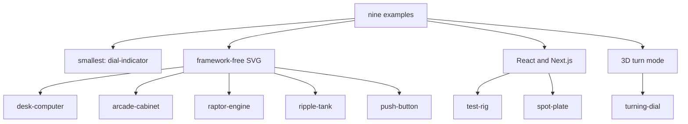
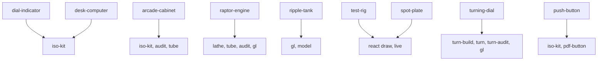

# 12 -- Examples: nine worked figures

The `examples/` directory holds nine worked figures. Seven are framework-free, and each of those is a complete build: a `build.mjs` script that writes a standalone page, and often a live script, a model module, a sheet and PDFs. The two React examples, `test-rig` and `spot-plate`, have no `build.mjs`. A builder opens the closest one before starting.

One note on the count: SKILL.md line 14 says "Eight complete examples" and lists eight. The directory has nine. `examples/push-button/` is the ninth; it is not in that list but is referenced later at SKILL.md line 170 for the `pdfButton` helper. Treat it as a complete example too.

## The taxonomy



`dial-indicator` is the smallest, about 300 lines in all: a dial gauge on a stand. `desk-computer` is a framework-free desk computer with a keyboard you can type on; the typed line appears on a cathode-ray tube (CRT) screen drawn in the plane of the case front, and the picture collapses to a line and a dot when switched off. `arcade-cabinet` is an upright cabinet with the side panel off, about 240 solids and 15 cables; a quarter rolls down the coin chute at the speed a disc reaches on a 30 degree slope, trips a switch and drops into the cash box. `raptor-engine` is a rocket engine in a test stand that comes apart into 11 assemblies, with a WebGL plume and splash between the back and front SVG. `ripple-tank` is a school ripple tank with two WebGL layers driven by a real optics model. `push-button` is the smallest publish-and-print example. `test-rig` and `spot-plate` are React production figures from a real site. `turning-dial` is the 3D mode: a combination dial with a robot hand.

## The smallest build

Every framework-free example follows one pattern. The dial indicator starts the same way the core does:

```js
// examples/dial-indicator/build.mjs, lines 1-11
import { writeFileSync } from "node:fs";
import { dirname, join } from "node:path";
import { fileURLToPath } from "node:url";
import * as k from "../../kit/iso-kit.mjs";
import { kitScript } from "../../scripts/inline-kit.mjs";

const HERE = dirname(fileURLToPath(import.meta.url));
const theme = process.argv.includes("--light") ? "light" : "dark";

const WIDTH = 600;
const HEIGHT = 380;
```

The script builds strings with the core helpers, wraps them with `figureSvg` and `plateHtml`, and writes the page with `pageHtml({ script: kitScript() + live })`. Add `--light` for the light theme. The pattern is the one in [02-isometric-core.md](./02-isometric-core.md).

## Recording the truth

The dense examples record every part's true shape as they draw it. The turning dial records before it turns:

```js
// examples/turning-dial/build.mjs, lines 47-48
export const R = A.recorder(P);
const put = (item) => R.put({ ...item, shapes: item.shapes.map((shape, index) => R.solid(Object.assign(shape, { name: shape.name ?? (index ? `${item.name}#${index + 1}` : item.name) }))) });
```

The recorder is the audit's truth, as in [05-audit.md](./05-audit.md). The raptor engine ends its build with the gate:

```js
// examples/raptor-engine/build.mjs, line 939
A.auditOrExit(R, P, { crowd: CROWD_OK });
```

`A.auditOrExit` runs only with `--audit` and exits non-zero on any problem. The raptor engine's audit proves, at rest, apart and in every replayed frame of the explode, that nothing passes through anything, every end sits on a real mount, no bend pinches or folds, no curved profile's slope wobbles, and every overlap is drawn in depth order.

## How the examples map to the kit



Each example is also a spec for its part of the kit. The raptor engine is the reference for dense pipework, smooth shading and fades, as documented in [03-lathe.md](./03-lathe.md) and [04-tube.md](./04-tube.md). The ripple tank is the reference for registered shaders in [06-webgl.md](./06-webgl.md). The turning dial is the reference for the turn mode in [07-turn.md](./07-turn.md). The React pair is the reference for the split in [08-react.md](./08-react.md). The sheets that ship with arcade-cabinet, raptor-engine and push-button feed [11-publish-print.md](./11-publish-print.md).

## The Aha Moment

**Aha:** every example is a test and a template at once.

The examples are not demonstrations. Each one is the smallest figure that exercises a part of the kit, and its build proves it. When a new figure follows an example, it inherits the example's discipline: record the truth, run the audit, ship the sheet.

Continue to [13-tests-evals.md](13-tests-evals.md).
