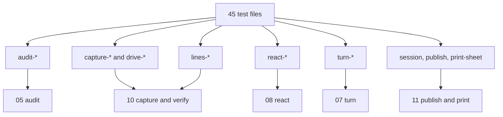
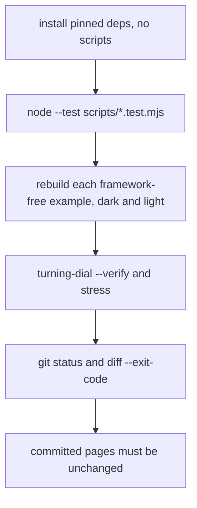

# 13 -- Tests and evals: what protects the toolchain

The project has no `package.json` at its root. The tests are 45 files in `scripts/`, named `*.test.mjs`, run with Node's built-in test runner. They protect the kit and the toolchain. The evals in `evals/evals.json` measure the skill's output end to end.

## The regression tests

The tests use `node:test`, the standard library runner:

```js
// scripts/session.test.mjs, lines 1-8
import assert from "node:assert/strict";
import { mkdirSync, mkdtempSync, writeFileSync } from "node:fs";
import { tmpdir } from "node:os";
import { join } from "node:path";
import { test } from "node:test";
import { describe, fromThisSession, measure, parseMinutes, parseTokens } from "./session.mjs";
```

Each test file imports the module it tests. The React tests pull in the real `react` and `react-dom`, which the CI job installs into a temporary directory without lifecycle scripts:

```yaml
# .github/workflows/ci.yml, lines 28-33
- name: Regression tests
  run: |
    test_deps="$(mktemp -d)"
    trap 'rm -rf "$test_deps"' EXIT
    npm install --prefix "$test_deps" --no-audit --no-fund --ignore-scripts react@19.3.0 react-dom@19.3.0 typescript@5.9.3 esbuild@0.28.2
    NODE_PATH="$test_deps/node_modules" node --test scripts/*.test.mjs
```

The tests are grouped by area. `audit-*` tests cover the signed distance field engine and its checks. `capture-*` and `drive-*` cover the headless Chrome toolchain. `lines-*` cover the line-end checker. `react-*` cover the React components and hooks. `turn-*` cover the 3D mode. `session.test.mjs`, `publish.test.mjs` and `print-sheet.test.mjs` cover the measurement, publish and print scripts. `tests/fixtures/` holds four PNG fixtures for the React tests: `react-dots-dark.png`, `react-dots-light.png`, `react-solid-dark.png` and `react-solid-light.png`.



## The CI gate

The CI job has three stages. First it runs the 45 test files. Then it rebuilds every framework-free example in both themes, with the turning dial also built with `--verify` and its `stress.mjs`. Then it checks that the committed pages are unchanged, so a change that affects a figure fails the build:



The gate rebuilds the examples because the built pages are committed. A kit change that alters a single path in a committed page fails the diff. That makes the examples a second regression suite, one that checks pixels, not functions.

## The evals

`evals/evals.json` holds five end-to-end evals for the skill. Each eval is a prompt plus an expected output:

```json
// evals/evals.json, lines 1-9
{
  "skill_name": "anatomy",
  "evals": [
    {
      "id": 1,
      "prompt": "I'm writing a blog post about how a token-bucket rate limiter works. Can you make me one interactive isometric illustration for it, the polished kind (like Linear's site), as a single HTML file I can just open? My blog has a white background. The bucket holds 20 tokens, refills 5 per second, and each request takes one token; requests get rejected when it's empty.",
      "expected_output": "A single standalone HTML file, light theme, with one framed isometric figure of a real physical object that explains a token bucket (tokens refilling, requests taking tokens, rejection when empty), live readout with true numbers, calm eased motion, keyboard/pointer interaction. ...",
      "files": []
    }
  ]
}
```

The five evals are: a token-bucket rate limiter, database connection pooling, a content delivery network (CDN) edge cache, a Bunsen burner with a WebGL flame, and a heat-exchanger espresso machine. The expected outputs name the same rules the docs do: smooth shading with no staircase, every line ending on a real edge, recorded shapes ending `audit passed`, and close-ups actually looked at.

The evals close the loop: the tests protect the modules, the examples protect the pixels, and the evals protect the end-to-end behaviour. Together with the capture checks in [10-capture-verify.md](./10-capture-verify.md) and the publish gate in [11-publish-print.md](./11-publish-print.md), they make the skill's quality reproducible.

## The Aha Moment

**Aha:** the examples are committed, so they are regression tests.

A picture cannot be unit tested, but a rebuilt picture can be diffed. The CI gate rebuilds every example and refuses any change to a committed page. That turns the visual quality bar from advice into an executable check. The tests prove the geometry, the examples prove the look.

Continue to [README.md](README.md).
