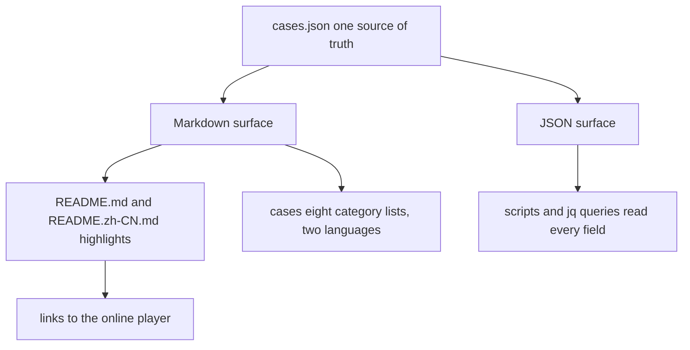
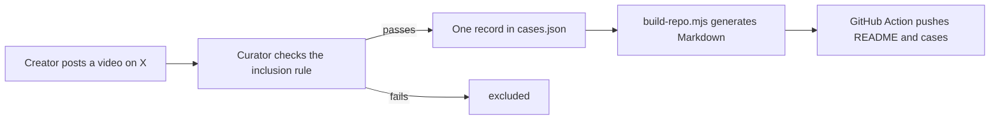

# 00 -- Overview: a curated catalog with two surfaces

`awesome-opus-5.5-video` is an awesome list. It collects 2,094 X (formerly
Twitter) posts. Each post shows a video, a motion-graphics piece, a 3D scene,
or a game. The creator made the work with the Claude 5.5 model family. The
catalog is a curated index: a human cannot watch every post, so a curator
picks the posts that pass a fixed rule and lists them. This document gives the
purpose, the audience, the two surfaces, and the key numbers.

The purpose is discovery and study. A designer can browse the catalog to find
motion-graphics styles. A developer can browse it to find game prototypes. A
prompt engineer can browse it to find the 515 works that ship their prompt.
The audience is anyone who makes things with a large language model (LLM) and
wants to see what the Claude 5.5 family can produce, and how other people
phrased the instruction that produced it.

## One catalog, two surfaces

The repository serves the same catalog in two forms. The Markdown is for
humans. The JavaScript Object Notation (JSON) is for machines.



The Markdown surface has three layers. The top layer is `README.md` (English)
and `README.zh-CN.md` (Chinese). Each README shows a highlight table per
category. The second layer is `cases/`. It holds eight per-category lists,
each in English and Chinese. The third layer is the online companion at
jasonzhu.ai. The README links each work there. That site plays the video and
shows the full prompt text.

The JSON surface is one file: `cases.json`. It holds every work as a record
with a fixed schema. The catalog's own numbers come from this file. A reader
can reproduce them with `jq`.

## The key numbers

The README states the headline numbers in its headline paragraph. This is the exact
text, from `README.md` line 5:

```markdown
Videos, motion graphics, 3D scenes and games made with Claude Opus 5.5, Sonnet 5.5, Haiku 5.5 and Fable 5.5 (limited preview, not yet announced) and shared on X, each with 5,000+ views on the original post. **2094 works** (Opus 5.5: 1956 · Sonnet 5.5: 116 · Fable 5.5: 77; comparisons count for each), **515 with a prompt** (235 full prompts).
```

Three claims in that line were verified against `cases.json` with `jq`; the block below is the author's recomputation, not a verbatim source quote:

```json
{
  "total_works": 2094,
  "works_with_prompt": 515,
  "full_prompts": 235,
  "brief_prompts": 280,
  "model_mentions_opus": 1956,
  "model_mentions_sonnet": 116,
  "model_mentions_haiku": 19,
  "model_mentions_fable": 77
}
```

The numbers match. Note one detail. The README parenthetical omits Haiku 5.5,
but the title and the data include it. `cases.json` counts 19 works with
`haiku-5.5`. This is a small omission in the headline, not in the data. See
[02-model-family.md](./02-model-family.md) for the full model breakdown.

## What a work looks like

Each work is one record in `cases.json`. The first record shows the shape.

```json
{
  "id": "2103534482930491441",
  "models": ["opus-5.5"],
  "category": "art3d",
  "title": {
    "zh": "用共享提示词一夜生成的精致场景",
    "en": "Elaborate overnight scene from shared prompt"
  },
  "creator": { "handle": "anabology", "name": "anabology" },
  "original_post_url": "https://x.com/anabology/status/2103534482930491441",
  "duration_seconds": 306,
  "views": 20097168,
  "prompt": null,
  "resources": []
}
```

This entry is the `cases.json` field `cases[0]`. The `views` value is
20,097,168. That is the highest-viewed work in the catalog. The `prompt` is
`null`, so this work has no traceable instruction. The schema is documented
field-by-field in [03-schema.md](./03-schema.md).

## The flow from post to catalog



The curator does not upload videos. The catalog links to the creator's own
post on X and to the online player. The catalog holds the metadata: the post
identifier, the category, the title in two languages, the creator, the view
count, and, when it exists, the prompt source.

## The Aha Moment

**Aha:** The catalog is not a hand-maintained list of rows. It is one JSON
file that a script turns into two languages of Markdown. Every number a reader
sees in the README is derived from `cases.json`. When you ask "how many works
are there", the answer is not a line someone typed; it is a count a script can
recompute. The repository is the compiled output of a data pipeline, not the
source of the data.

## Cross-References

- The rule that decides what enters the catalog: [01-inclusion-criteria.md](./01-inclusion-criteria.md).
- The four models and their counts: [02-model-family.md](./02-model-family.md).
- The field-by-field schema: [03-schema.md](./03-schema.md).
- How the Markdown is regenerated every day: [07-maintenance.md](./07-maintenance.md).

Continue to [01-inclusion-criteria.md](01-inclusion-criteria.md).
