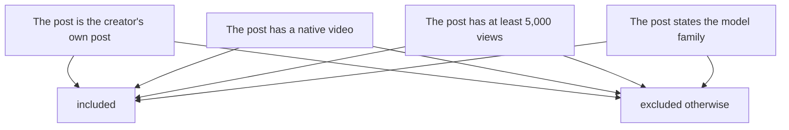
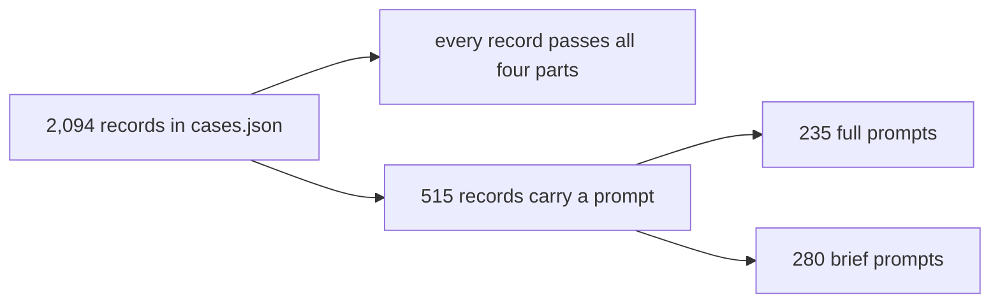

# 01 -- Inclusion Criteria: the gate every work must pass

A work enters the catalog only when it passes a fixed rule. The rule has four
parts: the post is the creator's own post, the post has a native video, the
post has at least 5,000 views, and the post states the work was made with the
Claude 5.5 family. If any part fails, the work stays out. This document quotes
the rule from the source and explains each part.

The rule appears twice in the source. `README.md` states it in human form.
`cases.json` stores a compact copy in its top-level metadata. Both say the same
thing, but the JSON adds one exclusion that the README states later.

## The rule as written

This is the human form, from `README.md` lines 26-31:

```markdown
## Inclusion rule

- The creator's own post, with a native video, and at least 5,000 views on that post (snapshot: 2026-10-24).
- The post states the work was made with Claude Opus 5.5, Sonnet 5.5, Haiku 5.5 or Fable 5.5; the Model column follows the creator's own words. **As of early October Fable 5.5 is in limited preview and not yet announced**; posts where the creator is unsure are excluded. **Model attribution is as stated by each creator and was not independently reproduced.**
- A prompt is listed only when it has a source: the post itself, the creator's own replies, a screenshot in those replies, or a link the creator shared. Prompts are kept verbatim, never rewritten or translated.
- Works with a video but no traceable instruction are still listed, with the prompt column left empty.
```

This is the compact form, from `cases.json`, field `inclusion_rule`:

```json
{
  "inclusion_rule": "Original post by the creator, native video attached, >= 5000 views on that post, creator states it was made with Claude Opus 5.5, Sonnet 5.5, Haiku 5.5 or Fable 5.5 (Fable 5.5 is in limited preview, not yet announced). Later posts that embed another account's upload are excluded."
}
```

The JSON text adds the last sentence: later posts that embed another account's
upload are excluded. The README states the same idea in its first bullet with
"the creator's own post".

## The four parts



All four parts must pass together. A work with a video and 10,000 views is
still excluded if the creator never names the model. A work that names the
model but embeds another account's upload is excluded.

### Part 1: the creator's own post

The catalog lists the creator's own post, not a repost. The JSON rule excludes
"later posts that embed another account's upload". The idea is that the view
count must belong to the creator's original post. A repost of a viral video
does not show the creator's own reach.

### Part 2: a native video

The post must have a video attached to the post itself, not a link to a video
elsewhere. The README calls this "a native video". The JSON calls it "native
video attached".

### Part 3: the 5,000-views threshold

The post must have at least 5,000 views on that post. The JSON stores the
threshold as a number:

```json
{
  "views_threshold": 5000
}
```

This is the `views_threshold` field in `cases.json`. The README states the
snapshot date as 2026-10-24. The lowest view count in the data is 5,061, just
above the threshold. The `views_checked_at` field on each record tells when
the view count was sampled.

### Part 4: the model statement

The post must state the work was made with Claude Opus 5.5, Sonnet 5.5, Haiku
5.5, or Fable 5.5. The Model column follows the creator's own words. The
catalog does not reproduce the work to verify the model. The `model_attribution`
field says this in one sentence:

```json
{
  "model_attribution": "As stated by each creator; not independently reproduced."
}
```

## The Fable exception

Fable 5.5 is special. As of early October 2026 it is in limited preview and not
yet announced. A post where the creator is unsure is excluded. A post where the
creator names Fable 5.5 is listed with the label "Fable 5.5 (preview)" in the
Markdown tables. The model coverage is documented in
[02-model-family.md](./02-model-family.md).

## The prompt condition

The fourth bullet of the README rule is about prompts, not entry. A prompt is
listed only when it has a source: the post itself, the creator's own replies, a
screenshot in those replies, or a link the creator shared. A work with a video
but no traceable instruction is still listed, with the prompt column left
empty. The prompt rule is documented in full in
[05-prompts.md](./05-prompts.md).

## How the rule shapes the data



The threshold is visible in the data in two ways. Every record's `views` value
is 5,000 or more. Every record's `views_checked_at` value is a snapshot
timestamp, which records that the count was sampled, not assumed.

## The Aha Moment

**Aha:** The inclusion rule is not enforced by a linter inside the repository.
It is enforced by the curator upstream, in the `jasonzhu.ai` data source. The
catalog repository is the output. That is why the rule is stored twice: once as
human prose in `README.md` and once as a machine-readable string in
`cases.json`. The two copies describe the same gate, and the `views_threshold`
field turns one part of that gate into a queryable number.

## Cross-References

- What the catalog is and who it is for: [00-overview.md](./00-overview.md).
- The four models the rule names, and their counts: [02-model-family.md](./02-model-family.md).
- The prompt-sourcing rule in full: [05-prompts.md](./05-prompts.md).
- How the upstream data reaches this repository: [07-maintenance.md](./07-maintenance.md).

Continue to [02-model-family.md](02-model-family.md).
