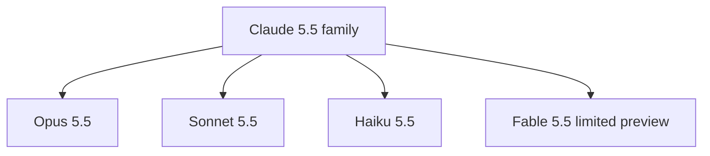
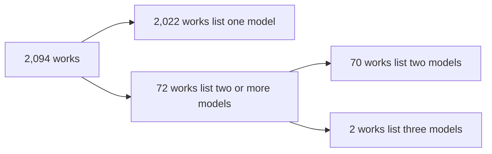

# 02 -- Model Family: four models, one family

The catalog covers one model family: Claude 5.5. The family has four members:
Opus 5.5, Sonnet 5.5, Haiku 5.5, and Fable 5.5. Each record in `cases.json`
names one or more members in its `models` array. The headline counts in the
README come from flattening those arrays. This document explains the four
models, the counts, the multi-model works, and one omission in the headline.

The Model column in the Markdown tables follows the creator's own words. The
catalog does not reproduce the work to verify the model. The
`model_attribution` field in `cases.json` says "As stated by each creator; not
independently reproduced."

## The four members



The top-level `model` field in `cases.json` names the family:

```json
{
  "model": "Claude 5.5 (Opus 5.5 · Sonnet 5.5 · Haiku 5.5 · Fable 5.5)"
}
```

The `models` array on a record uses slug values, not display names. The four
possible slugs are `opus-5.5`, `sonnet-5.5`, `haiku-5.5`, and `fable-5.5`.

## The counts

This query flattens every `models` array and counts each slug:

```json
{
  "opus-5.5": 1956,
  "sonnet-5.5": 116,
  "haiku-5.5": 19,
  "fable-5.5": 77
}
```

These numbers were produced by `jq -r '.cases[].models[]' cases.json | sort |
uniq -c`. The sum is 2,168, which is larger than the 2,094 works. The
difference is the multi-model works.

## Why the sum is larger than the total

A work can name more than one model. A comparison post is the common case. It
shows two models producing the same scene, so the record lists both. The
README states this with "comparisons count for each".



The math works out. The 2,022 single-model works add one mention each. The 70
two-model works add two mentions each. The 2 three-model works add three
mentions each. Total: 2,022 plus 140 plus 6 equals 2,168.

A multi-model record looks like this, from `cases.json` field `cases` (one of
the comparison entries):

```json
{
  "id": "2104994617573970308",
  "models": ["opus-5.5", "sonnet-5.5"],
  "category": "comparison",
  "title": {
    "en": "Watermelon rubber band test: Opus 5.5 vs GPT-6 Astra"
  },
  "creator": { "handle": "vib3coded", "name": "Vib3Coded" }
}
```

The Markdown table renders this as "Opus 5.5 / Sonnet 5.5" in the Model
column, with a slash between the display names.

## The omission in the headline

The README headline counts three models, not four. From `README.md` line 5:

```markdown
**2094 works** (Opus 5.5: 1956 · Sonnet 5.5: 116 · Fable 5.5: 77; comparisons count for each)
```

The parenthetical omits Haiku 5.5. The data counts 19 works with `haiku-5.5`.
The title and the `model` field both include Haiku 5.5. This is a small
omission in the headline prose, not in the data. The Chinese README has the
same omission. The record below is a Haiku 5.5 work that the headline does not
count:

```json
{
  "id": "2108156546056433826",
  "models": ["haiku-5.5"],
  "category": "comparison",
  "title": { "en": "Side-by-side model output comparison" },
  "creator": { "handle": "Da7_Tech", "name": "Da7em" }
}
```

The numbers 1,956, 116, and 77 are correct for their three models. The only
error is that Haiku 5.5 (19 works) is left out of the parenthetical.

## Fable 5.5 and the preview label

Fable 5.5 is in limited preview and not yet announced. The README writes this
explicitly. In the Markdown tables, Fable 5.5 works show "Fable 5.5 (preview)"
in the Model column. The record itself stores only the slug `fable-5.5`. The
preview label is added at render time, not stored in the data.

## Model values across the data

The `models` array never stores a display name. It always stores a slug. This
keeps the data consistent: a script can group by `models` and know the set of
values is closed. The display names live in the Markdown generator and in the
README prose.

## The Aha Moment

**Aha:** The headline count and the data count differ by design, not by
accident. "Comparisons count for each" means a 2-model work contributes one
mention to each model's total. The flatten-and-count gives 2,168 mentions for
2,094 works. The only real inconsistency is that the headline drops Haiku 5.5,
whose 19 works are present in the data. When you read a headline like
"Opus 5.5: 1956", you are reading a per-model mention count, not a count of
works that used only that model.

## Cross-References

- The rule that names the four models: [01-inclusion-criteria.md](./01-inclusion-criteria.md).
- The `models` field and its schema: [03-schema.md](./03-schema.md).
- The comparison category, where multi-model works cluster: [04-categories.md](./04-categories.md).

Continue to [03-schema.md](03-schema.md).
