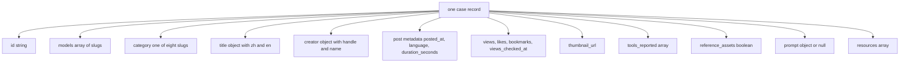
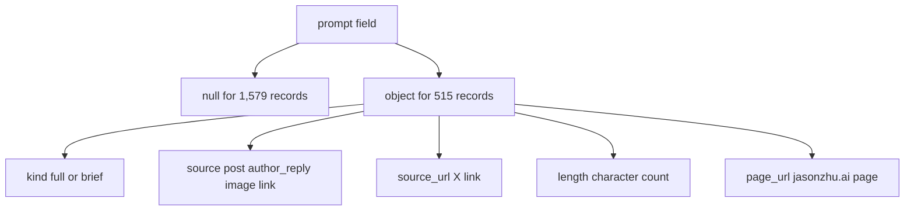

# 03 -- Schema: cases.json field by field

`cases.json` is the single source of truth for the catalog. It is a JSON
object with eight top-level keys. Seven keys hold metadata about the catalog
itself. The eighth key, `cases`, holds an array of 2,094 records, one per
work. Each record has eighteen fields. This document explains every field and
gives a real value for each.

The file is pretty-printed with one-space indentation and 65,071 lines. The
top-level metadata sits in the first eight lines; the `cases` array follows. A
reader can reproduce every count in this document with `jq`.

## The top level

```json
{
  "schema_version": 1,
  "model": "Claude 5.5 (Opus 5.5 · Sonnet 5.5 · Haiku 5.5 · Fable 5.5)",
  "inclusion_rule": "Original post by the creator, native video attached, >= 5000 views on that post, creator states it was made with Claude Opus 5.5, Sonnet 5.5, Haiku 5.5 or Fable 5.5 (Fable 5.5 is in limited preview, not yet announced). Later posts that embed another account's upload are excluded.",
  "views_threshold": 5000,
  "stats_checked_at": "2026-10-24T05:52:10.655Z",
  "updated_at": "2026-10-24T05:52:10.655Z",
  "model_attribution": "As stated by each creator; not independently reproduced."
}
```

This is `cases.json` lines 1-9, minus the `cases` key. The eight keys:

| Field | Type | Meaning |
|---|---|---|
| `schema_version` | number | Version of the record schema. Currently 1. |
| `model` | string | Display name of the model family. |
| `inclusion_rule` | string | The compact form of the inclusion rule. |
| `views_threshold` | number | The minimum views, 5000. |
| `stats_checked_at` | string | Timestamp when the aggregate stats were sampled. |
| `updated_at` | string | Timestamp of the last data update. |
| `model_attribution` | string | How the model label is decided. |
| `cases` | array | The 2,094 work records. |

The two timestamps use the International Organization for Standardization (ISO) 8601 format with a `Z` for Coordinated
Universal Time (UTC). The `schema_version` lets a future reader know the
record shape; today it is 1.

## The structure of a case record



Eighteen fields make up each record. The next sections group them by purpose.

## Identity and model

The first group identifies the post and the model.

```json
{
  "id": "2103534482930491441",
  "models": ["opus-5.5"],
  "category": "art3d"
}
```

- `id` (string): the X post status identifier. It is unique across all 2,094
  records. It also appears inside `original_post_url`.
- `models` (array of strings): the model slugs. The closed set of values is
  `opus-5.5`, `sonnet-5.5`, `haiku-5.5`, `fable-5.5`. Most records hold one
  slug; 72 records hold two or more. See
  [02-model-family.md](./02-model-family.md).
- `category` (string): the category slug. The eight values are `art3d`,
  `comparison`, `education`, `game`, `motion`, `product`, `production`,
  `stories`. See [04-categories.md](./04-categories.md).

## Title and creator

The `title` and `creator` fields are objects, not strings.

```json
{
  "title": {
    "zh": "用共享提示词一夜生成的精致场景",
    "en": "Elaborate overnight scene from shared prompt"
  },
  "creator": {
    "handle": "anabology",
    "name": "anabology"
  }
}
```

- `title.zh` (string): the Chinese title. `title.en` (string): the English
  title. Both are always present. The two titles are a translation pair for
  the bilingual mirror (see [06-bilingual-mirror.md](./06-bilingual-mirror.md)).
- `creator.handle` (string): the X handle without the `@`. `creator.name`
  (string): the display name. They often match, but not always. A creator
  whose handle is `EHuanglu` has the display name `el.cine`.

## Post metadata

This group describes the post itself.

```json
{
  "original_post_url": "https://x.com/anabology/status/2103534482930491441",
  "posted_at": "2026-09-25T17:17:57.000Z",
  "language": "en",
  "duration_seconds": 306
}
```

- `original_post_url` (string): the uniform resource locator (URL) of the post on X. It is built from the
  handle and the `id`, so it always contains the `id`.
- `posted_at` (string): when the post was published, in ISO 8601 UTC. The range
  in the data is 2026-09-22 to 2026-10-23.
- `language` (string): an ISO 639-1 two-letter language code for the post. The
  dominant value is `en` with 1,470 records; `ja` has 341, `zh` has 137, `tr`
  has 37. The full set spans 23 codes including `und` for unknown.
- `duration_seconds` (number): the length of the video in seconds. It ranges
  from 3 to 2059. The Markdown tables render this as `m:ss` (for example, 306
  becomes 5:06).

## Engagement statistics

This group holds the numbers that prove the post cleared the threshold.

```json
{
  "views": 20097168,
  "likes": 16372,
  "bookmarks": 13851,
  "views_checked_at": "2026-10-19T08:33:58.737Z"
}
```

- `views` (number): the view count on the post. The minimum is 5,061, just
  above the 5,000 threshold. The maximum is 20,097,168.
- `likes` (number): the like count. Never null.
- `bookmarks` (number): the bookmark count. Never null.
- `views_checked_at` (string): the timestamp when the view count was sampled.
  The data carries eleven distinct sample times, from 2026-10-19 to
  2026-10-24, mostly on a twelve-hour cadence. This field records that a
  statistic was measured, not asserted.

## Media, tools, and reference assets

```json
{
  "thumbnail_url": "https://pbs.twimg.com/amplify_video_thumb/2103533196721704960/img/ILpk1iqxJsJGiDcK.jpg",
  "tools_reported": ["Midjourney"],
  "reference_assets": true
}
```

- `thumbnail_url` (string): a picture URL for the video. Every record has one.
  It is the image the Markdown tables and the online player show.
- `tools_reported` (array of strings): the other tools the creator reported
  using. 971 records have an empty array. The most common values are Three.js
  (209), Blender (168), Claude Code (89), and Higgsfield (81). The field is
  free text, so the same tool can appear under more than one spelling.
- `reference_assets` (boolean): true when the creator shared reference assets,
  such as an image or a source file. 556 records are true; 1,538 are false.

## The prompt object

The `prompt` field is either `null` or an object with five keys. It is `null`
for 1,579 records and an object for 515.



```json
{
  "prompt": {
    "kind": "full",
    "source": "author_reply",
    "source_url": "https://x.com/donaldjewkes/status/2102801469976248500",
    "length": 9604,
    "page_url": "https://jasonzhu.ai/en/prompts/claude-opus-5-5/2102801274173587569"
  }
}
```

- `prompt.kind` (string): `full` or `brief`. `full` means the complete prompt
  text; 235 records. `brief` means a short instruction or one-liner; 280
  records.
- `prompt.source` (string): where the prompt was found. The four values are
  `post` (262), `author_reply` (247), `image` (3), and `link` (3).
- `prompt.source_url` (string): the X URL of the source post or reply.
- `prompt.length` (number): the character count of the prompt.
- `prompt.page_url` (string): the page on jasonzhu.ai that shows the prompt
  text. The page identifier at the end is the work's `id`.

The prompt convention is documented in [05-prompts.md](./05-prompts.md).

## The resources array

The `resources` field is an array of URLs the creator shared.

```json
{
  "resources": ["https://github.com/JimLiu/taohuayuan"]
}
```

Most records hold an empty array. 37 records hold at least one URL. These are
links to the code, a GitHub repository, or a shareable notebook, not the
prompt.

## The Aha Moment

**Aha:** The schema separates what is asserted from what is measured. The
`views` field is a number, but the `views_checked_at` field is a timestamp.
The pair says "we counted this on this day". The same honesty appears in the
prompt: `source` and `source_url` record where a prompt came from, and `kind`
records whether it is complete. A record is not a claim that a work is good;
it is a trail of evidence: who posted it, when, how many saw it, and where the
instruction lives.

## Cross-References

- The four model slugs in the `models` array: [02-model-family.md](./02-model-family.md).
- The eight `category` values: [04-categories.md](./04-categories.md).
- The prompt object in full: [05-prompts.md](./05-prompts.md).
- The `language` field and the bilingual mirror: [06-bilingual-mirror.md](./06-bilingual-mirror.md).

Continue to [04-categories.md](04-categories.md).
