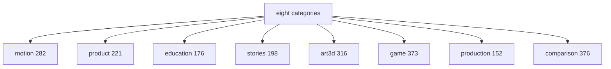
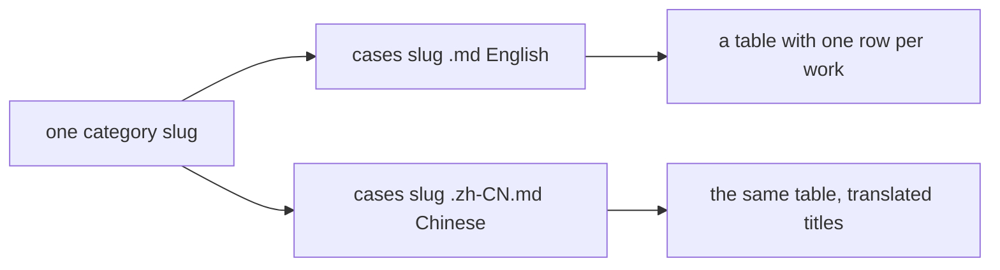

# 04 -- Categories: eight buckets for 2,094 works

The catalog splits its 2,094 works into eight categories. Each record in
`cases.json` carries one category slug in its `category` field. Each category
has an English title, a Chinese title, and one Markdown list per language
under `cases/`. This document names all eight categories, gives their counts,
and explains how the `cases/` directory is organized.

The category is a coarse label. It tells the reader what kind of work the post
shows: a motion-graphics reel, a product demo, an explainer, a story, a 3D
scene, a game, a production trick, or a model comparison.

## The eight categories



The slugs, titles, and counts, in the README's display order:

| Slug | English title | Chinese title | Works |
|---|---|---|---|
| `motion` | Motion graphics & UI | 动效设计 | 282 |
| `product` | Product demos & ads | 产品广告 | 221 |
| `education` | Explainers & education | 科普讲解 | 176 |
| `stories` | Characters & stories | 角色故事 | 198 |
| `art3d` | 3D worlds & simulations | 3D 场景 | 316 |
| `game` | Games | 游戏 | 373 |
| `production` | Music, editing & production | 制作流程 | 152 |
| `comparison` | Model comparisons | 模型对比 | 376 |

The counts sum to 2,094. The largest category is `comparison` with 376 works.
The smallest is `production` with 152.

The `category` field uses the slug values. A `jq` grouping of `cases.json`
produces this exact object:

```json
{
  "art3d": 316,
  "comparison": 376,
  "education": 176,
  "game": 373,
  "motion": 282,
  "product": 221,
  "production": 152,
  "stories": 198
}
```

The README links to each category list with an anchor. From `README.md` line
24:

```markdown
[Motion graphics & UI](#motion-graphics-ui) · [Product demos & ads](#product-demos-ads) · [Explainers & education](#explainers-education) · [Characters & stories](#characters-stories) · [3D worlds & simulations](#3d-worlds-simulations) · [Games](#games) · [Music, editing & production](#music-editing-production) · [Model comparisons](#model-comparisons)
```

## What each category holds

- `motion` collects motion-graphics reels and animated user-interface (UI)
  work.
- `product` collects product demos and mock advertisements.
- `education` collects explainers and educational videos.
- `stories` collects character-driven and narrative works.
- `art3d` collects 3D worlds, scenes, and physics simulations.
- `game` collects playable games and game prototypes.
- `production` collects music, video editing, and production workflow pieces.
- `comparison` collects posts that compare two or more models or tools.

## The cases directory

The `cases/` directory holds sixteen Markdown files: eight categories times two
languages. The file names are `{slug}.md` for English and `{slug}.zh-CN.md`
for Chinese.



There are no subdirectories. It is a flat directory of sixteen
files.

## The format of a category file

Each category file has a fixed shape. The English `motion` file starts like
this, from `cases/motion.md` lines 1-7:

```markdown
# Motion graphics & UI

282 works, 89 with a prompt. Titles link to the original post on X; prompt links open the page with the original text and its source.

| Work | Model | Creator | Length | Prompt |
|---|---|---|---|---|
| [Portfolio data dashboard and animation](https://x.com/bindureddy/status/2112606220293193965) | Opus 5.5 | [@bindureddy](https://x.com/bindureddy) | 1:05 | — |
```

Three parts repeat in every file. Line 1 is the category title. Line 3 is the
header sentence: the work count, the prompt count, and where the links point.
Then a table follows, one row per work. The table has five columns: Work,
Model, Creator, Length, Prompt.

The Prompt column shows one of three values. It shows an em dash `—` when the
work has no prompt. It shows `[Brief](...)` or `[Full prompt](...)` when the
work has one, linking to the jasonzhu.ai page.

## The header counts

The header sentence in each category file matches the data. This table
compares the header counts with `cases.json`:

| Category | Works (file) | Works (json) | Prompts (file) | Prompts (json) |
|---|---|---|---|---|
| motion | 282 | 282 | 89 | 89 |
| product | 221 | 221 | 42 | 42 |
| education | 176 | 176 | 51 | 51 |
| stories | 198 | 198 | 49 | 49 |
| art3d | 316 | 316 | 77 | 77 |
| game | 373 | 373 | 54 | 54 |
| production | 152 | 152 | 26 | 26 |
| comparison | 376 | 376 | 127 | 127 |

Every number matches. The generator writes these headers from the same
`cases.json` that backs the README.

## Why comparison is the largest category

The `comparison` category has 376 works, more than any other. This is the
category for posts that pit one model against another. Many of these posts
name two or more models, which is why the multi-model works cluster here. Both
records that list three models belong to `comparison`. The README's phrase
"comparisons count for each" refers to this category: a comparison post adds a
mention to each model it names. See
[02-model-family.md](./02-model-family.md).

## The Aha Moment

**Aha:** The category is stored once, as a slug, and expanded in three places.
The README turns the slug into a section heading and a highlight table. The
`cases/` file turns it into a full list. The record keeps only the slug. The
slug is the join key between the data and the prose, and the eight slugs are a
closed set, so a script can group all 2,094 records by `category` and rebuild
the directory structure from scratch.

## Cross-References

- The `category` field in the schema: [03-schema.md](./03-schema.md).
- The multi-model works that cluster in `comparison`: [02-model-family.md](./02-model-family.md).
- The Prompt column's `Brief` and `Full prompt` links: [05-prompts.md](./05-prompts.md).
- The Chinese side of each list: [06-bilingual-mirror.md](./06-bilingual-mirror.md).

Continue to [05-prompts.md](05-prompts.md).
