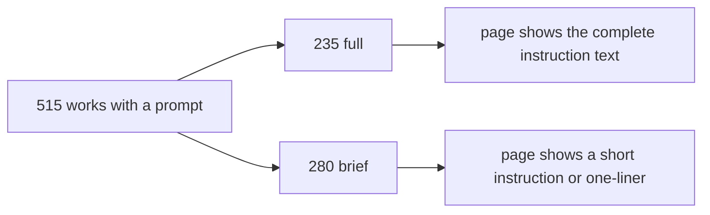
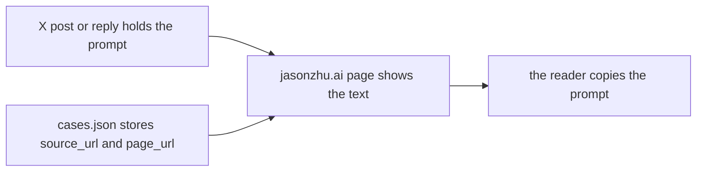

# 05 -- Prompts: full and brief, verbatim and sourced

A prompt is the instruction the creator gave the model. The catalog lists a
prompt only when it has a source. The prompt is kept verbatim: never rewritten
and never translated. Of 2,094 works, 515 carry a prompt. Of those, 235 are
full prompts and 280 are brief prompts. This document explains the two kinds,
the four sources, and the rule that keeps prompts trustworthy.

The prompt is not the video. The video is on X. The prompt is a text the
creator published, either in the post itself, in a reply, in a screenshot, or
in a link. The catalog records where the prompt lives and links to the page
that shows its text.

## The two kinds



The `prompt.kind` field stores the kind. A `full` prompt is the complete
instruction. A `brief` prompt is a short instruction or a one-liner. The label
is stored in the data and rendered in the tables as "Full prompt" and "Brief".

This is a `full` prompt object, from `cases.json` field `cases` (the work with
`id` `2103273003555402193`):

```json
{
  "prompt": {
    "kind": "full",
    "source": "post",
    "source_url": "https://x.com/twoclipping/status/2103273003555402193",
    "length": 2711,
    "page_url": "https://jasonzhu.ai/en/prompts/claude-opus-5-5/2103273003555402193"
  }
}
```

This is a `brief` prompt object, from the work with `id` `2104924603126603893`:

```json
{
  "prompt": {
    "kind": "brief",
    "source": "post",
    "source_url": "https://x.com/siyabuilt/status/2104924603126603893",
    "length": 34,
    "page_url": "https://jasonzhu.ai/en/prompts/claude-opus-5-5/2104924603126603893"
  }
}
```

The `length` field shows the difference. The full prompt is 2,711 characters.
The brief prompt is 34 characters.

## The four sources

The `prompt.source` field records where the prompt was found. Four values
exist, with these counts:

```json
{
  "post": 262,
  "author_reply": 247,
  "image": 3,
  "link": 3
}
```

- `post` means the prompt is in the body of the original post.
- `author_reply` means the prompt is in a reply the creator wrote.
- `image` means the prompt is in a screenshot inside a reply.
- `link` means the creator shared a link that holds the prompt.

The `source_url` field points at the exact post or reply. It is often a
different X status identifier than the work's own `id`, because a reply has its
own identifier. The source list mirrors the README rule.

## The verbatim rule

The README states the rule in its inclusion section, from `README.md` line 30:

```markdown
A prompt is listed only when it has a source: the post itself, the creator's own replies, a screenshot in those replies, or a link the creator shared. Prompts are kept verbatim, never rewritten or translated.
```

`CONTRIBUTING.md` sharpens the rule, from lines 11:

```markdown
If the creator published the prompt, point to where: the post itself, their own reply, a screenshot in their reply, or a link they shared. Prompts are kept verbatim. Descriptions of the work, tool lists and paraphrases are not prompts.
```

The last sentence matters. A description of the work is not a prompt. A tool
list is not a prompt. A paraphrase is not a prompt. Only the instruction the
creator actually gave qualifies. This is why the `tools_reported` field exists
separately from the `prompt` field: a tool list is metadata, not an
instruction.

## Where the text lives

The catalog repository does not store the prompt text. The `prompt` object
stores the source and a `page_url`. The page at jasonzhu.ai holds the text.



The `page_url` ends with the work's `id`. The English and Chinese READMEs link
the same work to the same page, with an `/en/` or `/zh/` path prefix. The
online player is where the prompt becomes copyable.

## The prompt column in the tables

The Markdown tables render the prompt as a link, not as text. A row with a
full prompt shows `[Full prompt](page_url)`. A row with a brief prompt shows
`[Brief](page_url)`. A row with no prompt shows an em dash. The text stays on
the page, one click away.

## The Aha Moment

**Aha:** The catalog treats a prompt as evidence, not as content. It does not
paste the prompt into `cases.json`; it stores a pointer to the source. That
single choice keeps the catalog honest: every prompt can be traced to the
creator's own words, and the verbatim rule means the catalog never improves or
summarizes what the creator wrote. The `length` field is the one number that
separates a 34-character one-liner from a 2,711-character full prompt.

## Cross-References

- The `prompt` object and its five fields: [03-schema.md](./03-schema.md).
- The inclusion rule that gates prompts: [01-inclusion-criteria.md](./01-inclusion-criteria.md).
- The `tools_reported` field, which is not a prompt: [03-schema.md](./03-schema.md).
- The English and Chinese prompt pages: [06-bilingual-mirror.md](./06-bilingual-mirror.md).

Continue to [06-bilingual-mirror.md](06-bilingual-mirror.md).
