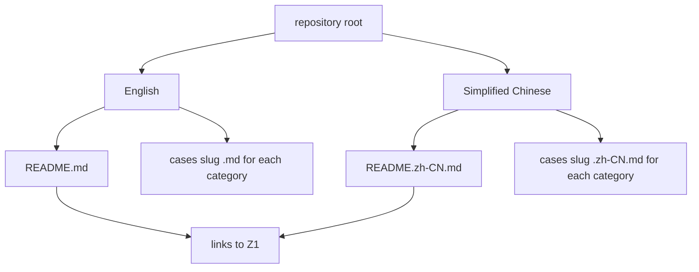
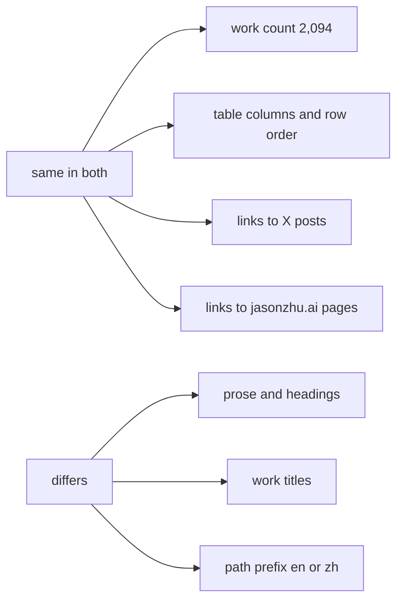

# 06 -- Bilingual Mirror: every page in English and Chinese

The catalog is published in two languages: English and Simplified Chinese.
Every human-readable file has a mirror. `README.md` mirrors `README.zh-CN.md`.
Each `cases/{slug}.md` mirrors `cases/{slug}.zh-CN.md`. The structured data
carries both title languages in one record. This document explains the mirror
and what stays the same across it.

The mirror is a translation pair, not a separate catalog. Both sides list the
same 2,094 works in the same order. Only the prose and the work titles change.

## The mirror at the file level



The two README files link to each other. The top of `README.md` line 3 says
`English | [简体中文](README.zh-CN.md)`. The top of `README.zh-CN.md` line 3
says `[English](README.md) | 简体中文`.

## What changes and what stays



The work count, the row order, the X post links, and the category slugs are
identical. The prose, the headings, and the work titles are translated. The
online-player links differ only in their path prefix: the English README links
`https://jasonzhu.ai/en/prompts/...`, the Chinese README links
`https://jasonzhu.ai/zh/prompts/...`.

## The title field

One record holds both titles. From `cases.json` field `cases`:

```json
{
  "title": {
    "zh": "用共享提示词一夜生成的精致场景",
    "en": "Elaborate overnight scene from shared prompt"
  }
}
```

The `title.en` feeds the English files. The `title.zh` feeds the Chinese files.
The generator never invents a translation; it reads the pair that the curator
already wrote.

The Chinese category file shows the translated title and the translated table.
From `cases/motion.zh-CN.md` lines 1-7:

```markdown
# 动效设计

共 282 个作品，其中 89 个附提示词。标题链接到 X 原帖，提示词链接到带原文和出处的页面。

| 作品 | 模型 | 创作者 | 时长 | 提示词 |
|---|---|---|---|---|
| [投资组合数据仪表盘与动画](https://x.com/bindureddy/status/2112606220293193965) | Opus 5.5 | [@bindureddy](https://x.com/bindureddy) | 1:05 | — |
```

The column headers change: Work becomes 作品, Model becomes 模型, Creator
becomes 创作者, Length becomes 时长, Prompt becomes 提示词. The links and the
row order stay.

## The language field

Each record also carries a `language` field. It is the language of the post,
not of the catalog. From `cases.json` field `cases`:

```json
{
  "language": "en",
  "views": 20097168
}
```

The field uses ISO 639-1 two-letter codes. The dominant value is `en` with
1,470 records. The next values are `ja` (341), `zh` (137), and `tr` (37). The
`language` field is data about the creator's post. It does not drive the
mirror; the mirror is a fixed pair.

## Why the mirror exists

The catalog's audience is global. The curator is JasonZhu.AI, and the site
jasonzhu.ai serves both an English and a Chinese audience. The mirror lets a
Chinese-speaking reader browse the same catalog in their language. The data
stays single: one `cases.json` with both title languages, so the two file sets
can never drift apart.

## The Aha Moment

**Aha:** The mirror is not two catalogs that someone keeps in sync by hand. It
is one record with two title strings. The generator reads `title.en` for the
English files and `title.zh` for the Chinese files, and emits both sets from
the same `cases.json`. That is why the two READMEs can always agree on the
counts and the row order: they are two projections of one source.

## Cross-References

- The `title` and `language` fields: [03-schema.md](./03-schema.md).
- The category files and their header counts: [04-categories.md](./04-categories.md).
- The prompt pages, linked with `/en/` and `/zh/` prefixes: [05-prompts.md](./05-prompts.md).
- How the generator emits both languages every day: [07-maintenance.md](./07-maintenance.md).

Continue to [07-maintenance.md](07-maintenance.md).
