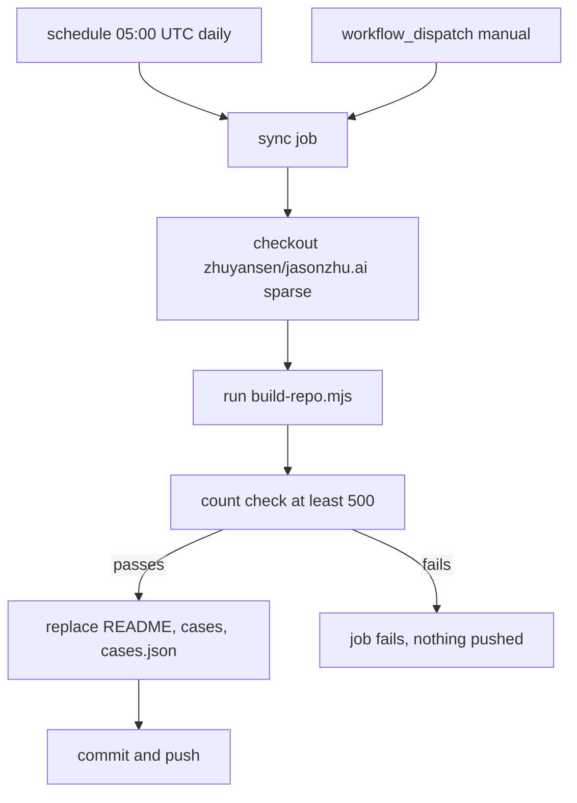
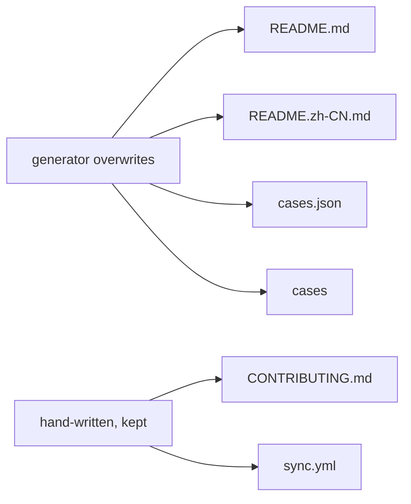

# 07 -- Maintenance: a daily sync regenerates the whole repository

The catalog is not edited by hand. A GitHub Actions workflow regenerates it
every day from an upstream data source. The workflow pulls the source data and
a generator script from the public repository `zhuyansen/jasonzhu.ai`, runs the
generator, and commits the result. This document explains the pipeline and the
guard that stops a bad sync from emptying the catalog.

The key idea: this repository is the compiled output. The source of truth for
the data lives upstream, in `zhuyansen/jasonzhu.ai`. The local `cases.json`,
the two README files, and the `cases/` directory are all produced by one
script.

## The workflow

The workflow is `.github/workflows/sync.yml`. It is 60 lines. The schedule and
the trigger are at lines 6-9:

```yaml
on:
  schedule:
    - cron: "0 5 * * *"
  workflow_dispatch:
```

The cron expression `0 5 * * *` runs at 05:00 UTC, which is 13:00 Beijing
time. The comment in the file states this. `workflow_dispatch` lets a person
run the sync by hand.



## The upstream pull

The workflow checks out two repositories. The first is this repository. The
second is the upstream, checked out with a sparse checkout. From `sync.yml`
lines 25-33:

```yaml
      - name: 拉取数据和生成脚本
        uses: actions/checkout@v4
        with:
          repository: zhuyansen/jasonzhu.ai
          path: _site
          sparse-checkout: |
            scripts/opus-prompts/build-repo.mjs
            src/content/opus-prompts/cases.json
          sparse-checkout-cone-mode: false
```

The sparse checkout pulls exactly two files: the generator script
`scripts/opus-prompts/build-repo.mjs` and the data
`src/content/opus-prompts/cases.json`. Nothing else from upstream is needed.

## The generator run and the guard

The workflow runs the generator with Node.js version 22, then counts the
result. From `sync.yml` lines 39-48:

```yaml
      - name: 生成
        run: |
          node _site/scripts/opus-prompts/build-repo.mjs "$RUNNER_TEMP/out" awesome-opus-5.5-video
          # 生成结果至少要有 500 个作品才覆盖，防止上游数据异常把合集清空
          COUNT=$(node -e 'console.log(JSON.parse(require("fs").readFileSync(process.argv[1]+"/cases.json","utf8")).cases.length)' "$RUNNER_TEMP/out")
          echo "works: $COUNT"
          test "$COUNT" -ge 500
          rm -rf cases
          cp -R "$RUNNER_TEMP/out/." .
          rm -rf _site
```

The generator writes the new files to a temporary directory first. Then the
workflow counts the works in the generated `cases.json`. The `test` command
fails the job unless the count is 500 or more. This guard exists so a bad
upstream export cannot replace the catalog with an empty one. Only after the
guard passes does the workflow delete the old `cases/` directory and copy the
new files in.

## The commit

The final step stages the four generated paths and commits. From `sync.yml`
lines 50-60:

```yaml
      - name: 提交
        run: |
          git config user.name "github-actions[bot]"
          git config user.email "github-actions[bot]@users.noreply.github.com"
          git add README.md README.zh-CN.md cases.json cases
          if git diff --cached --quiet; then
            echo "没有变化，不提交"
            exit 0
          fi
          git commit -m "Sync $(date -u +%F)"
          git push
```

The commit message is `Sync YYYY-MM-DD`. If nothing changed, the workflow
skips the commit. Only `README.md`, `README.zh-CN.md`, `cases.json`, and the
`cases` directory are staged.

## What is hand-written

Two files are not generated. The comment in `sync.yml` lines 3-5 states that
`CONTRIBUTING.md` and the workflow file itself are hand-written and are never
overwritten. The generator therefore never touches them.



## Corrections and removal

Maintenance also covers corrections. The README states the policy at the end:
creators can open an issue or send a direct message (DM) to `@GoSailGlobal` on
X to correct attribution or remove a work. Inclusion grants no license; all
works belong to their creators. The correction path is documented in
[08-contributing.md](./08-contributing.md).

## The Aha Moment

**Aha:** The repository protects itself against its own automation. The sync
deletes the old `cases/` directory and copies the new one in, which means a
bad upstream export would destroy the catalog in one push. The `test "$COUNT"
-ge 500` line is the tripwire: it runs before the delete, so a broken export
fails the job and leaves the repository untouched. A generated repository that
can regenerate itself is only as safe as the guard in front of the overwrite.

## Cross-References

- The inclusion rule the upstream data implements: [01-inclusion-criteria.md](./01-inclusion-criteria.md).
- How a person submits a work for the next sync: [08-contributing.md](./08-contributing.md).
- The schema of the `cases.json` the guard counts: [03-schema.md](./03-schema.md).
- The two languages the generator emits: [06-bilingual-mirror.md](./06-bilingual-mirror.md).

Continue to [08-contributing.md](08-contributing.md).
