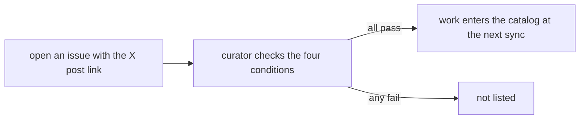
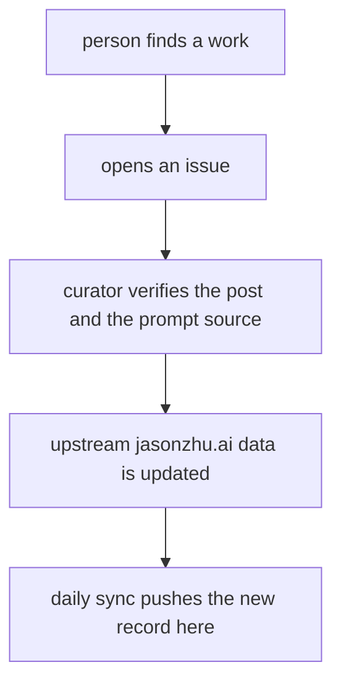

# 08 -- Contributing: submit, correct, or remove a work

Contribution is simple: open an issue. There is no pull-request flow, no build
to run locally, and no form. To submit a work, a contributor opens an issue
with a link to the creator's original post on X. To correct or remove a work,
the creator opens an issue or sends a direct message (DM) on X. This document
explains both paths and the one rule that decides what counts as a prompt.

The guide is `CONTRIBUTING.md`. It is written in both English and Chinese in
one file. It is hand-written and never overwritten by the sync workflow.

## Submitting a work

The submit section, from `CONTRIBUTING.md` lines 5-9:

```markdown
Open an issue with the link to the creator's **original post on X**. A work is listed when:

- the post is by the creator and has a native video attached;
- the post has at least 5,000 views;
- the post states the work was made with Claude Opus 5.5.
```

Four conditions must hold. The post is the creator's own post. The post has a
native video. The post has at least 5,000 views. The post states the work was made
with Claude Opus 5.5.



Note a small wording gap. This section names only Claude Opus 5.5. The README
and the `inclusion_rule` field in `cases.json` name all four models: Opus 5.5,
Sonnet 5.5, Haiku 5.5, and Fable 5.5. The contribution guide is narrower than
the actual gate. In practice a submission is checked against the four-model
rule described in [01-inclusion-criteria.md](./01-inclusion-criteria.md).

## Supplying a prompt

The guide then tells the contributor where the prompt can live, from
`CONTRIBUTING.md` line 11:

```markdown
If the creator published the prompt, point to where: the post itself, their own reply, a screenshot in their reply, or a link they shared. Prompts are kept verbatim. Descriptions of the work, tool lists and paraphrases are not prompts.
```

The contributor does not paste the prompt into the issue as a rewrite. They
point to the source. The four allowed locations are the post body, the
creator's own reply, a screenshot in that reply, or a link the creator shared.
The prompt is kept verbatim. A description, a tool list, or a paraphrase is not
a prompt. This is the same rule documented in
[05-prompts.md](./05-prompts.md).

## The issue-only flow



The contributor never edits `cases.json` directly. The issue is reviewed
upstream. The daily sync then brings the new record into this repository. The
sync pipeline is documented in [07-maintenance.md](./07-maintenance.md).

## Corrections and removal

The second section of the guide, from `CONTRIBUTING.md` line 18:

```markdown
Creators can ask to correct attribution or remove a work at any time: open an issue or DM [@GoSailGlobal](https://x.com/GoSailGlobal) on X. All works belong to their creators; inclusion grants no license.
```

Two ideas matter. First, the creator owns the work. The catalog does not claim
a license by listing it. Second, the creator can act at any time: open an
issue or DM `@GoSailGlobal` on X. The same text appears at the end of the
README.

## The Aha Moment

**Aha:** Contribution is a pointer, not a paste. The contributor submits a
link, and the prompt rule says to point at the source, never to reproduce or
improve the instruction. This keeps the catalog's quality out of the
contributor's hands and in the evidence: the curator only records what the
creator actually wrote and where. The contributor's job is to find the work
and the source; the catalog's job is to preserve both verbatim.

## Cross-References

- The four-model gate a submission actually faces: [01-inclusion-criteria.md](./01-inclusion-criteria.md).
- The verbatim prompt rule: [05-prompts.md](./05-prompts.md).
- What happens after a work is accepted, in the daily sync: [07-maintenance.md](./07-maintenance.md).
- The schema that a new record must fill: [03-schema.md](./03-schema.md).

Continue to [README.md](README.md).
