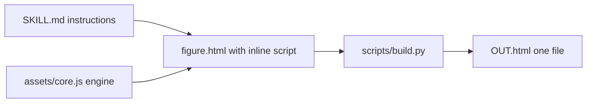
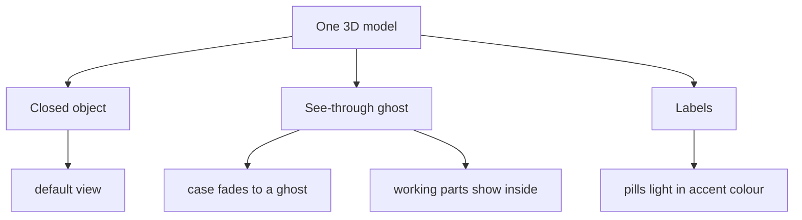

# 00 -- Overview: one page, three looks, real parts

Colorfigures is a Claude skill that draws a hand-inked, flat-coloured isometric figure of an everyday object as one self-contained HyperText Markup Language (HTML) page. The figure is a real three-dimensional (3D) body shaded in flat light, mid and dark bands. It has a heavy ink silhouette, a flat blue cast shadow, warm paper, and body-colour swatches. The reader drags to turn the object all the way round. A See-through switch fades the case to a ghost and shows the real working mechanism inside, with labels that light up while a part works. Every figure does something real: buttons press, doors open, items drop, parts move.

## The trigger

The frontmatter `description` in `SKILL.md` tells the model when to use it. The trigger is the full set of cases in this one line:

Source: `SKILL.md:3`

```text
Build colourful, hand-inked, interactive isometric figures of everyday objects and machines (washing machine, vending machine, toaster, kettle, lamp, claw machine, coffee set, arcade cabinet…) as one self-contained HTML page — real 3D bodies shaded in flat light/mid/dark bands, a heavy ink silhouette with finer inner lines, a flat blue cast shadow, warm paper and body-colour swatches. The viewer drags to turn the object all the way round, flips on See-through to watch the real mechanism work inside with labelled parts, and zooms in; it works on a phone too. Every figure does something: buttons press, doors open, items drop, parts move. Use this whenever someone wants a colourful / illustrated / hand-drawn / sketchy isometric object, a "Colorfigures" figure, a "how does X work" or "what's inside X" figure, a cutaway or see-through of a machine, or a playable or clickable object illustration — even if they don't name the skill. For dark glowing line-art use iso-glow instead.
```

The key rule is in the last sentence. Dark glowing line art goes to the sibling skill iso-glow. Colourful flat-shaded figures go to Colorfigures.

## One figure is two scripts

A finished figure is one HTML page. While the model works, the page is two files:

Source: `SKILL.md:8-13`

```text
Hand-inked, flat-coloured isometric objects you can turn round, see inside and play with. Each figure is one HTML
page: a small engine (`assets/core.js`) plus your figure script, which models the object in 3D and draws it with the
engine's shapes. The engine owns the camera (drag to turn, a Turntable and Front view button, arrow keys), the
shading (three flat tones by the way a face meets the light, which turns with the viewer), the ink and the cast
shadow. `scripts/build.py` makes the finished page: it inlines the engine and adds zoom, notices, the See-through /
Labels switches and the phone layout.
```

The figure script models the object and returns drawing instructions. The engine turns those instructions into the picture. The build script glues them into one final file.



## The three looks

One model produces three looks. The closed object, the see-through, and the labels:

Source: `SKILL.md:15-18`

```text
A figure has three looks, all from the same model:
1. **The object**, closed, as you would see it in a shop: correct from every side, back and underside included.
2. **See-through**: the case fades to a ghost and the real working parts show inside it, moving with the buttons.
3. **Labels**: short name tags on the parts, lit in the accent colour while that part is working.
```

The See-through and Labels switches start off. The closed object is what people see first.



## The workflow

The skill walks through six steps. The model sets up, reads the reference figures, researches the real object, writes the figure, verifies it, and builds it:

Source: `SKILL.md:20-36`

```text
1. **Set up:** copy `assets/core.js` next to your figure (the page loads it with `<script src="core.js">` while you work).
2. **Read the references** before writing. They are complete demo figures:
   - `assets/examples/toaster.html`: the smallest. A rounded case, a lever, bread that toasts and pops, and a
     see-through with heating cards, carriage, spring, latch and bimetal strip.
   - `assets/examples/lamp.html`: a scene on a desk board with a jointed arm, a light pool and parts sorted per angle.
   - `assets/examples/claw.html`: a big machine with glass, a game played on a keypad, stats, and a dense
     see-through (gantry, motors, harness, coin path).
3. **Research the real object** (below, *Truth first*) and write the notes and the parts list at the top of your
   figure script before any geometry.
4. **Write `figure.html`** (name it after the object): a doctype/head shell, `<script src="core.js"></script>`, then one
   inline `<script>` that defines the geometry and calls `mountFigure({...})`, then `xrMount(() => ui, () => '')`.
5. **Look at it from every side** with headless Chrome (*Verify*), fix, repeat (at most 3 rounds).
6. **Build one file:** `python3 "<skill folder>/scripts/build.py" figure.html OUT.html`. Hand over OUT.html and say
   what the buttons do (the page shows no instructions).
```

## The file layout

Source: `README.md:30-37`

```text
- `SKILL.md` — the instructions Claude follows
- `assets/core.js` — the engine: free 3D camera, shapes and shading, ink, see-through and labels, game keypad, the page with its buttons and controls
- `assets/examples/` — complete figures to learn from (toaster, desk lamp, claw machine)
- `scripts/build.py` — makes one self-contained file with zoom and the phone layout: `python3 scripts/build.py figure.html OUT.html`

Plain text only. Nothing runs on install; figures run in the browser like any web page, with no outside requests.
```

The engine is 641 lines. The three examples are 406, 395, and 974 lines. The build script is 25 lines.

## The inheritance chain

Colorfigures does not start from nothing. It builds on iso-glow, which builds on iso-figure:

Source: `README.md:39-43`

```text
- Built on [ISO-GLOW](https://isoglow.dev) by April Zhu (MIT).
- ISO-GLOW is built on [iso-figure](https://github.com/MrBongoC/ai-iso-skill) by Tolga Cohce (MIT).
- See-through views follow the method of [Anatomy](https://github.com/wheresryan22/anatomy) by Ryan (MIT).
```

The Massachusetts Institute of Technology (MIT) license lists the same three authors:

Source: `LICENSE:3-5`

```text
Copyright (c) 2026 April Zhu (Colorfigures: colour, hand-drawn style, 3D props, template, examples)
Copyright (c) 2026 April Zhu (iso-glow, on which Colorfigures is based)
Copyright (c) 2026 Tolga Cohce (iso-figure, on which iso-glow is based)
```

iso-glow keeps the fixed isometric projection and the "every figure must do something real" rule from iso-figure. Colorfigures keeps the isometric default view and adds the free camera and the flat-colour look. The projection document [01-projection.md](01-projection.md) explains this in detail. The sibling iso-glow exploration lives at [../../iso-glow/](../../iso-glow/).

## The Aha Moment

**Aha:** A figure is not a DOM (Document Object Model) that the code mutates. It is one pure function, `scene(st, m)`, that reads the state and returns the whole drawing as a Scalable Vector Graphics (SVG) string. The engine calls that function once per frame and replaces the picture. Because the whole picture is rebuilt from one state object, animations, buttons, and the See-through fade all use the same one mechanism: change the state, then redraw. There is no per-part bookkeeping.

## Where next

The projection is the foundation. Read [01-projection.md](01-projection.md) to see the coordinates and the free camera. Read [02-shading.md](02-shading.md) for the flat light, mid, and dark bands. Read [07-examples-build.md](07-examples-build.md) to see the whole workflow end to end.

Continue to [01-projection.md](01-projection.md).
