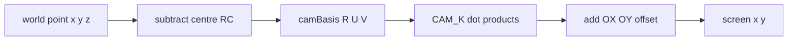
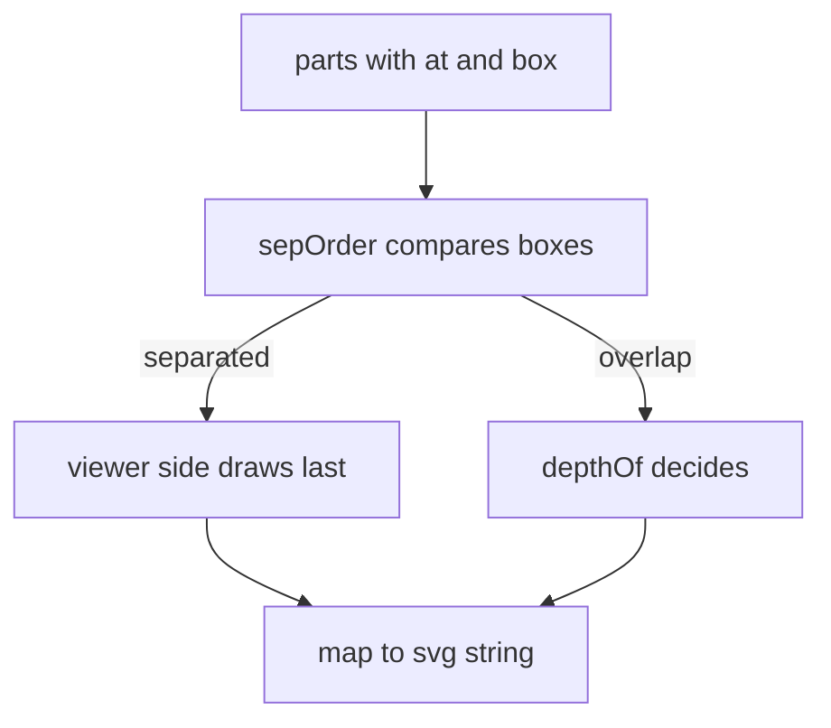

# 01 -- Projection: one fixed view, one free camera

A figure is drawn in 3D coordinates. The engine turns the camera and redraws the scene for each view. The default view is true isometric: yaw 45 degrees, pitch about 35.26 degrees. At that default the free camera produces exactly the old fixed isometric projection, so every figure drawn for the older iso-glow and iso-figure skills still lines up. The engine keeps the camera; the figure script only supplies 3D points and shapes.

## Coordinates and scale

The axis meaning is fixed and simple. The front face of the object sits at `x = W`. The ground is at `z = 0`. One unit is about one centimetre:

Source: `SKILL.md:57-64`

```text
- `x` = depth (the front face is at `x = W`), `y` = width (+y goes viewer-left at the default view), `z` = up.
  Ground at `z = 0`. Scale ≈ 1 unit per cm (washer 62 × 65 × 88); small objects (a kettle) can be modelled bigger
  (60–100 units) so detail reads. Framing and line weight adapt automatically.
- The engine turns the camera; your scene is redrawn for the current view. `YAW`, `PITCH` (degrees) and `CAM_V` (unit
  vector toward the viewer) are readable. `?yaw=200&pitch=40` sets the view; `?free=1` lifts the turning limit.
- A figure turns ±60° around its front until you have checked it from every side; then add `turn:'full'` to its
  `mountFigure({...})` call and it turns all the way round. Ship with `turn:'full'` unless something can't be fixed.
- `size` = the object's true bounding box (handles, trays, a lifted part at its highest). `center:[x, y]` if the
  object isn't centred in it.
```

The turning limit matters. A figure turns plus or minus 60 degrees around the front until the model has checked every side. Then the figure sets `turn:'full'`. The uniform resource locator (URL) query `?free=1` lifts the limit for testing.

## The raw isometric projection

The classic isometric projection is two lines. The constant `C` is the cosine of 30 degrees, `S` the sine:

Source: `assets/core.js:25-26`

```javascript
const C = Math.cos(Math.PI/6), S = Math.sin(Math.PI/6);
```

Source: `assets/core.js:50`

```javascript
const P0 = (x,y,z) => [(x-y)*C + OX, (x+y)*S - z + OY];                       // raw iso
```

`P0` maps a world point to screen. The x term subtracts y, the y term adds x and subtracts z. `OX` and `OY` are the frame offsets.

## The free orthographic camera

Colorfigures replaces the fixed projection with a free orthographic camera. The comment above it explains the design:

Source: `assets/core.js:27-31`

```javascript
/* Free orthographic camera (internal names start with CAM_ / cam so they never clash with a figure's own names). YAW turns the viewer around the vertical axis (45° = the classic front-left view),
   PITCH is how far it looks down (35.26° = true isometric). At the defaults P() is exactly the old isometric
   projection, so every figure drawn for it still lines up. Drag the figure to orbit; double-click to reset.
   rotV(n) maps a world direction into the default view's frame, so vis / tone / any "sum of rotV > 0" test keep
   working at every angle: the viewer is always (1,1,1) and the light stays put relative to the viewer. */
```

The camera basis is built from yaw and pitch:

Source: `assets/core.js:35-43`

```javascript
const YAW0 = 45, PITCH0 = Math.atan(1/Math.SQRT2) * 180/Math.PI, CAM_K = Math.sqrt(1.5);
let YAW = YAW0, PITCH = PITCH0, CAM_R, CAM_U, CAM_V, CAM_D;                       // right, up, toward viewer, screen-down
const camBasis = (yaw, pitch) => { const t = yaw*Math.PI/180, p = pitch*Math.PI/180, ct = Math.cos(t), st = Math.sin(t), cp = Math.cos(p), sp2 = Math.sin(p);
  return { R:[st,-ct,0], U:[-sp2*ct,-sp2*st,cp], V:[cp*ct,cp*st,sp2] }; };
const CAM_B0 = camBasis(YAW0, PITCH0);
let CAM_LIM = null;
function setCam(yaw, pitch){ YAW = CAM_LIM == null ? yaw : Math.max(YAW0 - CAM_LIM, Math.min(YAW0 + CAM_LIM, yaw));
  PITCH = CAM_LIM == null ? Math.max(6, Math.min(78, pitch)) : Math.max(15, Math.min(62, pitch)); const b = camBasis(YAW, PITCH); CAM_R = b.R; CAM_U = b.U; CAM_V = b.V; CAM_D = CAM_U.map(v => -v); }
```

`PITCH0 = atan(1/√2)` is about 35.26 degrees, the true isometric angle. `CAM_K = √1.5` compensates for the shortened depth. `camBasis` returns three unit vectors: `R` (right), `U` (up), `V` (toward the viewer). `setCam` clamps pitch and applies the turn limit.

The actual projection maps the world point through the basis:

Source: `assets/core.js:51-53`

```javascript
const P  = (x,y,z) => { const q = [x-RC[0], y-RC[1], z-RCZ];
  return [CAM_K*camDot(q,CAM_R) + (RC[0]-RC[1])*C + OX, CAM_K*camDot(q,CAM_D) + (RC[0]+RC[1])*S - RCZ + OY]; };
const Dv = (x,y,z) => [CAM_K*camDot([x,y,z],CAM_R), CAM_K*camDot([x,y,z],CAM_D)];
```

`P` subtracts the rotation centre `RC`, projects, and adds the offset back. `Dv` projects a direction the same way, used by text.



## The viewer is always at 1 1 1

A key helper is `rotV`. It maps a world normal back into the default view's frame:

Source: `assets/core.js:45-46`

```javascript
const camDot = (a,b) => a[0]*b[0]+a[1]*b[1]+a[2]*b[2];
const rotV = n => { const r = camDot(n,CAM_R), u = camDot(n,CAM_U), v = camDot(n,CAM_V); return [0,1,2].map(i => CAM_B0.R[i]*r + CAM_B0.U[i]*u + CAM_B0.V[i]*v); };
```

`vis(n)` tests whether a face points at the viewer. It is simply the sum of the three components of `rotV(n)`:

Source: `assets/core.js:87-88`

```javascript
const vis = n => { const r = rotV(n); return r[0]+r[1]+r[2] > 1e-6; };   // viewer looks from (+1,+1,+1) after the turn
const facing = vis;
```

Because `rotV` maps back to the default frame, the viewer is always treated as looking from the corner (1,1,1). Any test written as `vis(n)` works at every camera angle. The same trick keeps the shading correct, as [02-shading.md](02-shading.md) explains.

## Depth sorting without a depth buffer

The renderer has no depth buffer. Parts are drawn back to front in one order. Each part is an item with an `at` point and an optional `box`:

Source: `assets/core.js:55-63`

```javascript
const depthOf = p => camDot(p, CAM_V);
const boxMid = b => [0,1,2].map(k => (b[0][k] + b[1][k]) / 2);
const sepOrder = (p, q) => { if (!p.box || !q.box) return 0;
  for (let k = 0; k < 3; k++){ if (p.box[1][k] <= q.box[0][k] + 1e-6) return CAM_V[k] >= 0 ? -1 : 1; if (q.box[1][k] <= p.box[0][k] + 1e-6) return CAM_V[k] >= 0 ? 1 : -1; }
  return 0; };
const byDepth = parts => parts.filter(Boolean).sort((p,q) => sepOrder(p,q) || (depthOf(p.at || boxMid(p.box)) - depthOf(q.at || boxMid(q.box)))).map(p => p.svg).join('');
```

`depthOf` is the distance toward the viewer. `sepOrder` handles two boxes separated along an axis: the one on the viewer's side draws last. A centre point alone gets long or wrapping parts wrong. That is why every part should carry a box.



The box rule is the first and most repeated bug in the skill's list:

Source: `SKILL.md:69-74`

```text
1. **Never write a fixed back-to-front order.** "A then B" is only true for one view. Every separate part goes
   through `byDepth([{ at:[x,y,z], box:[[x0,y0,z0],[x1,y1,z1]], svg }])`, and **every part gets a `box`**: two boxes
   separated along an axis sort by which side the viewer is on; a centre point alone gets long or wrapping parts
   wrong (a pole beside keys, a spout past a cup, a door beside its shelves). A function that draws several things
   one after another is a fixed order too: return items and sort them.
```

## Rings and open shells

Two helpers split a wrapping part by the current view. `nearHalf` and `farHalf` return the visible and hidden halves of a ring in degrees:

Source: `assets/core.js:65-67`

```javascript
const nearHalf = () => [YAW - 90, YAW + 90], farHalf = () => [YAW + 90, YAW + 270];
const openShell = (A, B, colour, contents = '') => loft(A, B, colour, true) + contents + loft(A, B, colour);
```

`openShell` draws the far inner wall, then the contents, then the near outer wall. This is the pattern for cups, cones, bins, and drums. The geometry document [04-geometry.md](04-geometry.md) covers the shapes it uses.

## The Aha Moment

**Aha:** The camera is free, but the shading and visibility tests are written as if the camera never moved. `rotV` maps every normal back into the default view's frame, so the viewer is always treated as looking from the corner (1,1,1). One invariant, "the viewer is at (1,1,1)", lets every `vis` and `tone` test work unchanged at every angle. The author only had to write the projection once, not per angle.

## Where next

The camera decides visibility; the light decides colour. Read [02-shading.md](02-shading.md) for the flat tones. Read [04-geometry.md](04-geometry.md) for the shapes and the full no-depth-buffer rules.

Continue to [02-shading.md](02-shading.md).
