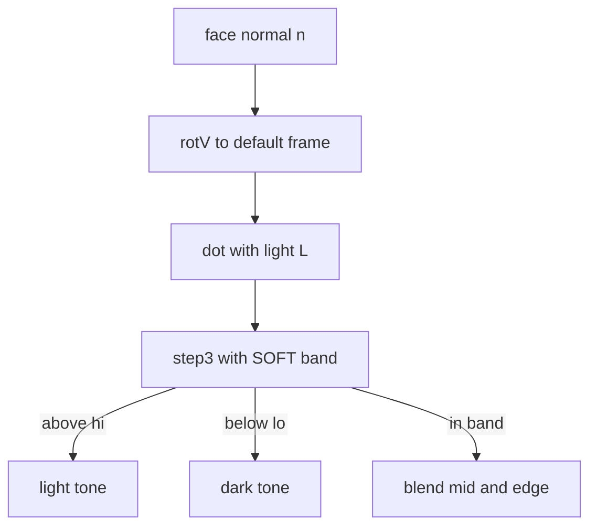
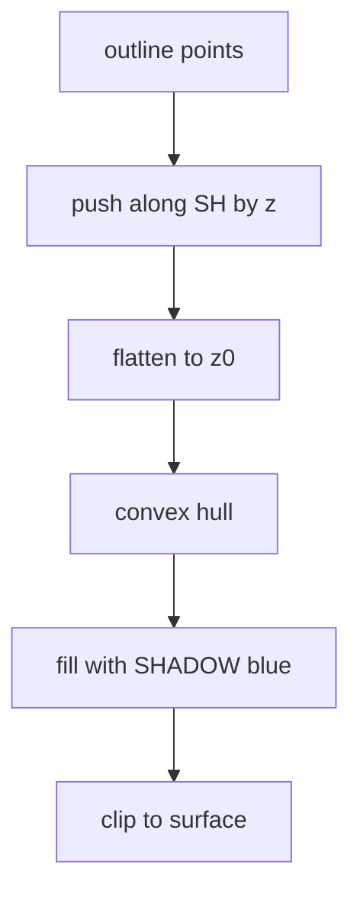

# 02 -- Shading: three flat tones and one blue shadow

A face is filled with one of three flat tones: light, mid, or dark. The tone depends on how the face meets the light. The light is fixed in the scene: it comes from above and behind the viewer's right shoulder. So the front is lit, the left side is in shade, and cast shadows fall toward the lower left of the screen. Two functions choose the tone: `tone` for the exterior body and `toneI` for interiors and small props.

## The light

The light direction is a unit vector `L`. The shadow direction `SH` is its ground projection, scaled:

Source: `assets/core.js:89-95`

```javascript
const SHADOW_K = 0.85, AZ_MIN = 20, AZ_MAX = 160;
// cast shadows are drawn shorter than the shading light implies (0.45 × height instead of 0.85 ×): long shadows of tall
// parts on thin supports (a lamp shade, a fan head) land far from the object and read as separate blobs
const SHADOW_LEN = 0.45;
let L = [0,0,1], SH = [0,0];
function setLight(deg){ const a=deg*Math.PI/180; SH=[SHADOW_K*Math.cos(a), SHADOW_K*Math.sin(a)]; L=norm([-SH[0],-SH[1],1]); }
const LIN = norm([.6,.2,1]);                       // fixed light for interiors / small props
```

`setLight` takes an azimuth angle in degrees. The default is set later in `mountFigure` to 105 degrees (`st.az = 105`). `L` points toward the light: the negative of the shadow ground direction, tilted up. `LIN` is a second, fixed light for interiors.

## Three tones, blended at the edges

`tone` and `toneI` both call `step3`. The `SOFT` band blends a face between tones as it turns past a threshold, instead of snapping:

Source: `assets/core.js:98-103`

```javascript
const SOFT = .18;
const step3 = (d, hi, lo, m) => { const ss = (a, b, x) => { const k = Math.min(1, Math.max(0, (x - a)/(b - a))); return k*k*(3 - 2*k); };
  const a = ss(hi - SOFT, hi + SOFT, d), b = ss(lo - SOFT, lo + SOFT, d);
  return a >= 1 ? m.l : b <= 0 ? m.d : a > 0 ? mix(m.m, m.l, a) : b < 1 ? mix(m.d, m.m, b) : m.m; };
const tone  = (n,m) => step3(dot(rotV(n),L),   -.15, -.45, m);   // exterior, follows the sun
const toneI = (n,m) => step3(dot(rotV(n),LIN),  .6,   .05, m);   // interior / props
```

The input is `dot(rotV(n), L)`: the angle between the face normal and the light. A face pointing at the light gets the light tone. A face turned away gets the dark tone. The threshold values differ for exterior and interior light.



## The palettes

A material is one object with `l`, `m`, and `d` fields. The five body palettes and the four fixed materials:

Source: `assets/core.js:10-22`

```javascript
const PALS = {
  mustard: { l:'#f4b829', m:'#d49c1f', d:'#4e4a18' },
  tomato:  { l:'#ef6a4c', m:'#cf5038', d:'#4a2219' },
  mint:    { l:'#93d3b0', m:'#71b693', d:'#1f4034' },
  cobalt:  { l:'#76a0e2', m:'#5a82c6', d:'#1c2948' },
  blush:   { l:'#f3a6bb', m:'#d8869c', d:'#4b2430' },
};
const METAL   = { l:'#eef0f0', m:'#c6ccce', d:'#8f989b' };
const CLEAR   = { l:'#e4f2f4', m:'#c4dfe4', d:'#97b9c0' };
const CERAMIC = { l:'#fbfaf3', m:'#e3e0d2', d:'#bdb8a6' };
const DARK    = { l:'#55504a', m:'#3d3935', d:'#272421' };
const INK = '#231e16';
const SHADOW = '#41538f';
```

`INK` is the dark ink colour. `SHADOW` is the flat blue cast shadow. A custom colour becomes a material with `matOf`:

Source: `assets/core.js:104-105`

```javascript
const mix = (a,b,t) => '#' + [1,3,5].map(i => Math.round(parseInt(a.substr(i,2),16)*(1-t) + parseInt(b.substr(i,2),16)*t).toString(16).padStart(2,'0')).join('');
const matOf = hex => ({ l:hex, m:mix(hex,'#000000',.16), d:mix(hex,'#000000',.42) });
```

`mix` blends two hex colours by channel. `matOf` makes a light/mid/dark ramp from one colour by mixing with black.

## The blue cast shadow

A cast shadow takes a set of 3D points, projects them along the light onto a floor, and fills the convex hull:

Source: `assets/core.js:188-190`

```javascript
const castShadow = (pts3, z0=0, clip=null) => { const k = SHADOW_LEN / SHADOW_K, [sx, sy] = yawTurn(SH);
  const s = fill(sp(hull(pts3.map(([x,y,z]) => P(x+(z-z0)*sx*k, y+(z-z0)*sy*k, z0)))), SHADOW);
  return clip ? clipTo(clip, s) : s; };
```

Each point is pushed along the shadow direction by `(z - z0) * k`, then flattened to the surface at height `z0`. The factor `k = SHADOW_LEN / SHADOW_K = 0.45 / 0.85` is why the shadow is shorter than the shading light implies. The shadow turns with the viewer's yaw through `yawTurn`, so it always falls toward the lower left:

Source: `assets/core.js:48`

```javascript
const yawTurn = ([x,y]) => { const t = (YAW - YAW0)*Math.PI/180, c = Math.cos(t), s = Math.sin(t); return [x*c - y*s, x*s + y*c]; };
```



`clipTo` clips the shadow to the surface it falls on, so it cannot spill over a board edge:

Source: `assets/core.js:214`

```javascript
const clipTo = (pts3, inner) => { const id = 'k' + (++_clipN); return `<clipPath id="${id}"><path d="${pd(pts3)}"/></clipPath><g clip-path="url(#${id})">${inner}</g>`; };
```

One shadow per object. See-through parts, like a cage or a glass dome, cast a lighter shadow with `opacity=".45"`, as `SKILL.md` says.

## Accent colours

Status and light colours are used sparingly. They are the only bright spots on the warm paper:

Source: `SKILL.md:112-113`

```text
- Accent colours sparingly: status lights (`#43c25c` / `#e2483d`), screens (`#1d2a26` with `#8af0ae` text), glass
  (`#cfe9f0` at low opacity + 1–2 white streaks at ~.38 opacity). Only ink strokes are dark.
```

Green `#43c25c` and red `#e2483d` are the two status light colours. The lamp example uses green `#43c25c` for its on state and a grey `#8d877a` for off.

## The Aha Moment

**Aha:** The shading light and the cast shadow use different lengths on purpose. The light is placed as if a shadow were 0.85 of the height. The shadow is drawn at 0.45 of the height. The comment explains why: a long shadow from a tall part on a thin support, like a lamp shade or a fan head, lands far from the object and reads as a separate blob. Shortening the shadow keeps it connected to the object. The second aha is `SOFT = .18`: faces blend across a narrow band so they fade between tones while the figure rotates instead of snapping, yet at rest almost every face still sits on a pure flat tone.

## Where next

The tones fill the faces; the ink draws the edges. Read [03-ink-paper.md](03-ink-paper.md) for the silhouette and the wobble. The palettes feed the shapes in [04-geometry.md](04-geometry.md).

Continue to [03-ink-paper.md](03-ink-paper.md).
