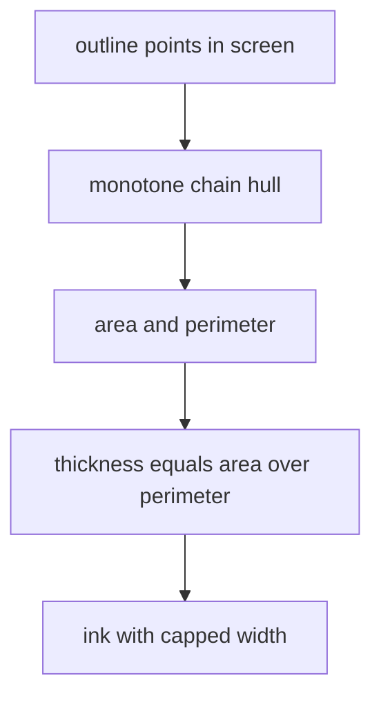
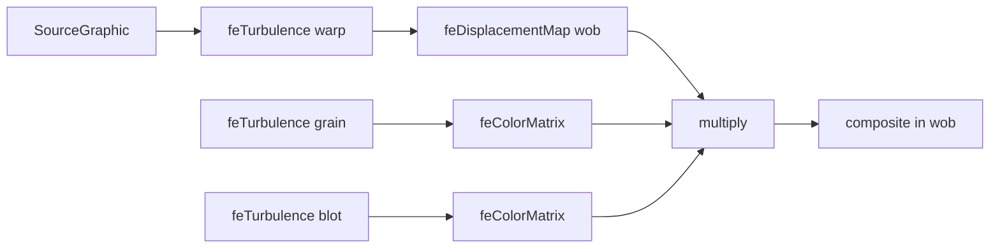

# 03 -- Ink and paper: the hand-drawn wobble and heavy silhouette

The look comes from three layers. A heavy ink silhouette with finer inner lines. A hand-drawn wobble filter that distorts every stroke. Warm paper with a fine grain. The ink is always the same dark colour `#231e16`. Only ink strokes are dark; every fill is a flat colour from a palette. This document shows how the ink and the paper are made.

## The ink primitives

Every mark is an SVG path string. `ink` strokes a path, `fill` fills it, `face` fills and strokes it with the same colour, `shape` fills and inks a 3D outline, and `line` draws an open polyline:

Source: `assets/core.js:109-113`

```javascript
const ink   = (d,w=1.0) => `<path d="${d}" fill="none" stroke="${INK}" stroke-width="${w}" stroke-linejoin="round" stroke-linecap="round"/>`;
const fill  = (d,c,extra='') => `<path d="${d}" fill="${c}" ${extra}/>`;
const face  = (d,c) => `<path d="${d}" fill="${c}" stroke="${c}" stroke-width=".7" stroke-linejoin="round"/>`;
const shape = (pts,c,w=.9) => fill(pd(pts),c) + (w ? ink(pd(pts),w) : '');
const line  = (pts,w=.9) => ink(pd(pts,false),w);
```

`pd` turns 3D points into a closed path string; `pd(pts, false)` leaves it open. The strokes use round joins and round caps for the inked look.

## The silhouette ink, weighted by thickness

The silhouette is drawn with `hullInk`. It builds the convex hull of the outline and sets the stroke width from how thick the part is on screen:

Source: `assets/core.js:134-141`

```javascript
// Silhouette ink, weighted by how thick the part is on screen (like a hand inker): the w you pass is the most it gets.
// Thickness = 2 × area / perimeter of the outline (a rod's diameter, about half a box's width), as a share of the
// frame width. A long thin rod, a handle or a knob stays light (~1–1.5); a grinder, kettle or machine body gets the
// heavy ~2.4–2.8. Thin parts stay thin and parts keep air between them.
const hullInk = (pts3, w=1.4) => { const h = hull(pts3.map(p=>P(...p))); let a = 0, per = 0;
  for (let i = 0; i < h.length; i++){ const p = h[i], q = h[(i+1) % h.length]; a += p[0]*q[1] - q[0]*p[1]; per += Math.hypot(q[0]-p[0], q[1]-p[1]); }
  const thick = per ? Math.abs(a) / per / (INK_K * INK_REF_VB) : 0;
  return ink(sp(h), Math.min(w, .9 + 20*thick)); };
```

The thickness is two times the area divided by the perimeter. A thin rod has a small ratio and gets a light stroke. A big body has a large ratio and gets a heavy stroke. The maximum is the `w` argument. The convex hull is computed by `hull`:

Source: `assets/core.js:127-133`

```javascript
function hull(pts){
  pts = pts.slice().sort((a,b)=>a[0]-b[0]||a[1]-b[1]);
  const cr=(o,a,b)=>(a[0]-o[0])*(b[1]-o[1])-(a[1]-o[1])*(b[0]-o[0]); const lo=[], up=[];
  for (const p of pts){ while(lo.length>=2 && cr(lo[lo.length-2],lo[lo.length-1],p)<=0) lo.pop(); lo.push(p); }
  for (const p of pts.reverse()){ while(up.length>=2 && cr(up[up.length-2],up[up.length-1],p)<=0) up.pop(); up.push(p); }
  lo.pop(); up.pop(); return lo.concat(up);
}
```

This is the monotone chain convex hull in screen space. The same `hull` builds the cast shadow in [02-shading.md](02-shading.md).



## The stroke-weight ladder

The skill sets four weights. The silhouette is heaviest, details are lightest:

Source: `SKILL.md:105-106`

```text
- **Ink:** silhouette `hullInk(points, ~2.8)` after the body; panel outlines ~2.2; openings 1.6–1.8; details
  0.8–1.4. Always draw through `pd()` on 3D points; `pd(pts, false)` for an open line.
```

The silhouette is drawn after the body. Panel outlines come next, then openings, then details.

## Constant on-screen line weight

Stroke widths are written in model units. A small object zoomed to fill the frame would get fat lines. `INK_K` rescales every stroke width so all figures match a reference zoom:

Source: `assets/core.js:216-222`

```javascript
/* ---------- constant on-screen line weight ----------
   Stroke widths are written in model units, and each figure is zoomed to fill the frame, so a small
   object would get fat lines. INK_K rescales every stroke-width (and the wobble/grain filter) so all
   figures match the reference zoom of the booth / vending machine (viewBox ≈ 585 units wide). */
const INK_REF_VB = 585;
let INK_K = 1;
const inkScale = svg => INK_K === 1 ? svg : svg.replace(/stroke-width="([\d.]+)"/g, (_, w) => `stroke-width="${(+w * INK_K).toFixed(2)}"`);
```

`inkScale` is applied to the whole scene string on every render. `INK_K` is the current viewBox width divided by 585.

## The hand-drawn wobble

The wobble is an SVG filter. Three noise layers combine into a distortion and a grain:

Source: `assets/core.js:280-288`

```javascript
const filterFor = k => `<filter id="hand" x="-3%" y="-3%" width="106%" height="106%" color-interpolation-filters="sRGB">
  <feTurbulence type="fractalNoise" baseFrequency="${(0.045/k).toFixed(4)}" numOctaves="2" seed="4" result="warp"/>
  <feDisplacementMap id="wob" in="SourceGraphic" in2="warp" scale="${(2.4*k).toFixed(2)}" xChannelSelector="R" yChannelSelector="G" result="wob"/>
  <feTurbulence type="fractalNoise" baseFrequency="${(0.9/k).toFixed(4)}" numOctaves="3" seed="11" result="n1"/>
  <feColorMatrix in="n1" type="matrix" values=".3 0 0 0 .84  .3 0 0 0 .84  .3 0 0 0 .84  0 0 0 0 1" result="grain"/>
  <feTurbulence type="fractalNoise" baseFrequency="${(0.012/k).toFixed(4)}" numOctaves="2" seed="7" result="n2"/>
  <feColorMatrix in="n2" type="matrix" values=".3 0 0 0 .85  .3 0 0 0 .85  .3 0 0 0 .85  0 0 0 0 1" result="blot"/>
  <feBlend in="wob" in2="grain" mode="multiply" result="g1"/><feBlend in="g1" in2="blot" mode="multiply" result="g2"/>
  <feComposite in="g2" in2="wob" operator="in"/></filter>`;
```

The first turbulence warps the drawing. The displacement map scale `2.4 * k` is the wobble amount, controlled by the "Hand-drawn wobble" slider. Two more turbulence layers add a fine grain and a coarse blot. The blend modes multiply the paper grain over the wobbled drawing.



## Baking the noise

On phones the SVG filter runs on the central processing unit (CPU). Recomputing every turbulence layer each frame is most of the cost. `bakeNoise` renders each noise layer once into an image and swaps it in:

Source: `assets/core.js:306-309`

```javascript
/* The hand-drawn filter's noise never changes, but browsers recompute every feTurbulence each time the drawing changes
   (on phones SVG filters run on the CPU, so this is most of the cost of a frame). bakeNoise renders each noise layer once
   into an image and swaps it in: coarse layers as one small image over the whole view (they are smooth, so scaling up
   is invisible), fine grain as a seamless tile. If anything fails (an old browser), the live filter simply stays. */
```

The coarse layers become one small image over the whole view. The fine grain becomes a seamless tile. If anything fails, the live filter stays.

## The warm paper

The page shell styles the paper. The body background is a warm colour with a turbulence-based grain as a data URL:

Source: `assets/core.js:225-230`

```javascript
const CORE_CSS = `
  :root{--paper:#f2efe7;--ink:#231e16;--muted:#857d6e;--rule:#ddd6c8}
  *{box-sizing:border-box} html,body{margin:0;height:100%}
  body{background-color:var(--paper);
    background-image:url("data:image/svg+xml;utf8,<svg xmlns='http://www.w3.org/2000/svg' width='320' height='320'><filter id='p'><feTurbulence type='fractalNoise' baseFrequency='.85' numOctaves='3' stitchTiles='stitch'/><feColorMatrix values='0 0 0 0 .42  0 0 0 0 .39  0 0 0 0 .33  .16 0 0 0 0'/></filter><rect width='100%' height='100%' filter='url(%23p)'/></svg>");
    overflow-x:hidden;color:var(--ink);font:13px/1.4 ui-monospace,SFMono-Regular,Menlo,monospace;display:flex;flex-direction:column;align-items:center;padding:24px 16px 32px}
```

The four design tokens are the paper `#f2efe7`, the ink `#231e16`, the muted text `#857d6e`, and the rule line `#ddd6c8`. The page text is a monospace font. The paper grain is the same fractal noise used inside the drawing filter, this time behind everything.

## The Aha Moment

**Aha:** `hullInk` turns stroke weight into a physical measurement. It computes two times the area divided by the perimeter of the on-screen outline, which is the classic "hydraulic diameter". A rod has a small diameter, so it gets a light stroke. A machine body has a large diameter, so it gets the heavy 2.4 to 2.8 stroke. The result mimics a hand inker who presses harder on large masses and lightly on thin parts. The second aha is the wobble filter itself: a displacement map over the whole drawing, plus grain and blot, turns a clean vector drawing into a sketch without drawing a single wobbly line by hand.

## Where next

The ink covers the shapes. Read [04-geometry.md](04-geometry.md) for the shape kit that produces the outlines. The paper and page shell come back in [07-examples-build.md](07-examples-build.md), where the build adds zoom and the phone layout.

Continue to [04-geometry.md](04-geometry.md).
