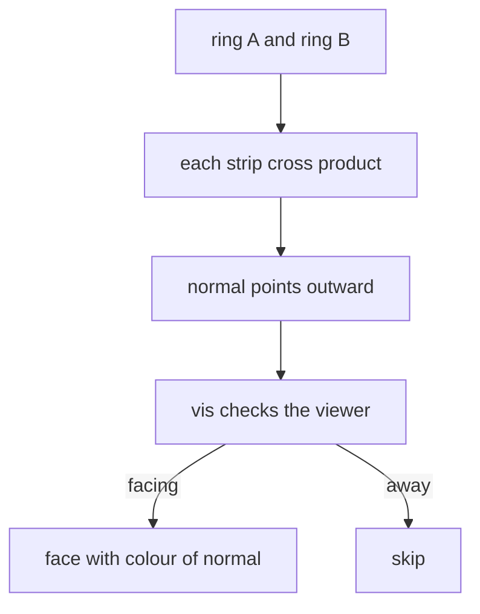
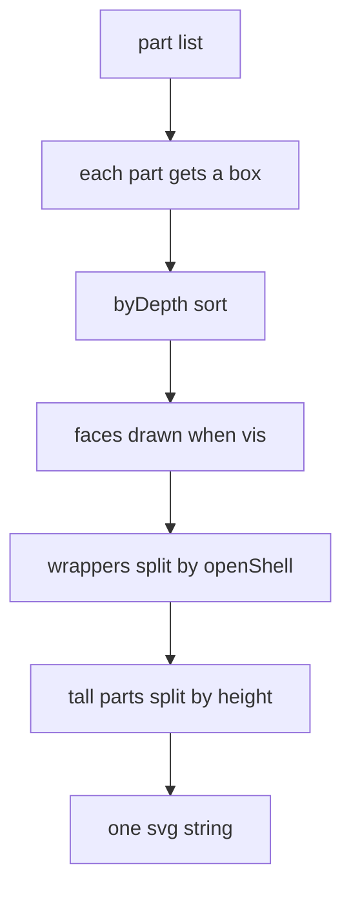

# 04 -- Geometry: the shape kit and the no-depth-buffer rules

Every shape is a function that returns an SVG string. A 2D profile is defined in a plane's local coordinates, then mapped into 3D by a plane. Solid bodies are built by lofting or extruding profiles, or by the ready-made cylinders, rods, and boxes. Because there is no depth buffer, the figure script must sort parts and split wrapping parts. This document shows the shape kit and the rules that make it correct from every side.

## Planes and two-dimensional profiles

A profile is a list of points in `(u, v)` coordinates. Three planes map those points into 3D:

Source: `assets/core.js:73-80`

```javascript
const arcUV  = (cu,cv,r,a0,a1,n=7) => { const o=[]; for (let i=0;i<=n;i++){ const a=(a0+(a1-a0)*i/n)*Math.PI/180; o.push([cu+r*Math.cos(a), cv+r*Math.sin(a)]); } return o; };
const rrUV   = (u0,v0,u1,v1,r,n=7) => r <= 0 ? rectUV(u0,v0,u1,v1) : [...arcUV(u1-r,v0+r,r,-90,0,n), ...arcUV(u1-r,v1-r,r,0,90,n), ...arcUV(u0+r,v1-r,r,90,180,n), ...arcUV(u0+r,v0+r,r,180,270,n)];
const rectUV = (u0,v0,u1,v1) => [[u0,v0],[u1,v0],[u1,v1],[u0,v1]];
const ellUV  = (cu,cv,ru,rv,n=24) => Array.from({length:n}, (_,i) => { const a=i/n*2*Math.PI; return [cu+ru*Math.cos(a), cv+rv*Math.sin(a)]; });
const PX = x => ([u,v]) => [x,u,v];      // front-facing plane x = const   (u = y, v = z)
const PY = y => ([u,v]) => [u,y,v];      // side plane y = const           (u = x, v = z)
const PZ = z => ([u,v]) => [u,v,z];      // horizontal plane z = const     (u = x, v = y)
const on = (plane, uv) => uv.map(plane);
```

`arcUV` makes an arc, `rrUV` a rounded rectangle, `rectUV` a plain rectangle, and `ellUV` an ellipse. `PX`, `PY`, and `PZ` fix one axis. `on` applies a plane to every point in a profile.

## The loft, the core of every rounded body

`loft` connects two rings of equal length with strips. Each strip is a face drawn only when it faces the viewer:

Source: `assets/core.js:115-126`

```javascript
function loft(A, B, colour, flip=false){
  const n=A.length, cen=avg(A.concat(B)); let s='';
  for (let i=0;i<n;i++){
    const a0=A[i], a1=A[(i+1)%n], b1=B[(i+1)%n], b0=B[i];
    let nr = norm(cross(sub(a1,a0), sub(b0,a0)));
    if (!isFinite(nr[0])) continue;
    if (dot(nr, sub(avg([a0,a1,b1,b0]), cen)) < 0) nr = nr.map(v=>-v);
    if (flip) nr = nr.map(v=>-v);
    if (vis(nr)) s += face(pd([a0,a1,b1,b0]), colour(nr));
  }
  return s;
}
```

The strip normal comes from the cross product of two edges. The normal is flipped to point away from the ring centre, so the outside shows. The `colour` argument is a function that receives the normal, so each strip can be shaded individually with `tone` or `toneI`. The `flip` flag shows the inside, used by `openShell` in [01-projection.md](01-projection.md).



## The ready-made solids

`extrude` sweeps a profile along an axis. `cyl` and `cylX` are cylinders. `rod` joins any two 3D points:

Source: `assets/core.js:154-159`

```javascript
function extrude(profileUV, x0, x1, m, shade=tone){ return loft(on(PX(x0),profileUV), on(PX(x1),profileUV), n=>shade(n,m)); }
// Vertical cylinder (axis z) centred (x,y), radius r from z0 to z1, with top cap.
function cyl(x,y,z0,z1,r,m,shade=toneI,w=1.2,n=24){
  const A=on(PZ(z0),ellUV(x,y,r,r,n)), B=on(PZ(z1),ellUV(x,y,r,r,n));
  return loft(A,B,nr=>shade(nr,m)) + fill(pd(B),shade([0,0,1],m)) + hullInk([...A,...B],w) + ink(pd(B),w*.8);
}
```

`extrude` is how most machine bodies are made: a rounded rectangle profile swept along x. The toaster uses `OUT = rrUV(0, 0, D, H, 12)` swept with `extrude(OUT, 0, W, m)`. `cyl` adds the top cap and the silhouette ink.

`rod` joins two points with an optional taper, used for lamp arms and pipes:

Source: `assets/core.js:169-175`

```javascript
function rod(a, b, r, m, shade=toneI, w=1, r1=r, n=16){
  const d = norm(sub(b, a)), u = norm(cross(d, Math.abs(d[2]) < .9 ? [0,0,1] : [1,0,0])), v = cross(d, u);
  const ring = (p, rr) => Array.from({length:n}, (_,i) => { const t = i/n*2*Math.PI, c = Math.cos(t)*rr, s2 = Math.sin(t)*rr;
    return [p[0] + u[0]*c + v[0]*s2, p[1] + u[1]*c + v[1]*s2, p[2] + u[2]*c + v[2]*s2]; });
  const A = ring(a, r), B = ring(b, r1), capB = vis(d), cap = capB ? B : A, cn = capB ? d : d.map(x => -x);
  return loft(A, B, nr => shade(nr, m)) + (Math.max(r, r1) > 0 ? fill(pd(cap), shade(cn, m)) + ink(pd(cap), w*.8) : '') + hullInk([...A, ...B], w);
}
```

The cap goes on whichever end faces the viewer. A second radius `r1` makes a cone, for a lamp shade or a funnel.

`box` draws an axis-aligned box with the three visible faces shaded:

Source: `assets/core.js:143-152`

```javascript
function box(x0,y0,z0,x1,y1,z1,m,shade=toneI,w=.9){
  const F = [
    [[0,1,0],  [[x0,y1,z0],[x1,y1,z0],[x1,y1,z1],[x0,y1,z1]]],
    [[1,0,0],  [[x1,y0,z0],[x1,y1,z0],[x1,y1,z1],[x1,y0,z1]]],
    [[0,-1,0], [[x0,y0,z0],[x1,y0,z0],[x1,y0,z1],[x0,y0,z1]]],
    [[-1,0,0], [[x0,y0,z0],[x0,y1,z0],[x0,y1,z1],[x0,y0,z1]]],
    [[0,0,1],  [[x0,y0,z1],[x1,y0,z1],[x1,y1,z1],[x0,y1,z1]]] ];
  return F.filter(([n]) => vis(n)).map(([n,q]) => shape(q, shade(n,m), w)).join('');
}
```

Five faces are listed; each is drawn only when it faces the viewer. This is the pattern the skill wants everywhere: a face and everything on it draw only when that face is toward the viewer.

## Text on faces

Text lies flat on a face and hides when the face turns away. `txM` builds the transform and returns a zero matrix when the face is edge-on:

Source: `assets/core.js:178-183`

```javascript
const txM = (o, U, V) => (U[0]*V[1] - U[1]*V[0]) <= .02 * Math.hypot(...U) * Math.hypot(...V) ? `matrix(0 0 0 0 ${f(o[0])} ${f(o[1])})` : `matrix(${U[0].toFixed(4)} ${U[1].toFixed(4)} ${V[0].toFixed(4)} ${V[1].toFixed(4)} ${f(o[0])} ${f(o[1])})`;
const tx = (x,y,z,str,size,col=INK,weight=700) => { const o=P(x,y,z);
  return `<text transform="${txM(o, Dv(0,-1,0), Dv(0,0,-1))}" font-size="${size}" fill="${col}" text-anchor="middle" font-family="ui-monospace,Menlo,monospace" font-weight="${weight}" letter-spacing=".04em">${str}</text>`; };
const txY = (x,y,z,str,size,col=INK,weight=700) => { const o=P(x,y,z);
  return `<text transform="${txM(o, Dv(1,0,0), Dv(0,0,-1))}" font-size="${size}" fill="${col}" text-anchor="middle" font-family="ui-monospace,Menlo,monospace" font-weight="${weight}" letter-spacing=".04em">${str}</text>`; };
```

`tx` puts text on a front plane, `txY` on a side plane. The skill says plain letters and digits only: emoji and symbols render as blobs.

## Boards, acts, and clips

A desk object stands on a board. `board` draws a rounded slab and `boardTop` gives its top ring for shadow clipping:

Source: `assets/core.js:193-198`

```javascript
const BOARD = { l:'#e6e1d4', m:'#cfc8b8', d:'#aaa293' }, WOOD = { l:'#d9a86c', m:'#bf8a4f', d:'#8e6236' };
const boardTop = (x0,y0,x1,y1,h=3,r=5) => on(PZ(h), rrUV(x0,y0,x1,y1,r));
function board(x0,y0,x1,y1,h=3,r=5,m=BOARD){
  const A = on(PZ(0), rrUV(x0,y0,x1,y1,r)), B = boardTop(x0,y0,x1,y1,h,r);
  return loft(A, B, n => toneI(n, m)) + fill(pd(B), m.l) + ink(pd(B), 1) + hullInk([...A, ...B], 1.8);
}
```

Two wrappers round off the kit. `act` marks a group as clickable. `clipTo` clips contents to a 3D outline, used for glass openings and shadow edges:

Source: `assets/core.js:200-214`

```javascript
const act  = (name, inner, data='') => `<g data-act="${name}" ${data}>${inner}</g>`;
let _clipN = 0;
...
const clipTo = (pts3, inner) => { const id = 'k' + (++_clipN); return `<clipPath id="${id}"><path d="${pd(pts3)}"/></clipPath><g clip-path="url(#${id})">${inner}</g>`; };
```

## The twelve rules for every angle

The skill lists the most repeated bugs. The first rule is `byDepth` with a box, covered in [01-projection.md](01-projection.md). The others are:

Source: `SKILL.md:75-94`

```text
2. **Faces: draw a face, and everything on it, only when it faces the viewer**: `vis(n)` / `facing(n)`. Buttons,
   displays, decals, windows, knobs, and their labels included. Something mounted on a face is drawn in front of the
   body while that face is toward you and *before* the body when it turns away, so the body hides it.
3. **Parts with no single correct order** (a fan head, a jug with a handle): test which side faces the viewer and
   write both orders: facing → far end first; facing away → the exact reverse.
4. **Things that wrap other things are split**: far half, contents, near half (`openShell(A, B, colour, contents)`
   for cups, cones, bins, drums). Never hard-code the visible half of a ring: `nearHalf()` / `farHalf()`.
5. **Split tall parts by height** (a pole, a stand, a spine): one section per thing beside it, each only as thick
   as the part, or sorting loops appear. When many long parts overlap, sort only the pairs that overlap on screen.
6. **Every solid has its far end and every face**: caps on whichever end faces the viewer, doors and flaps with both
   faces and both edges, wheels and plates with thickness and a rim (nothing real is a flat disc), open tubes with a
   rim and a dark bore.
7. **Concave parts are built from convex pieces** (`extrude`/`loft` handle convex profiles only), each with its own
   ink; no ink on the joins.
8. **Real objects have backs**: service panels, cords, coils, vents, a chassis under a truck. Parts seen only from
   behind still have real proportions.
9. **Contents in an opening are real 3D objects behind the glass**, clipped to the opening (`clipTo`), and centred
   in it as seen straight on.
10. **Text sits on a face**: `tx`/`txY`/`txM` hide it when the face turns away; draw it after its face.
```

Rules 11 and 12 finish the list: after you resize or move a part, re-check the draw order of everything it now overlaps, and draw flat floor pieces after the cast shadows, because an opaque shadow fill paints over what is under it.



## The Aha Moment

**Aha:** The geometry kit has no depth buffer, so correctness is a discipline, not a feature. The first rule is that every part carries a bounding `box`, because `sepOrder` can then decide two separated boxes by which side the viewer is on, while a centre point alone sorts a long pole wrong. The second insight is `loft`'s colour function: each strip receives its own face normal, so the flat light, mid, and dark shading from [02-shading.md](02-shading.md) falls out of the geometry for free, with no extra bookkeeping.

## Where next

The shapes are static until the state changes. Read [05-interaction.md](05-interaction.md) for drag, buttons, and animations. Read [06-seethrough.md](06-seethrough.md) to see how the same kit builds the working parts inside the ghost case.

Continue to [05-interaction.md](05-interaction.md).
