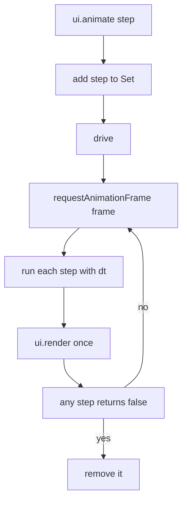
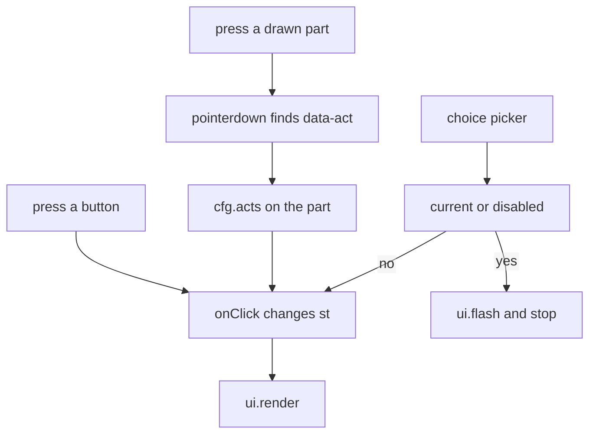

# 05 -- Interaction: one state object, one frame driver

Every figure has one state object. A press changes the state. The engine redraws the whole picture from that state. So there is only one mechanism for buttons, drags, animations, and notices: change `st`, then draw. This document shows the interface, the frame driver, and the rules that keep animations safe.

## The configuration and the ui object

A figure calls `mountFigure` with a config. The comment above it is the whole contract:

Source: `assets/core.js:290-303`

```javascript
/* mountFigure({
     fig:'03', title:'Photo booth', hint:'click the curtain…',
     size:[W,D,H],                 // bounding box, used to frame the view (shadow range included)
     palette:'mustard',            // default PALS key
     state:{...},                  // figure state (st.pal is built in)
     scene: (st, m) => svgString,  // m = current palette {l,m,d}
     readout: st => 'text',        // status line under the figure
     buttons: [{label, onClick(st, ui)}      // listed in the order the user should do them
               | {label, choices: st => [{label, onClick(st,ui), current?, disabled?, why?}]}],   // opens a picker
     stats: st => [{label, value, small?}],   // optional: big numbers top-right (credit, change, score)
     credit: false,                // optional: hide the small "Made with Colorfigures" link
     acts: { name(st, el, ui){} },  // clicks on act(name, …) groups; el has dataset
     params(st, q){}               // optional: read URLSearchParams for screenshot states
   })  -> ui = { st, render, animate(stepFn), flash(text,ms) }
   animate(step): calls step(dt seconds) every frame and re-renders until step returns false. */
```

`mountFigure` returns a `ui` object. `ui.st` is the state. `ui.render` redraws. `ui.animate` runs a step every frame. `ui.flash` shows a notice. The figure never touches the DOM; it only writes to `st` and returns SVG.

## The frame driver

One driver runs every animation and draws once per frame. It also has a timer fallback for headless shots:

Source: `assets/core.js:409-419`

```javascript
  // One frame driver for every running animation: each frame runs all the steps, then draws once (two animations at
  // the same time no longer draw twice). It follows the screen's frames, with a timer fallback for when frames don't
  // come (headless shots, a hidden tab). ui.invalidate() asks for one redraw on the next frame (used while dragging).
  const steps = new Set(); let driving = false, lastT = 0, fbT = 0;
  const frame = () => { if (!driving) return; driving = false; clearTimeout(fbT);
    const now = performance.now(), dt = Math.max(0, Math.min(.05, (now - lastT) / 1000)); lastT = now;
    for (const s of [...steps]) if (s(dt) === false) steps.delete(s);
    ui.render(); if (steps.size) drive(); };
  const drive = () => { if (driving) return; driving = true; requestAnimationFrame(frame); fbT = setTimeout(frame, 60); };
  ui.animate = step => { if (!steps.size && !driving) lastT = performance.now(); steps.add(step); drive(); };
  ui.invalidate = () => drive();
```

`steps` is a Set of step functions. A step receives the time since the last frame in seconds and returns false when it is done. `dt` is clamped to 0.05 seconds so a hidden tab does not jump an animation. `drive` uses `requestAnimationFrame` plus a 60 millisecond timer fallback.



## Drag, arrows, and the turntable

The orbit is plain pointer handling. Drag anywhere that is not a clickable part; the machine turns the way the finger moves:

Source: `assets/core.js:430-436`

```javascript
  svg.addEventListener('pointerdown', e => { if (e.button || e.target.closest('[data-act]')) return;
    camAnim++; drag = { x:e.clientX, y:e.clientY, yaw:YAW, pitch:PITCH }; svg.classList.add("drag"); try { svg.setPointerCapture(e.pointerId); } catch {} });
  svg.addEventListener('pointermove', e => { if (!drag) return; const k = 300 / svg.getBoundingClientRect().width;
    setCam(drag.yaw + (e.clientX - drag.x)*.55*k, drag.pitch + (e.clientY - drag.y)*.35*k); ui.invalidate(); });
  const endDrag = () => { drag = null; svg.classList.remove('drag'); };
  svg.addEventListener('pointerup', endDrag); svg.addEventListener('pointercancel', endDrag);
  svg.addEventListener('dblclick', e => { if (!e.target.closest('[data-act]')) camTo(YAW0, PITCH0); });
```

The pointer is captured, so a drag keeps working even when the finger leaves the figure. The scale factor `300 / width` makes the turn speed the same on every screen. Double-click eases back to the front view. Arrow keys nudge the camera, but a game figure keeps them for play:

Source: `assets/core.js:437-438`

```javascript
  addEventListener('keydown', e => { const k = { ArrowLeft:[-15,0], ArrowRight:[15,0], ArrowUp:[0,8], ArrowDown:[0,-8] }[e.key];
    if (!k || window.GAME_KEYS || /input|textarea/i.test(e.target.tagName)) return; e.preventDefault(); camTo(YAW + k[0], PITCH + k[1], 260); });   // a game figure keeps the arrows for play
```

The turntable button swings the view. Inside a turn limit it swings back and forth:

Source: `assets/core.js:440-444`

```javascript
  const vsp = document.getElementById('vspin');
  vsp.onclick = () => { spin = !spin; vsp.setAttribute('aria-pressed', spin); camAnim++;
    let dir = 1;   // with a turning limit, the turntable swings back and forth inside it
    if (spin) ui.animate(dt => { if (!spin) return false; if (!drag){ let y = YAW + dir*dt*18;
      if (CAM_LIM != null && Math.abs(y - YAW0) >= CAM_LIM - .5){ dir = -dir; y = YAW + dir*dt*18; } setCam(y, PITCH); } return true; }); };
```

## Buttons, choices, and presses on parts

Buttons are the main interface. A choice picker keeps every option clickable, so nothing silently ignores a press:

Source: `assets/core.js:461-466`

```javascript
      for (const c of b.choices(st)){ const ch = document.createElement('button'); ch.className = 'chip' + (c.current ? ' current' : c.disabled ? ' off' : ''); ch.textContent = c.label;
        if (c.current) ch.setAttribute('aria-pressed', 'true');
        ch.onclick = ev => { ev.stopPropagation(); closeChips();
          if (c.current) return ui.flash(`${c.label} — already set`);
          if (c.disabled) return ui.flash(c.why || `${c.label} isn't possible right now`);
          c.onClick(st, ui); ui.render(); }; chips.appendChild(ch); }
```

A `current` choice says it is already set. A `disabled` choice says why it is not possible. Drawn parts wrapped in `act('name', svg)` react on press, not click, because the scene is redrawn every frame and the element under the pointer would be replaced before a click fires:

Source: `assets/core.js:423-424`

```javascript
  svg.addEventListener('pointerdown', e => { if (e.button) return; const a = e.target.closest('[data-act]'); if (!a || !cfg.acts || !cfg.acts[a.dataset.act]) return;
    e.preventDefault(); cfg.acts[a.dataset.act](st, a, ui); ui.render(); });
```



The skill sets the rules for the fun part: follow the real process, 2 to 5 meaningful actions, every supply comes from something in the scene, out-of-order presses answer sensibly:

Source: `SKILL.md:143-151`

```text
- **Follow the real process** (*Truth first*). 2–5 meaningful actions with real outcomes. **`buttons` are the
  interface**, in the order a person would use them (`{label, onClick(st, ui)}`, or `{label, choices: st => [...]}`
  for a picker, with `current: true` / `disabled: true, why: '…'`). Parts wrapped in `act('name', svg)` respond on
  *press* through `acts`; never add `click` listeners to drawn parts (the scene is redrawn every frame).
- **Every supply comes from something in the scene** (water from a jug, coins from a slot).
- Out-of-order presses do something sensible: run the missing step, or `ui.flash('Insert a coin first')`, a notice
  shown on the figure. `stats: st => [{label, value}]` (top right) for a measured quantity: credit, litres, score.
- Animations: `ui.animate(dt => { ...; return stillRunning; })`, eased, mostly under ~2 s, safe if another button is
  pressed meanwhile (one state object).
```

## Games and the keypad

A game figure calls `mountKeypad`. The pad sends the same keyboard events as the arrows and space:

Source: `SKILL.md:152-154`

```text
- **Games** (a claw machine, an arcade): `mountKeypad({...})` adds an inked pad (arrows + a round action button)
  that sends the same keys as the keyboard; set `window.GAME_KEYS = true` so the arrows play instead of turning the
  camera, and let space always trigger the action. On a phone it becomes one slim row under the figure.
```

`window.GAME_KEYS = true` is what makes the arrow keys play the game instead of turning the camera. The claw machine example uses it.

## The Aha Moment

**Aha:** The whole page is one pure function of one state object. `ui.animate` does not mutate the picture; it mutates `st` and lets the shared frame driver call `scene(st, m)` again. That is why two animations can run at once without fighting, why a press during an animation is safe, and why the headless screenshot runner can reproduce any moment by setting the same state through the URL. Read [07-examples-build.md](07-examples-build.md) for how `?press=` drives the same path for testing.

## Where next

Interaction changes the state; See-through reads the same state. Read [06-seethrough.md](06-seethrough.md) for the ghost case and the labels. The zoom control is not part of the engine; [07-examples-build.md](07-examples-build.md) shows how the build script adds it.

Continue to [06-seethrough.md](06-seethrough.md).
