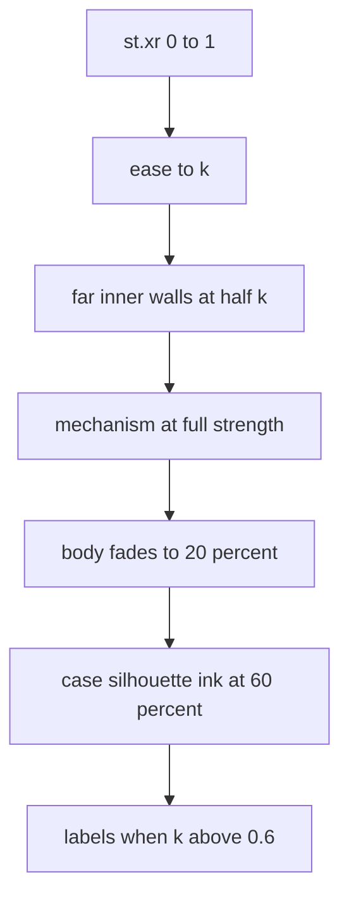
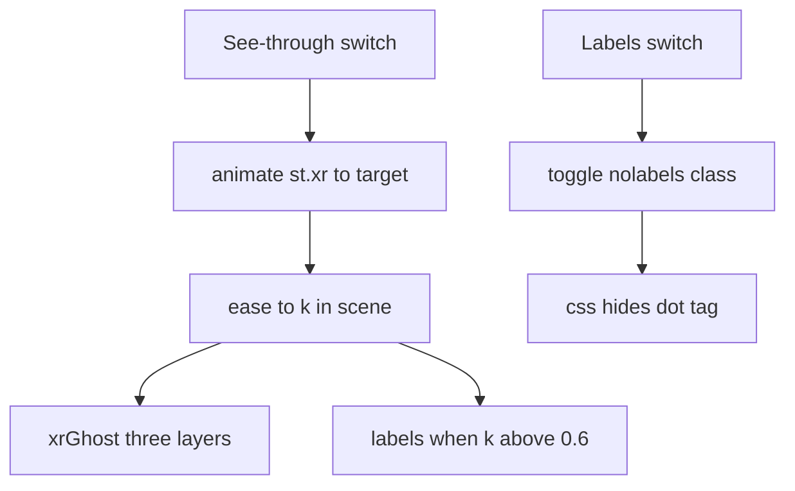

# 06 -- See-through: the ghost case and the labelled mechanism

The closed object is what people see first. The See-through switch fades the case to a ghost and shows the real working parts inside, moving with the buttons. Labels name the parts and light in the accent colour while a part works. One value, `st.xr`, drives the whole fade: 0 is closed, 1 is fully see-through. This document shows the ghost, the labels, and the truth-first rule that makes the inside real.

## One value drives the fade

`ease` is a smooth in-out curve. `st.xr` eases from 0 to 1 over about 0.7 seconds when the switch is pressed:

Source: `assets/core.js:106`

```javascript
const ease = t => t<.5 ? 2*t*t : 1-Math.pow(-2*t+2,2)/2;
```

The See-through switch animates `st.xr` toward its target `st.xrT`:

Source: `assets/core.js:557-558`

```javascript
  if (xrb) xrb.onclick = () => { const u = getUI(), st = u.st; st.xr = st.xr || 0; st.xrT = st.xrT ? 0 : 1; sync();
    u.animate(dt => { const g = Math.sign(st.xrT - st.xr); st.xr = Math.min(1, Math.max(0, st.xr + g*dt/.7)); return st.xr !== st.xrT; }); };
```

The figure script reads `const k = ease(st.xr || 0)` in `scene`, so the fade is smooth and every layer has the same progress.

## The ghost case

`xrGhost` draws three layers in order: the far inner walls faintly, the working parts, then the case as a ghost over them:

Source: `assets/core.js:537-542`

```javascript
function xrGhost(body, mech, k, OUTp, x0, x1, m){
  const fF = facing([1,0,0]), fB = facing([-1,0,0]);
  const far = `<g opacity="${f(.5*k)}">` + loft(on(PX(x0), OUTp), on(PX(x1), OUTp), n => mix(toneI(n.map(v => -v), m), '#f2efe7', .55), true)
    + (fF ? fill(pd(on(PX(x0), OUTp)), mix(m.d, '#f2efe7', .5)) : '') + (fB ? fill(pd(on(PX(x1), OUTp)), mix(m.d, '#f2efe7', .5)) : '') + `</g>`;
  return far + mech + `<g opacity="${f(1 - .8*k)}">${body}</g>` + `<g opacity="${f(.6*k)}">` + hullInk([...on(PX(x0), OUTp), ...on(PX(x1), OUTp)], 2.8) + `</g>`;
}
```

The far walls are the inside of the case loft, drawn with `flip` and washed toward paper colour. The `mech` string, the working parts, comes next at full strength. The closed `body` fades to 20 percent as `k` reaches 1, so it becomes a ghost. The silhouette ink of the case is drawn last at 60 percent, so the ghost keeps its outline. This layering is the key: the mechanism is above the ghosted shell, never inside it, or it would fade with the case.

Bodies that are not one box use two variants. `xrGhostRings` works between two horizontal rings. `xrUnder` puts the whole drawing pale over the inside parts:

Source: `assets/core.js:571-578`

```javascript
function xrGhostRings(body, mech, k, A, B, m){
  const far = `<g opacity="${f(.5*k)}">` + loft(A, B, n => mix(toneI(n.map(v => -v), m), '#f2efe7', .55), true) + fill(pd(A), mix(m.d, '#f2efe7', .5)) + `</g>`;
  return far + mech + `<g opacity="${f(1 - .8*k)}">${body}</g>` + `<g opacity="${f(.6*k)}">` + hullInk([...A, ...B], 2.8) + `</g>`;
}
// generic see-through for any figure: the whole drawing fades back and the inside parts show over it.
const xrUnder = (svg, mech, k) => `<g opacity="${f(k)}">${mech}</g><g opacity="${f(1 - .62*k)}">${svg}</g>`;
```

`xrWrap` is the generic wrapper that picks the right variant and appends the labels:

Source: `assets/core.js:579-588`

```javascript
function xrWrap(sceneFn, opts){
  return function(){
    let s = sceneFn.apply(this, arguments);
    const st = opts.getSt(), k = ease(st.xr || 0);
    if (k > 0 && opts.under) s = xrUnder(s, opts.mech(st, k), k);   // the whole drawing is the object
    else if (k > 0 && !opts.inline) s = `<g opacity="${f(1 - .5*k)}">${s}</g><g opacity="${f(k)}">${opts.mech(st, k)}</g>`;   // inline: the figure ghosts its own case
    const items = k > .6 ? opts.inside(st) : opts.surface ? opts.surface(st) : [];
    return s + (items.length ? xrCallouts(items, opts.B) : '');
  };
}
```



## Labels on the surface and inside

Surface parts use `tag`, a cream pill with a leader line to a 3D point. It turns the accent colour when `on` is true:

Source: `assets/core.js:205-213`

```javascript
function tag(p3, dx, dy, text, on=false){
  // on a phone (LBL_U = drawing units per screen px) the pill is a numbered badge and the names go in a legend under the figure
  const u = window.LBL_U ? LBL_U() : 0, n = ((window.__ln || (window.__ln = {}))[text] || (__ln[text] = Object.keys(__ln).length + 1));
  const k = INK_K, [X,Y] = P(...p3), fs = u ? 10*u : 8.6*k, h = u ? 17*u : fs*1.8, w = u ? h*(n > 9 ? 1.3 : 1) : text.length*fs*.62 + fs*1.5, cx = X + dx*k, cy = Y + dy*k;
  return `<g class="tag${on ? ' on' : ''}" data-n="${n}" data-t="${text}"><path d="M${f(X)} ${f(Y)}L${f(cx)} ${f(cy)}" fill="none" stroke="${INK}" stroke-width="1"/>`
    + `<circle cx="${f(X)}" cy="${f(Y)}" r="${f(1.3*k)}" fill="${INK}"/>`
    + `<rect x="${f(cx-w/2)}" y="${f(cy-h/2)}" width="${f(w)}" height="${f(h)}" rx="${f(h/2)}" fill="${on ? 'var(--accent,#f4b829)' : '#fff4d6'}" stroke="${INK}" stroke-width="1.2"/>`
    + `<text x="${f(cx)}" y="${f(cy+fs*.36)}" font-size="${f(fs)}" text-anchor="middle" font-family="ui-monospace,Menlo,monospace" font-weight="800" letter-spacing=".04em" fill="${INK}">${u ? n : text}</text></g>`;
}
```

`dx` and `dy` set where the pill sits, in screen units at the reference zoom. On a phone, `LBL_U` returns the drawing units per screen pixel, and the pill becomes a numbered badge; the names go in a legend under the figure.

Inside see-through, `xrCallouts` lays the pills in two columns either side of the object, sorted top to bottom so leaders never cross:

Source: `assets/core.js:506-515`

```javascript
function xrCallouts(items, B){
  const pts = []; for (const x of [B[0], B[1]]) for (const y of [B[2], B[3]]) for (const z of [B[4], B[5]]) pts.push(P(x, y, z));
  const xmin = Math.min(...pts.map(p => p[0])), xmax = Math.max(...pts.map(p => p[0])), cx = (xmin + xmax)/2;
  // on a phone (LBL_U = drawing units per screen px) each label is a numbered badge and the names go in a legend under the figure
  const k = INK_K, u = window.LBL_U ? LBL_U() : 0, fs = u ? 10*u : 8.6*k, hgt = u ? 17*u : fs*1.8, gap = hgt + (u ? 3*u : 3*k);
  const L = [], R = [];
  const svgEl = document.getElementById('fig'), vb = svgEl.viewBox.baseVal, btn = document.getElementById('btns');
  const wMax = u ? hgt*1.3 + 12*k : Math.max(...items.map(it => it.text.length))*fs*.62 + fs*1.5 + 12*k;
  const roomL = xmin - vb.x >= wMax, roomR = vb.x + vb.width - xmax >= wMax;
  for (const it of items){ const [X, Y] = P(...it.at); ((X < cx && roomL) || !roomR ? L : R).push({ ...it, X, Y }); }
```

Each item is `{ at:[x,y,z], text, on }`. `B` is the object's bounds. The pills split into left and right columns by which side of centre the anchor falls on, and only when there is room. The skill says labels only name parts that are drawn, and each label anchors on its part and moves with it:

Source: `SKILL.md:135-138`

```text
- **Labels**: `xrCallouts([{ at:[x,y,z], text:'BIMETAL STRIP', on }], bounds)` gives pills in two columns either side
  of the object, sorted so leaders never cross; draw them last, only when `k > .6`. Outside see-through, label
  surface parts with `tag([x,y,z], dx, dy, 'TEXT', on)`. Short names in capitals; `on` while that part works. Labels
  only name parts that are drawn. Anchor each label on its part and move it with the part.
```

## The switches and the caption

`xrMount` adds the See-through and Labels switches, the caption, and label hiding:

Source: `assets/core.js:543-560`

```javascript
function xrMount(getUI, caption, opt = {}){   // opt.labelsOnly: only the Labels switch (the insides are on show already)
  const ui = getUI(), q = new URLSearchParams(location.search), html = document.documentElement;
  if (q.get('labels') !== '1') html.classList.add('nolabels');
  if (ui.st.xr == null){ ui.st.xr = 0; ui.st.xrT = 0; }
  if (q.get('xr') === '1') ui.st.xr = ui.st.xrT = 1;
  const old = document.getElementById('lblctl'); if (old) old.style.display = 'none';
  const vset = document.createElement('div'); vset.className = 'vset';
  vset.innerHTML = '<div class="vrow">' + (opt.labelsOnly ? '' : '<button class="act" id="xrb" aria-pressed="false">See-through</button>') + '<button class="act" id="lblb" aria-pressed="false">Labels</button></div>';
  document.querySelector('.stage').appendChild(vset);
  // pages with a stats panel in the top right: the switches go just under it
  const place = () => { const sp = document.getElementById('stats'); vset.style.top = sp ? (sp.offsetTop + sp.offsetHeight + 10) + 'px' : ''; };
  place(); new ResizeObserver(place).observe(document.getElementById('stats') || vset);
  const xrb = document.getElementById('xrb'), lblb = document.getElementById('lblb');
  const sync = () => { if (xrb) xrb.setAttribute('aria-pressed', !!getUI().st.xrT); lblb.setAttribute('aria-pressed', !html.classList.contains('nolabels')); };
```

The URL queries `?xr=1&labels=1` open both for screenshots. The switches start off, so the closed object is what people see first.



## Truth first makes the inside real

The inside is only as good as the model of the real object. Before drawing, the skill requires the real process and the parts list:

Source: `SKILL.md:40-50`

```text
The figure is only as good as its model of the real object. Before drawing:
- **Write how it really works** as a short list of steps, and where every material is after each one (coin in the
  slot → coin chute → acceptor → cash box; water in the tank → pump → boiler → group → cup). Each button is one real
  step and things only move along their real path.
- **Write the parts list in the code** (a comment block, grouped: case, structure, mechanism, power, controls). For
  the see-through aim for 30–60 real parts: motors, gears, shafts, springs, boards, sensors, wiring, tubes, brackets.
  Look up proportions you are unsure of (a home espresso tank is 1.5–2.5 L: nearly full height, half the width).
- **Every part is held by another**: name what it is fixed to. Nothing floats. Cables and tubes run from a real port
  to a real port along walls and floor, never across open space.
- **Every driving part touches what it drives** (shaft to gear, gear rim to gear rim, pipe end to port): work the
  contact points out with numbers.
```

A flat picture of a mechanism is not a see-through; it is built in 3D with the shape kit from [04-geometry.md](04-geometry.md). Long parts through a ring are drawn in pieces either side of it. Wires are short pieces so they sort with solids.

## The Aha Moment

**Aha:** The fade is one number, and every layer reads the same number. `k = ease(st.xr)` is the only progress value, and `xrGhost` turns it into three different opacities: the far walls at half of `k`, the body at `1 - .8*k`, and the case ink at `.6*k`. Because the layers share one `k`, the whole transition is always coherent, no matter which button was pressed or when. The same single value decides when the labels appear (`k > .6`), so the pills never pop in before the case has thinned.

## Where next

The examples show the whole system in action. Read [07-examples-build.md](07-examples-build.md) for the toaster, the lamp, and the claw machine, and how the build script packages the page. Read [05-interaction.md](05-interaction.md) for the frame driver that animates the fade.

Continue to [07-examples-build.md](07-examples-build.md).
