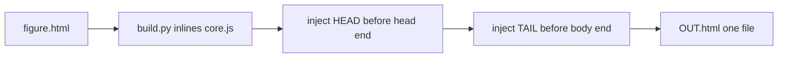
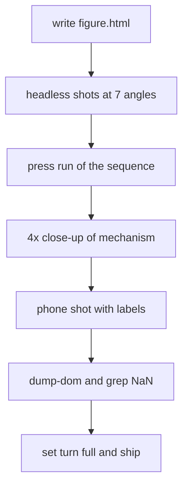

# 07 -- Examples and build: three reference figures, one output file

Three complete figures live in `assets/examples/`. They are the teaching set, ordered from smallest to largest. The build script glues the engine and the figure into one self-contained HTML page and adds the zoom, the notices, the phone layout, and the See-through and Labels placement. The owner verifies the page with headless Chrome from many angles before shipping. This document shows the examples, the build, and the verify loop.

## The three reference figures

The skill lists them and what each teaches:

Source: `SKILL.md:23-28`

```text
2. **Read the references** before writing. They are complete demo figures:
   - `assets/examples/toaster.html`: the smallest. A rounded case, a lever, bread that toasts and pops, and a
     see-through with heating cards, carriage, spring, latch and bimetal strip.
   - `assets/examples/lamp.html`: a scene on a desk board with a jointed arm, a light pool and parts sorted per angle.
   - `assets/examples/claw.html`: a big machine with glass, a game played on a keypad, stats, and a dense
     see-through (gantry, motors, harness, coin path).
```

The toaster is 406 lines. The lamp is 395. The claw machine is 974.

## The toaster, the smallest complete figure

The toaster shows the whole pipeline in miniature. Its body profile is a rounded rectangle in `(y, z)` swept along `x`:

Source: `assets/examples/toaster.html:10-10`

```javascript
const OUT = rrUV(0, 0, D, H, 12);                              // body profile in (y, z), swept along x
```

And later the profile becomes the body:

Source: `assets/examples/toaster.html:174-174`

```javascript
  body += extrude(OUT, 0, W, m);
```

This is exactly the `extrude` primitive from [04-geometry.md](04-geometry.md). The see-through shows three mica cards wound with nichrome wire, a carriage on a guide rod with its spring, the switch contacts, and the bimetal strip that trips the latch. The bread toasts and pops.

## The claw machine, the largest

The claw machine is a full game. It sets `window.GAME_KEYS` so the arrows and space play the game instead of turning the camera, and it wires a keypad:

Source: `assets/examples/claw.html:721-721`

```javascript
window.GAME_KEYS = true;   // the arrows and space play the game; they don't turn the camera here
```

Its `mountFigure` call adds the two measured quantities, tokens and prizes:

Source: `assets/examples/claw.html:934-940`

```javascript
ui = mountFigure({
  fig:'18', turn:'full', title:'Claw machine', hint:'insert a coin, steer with the arrow keys, drop to grab',
  idea:'The claw only holds a prize it closes around squarely; off-centre, it slips out on the way to the chute.',
  size:[W + LX, D, HC], palette:'blush', state:st,
  scene,
  readout: st => st.phase,
  stats: st => [ { label:'Tokens', value: String(st.tokens) }, { label:'Prizes won', value: String(st.won) } ],
```

The `stats` field is the big numbers in the top-right corner from [05-interaction.md](05-interaction.md). The dense see-through holds the gantry, motors, harness, and coin path, built with the rules from [06-seethrough.md](06-seethrough.md).

## The build script

`scripts/build.py` is 25 lines. It reads the figure, inlines the engine in place of the `<script src="core.js">` tag, and injects two large strings, `HEAD` and `TAIL`:

Source: `scripts/build.py:16-24`

```python
src, out = sys.argv[1], sys.argv[2]
page = open(src, encoding='utf-8').read(); core = open(os.path.join(HERE, '..', 'assets', 'core.js'), encoding='utf-8').read()
tag = re.search(r'<script\s+src=["\'](?:\./)?core\.js["\']\s*>\s*</script>', page)
if not tag: sys.exit('no <script src="core.js"></script> in ' + src)
page = page[:tag.start()] + '<script>\n' + core + '\n</script>' + page[tag.end():]
page = page.replace('</head>', HEAD + '</head>', 1) if '</head>' in page else HEAD + page
i = page.rfind('</body>')
page = page[:i] + TAIL + page[i:] if i >= 0 else page + TAIL
open(out, 'w', encoding='utf-8').write(page)
print('wrote', out)
```

The regex finds any `<script src="core.js"></script>` with an optional `./` prefix, so the working figure and the built file use the same source. `HEAD` goes before `</head>`; `TAIL` goes before `</body>`.

The docstring names exactly what the build adds:

Source: `scripts/build.py:6-10`

```text
figure.html loads <script src="core.js"></script>; the engine (assets/core.js) is inlined in its place, and the page
features are added: zoom (pinch, ctrl/cmd + scroll, a - 100% + chip), notices on the figure, the See-through / Labels
switches placed for desktop and phone, labels as numbered badges with a list on a phone, a taller frame on a phone,
the slim game keypad on a phone, solid cast shadows in see-through, and a lighter filter while the figure moves on
touch screens.
```

The zoom is not part of the engine. `HEAD` sets two globals the engine reads: `FIG_A` for the phone's taller frame and `LBL_U` for the drawing units per screen pixel that turn labels into numbered badges:

Source: `scripts/build.py:14-14`

```javascript
HEAD = '<style>.mcap{display:none!important}@media (max-width:560px){.stat .v{font-size:20px!important}.stats{align-items:flex-end}}@media (min-width:561px){.vset{top:4px!important}#stats{top:var(--vset-h,44px)!important}}</style><style>@media (max-width:560px){body > header{display:none}}</style><script>window.FIG_A = () => innerWidth <= 560 ? 1.1 : .75;</script><script>window.LBL_U = () => { if (innerWidth > 560) return 0; const s = document.getElementById("fig"); return s && s.clientWidth && s.viewBox.baseVal.width ? s.viewBox.baseVal.width / s.clientWidth : 0; };</script>'
```

`TAIL` holds the zoom control, the pinch gestures, the toast styling, the phone legend, and the lighter filter while moving on touch screens.



## The verify loop

The skill renders the finished page with headless Chrome over `file://`, at seven camera angles, one after another:

Source: `SKILL.md:171-177`

```bash
G="/Applications/Google Chrome.app/Contents/MacOS/Google Chrome"
for v in "yaw=45" "yaw=110" "yaw=170" "yaw=230" "yaw=300" "yaw=20&pitch=62" "yaw=200&pitch=70"; do
  "$G" --headless=new --hide-scrollbars --user-data-dir="$(mktemp -d)" --force-device-scale-factor=2 \
    --window-size=900,800 --virtual-time-budget=3000 --screenshot="shot-${v//[&=]/_}.png" "file://$PWD/OUT.html?free=1&$v"
done
```

The URL query `?free=1` lifts the turn limit from [01-projection.md](01-projection.md), so the owner can check the back. Each run uses its own `--user-data-dir`, so the runs do not share state. The checks are five:

Source: `SKILL.md:178-187`

```text
1. **Every angle above**, closed and with `&xr=1&labels=1`. Look at 2–3× crops of each part, not just the whole
   image: nothing painted over a nearer part, no missing face, no floating part, no mirrored text, no part visible
   through a solid wall, the back makes sense.
2. **One `?press=` run of the main sequence** (`figure.html?press=Coin@300,Left@1500,Drop@2500`; `Label>Choice`
   picks from a picker), shot at two or three budgets, at the default view and from behind, in see-through too.
   Add one out-of-order press to see it answers sensibly.
3. **A 4× close-up of the mechanism in see-through**: every part held, every drive touching, wires port to port.
4. **A phone shot** (`--window-size=390,844`) with `&xr=1&labels=1`: badges and the label list read, nothing cut off.
5. **Errors:** run the press URL once with `--dump-dom` and check `<html data-errors="…">`; grep for `NaN`.
```

Only when every angle passes does the figure set `turn:'full'`. The engine logs any runtime error into `<html data-errors>`, so a `--dump-dom` run plus a grep for `NaN` catches geometry mistakes.



## The Aha Moment

**Aha:** The engine and the build script are split on purpose, so the skill stays a single file during work and a single file after. While writing, the figure loads `core.js` from disk and the browser runs the same code the built page will carry. The build script only inlines that file and adds page features, never figure logic. The verify loop works on the built `OUT.html`, so the exact file the user gets is the one the owner tested.

## Where next

This is the last numbered document. Return to [README.md](README.md) for the index and reading order, or go back to [00-overview.md](00-overview.md) for the purpose and trigger.

Continue to [README.md](README.md).
