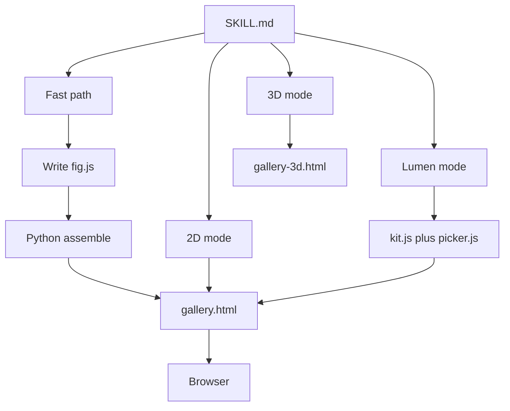
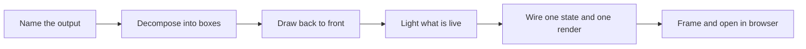

# 00 -- Overview: a dark hairline drawing where only what is live glows

ISO-GLOW is a skill for Claude that turns a named object into one HTML file: an isometric hairline drawing on a numbered plate, where pressing parts produces real output and one accent colour glows only on what is live. The skill builds on iso-figure and adds four layers: the glow lighting, the palette picker, the gallery shell, and a three.js 3D mode. It also ships a second look called Lumen, which replaces hairlines with solid, lit, filled objects. Everything a user needs to know is on one page, `SKILL.md`; the assets are copied, never read, and a small Python command stitches them together.

## What the skill is

`SKILL.md` opens with a frontmatter block that states the whole scope in one description.

```yaml
---
name: iso-glow
description: Build interactive isometric line-art figures with glow lighting in a single HTML file — a dark hairline drawing where whatever is live glows in one accent colour (pressed keys, lit screens and windows, beams, wires with travelling light pulses), plus an accent-colour picker. One figure, or a gallery of several figures with sidebar navigation. Also builds the same look in real 3D (three.js: orbit, true isometric view, revolve), including cleaning up a user's own .glb model into iso-glow hairlines. Also has a Lumen style: solid, lit, filled objects with geometric light cones, for product showcases and web/landing-page illustration. Use for isometric objects, devices, buildings and cityscapes, "Fig N" plates, glowing interactive isometric illustrations, Lumen / solid isometric product illustrations, and 3D versions of them, including exploded and sectioned real objects.
---
```

From `SKILL.md` lines 1-4.

The skill states the look in one sentence and then explains the contrast that drives every design choice.

```md
## The look in one sentence

A monochrome hairline drawing on a dark panel; **one accent colour, only on what is live** — and live things glow. Lit display content, the key you just pressed, a floor whose lights are on, a wire carrying signal, a sweeping beam. That contrast is the whole effect.
```

From `SKILL.md` lines 10-12.

## The build system

The skill never asks Claude to read the template files. It gives a fast path: write the figure to a file, then run one Python command that copies the template and makes four text replacements. The 2D command replaces the title, the brand text, the palette, and the figure placeholder.

```bash
python3 - "<skill folder>/assets/gallery.html" NAME.html fig.js "NAME" PALETTE <<'PY'
import sys
src, out, fig, name, pal = sys.argv[1:6]
s = open(src).read()
for a, b in [('<title>Iso Figures</title>', f'<title>{name}</title>'), ('Iso figures</span>', f'{name}</span>'),
             ("palette: 'ember'", f"palette: '{pal}'"), ('/* paste figure scripts here (see examples/) */', open(fig).read())]:
    assert a in s, a
    s = s.replace(a, b, 1)
open(out, 'w').write(s)
print('wrote', out)
PY
```

From `SKILL.md` lines 21-33.

The same pattern builds the 3D page and the Lumen page. The 3D command makes three replacements; the Lumen command concatenates the kit, the figure, and the picker into one script slot.

## The source inventory

The project is small and flat. Fourteen files hold everything.

- `SKILL.md` — the single source of truth for the skill.
- `references/anatomy-builds.md` — rules for exploded, sectioned, labelled real objects.
- `references/lumen.md` — the Lumen style rules and kit API.
- `assets/gallery.html` — the 2D page: tokens, filters, CSS, kernel, api, navigation, picker.
- `assets/gallery-3d.html` — the 3D page: renderer, line tiers, crease extraction, figures.
- `assets/examples/desk-computer.js`, `office-tower.js` — complete 2D figures.
- `assets/examples/lens-camera-3d.js` — the anatomy reference build.
- `assets/lumen/kit.js`, `picker.js` — the Lumen shading kit and gradient picker.
- `assets/lumen/examples/card-terminal.js`, `eth-blocks.js`, `vault-safe.js` — Lumen figures.
- `LICENSE` — MIT, April Zhu and Tolga Cohce.

The 2D gallery page is the central asset. It declares a `window.GALLERY` settings object and an empty `FIGS` array, then a core script that defines the kernel, the api, and the navigation.

```js
  // Gallery settings: palette 'ember' | 'city' | your own [[name, darkAccent, darkHi, lightAccent, lightHi], ...]
  window.GALLERY = { palette: 'ember', autoDemo: false, storageKey: 'iso-glow-accent' };
  const FIGS = [];
```

From `assets/gallery.html` lines 162-164.

## The two fast paths

The 2D fast path writes one figure of roughly 150-300 lines. The 3D fast path writes one module of 100-250 lines and pastes it into a `FIGS3D` slot. Both end the same way: check the file once, open the page in the user's browser, and tell the user what to press. The skill forbids browser automation because headless browsers can hang or need downloads.

The figure contract is the bridge between the author and the shell. A figure is one call to `FIGS.push` with an `id`, a `name`, an optional `css` block, and a `mount` function that receives a fresh SVG stage and an api object, then returns keyboard, pointer, and demo handlers.

```js
FIGS.push({
  id: 'lamp', name: 'Desk lamp', hint: 'Click the switch · ↑↓ dim', aria: 'Isometric desk lamp. …',
  css: `[data-fig="lamp"] …`,            // optional, always scoped to the figure
  mount(stage, api) {                      // stage: a fresh <svg> per mount
    const K = api.iso.frame([/* extreme 3D corners, incl. the tallest point */]);
    const { P, D, TOP, FRONT, SIDE, rect, box, boxc, path } = K;
    stage.setAttribute('viewBox', K.viewBox); stage.innerHTML = svg;
    // listeners on stage; one state object; one render()
    return { key(e) { /* true if handled */ }, keyup(e) {}, unmount() {}, demo() {} };
  },
});
```

From `SKILL.md` lines 72-84.





## How the pieces fit

The 2D figures, the 3D figures, and the Lumen figures share one projection kernel and one figure contract. They differ only in the shading layer: hairlines with glow for 2D, line tiers and creases for 3D, and gradient-filled solids for Lumen. The palettes are shared; the light theme keeps the accent but removes the glow in every mode.

The remaining documents go deeper. [01-iso-figure-base.md](./01-iso-figure-base.md) explains the kernel. [02-glow.md](./02-glow.md) explains the lighting. [03-palette-picker.md](./03-palette-picker.md) explains the accent choice. [04-gallery-shell.md](./04-gallery-shell.md) explains the api and mount. [05-3d-mode.md](./05-3d-mode.md) and [06-3d-figures.md](./06-3d-figures.md) explain the 3D page. [07-lumen.md](./07-lumen.md) explains the solid style. [08-anatomy-builds.md](./08-anatomy-builds.md) explains the real-object builds.

## The Aha Moment

**Aha:** the skill is not a library of drawings; it is a small contract plus a big template, and the contract is the product.

Everything a figure author must know fits in the figure contract and the glow-kit table. The template supplies the kernel, the filters, the classes, the navigation, and the picker, so the author only writes boxes and state. The fast path encodes this by replacing four strings in a file the author never reads. That is why twenty figures, three modes, and two looks all stay consistent: they share one template and one contract, and the variation is only in the shading layer.

Continue to [01-iso-figure-base.md](01-iso-figure-base.md).
