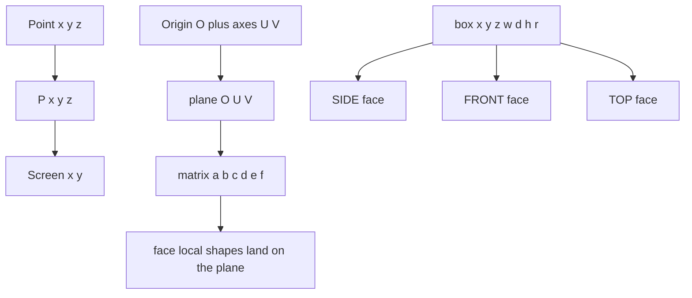
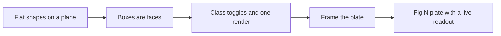

# 01 -- The iso-figure base: nine lines of projection do all the drawing

ISO-GLOW inherits its drawing engine from iso-figure by Tolga Cohce. The engine is a projection kernel of nine lines: it turns a three-dimensional point into a screen point, turns three in-plane axes into one SVG `matrix`, and draws a box as its three visible faces. The key idea is that nothing is ever hand-computed as a skewed polygon; the author draws ordinary rectangles, text, and paths in a flat face, and one matrix transform lays them on the correct isometric plane. The whole skill is described in [00-overview.md](./00-overview.md).

## The four things that make it work

The base skill states four rules that define the whole approach. The first rule is the engine; the other three are the discipline around it.

1. **Everything is a flat 2D shape placed on a 3D plane.** The author never hand-computes skewed polygons. Ordinary shapes go in a face's local coordinates, and one SVG `matrix()` puts them on the plane.
2. **Objects are boxes; a box is its three visible faces.** Complex objects are boxes plus flat detail drawn on their faces.
3. **Interaction is class toggles on SVG groups.** One `state` object, one `render()`; CSS does the motion.
4. **The frame sells it.** Four monospace corner captions: `Fig N`, the object name, the instruction, and a live state readout.

These four rules come from the base iso-figure skill, credited in `SKILL.md` line 8.

## The kernel

The base kernel is copied verbatim. ISO-GLOW reproduces it inside the gallery page with a small extension: a `frame` function that fits a scene to a 4:3 viewBox.

```js
const C = Math.cos(Math.PI/6), S = Math.sin(Math.PI/6);
function kernel(OX, OY) {
  const P = (x,y,z) => [(x-y)*C + OX, (x+y)*S - z + OY];   // point: 3D -> screen
  const D = (x,y,z) => [(x-y)*C, (x+y)*S - z];              // direction only
  // plane = origin O + in-plane axes U,V. Anything inside a <g> with this transform lies flat on that plane.
  const plane = (O,U,V) => { const o=P(...O), u=D(...U), v=D(...V);
    return `matrix(${u[0]} ${u[1]} ${v[0]} ${v[1]} ${o[0]} ${o[1]})`; };
  const TOP   = (x,y,z) => plane([x,y,z],[1,0,0],[0,1,0]);   // z = const
  const FRONT = (x,y,z) => plane([x,y,z],[1,0,0],[0,0,-1]);  // y = max face, lower-left
  const SIDE  = (x,y,z) => plane([x,y,z],[0,-1,0],[0,0,-1]); // x = max face, lower-right
}
```

From `assets/gallery.html` lines 179-187, the source of the kernel.

The projection is the standard isometric transform. `C = Math.cos(Math.PI/6)` and `S = Math.sin(Math.PI/6)` are the cosine and sine of 30 degrees. A point projects as:

- screen x = `(x - y) * C + OX`
- screen y = `(x + y) * S - z + OY`

The axes are: positive x runs down-right, positive y runs down-left, positive z is up. The viewer sees the top face, the `y = max` face (left), and the `x = max` face (right).

A plane is three points. The function `plane(O, U, V)` takes an origin `O` and two in-plane axis vectors `U` and `V`, projects them, and returns the SVG `matrix(a b c d e f)` that maps face-local coordinates onto that plane. The `a b c d` entries are the two projected direction vectors; the `e f` entries are the projected origin.

The three face helpers are just `plane` with fixed axes. `TOP` keeps z constant and uses the x and y axes. `FRONT` keeps y constant and uses the x axis and the negative z axis. `SIDE` keeps x constant and uses the negative y axis and the negative z axis.

## The gallery page kernel

The gallery page restates the kernel inside an `ISO` module and adds `frame`, `slits`, and `esc`. This is the version the figures actually use, because it computes the viewBox from the scene's extreme corners.

```js
const ISO = (() => {
  const C = Math.cos(Math.PI / 6), S = Math.sin(Math.PI / 6);
  function kernel(OX, OY) {
    const P = (x,y,z) => [(x-y)*C + OX, (x+y)*S - z + OY];
    const D = (x,y,z) => [(x-y)*C, (x+y)*S - z];
    const plane = (O,U,V) => { const o=P(...O), u=D(...U), v=D(...V);
      return `matrix(${u[0]} ${u[1]} ${v[0]} ${v[1]} ${o[0]} ${o[1]})`; };
    const TOP   = (x,y,z) => plane([x,y,z],[1,0,0],[0,1,0]);
    const FRONT = (x,y,z) => plane([x,y,z],[1,0,0],[0,0,-1]);
    const SIDE  = (x,y,z) => plane([x,y,z],[0,-1,0],[0,0,-1]);
    const rect = (t,w,h,r=0,cls='face') => `<g transform="${t}"><rect class="${cls}" width="${w}" height="${h}" rx="${r}"/></g>`;
```

From `assets/gallery.html` lines 178-188.

The `frame` function projects every extreme corner, takes the bounding box, adds a margin, and pads the smaller dimension to a 4:3 aspect ratio. This is the numeric framing step from the base procedure, automated.

```js
  function frame(points, margin = 0.09, aspect = 4 / 3) {
    const d = points.map(([x,y,z]) => [(x-y)*C, (x+y)*S - z]);
    let x0 = Math.min(...d.map(p => p[0])), x1 = Math.max(...d.map(p => p[0]));
    let y0 = Math.min(...d.map(p => p[1])), y1 = Math.max(...d.map(p => p[1]));
    const m = margin * Math.max(x1 - x0, y1 - y0);
    let w = x1 - x0 + 2*m, h = y1 - y0 + 2*m;
    let ox = m - x0, oy = m - y0;
    if (w / h < aspect) { const nw = h * aspect; ox += (nw - w) / 2; w = nw; }
    else { const nh = w / aspect; oy += (nh - h) / 2; h = nh; }
    return { ...kernel(ox, oy), viewBox: `0 0 ${w.toFixed(1)} ${h.toFixed(1)}`, W: w, H: h };
  }
```

From `assets/gallery.html` lines 209-220.

## Boxes and detail

A box is its three visible faces. The base `box` helper draws the side face, the front face, and the top face. The gallery page adds a `rounded` variant that draws one rounded top plus one continuous side wall so the corners meet cleanly.

```js
    const box = (x,y,z,w,d,h,r=0) => r > 0 ? rounded(x,y,z,w,d,h,r,'') :
      rect(SIDE(x+w,y+d,z+h), d,h) + rect(FRONT(x,y+d,z+h), w,h) + rect(TOP(x,y,z+h), w,d,0,'face top');
    const boxc = (x,y,z,w,d,h,r,cls) => r > 0 ? rounded(x,y,z,w,d,h,r,cls) :
      rect(SIDE(x+w,y+d,z+h), d,h,0,'face '+cls) + rect(FRONT(x,y+d,z+h), w,h,0,'face '+cls) + rect(TOP(x,y,z+h), w,d,0,'face top '+cls);
```

From `assets/gallery.html` lines 201-204.

The `box` parameters are `(x, y, z, w, d, h, r)`: position, width along x, depth along y, height along z, and corner radius. The face corners passed to `FRONT` and `SIDE` are the face top-left corners, because the local v axis grows downward.

Detail is drawn inside a group that carries a face transform. The author opens a group with `FRONT(x, y+d, z+h)` and draws in face-local units. This is why text, glyphs, and rounded corners come out in correct perspective for free.

## Paint order is the only depth sort

The base skill has no z-buffer. Painter's order is the only depth sorting: smaller `x + y` first, lower z first. Every face must have an opaque fill, because a later face hides an earlier one by drawing over it. Grids loop rows by increasing y, then columns by increasing x.

The `slits` helper produces the repeated hairline texture that stands in for shading: vents, window grids, and ribs.

```js
  const slits = (a0, a1, step, b0, b1, vertical = true, cls = 'detail') => {
    let s = ''; for (let a = a0; a <= a1 + 1e-6; a += step)
      s += vertical ? `<line class="${cls}" x1="${a}" y1="${b0}" x2="${a}" y2="${b1}"/>` : `<line class="${cls}" x1="${b0}" y1="${a}" x2="${b1}" y2="${a}"/>`;
    return s;
  };
```

From `assets/gallery.html` lines 222-226.

## The figure contract in practice

The desk computer is the flagship 2D figure. Its `mount` opens by writing a box table in a comment, then calls `api.iso.frame` with the extreme corners, then builds the plate, the computer case, the keyboard, and a coiled cable whose path is computed with a cubic Bezier curve and a moving Frenet frame.

```js
  mount(stage, api) {
    /*  boxes            x    y    z    w    d    h
        plate            0    0    0  300  268    7
        plinth         112   22    7  132  140    6
        case           108   18   13  140  148  187   -> front y=166, top z=200
        keyboard        18  186    7  194   70   12   -> deck z=19
        keys          grid on the deck, h 4                                   */
    const K = api.iso.frame([[0,268,0],[300,0,7],[300,268,0],[108,18,200],[248,18,200],[108,166,200],[280,190,10]]);
    const { P, TOP, FRONT, SIDE, box, path } = K, slits = api.iso.slits;
```

From `assets/examples/desk-computer.js` lines 14-22.





## The Aha Moment

**Aha:** the isometric drawing is not geometry, it is a coordinate-system trick, and every part of the look falls out of one matrix.

Hand-drawn isometric art is hard because every face is a skewed polygon. The kernel removes that difficulty entirely: the author draws a flat rectangle in a face's own coordinates and lets `plane()` supply the skew as an SVG `matrix`. Text, rounded corners, and repeated slits all inherit the correct perspective with zero extra work. Depth is painter's order, texture is repetition, and motion is a CSS class toggle. The base skill's nine lines are the entire rendering engine, and ISO-GLOW keeps them verbatim, which is why the glow layer in [02-glow.md](./02-glow.md) can be added as pure CSS on top.

Continue to [02-glow.md](02-glow.md).
