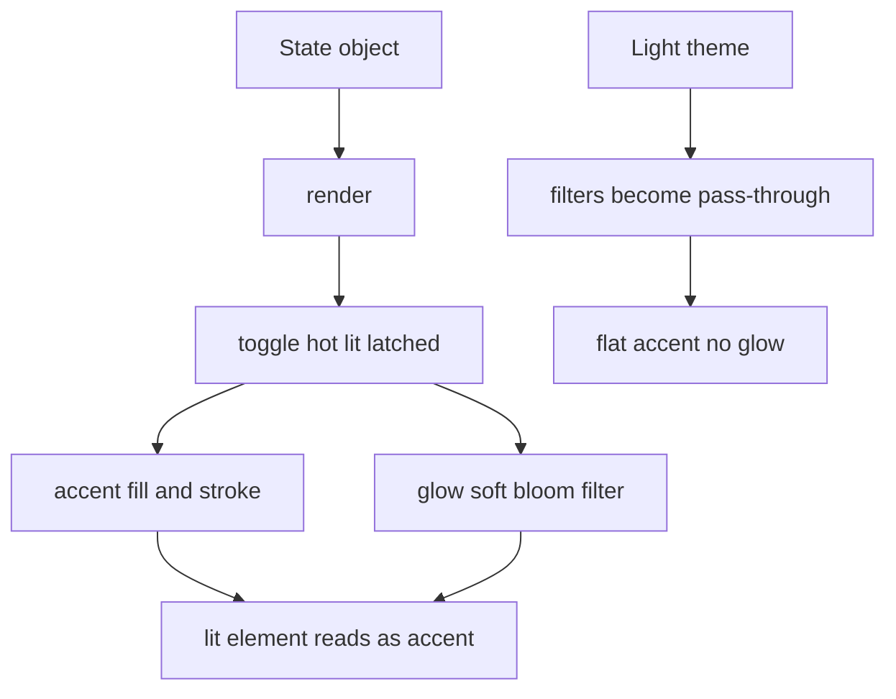
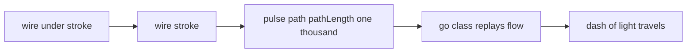

# 02 -- Glow lighting: one accent colour, only on what is live

The glow layer is the heart of ISO-GLOW. The base skill ([01-iso-figure-base.md](./01-iso-figure-base.md)) is monochrome: a near-white `--live` colour marks what is active. ISO-GLOW replaces that with colour and blur. A dark hairline drawing sits on a dark panel, and one accent colour appears only on what is live, then glows. The whole effect comes from two things: a small set of colour tokens that forbid any literal hue in a figure, and three SVG blur filters that wrap those tokens in light.

## The tokens

Colour is only allowed through CSS custom properties (tokens). A figure that uses a literal hue breaks the palette picker and the light theme, so the tokens are the contract. The dark theme defines them first.

```css
  :root {
    color-scheme: dark;
    --bg:#0c0d0e; --panel:#141516; --edge:#222426;
    --line:#3d4144; --detail:#2b2e30; --body:#17181a; --deck:#1b1d1f;
    --ink:#868b8f; --ink-hi:#e6e8e9; --live:#f4f5f5;
    --glass:#0f1011; --glass-on:#1a1410; --recess:#0e0f10;
    --accent:#ff9a2e; --accent-hi:#ffc77a; --accent-dim:rgba(255,154,46,.10);
    --mono:"DM Mono",ui-monospace,"SF Mono",Menlo,Consolas,monospace;
  }
```

From `assets/gallery.html` lines 9-17.

The tokens split into two groups. The first group is the neutral hairline set: `--body`, `--deck`, `--line`, `--detail`, `--recess`, `--ink`, `--ink-hi`, `--glass`, `--glass-on`, and `--panel`. These draw the object. The second group is the accent set: `--accent`, `--accent-hi`, and `--accent-dim`. These mark what is live. The same block also defines `--bg` and `--edge` (the page chrome), `--mono` (the font), and `--live` (the near-white mark the base skill uses).

`--accent` is the main colour, `--accent-hi` is its brighter twin for lit text and cores, and `--accent-dim` is a transparent version used for the warm haze behind a powered figure.

## The three filters

The glow is SVG filters, defined once in a hidden `<svg>` and referenced by URL. Each filter uses `filterUnits="userSpaceOnUse"` with a huge region, because a perfectly horizontal or vertical path has a zero-height bounding box and vanishes under a default filter region.

```svg
  <defs>
    <filter id="glow" filterUnits="userSpaceOnUse" x="-2000" y="-2000" width="6000" height="6000"><feGaussianBlur stdDeviation="4" result="b"/><feMerge><feMergeNode in="b"/><feMergeNode in="b"/><feMergeNode in="SourceGraphic"/></feMerge></filter>
    <filter id="soft" filterUnits="userSpaceOnUse" x="-2000" y="-2000" width="6000" height="6000"><feGaussianBlur stdDeviation="2.2" result="b"/><feMerge><feMergeNode in="b"/><feMergeNode in="SourceGraphic"/></feMerge></filter>
    <filter id="bloom" filterUnits="userSpaceOnUse" x="-2000" y="-2000" width="6000" height="6000"><feGaussianBlur stdDeviation="9"/></filter>
  </defs>
```

From `assets/gallery.html` lines 137-141.

Each filter has a different job:

- `#glow` — strong glow. A Gaussian blur of standard deviation 4, then the blurred result twice plus the original source, merged. Two copies of the blur double the light.
- `#soft` — subtle glow. A blur of standard deviation 2.2 plus the source once.
- `#bloom` — blur only, no source. This makes a soft halo behind a lit glass, beam, or bulb.

A figure references a filter with `filter="url(#soft)"` on the element it wants to light.

## The class vocabulary

The shared CSS maps states to the tokens and filters. A live thing gets a `.hot`, `.lit`, or `.latched` class, and the CSS turns on the accent and the glow.

```css
  .face { fill:var(--body); stroke:var(--line); stroke-width:1; vector-effect:non-scaling-stroke; stroke-linejoin:round; }
  .face.top { fill:var(--deck); }
  .face.recess { fill:var(--recess); }
  .detail { fill:none; stroke:var(--detail); stroke-width:1; vector-effect:non-scaling-stroke; }
  .label { fill:var(--ink); font-family:var(--mono); }
  .glass { fill:var(--glass); transition:fill .3s, stroke .3s; }
  .glass.hot { fill:var(--glass-on); stroke:var(--accent); }
  .halo { fill:var(--accent); opacity:0; transition:opacity .4s; }
  .halo.hot { opacity:.22; }
  .scr { fill:var(--accent-hi); font-family:var(--mono); }
  .scr-accent { fill:var(--accent); }
  .led { fill:var(--detail); transition:fill .2s; }
  .led.hot { fill:var(--accent); }
  .wire { fill:none; stroke:var(--line); stroke-width:1; vector-effect:non-scaling-stroke; stroke-linecap:round; stroke-linejoin:round; transition:stroke .4s; }
  .wire.hot { stroke:var(--accent); }
  .wire-under { fill:none; stroke:var(--panel); stroke-width:3.5; stroke-linecap:round; stroke-linejoin:round; }
```

From `assets/gallery.html` lines 100-115.

The vocabulary, as `SKILL.md` lists it in the glow-kit table:

- `.face`, `.face.top`, `.face.recess`, `.detail`, `.label` — structure, decks, insets, hairlines, printed text.
- `.press` with `.down`, `.lit`, `.latched` — a pressable part that sinks, flashes, or stays on.
- `.glass` with `.hot` — display glass, lit with a warm fill and accent stroke.
- `.halo` with `.hot` and `filter="url(#bloom)"` — soft light spilling behind a lit glass or bulb.
- `.scr`, `.scr-accent` — lit display content.
- `.led` with `.hot` — an indicator on.
- `.wire` with `.hot`, `.wire-under` — a wire carrying signal, with a background stroke under it for crossings.
- `.pulse` with `.go` — a dash of light travelling along a wire.

## The light pulse

A wire carrying signal is the signature move. The wire is drawn three times: a background stroke under it (`.wire-under`), the visible wire (`.wire`), and a pulse path on top. The pulse path declares `pathLength="1000"` and a dash array, then a `.go` class restarts a one-shot animation that slides the dash along the wire.

```css
  .pulse { fill:none; stroke:var(--accent-hi); stroke-width:2.2; stroke-linecap:round; vector-effect:non-scaling-stroke;
           stroke-dasharray:70 1200; stroke-dashoffset:70; opacity:0; }
  .pulse.go { animation:flow .55s linear; }
  @keyframes flow { 0% { stroke-dashoffset:70; opacity:1; } 90% { opacity:1; } 100% { stroke-dashoffset:-1000; opacity:0; } }
```

From `assets/gallery.html` lines 116-119.

The desk computer draws this exact pulse on its coiled cable. It computes the cable as a cubic Bezier, wraps it into a coil with a moving Frenet frame, and emits three paths.

```js
    svg += `<path class="wire-under" d="${d}"/><path class="wire" filter="url(#soft)" d="${d}"/><path class="pulse" filter="url(#glow)" pathLength="1000" d="${d}"/>`;
```

From `assets/examples/desk-computer.js` line 86.

## The light theme has no glow

The light theme keeps the accent fills, strokes, and lit text exactly as in the dark theme, but it removes all ambient, radiating light. A script rewrites the three filters when the theme is light: `#glow` and `#soft` become pass-through merges, and `#bloom` becomes a flood of zero opacity.

```js
(function () {
  var root = document.documentElement, mq = matchMedia('(prefers-color-scheme: light)'), orig = {};
  function apply() {
    var t = root.dataset.theme, light = t === 'light' || (t !== 'dark' && mq.matches);
    ['glow', 'soft', 'bloom'].forEach(function (id) {
      var f = document.getElementById(id); if (!f) return;
      if (!(id in orig)) orig[id] = f.innerHTML;
      f.innerHTML = !light ? orig[id] : id === 'bloom' ? '<feFlood flood-opacity="0"/>' : '<feMerge><feMergeNode in="SourceGraphic"/></feMerge>';
    });
  }
  new MutationObserver(apply).observe(root, { attributes: true, attributeFilter: ['data-theme'] });
  if (mq.addEventListener) mq.addEventListener('change', apply);
  apply();
})();
```

From `assets/gallery.html` lines 365-379.

A matching style rule hides every `.halo` and the desk lamp's light pools in the light theme.

```css
  :root[data-theme="light"] .halo, :root[data-theme="light"] #lamp-pool, :root[data-theme="light"] #lamp-bookpool, :root[data-theme="light"] #lamp-cone { display:none !important; }
```

From `assets/gallery.html` line 356.





## The Aha Moment

**Aha:** glow is not a colour, it is a state, and the state is a class toggle plus a filter URL.

The base skill already had the right architecture: one state object, one `render()`, and CSS class toggles. ISO-GLOW did not need a lighting engine; it needed only to redefine what "live" looks like in CSS. The accent tokens make the state visible, the filters make it glow, and the `.hot` class is the single switch that turns both on. Because colour flows only through tokens, the palette picker in [03-palette-picker.md](./03-palette-picker.md) can re-skin every figure with one CSS variable, and the light theme can drop the glow without touching any figure code.

Continue to [03-palette-picker.md](03-palette-picker.md).
