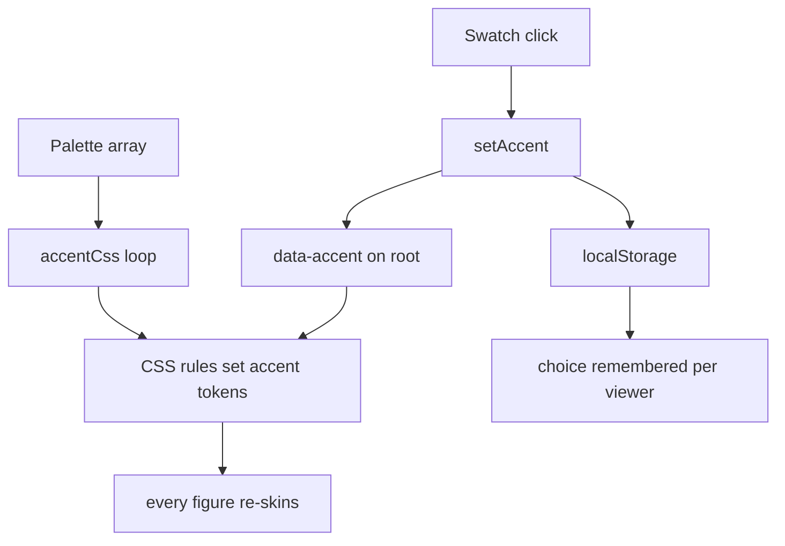
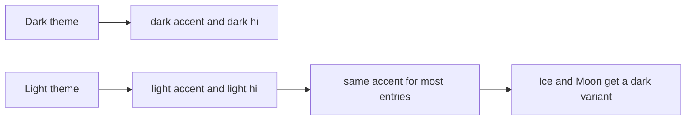

# 03 -- The palette picker: the accent is a CSS variable, so the picker is one selector

The palette picker lets a viewer change the accent colour of every figure on a page, and remembers the choice. It is possible only because the glow layer routes all colour through tokens. The picker does not edit the figures; it writes CSS custom properties on the root element, and every figure follows. The key idea is that a palette is an array of name-and-colour tuples, and the picker is a loop that turns those tuples into CSS rules plus a row of buttons.

## The palette data

Two named palettes ship with the skill: `ember` for desk objects and `city` for buildings. A third form is a custom array, where each entry is `[name, darkAccent, darkHi, lightAccent, lightHi]`.

```js
  const PALETTES = {
    // [name, dark accent, dark hi, light accent, light hi]
    ember: [['Ember','#ff7a1a','#ffb070','#ff7a1a','#ffb070'], ['Cyan','#22d3ee','#9beefa','#22d3ee','#9beefa'], ['Lime','#a3e635','#d6f79f','#a3e635','#d6f79f'],
            ['Violet','#a78bfa','#d6caff','#a78bfa','#d6caff'], ['Rose','#fb7185','#fdb8c2','#fb7185','#fdb8c2'], ['Ice','#dfe9ef','#ffffff','#1f2937','#3b4656']],
    city:  [['Sodium','#ff9a2e','#ffc77a','#ff9a2e','#ffc77a'], ['Tungsten','#ffd166','#ffe7a8','#ffd166','#ffe7a8'], ['Neon','#ff4fa3','#ff9fcb','#ff4fa3','#ff9fcb'],
            ['Signal','#3ee8a0','#a3f5cf','#3ee8a0','#a3f5cf'], ['Dusk','#6f9dff','#b5ccff','#6f9dff','#b5ccff'], ['Moon','#dfe7f5','#ffffff','#273246','#3d4a61']],
  };
  const ACCENTS = Array.isArray(CFG.palette) ? CFG.palette : (PALETTES[CFG.palette] || PALETTES.ember);
```

From `assets/gallery.html` lines 296-303.

The `window.GALLERY` settings object chooses which palette to load. The default is `ember`. A figure author sets `palette: 'city'` for buildings, or passes a custom array. The fallback in the last line means an unknown palette name quietly becomes `ember`.

Each entry carries four colours: the dark accent, its brighter dark twin, the light accent, and its brighter light twin. This is the whole data model. The picker needs nothing else.

## Turning a palette into CSS

The picker builds a style sheet. For every accent it writes three rules: a dark rule, a system-light rule, and an explicit-light rule. Each rule sets the accent tokens with a `vars` helper.

```js
  const vars = (a, hi, dark) => `--accent:${a}; --accent-hi:${hi}; --accent-dim:color-mix(in srgb, ${a} 10%, transparent);` +
    ` --glass-on:color-mix(in srgb, ${a} ${dark ? 9 : 12}%, ${dark ? '#101112' : '#eef0f0'});`;
  const accentCss = ACCENTS.map(([n, da, dh, la, lh]) => { const k = n.toLowerCase();
    return `:root[data-accent="${k}"] { ${vars(da, dh, true)} }
@media (prefers-color-scheme: light) { :root[data-accent="${k}"]:not([data-theme="dark"]) { ${vars(la, lh, false)} } }
:root[data-accent="${k}"][data-theme="light"] { ${vars(la, lh, false)} }`; }).join('\n');
  const accentStyle = document.createElement('style'); accentStyle.textContent = accentCss; document.head.appendChild(accentStyle);
```

From `assets/gallery.html` lines 304-310.

The `vars` helper computes the derived tokens. `--accent-dim` is the accent mixed 10 percent into transparency; this drives the warm haze behind a powered figure. `--glass-on` mixes the accent 9 or 12 percent into a dark or light base; this is the warm fill of lit display glass. Both are computed with the CSS `color-mix` function, so the author never writes a second colour by hand.

## Selecting an accent

The swatch row is built from the palette, one button per entry, each with an inline `--sw` property for its dot. A `setAccent` function writes `data-accent` on the root element, updates the `aria-checked` state, and stores the choice.

```js
  sw.innerHTML = ACCENTS.map(([n, da]) => `<button role="radio" data-accent="${n.toLowerCase()}" aria-label="${n}" title="${n}" style="--sw:${da}"><i></i></button>`).join('');
  function setAccent(k) {
    if (!ACCENTS.some(a => a[0].toLowerCase() === k)) k = ACCENTS[0][0].toLowerCase();
    document.documentElement.dataset.accent = k;
    sw.querySelectorAll('button').forEach(b => b.setAttribute('aria-checked', b.dataset.accent === k ? 'true' : 'false'));
    try { localStorage.setItem((CFG.storageKey || 'iso-glow-accent'), k); } catch (e) {}
  }
  let saved = null; try { saved = localStorage.getItem((CFG.storageKey || 'iso-glow-accent')); } catch (e) {}
  setAccent(saved || ACCENTS[0][0].toLowerCase());
  sw.addEventListener('click', e => { const b = e.target.closest('button[data-accent]'); if (b) { setAccent(b.dataset.accent); const s = $('stage'); if (s) s.focus({ preventScroll: true }); } });
```

From `assets/gallery.html` lines 312-321.

The storage key defaults to `iso-glow-accent`, but `window.GALLERY.storageKey` can override it. This lets the 3D page and the Lumen page use their own keys while still sharing the same picker code. The `try/catch` around local storage is for browsers that block it.

After a click, the script focuses the SVG stage, so the Space and Enter keys go back to the figure instead of re-clicking the button.

## The light theme keeps the same accent

The important rule is in `SKILL.md`: the light theme uses the same accent as the dark theme. Only near-white colours, Ice and Moon, get a dark light-theme variant, because white would vanish on a pale panel.

The four-colour entry makes this work. The dark rule uses the first two colours; the light rule uses the last two. For most accents these are identical. For Ice and Moon the light accent is a dark grey, so the lit parts still read against a light panel.





## Custom palettes

A custom palette is just an array with the same shape. The Lumen fast path uses one to install a single base entry whose colours the Lumen picker later drives.

```js
pal = "palette: [['Lumen','#a3e635','#d6f79f','#a3e635','#d6f79f']], autoDemo: true, storageKey: 'iso-glow-lumen'"
```

From `references/lumen.md` line 18.

Because `ACCENTS` accepts any array, a figure author can pass brand colours directly. The rest of the picker, the swatch row, and the persistence logic all stay the same.

## The Aha Moment

**Aha:** a palette is not a theme engine, it is four CSS variables per name, and the picker is the loop that writes them.

The picker never touches a figure. It writes `--accent`, `--accent-hi`, `--accent-dim`, and `--glass-on` on the root element, and the figures follow because [02-glow.md](./02-glow.md) routed every colour through those tokens. The dark-and-light pair per entry handles the theme, and `color-mix` derives the two soft tokens so the author only ever supplies two hex colours. The storage key is the one seam that lets the 3D and Lumen pages share the picker while keeping their own memory. The gallery shell in [04-gallery-shell.md](./04-gallery-shell.md) is where the picker, the api, and the navigation all come together.

Continue to [04-gallery-shell.md](04-gallery-shell.md).
