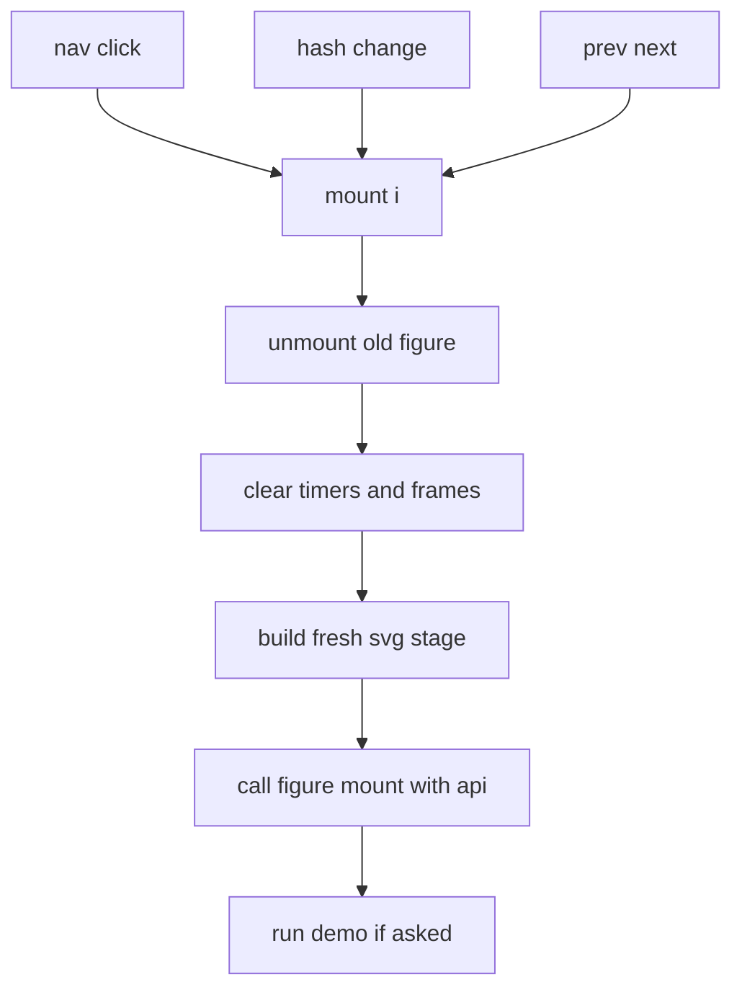
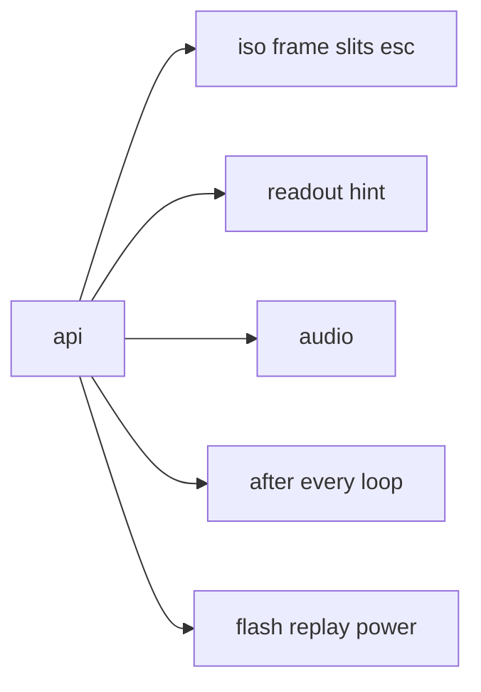

# 04 -- The gallery shell: one api object and one mount function run the whole page

The gallery page is a complete, self-contained shell. It holds the tokens, the filters, the shared CSS, the kernel, the navigation, the palette picker, and an empty slot for figures. The figure author never reads it; the fast path copies it and pastes figures into the slot. The key idea is a shared api object: it is the only thing a figure receives beyond its own SVG stage, and it concentrates every piece of state, timing, sound, and feedback a figure may need.

## The page layout

The page is a two-column grid: a sidebar of figure buttons on the left, and a captioned figure on the right. The figure is an SVG stage inside a rounded panel, with a caption row on top (`Fig N` and the name) and a hint-and-readout row below.

The settings object and the figure slot sit at the top of the script, before the core.

```js
  window.GALLERY = { palette: 'ember', autoDemo: false, storageKey: 'iso-glow-accent' };
  const FIGS = [];
```

From `assets/gallery.html` lines 162-164.

```html
<!-- FIGURES: one <script> per figure, each calling FIGS.push({...}). Order here = Fig 1, 2, 3 ... -->
<script>
/* paste figure scripts here (see examples/) */
</script>
```

From `assets/gallery.html` lines 166-169.

The placeholder is already inside a `<script>` tag, so a figure author pastes plain JavaScript, one `FIGS.push({...})` per figure, never another `<script>` tag.

## The api object

The api is the figure's entire interface to the shell. It bundles the ISO module, the readout and hint writers, the audio factory, three timing helpers, and three feedback helpers.

```js
  const api = {
    iso: ISO,
    readout: s => { readoutEl.textContent = s; },
    hint: s => { hintEl.textContent = s; },
    audio: AUDIO,
    after: (ms, fn) => { const t = setTimeout(fn, ms); timers.push(t); return t; },
    every: (ms, fn) => { const t = setInterval(fn, ms); timers.push(t); return t; },
    loop: fn => { let alive = true; const f = ts => { if (!alive) return; fn(ts); requestAnimationFrame(f); };
      requestAnimationFrame(f); const stop = () => { alive = false; }; frames.push(stop); return stop; },
    flash: (el, ms = 160) => { if (!el) return; el.classList.add('down', 'lit'); clearTimeout(el._f1); clearTimeout(el._f2);
      el._f1 = setTimeout(() => el.classList.remove('down'), 110); el._f2 = setTimeout(() => el.classList.remove('lit'), ms); },
    replay: (el, cls = 'go') => { if (!el) return; el.classList.remove(cls); void el.getBoundingClientRect(); el.classList.add(cls); },
    power: on => { holder.classList.toggle('glow', !!on); },
  };
```

From `assets/gallery.html` lines 254-269.

Each helper has one job:

- `iso.frame(points)` — the kernel plus a 4:3 viewBox, from [01-iso-figure-base.md](./01-iso-figure-base.md).
- `iso.slits(...)` — repeated parallel hairlines.
- `iso.esc` — escape `&`, `<`, and `>` before writing text into SVG.
- `readout(str)` — write the bottom-right readout.
- `audio()` — lazily create an AudioContext inside a user gesture.
- `after(ms, fn)` and `every(ms, fn)` — timers that are auto-cleared on unmount.
- `loop(fn)` — call `fn(timestampMs)` every animation frame; returns a stop function.
- `flash(el)` — press plus glow, then fade.
- `replay(el, 'go')` — restart a one-shot animation such as the pulse.
- `power(bool)` — toggle the warm haze behind a powered figure.

The timing helpers push their handles onto shared `timers` and `frames` arrays so `mount` can clear them all when a figure unmounts.

## The mount lifecycle

`mount(i)` is the page's single source of change. It unmounts the old figure, clears all timers and frames, builds a fresh SVG stage, and hands it to the figure's `mount`.

```js
  function mount(i) {
    if (handle && handle.unmount) handle.unmount();
    timers.forEach(t => { clearTimeout(t); clearInterval(t); }); timers = [];
    frames.forEach(stop => stop()); frames = [];
    idx = (i + FIGS.length) % FIGS.length; active = FIGS[idx];
    holder.classList.remove('glow');
    const svg = document.createElementNS('http://www.w3.org/2000/svg', 'svg');
    svg.setAttribute('id', 'stage'); svg.setAttribute('role', 'img'); svg.setAttribute('tabindex', '0');
    svg.setAttribute('aria-label', active.aria || active.name);
    svg.dataset.fig = active.id;
    holder.replaceChildren(svg);
    numEl.textContent = `Fig ${idx + 1}`; nameEl.textContent = active.name;
    hintEl.textContent = active.hint || ''; readoutEl.textContent = '';
    document.title = `Fig ${idx + 1} · ${active.name}`;
    [...nav.querySelectorAll('button[data-i]')].forEach(b => b.setAttribute('aria-current', +b.dataset.i === idx ? 'true' : 'false'));
    const cur = nav.querySelector(`button[data-i="${idx}"]`);
    if (cur && nav.scrollWidth > nav.clientWidth) nav.scrollTo({ left: cur.offsetLeft - nav.clientWidth / 2 + cur.offsetWidth / 2, behavior: 'smooth' });
    if (location.hash.slice(1) !== active.id) history.replaceState(null, '', '#' + active.id);
    handle = active.mount(svg, api) || {};
    const runDemo = /demo/.test(location.search) || (CFG.autoDemo && !/still/.test(location.search));
    if (runDemo && handle.demo) setTimeout(() => handle.demo(), 120);
  }
```

From `assets/gallery.html` lines 271-293.

The lifecycle guarantees a figure never leaks. Every timer and frame is cleared before a new figure mounts, and the figure's own `unmount` runs first. The `svg.dataset.fig = active.id` line is what scopes a figure's CSS: every figure rule begins with `[data-fig="id"]`.

The URL hash holds the active figure id, so a viewer can link to a specific figure. The demo runs with `?demo` in the query, or on every arrival when `GALLERY.autoDemo` is true, unless `?still` disables it.

## Navigation and keyboard

Navigation is a list of buttons plus prev and next arrows. The keyboard is wired once at the window level and delegates to the active figure's `key` handler.

```js
  nav.innerHTML = FIGS.map((f, i) =>
    `<button data-i="${i}"><span class="n">${String(i + 1).padStart(2, '0')}</span><span class="t">${f.name}</span></button>`).join('');
  const focusStage = () => { const s = $('stage'); if (s) s.focus({ preventScroll: true }); };
  nav.addEventListener('click', e => { const b = e.target.closest('button[data-i]'); if (b) { mount(+b.dataset.i); focusStage(); } });
  $('prev').addEventListener('click', () => { mount(idx - 1); focusStage(); });
  $('next').addEventListener('click', () => { mount(idx + 1); focusStage(); });
  window.addEventListener('hashchange', () => { const i = FIGS.findIndex(f => f.id === location.hash.slice(1)); if (i >= 0 && i !== idx) mount(i); });
```

From `assets/gallery.html` lines 327-334.

The `focusStage` call after every nav click is a lesson learned the hard way: without it, Space and Enter re-click the button instead of driving the figure.

```js
  window.addEventListener('keydown', e => {
    if (e.metaKey || e.ctrlKey || e.altKey) return;
    if (e.target.closest && e.target.closest('button') && (e.key === 'Enter' || e.key === ' ')) return;
    if (handle && handle.key && handle.key(e)) { e.preventDefault(); return; }
    if (e.key === 'PageDown') mount(idx + 1);
    if (e.key === 'PageUp') mount(idx - 1);
  });
  window.addEventListener('keyup', e => { if (handle && handle.keyup) handle.keyup(e); });
  window.addEventListener('blur', () => { if (handle && handle.blur) handle.blur(); });
```

From `assets/gallery.html` lines 336-344.

## Audio

Sound is created lazily, inside the first user gesture, because browsers block an AudioContext before a gesture. The `AUDIO` factory builds one context, one master gain, and one analyser, then returns the same trio on later calls.

```js
const AUDIO = (() => {
  let ctx = null, out = null, analyser = null;
  return () => {
    if (!ctx) {
      ctx = new (window.AudioContext || window.webkitAudioContext)();
      out = ctx.createGain(); out.gain.value = 0.5;
      analyser = ctx.createAnalyser(); analyser.fftSize = 1024;
      out.connect(analyser); analyser.connect(ctx.destination);
    }
    if (ctx.state === 'suspended') ctx.resume();
    return { ctx, out, analyser };
  };
})();
```

From `assets/gallery.html` lines 232-244.





## The Aha Moment

**Aha:** the shell is a lifetime manager, not a framework, and the api is the whole framework surface.

A figure is a plain object with a `mount` function and a small set of handlers. The shell's entire job is to give that object a clean, isolated life: a fresh SVG stage per mount, all timers and frames cleared on unmount, one api to reach state and sound, and one `render()` convention the figure owns. There is no component system and no virtual DOM. The discipline — one state object, one render, keyboard and pointer calling the same functions — is what keeps twenty figures consistent, and the api is the single seam that all of them plug into. The 3D page in [05-3d-mode.md](./05-3d-mode.md) repeats this same pattern with three.js and a per-figure module contract.

Continue to [05-3d-mode.md](05-3d-mode.md).
