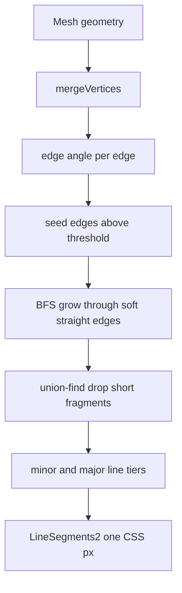
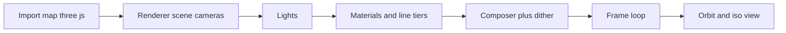

# 05 -- 3D mode: the same hairline look rebuilt on three.js

The 3D mode takes the exact look of the SVG figures and rebuilds it with three.js. The page is a full shell: a renderer, cameras, lights, a post-processing chain, three line tiers, crease extraction, light points, and a registry for figures. The author never writes a renderer, lines, lights, or UI; they write a figure module and paste it into a `FIGS3D` slot. The key idea is that the hairline is not a texture or a shader trick on the mesh; it is a separate set of line segments computed from the mesh edges, drawn on top at exactly one CSS pixel wide.

## The import map and scene

The page loads three.js from a content delivery network through an import map. This is the one allowed exception to the "no external scripts" rule, because the page must still run from disk.

```html
<script type="importmap">
{ "imports": {
  "three": "https://cdn.jsdelivr.net/npm/three@0.160.0/build/three.module.js",
  "three/addons/": "https://cdn.jsdelivr.net/npm/three@0.160.0/examples/jsm/"
} }
</script>
```

From `assets/gallery-3d.html` lines 62-67.

The renderer is a standard WebGL renderer with a pixel ratio capped at two. A perspective camera is the default; an orthographic camera provides the true isometric view. Lights are a hemisphere light, an ambient light, and two directional lights, all at low intensity so the object reads as a dark solid.

```js
const renderer = new THREE.WebGLRenderer({ antialias: true });
renderer.setPixelRatio(Math.min(devicePixelRatio, 2));
renderer.setSize(innerWidth, innerHeight);
document.body.prepend(renderer.domElement);
const scene = new THREE.Scene();
scene.background = new THREE.Color(0x121314);
const persp = new THREE.PerspectiveCamera(28, innerWidth / innerHeight, 0.1, 400);
const ortho = new THREE.OrthographicCamera(-1, 1, 1, -1, 0.1, 400);
```

From `assets/gallery-3d.html` lines 142-150.

## The post-processing chain

A `EffectComposer` runs three passes: a render pass, an output pass, and a custom dither pass. The dither adds a tiny hash noise so glows and light pools stay smooth instead of banding.

```js
const NOISE = `float hash(vec2 p) { return fract(sin(dot(p, vec2(12.9898, 78.233))) * 43758.5453); }`;
const composer = new EffectComposer(renderer, new THREE.WebGLRenderTarget(innerWidth, innerHeight, { samples: 4, type: THREE.HalfFloatType }));
const renderPass = new RenderPass(scene, camera); composer.addPass(renderPass);
composer.addPass(new OutputPass());
composer.addPass(new ShaderPass({
  uniforms: { tDiffuse: { value: null } },
  vertexShader: `varying vec2 vUv; void main() { vUv = uv; gl_Position = projectionMatrix * modelViewMatrix * vec4(position, 1.0); }`,
  fragmentShader: `uniform sampler2D tDiffuse; varying vec2 vUv; ${NOISE}
    void main() { vec4 c = texture2D(tDiffuse, vUv); c.rgb += (hash(gl_FragCoord.xy) - 0.5) / 255.0; gl_FragColor = c; }`,
}));
```

From `assets/gallery-3d.html` lines 165-174.

The render target is HalfFloat and the composer is sized to device resolution, so the output stays sharp on high-density displays.

## The three line tiers

The hairline look comes from three line tiers, matching the SVG figures: silhouette, major folds, and minor detail. Lines stay one CSS pixel at every zoom.

```js
const LINE_COL = new THREE.Color(0x4f5357), MAJOR_COL = new THREE.Color(0x393c3f), EDGE_COL = new THREE.Color(0x27292c), BG_COL = new THREE.Color(0x121314);
const MAJOR_ANGLE = 60;
const lineOpts = { linewidth: 1, resolution: devRes(), polygonOffset: true, polygonOffsetFactor: -2, polygonOffsetUnits: -6 };
const lineMat = new LineMaterial({ color: EDGE_COL, ...lineOpts });
const majorMat = new LineMaterial({ color: MAJOR_COL, ...lineOpts });
```

From `assets/gallery-3d.html` lines 188-193.

The silhouette is a separate back-facing shader material that pushes a shell slightly behind the hull, so the surface never hides parts of its own outline.

```js
const outlineMat = new THREE.ShaderMaterial({
  uniforms: { color: { value: LINE_COL.clone() }, thickness: { value: 1 }, res: { value: devRes() } },
  vertexShader: `uniform float thickness; uniform vec2 res;
    void main() {
      vec4 p = projectionMatrix * modelViewMatrix * vec4(position, 1.0);
      vec4 n = projectionMatrix * vec4(normalize(normalMatrix * normal), 0.0);
      vec2 d = length(n.xy) > 1e-5 ? normalize(n.xy) : vec2(0.0);
      p.xy += d * thickness * 2.0 / res * p.w;
      gl_Position = p;
    }`,
  fragmentShader: `uniform vec3 color; void main() { gl_FragColor = vec4(color, 1.0); }`,
  side: THREE.BackSide,
  polygonOffset: true, polygonOffsetFactor: 6, polygonOffsetUnits: 24,
});
```

From `assets/gallery-3d.html` lines 194-208.

A `fat` helper wraps line segment arrays into `LineSegments2` objects, which three.js draws through `LineMaterial` with a real world-space width. The `linewidth` is kept at one pixel.

```js
const fat = (arr, mat = lineMat) => { const l = new LineSegments2(new LineSegmentsGeometry().setPositions(arr), mat); fatLines.push(l); return l; };
```

From `assets/gallery-3d.html` line 280.

## Crease extraction

The hardest problem is drawing crease lines that stay continuous. Testing each edge on its own with `EdgesGeometry` chops gently curving panel lines into dashes. The shell solves it with a two-stage algorithm: compute the angle between adjacent faces for every edge, then grow lines through softer, straight-on neighbours.

First, `creaseInfo` merges duplicate vertices and records, for every edge, which faces share it and the angle between their normals.

```js
function creaseInfo(geo) {
  if (geo.userData.crease) return geo.userData.crease;
  const src = new THREE.BufferGeometry().setAttribute('position', geo.attributes.position);
  if (geo.index) src.setIndex(geo.index);
  const g = mergeVertices(src, 1e-4);
  const p = g.attributes.position, ix = g.index.array, nV = p.count;
  const P = i => new THREE.Vector3().fromBufferAttribute(p, i);
  const faceN = [], edgeFaces = new Map();
  for (let f = 0; f < ix.length / 3; f++) {
    const a = ix[3 * f], b = ix[3 * f + 1], c = ix[3 * f + 2];
    const n = new THREE.Vector3().crossVectors(P(b).sub(P(a)), P(c).sub(P(a)));
    faceN.push(n.lengthSq() > 1e-14 ? n.normalize() : null);
    for (const [u, v] of [[a, b], [b, c], [c, a]]) {
      if (u === v) continue;
      const k = Math.min(u, v) * nV + Math.max(u, v);
      (edgeFaces.get(k) || edgeFaces.set(k, []).get(k)).push(f);
    }
  }
  const edges = [];
  for (const [k, fs] of edgeFaces) {
    const a = Math.floor(k / nV), b = k % nV;
    const ns = fs.map(f => faceN[f]).filter(Boolean);
    let ang = 180;
    if (ns.length >= 2) { ang = 0; for (let i = 1; i < ns.length; i++) ang = Math.max(ang, THREE.MathUtils.radToDeg(ns[0].angleTo(ns[i]))); }
    else if (ns.length === 0) continue;
    const dir = P(b).sub(P(a)), len = dir.length();
    if (len > 0) edges.push({ a, b, ang, dir: dir.divideScalar(len), len });
  }
  const byVert = new Map();
  edges.forEach((e, i) => { for (const v of [e.a, e.b]) (byVert.get(v) || byVert.set(v, []).get(v)).push(i); });
  return (geo.userData.crease = { p, edges, byVert });
}
```

From `assets/gallery-3d.html` lines 319-350.

Second, `creaseLines` seeds every edge sharper than the threshold, then grows the line through neighbouring edges down to 55 percent of the threshold, as long as each continues within about 25 degrees of the same direction. A breadth-first queue walks the edges. Finally, a union-find pass drops fragments shorter than six centimetres.

```js
const GROW = 0.55, STRAIGHT = 0.9;
function creaseLines(geo, thr) {
  const { p, edges, byVert } = creaseInfo(geo), low = thr * GROW;
  const on = new Uint8Array(edges.length), queue = [];
  edges.forEach((e, i) => { if (e.ang >= thr) { on[i] = 1; queue.push(i); } });
  while (queue.length) {
    const i = queue.pop(), e = edges[i];
    for (const [v, out] of [[e.a, -1], [e.b, 1]]) {
      for (const j of byVert.get(v)) {
        if (on[j]) continue; const f = edges[j]; if (f.ang < low) continue;
        const d = f.dir.dot(e.dir) * (f.a === v ? 1 : -1) * out;
        if (d > STRAIGHT) { on[j] = 1; queue.push(j); }
      }
    }
  }
  const parent = new Map(), find = x => { while (parent.get(x) !== x) { parent.set(x, parent.get(parent.get(x))); x = parent.get(x); } return x; };
  edges.forEach((e, i) => { if (!on[i]) return; for (const v of [e.a, e.b]) if (!parent.has(v)) parent.set(v, v); parent.set(find(e.a), find(e.b)); });
  const total = new Map(); edges.forEach((e, i) => { if (on[i]) { const r = find(e.a); total.set(r, (total.get(r) || 0) + e.len); } });
  const out = [];
  edges.forEach((e, i) => { if (on[i] && total.get(find(e.a)) >= 0.06) out.push(p.getX(e.a), p.getY(e.a), p.getZ(e.a), p.getX(e.b), p.getY(e.b), p.getZ(e.b)); });
  return out;
}
```

From `assets/gallery-3d.html` lines 351-373.

The two tiers come from calling `creaseLines` twice with different thresholds, then letting the major tier draw after so a fold present in both shows in the brighter colour.

## The coordinate bridge

Figures are written in the SVG units, not three.js metres. A single helper converts them: `W(x, y, z)` maps the iso coordinates to a three.js vector, with `TS = 0.01` so 100 units equal one metre.

```js
const TS = 0.01;
const W = (x, y, z) => new THREE.Vector3(x * TS, z * TS, y * TS);
```

From `assets/gallery-3d.html` lines 454-455.

The `rbox` helper is the 3D twin of the SVG `box`. It builds a rounded-plan shape and extrudes it, then adds the outline and registers the mesh for crease lines.

```js
function rbox(x, y, z, w, d, h, r = 0, mat = bodyMat, parent = tw, { lines = true } = {}) {
  r = Math.max(0.01, Math.min(r, w / 2 - 0.01, d / 2 - 0.01));
  const sh = new THREE.Shape(); roundRect(sh, x, -(y + d), w, d, r);
  const g = new THREE.ExtrudeGeometry(sh, { depth: h, bevelEnabled: false, curveSegments: 10 });
  g.rotateX(-Math.PI / 2); g.translate(0, z, 0); g.scale(TS, TS, TS);
  const m = new THREE.Mesh(g, mat);
  if (lines) { addOutline(m); twMeshes.push(m); }
  parent.add(m); return m;
}
```

From `assets/gallery-3d.html` lines 470-478.

## The iso view and revolve

The page offers a true isometric view: an orthographic camera where parallel edges stay parallel, like the SVG figures. A `setOrtho` function switches the camera and keeps the framing identical to the perspective view. A Revolve toggle slowly orbits the camera.

```js
function setOrtho(on, frameDist) {
  if (on === (camera === ortho)) return;
  if (on) {
    orthoH = (frameDist || camera.position.distanceTo(controls.target)) * fovK();
    ortho.position.copy(camera.position); ortho.quaternion.copy(camera.quaternion); ortho.zoom = 1; orthoFrustum();
    camera = ortho;
  } else {
    const d = orthoH / fovK() / ortho.zoom;
    persp.position.copy(controls.target).add(ortho.position.clone().sub(controls.target).setLength(d));
    persp.quaternion.copy(ortho.quaternion); camera = persp;
  }
  controls.object = camera; renderPass.camera = camera; controls.update(); appliedKey = '';
  glowMats.forEach(m => m.uniforms.ortho.value = on ? 1 : 0);
}
```

From `assets/gallery-3d.html` lines 2775-2790.

## The module contract

A 3D figure module returns an object with the same shape as the 2D figure's `mount` return, plus a view, an info string, and a panel. The coordinates stay in SVG units.

```js
return { group: g0, readout, demo: push, stop: () => {},
  key: e => e.key === ' ' && !e.repeat ? push() : false,
  click: hit => { let o = hit?.object; while (o && !o.userData.hit) o = o.parent; if (o) push(); },
  tick: now => tickFlashes(now),
  panel: [['Push', 'space', push]],
  view: { target: W(120, 100, 40), dist: 6.4 },
  info: '<h2>Clicker</h2><p>Press the button (or space): it sinks, flashes and counts on the front screen; the LED toggles on every odd count.</p>',
  hint: 'click the button · space' };
```

From `SKILL.md` lines 200-207.





## The Aha Moment

**Aha:** the 3D hairline is not shading on the mesh, it is a second geometry made of edges, and continuity is a graph-growing problem.

A naive edge renderer marks every sharp edge and produces a dashed, flickering line on any gently curving panel. The shell instead treats the mesh as a graph of edges, each labelled with the angle between its faces, and grows a crease through the graph the way a search follows a path: start at sharp edges, continue through softer edges that keep going straight, then drop tiny islands. The result is a continuous line, drawn with `LineSegments2` so it stays one CSS pixel at any zoom, exactly matching the SVG hairline in [02-glow.md](./02-glow.md). The figures that plug into this shell are the subject of [06-3d-figures.md](./06-3d-figures.md).

Continue to [06-3d-figures.md](06-3d-figures.md).
