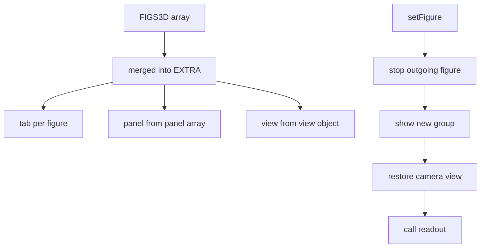
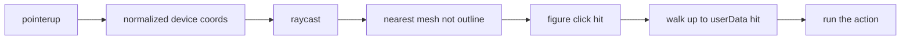

# 06 -- 3D figures: a registry turns modules into tabs, panels, and raycast clicks

The 3D page ships twelve working figures as references, but a figure author pastes their own modules into a `FIGS3D` array, and the shell builds tabs, button panels, camera views, and input wiring from the module contract. The key idea is that the figure module is a complete, self-contained description: it declares its group, its interaction handlers, its readout, its panel buttons, and its camera view, and the shell does everything else from those declarations.

## The registry and its slot

The built-in figures live in their own scopes, but the shell keeps a registry object, `EXTRA`, that maps ids to modules. A figure author fills the empty `FIGS3D` array, and the shell merges it into `EXTRA`.

```js
const FIGS3D = [];
/* paste 3D figure modules here */
```

From `assets/gallery-3d.html` lines 2638-2639.

```js
const EXTRA = { pc: PC, lp: LP, lg: LG, rk: RK, sk: SK, tt: TT, pl: PL }, EXTRA_NAMES = { pc: 'Computer', lp: 'Lamp', lg: 'Logic', rk: 'Rack', sk: 'Stack', tt: 'Turntable', pl: 'Camera' };
FIGS3D.forEach(f => { EXTRA[f.id] = f.mod; EXTRA_NAMES[f.id] = f.name; });
const SHOW_FIGS = FIGS3D.length ? FIGS3D.map(f => f.id) : ['tw', 'dr', 'cs', 'tm', 'vm', 'pc', 'lp', 'lg', 'rk', 'sk', 'tt', 'pl'];
```

From `assets/gallery-3d.html` lines 2845-2847.

The `SHOW_FIGS` rule is the key behaviour: when `FIGS3D` has entries, only those entries get tabs; the built-in figures stay as working references. With one figure, the tab bar is hidden entirely.

## Building tabs, panels, and views from the module

For every registered figure, the shell constructs a button panel from the module's `panel` array, a tab, and a camera view from the module's `view` object.

```js
for (const [id, F] of Object.entries(EXTRA)) {
  VIEWS[id] = { target: F.view.target, dir: new THREE.Vector3(1, 1, 1).normalize(), dist: () => F.view.dist * Math.max(1, 1.45 / persp.aspect), min: 1, cam: null, info: F.info, hint: F.hint };
  const panel = document.createElement('div'); panel.className = 'ui ctl hide'; panel.id = 'ctl-' + id;
  panel.style.cssText = 'top:64px; right:16px; display:flex; flex-direction:column; gap:6px; width:182px;';
  [...F.panel, null, ['Iso view', '', () => act.iso(), 'iso']].forEach(b => {
    if (!b) { const sp = document.createElement('div'); sp.className = 'sep'; panel.appendChild(sp); return; }
    const el = document.createElement('button'); el.innerHTML = `${b[0]}<kbd>${b[1]}</kbd>`; if (b[3]) el.dataset.x = b[3];
    el.addEventListener('click', () => { b[2](); el.blur(); }); panel.appendChild(el);
  });
  document.body.insertBefore(panel, document.getElementById('info'));
  const tab = document.createElement('button'); tab.dataset.fig = id; tab.setAttribute('role', 'tab'); tab.textContent = EXTRA_NAMES[id];
  tab.addEventListener('click', () => setFigure(id)); document.querySelector('.seg').appendChild(tab);
}
```

From `assets/gallery-3d.html` lines 2848-2860.

A `panel` entry is a triple `[label, key, fn]`. The shell appends an "Iso view" button after every panel, so every figure can snap to the true isometric view. The `null` entry inserts a separator.

## The setFigure lifecycle

`setFigure` is the 3D twin of the 2D `mount`. It stops the outgoing figure, shows only the new figure's group, wires the camera, and calls the new figure's `readout`.

```js
function setFigure(f) {
  if (VIEWS[active]) VIEWS[active].cam = { pos: camera.position.clone(), target: controls.target.clone(), zoom: camera === ortho ? ortho.zoom : undefined };
  if (active === 'dr' && f !== 'dr') DR.stop();
  if (active === 'cs' && f !== 'cs') CS.stop();
  if (active === 'tm' && f !== 'tm') TM.stop();
  if (EXTRA[active] && f !== active) EXTRA[active].stop();
  active = f; const v = view();
  heli.visible = pad.visible = f === 'heli'; tw.visible = f === 'tw'; DR.group.visible = f === 'dr'; CS.group.visible = f === 'cs'; TM.group.visible = f === 'tm'; VM.group.visible = f === 'vm';
  Object.entries(EXTRA).forEach(([id, F]) => { F.group.visible = f === id; document.getElementById('ctl-' + id).classList.toggle('hide', f !== id); });
```

From `assets/gallery-3d.html` lines 2814-2822.

Each figure's `stop()` runs when it is left, mirroring the 2D `unmount`. The camera view is saved per figure so returning restores the exact angle.

## Raycast clicks

Clicks are raycasts. The shell projects the pointer into the scene, finds the nearest mesh under the cursor, ignores line segments and outline shells, and hands the hit to the active figure's `click`.

```js
renderer.domElement.addEventListener('pointerup', e => {
  if (!down || Math.hypot(e.clientX - down[0], e.clientY - down[1]) > 5) return;
  ndc.set(e.clientX / innerWidth * 2 - 1, -(e.clientY / innerHeight) * 2 + 1); ray.setFromCamera(ndc, camera);
  if (EXTRA[active]) { const F = EXTRA[active]; F.click(ray.intersectObject(F.group, true).find(h => h.object.isMesh && !h.object.isLineSegments2 && !h.object.userData.outline), e); return; }
```

From `assets/gallery-3d.html` lines 2759-2763.

The module's `click` handler walks up the parent chain to find the `userData.hit` marker on the pressable group.

## Flash and tick

The flash helper mirrors `api.flash`: it sinks a group three units and lights its accent materials, then fades back. The `tickFlashes` function animates every active flash per frame.

```js
function flash(g, ms = 110) {
  const mats = []; g.traverse(o => { if (o.isMesh && o.material.emissive && twCaps.includes(o.material)) mats.push(o.material); });
  twFlashes.push({ g, mats, t0: performance.now(), ms });
}
```

From `assets/gallery-3d.html` lines 629-632.

```js
function tickFlashes(now) {
  for (let i = twFlashes.length - 1; i >= 0; i--) {
    const f = twFlashes[i], t = now - f.t0, down = t < f.ms, k = Math.max(0, 1 - t / (f.ms + 260));
    const ax = f.g.userData.pressAxis || 'y';
    f.g.position[ax] = down ? -(f.g.userData.pressDepth || 3) * TS : 0;
    f.mats.forEach(m => m.emissiveIntensity = Math.max(m.userData.base || 0, 1.4 * k));
    if (t > f.ms + 260) { f.g.position[f.g.userData.pressAxis || 'y'] = 0; f.mats.forEach(m => m.emissiveIntensity = m.userData.base || 0); twFlashes.splice(i, 1); }
  }
}
```

From `assets/gallery-3d.html` lines 698-706.

A pressable part is any group whose meshes share a `capMat` material in the `twCaps` list. `pressAxis` is `'y'` for top buttons that sink and `'z'` for front buttons that push in. A latched part keeps its glow by setting `mat.userData.base = 0.55`, so it fades back to a resting glow instead of zero.

## Canvas screens

Screens are canvases, not meshes with textures baked once. A `faceCanvas` helper draws a plane with a canvas texture, and the figure redraws the canvas whenever state or theme changes.

```js
function faceCanvas(kind, x, y, z, w, h, P, parent, transparent = false) {
  const c = document.createElement('canvas'); c.width = Math.round(w * P); c.height = Math.round(h * P);
  const tex = new THREE.CanvasTexture(c); tex.colorSpace = THREE.SRGBColorSpace; tex.anisotropy = 8;
  const m = new THREE.Mesh(new THREE.PlaneGeometry(w * TS, h * TS), new THREE.MeshBasicMaterial({ map: tex, toneMapped: false, transparent, depthWrite: !transparent, polygonOffset: true, polygonOffsetFactor: -4, polygonOffsetUnits: -12 }));
  if (kind === 'top') { m.rotation.x = -Math.PI / 2; m.position.copy(W(x + w / 2, y + h / 2, z + 0.15)); }
  else { m.position.copy(W(x + w / 2, y + 0.3, z - h / 2)); }
  parent.add(m); return { c, x: c.getContext('2d'), tex, P, mesh: m };
}
```

From `assets/gallery-3d.html` lines 1208-1215.

## Accent and theme hooks

The accent picker and the theme switch both need to re-skin every figure. Two mechanisms handle this. `accentFill` patches every material that can light up, and `themeHooks` holds per-figure callbacks that redraw canvases and pools.

```js
function accentFill(root) {
  root.traverse(o => { const m = o.material; if (!m || !m.isMeshStandardMaterial || accentFilled.has(m) || m.emissive.getHex() === 0) return; accentFilled.add(m);
    m.onBeforeCompile = sh => { sh.uniforms.uAccentFill = accentFillU; sh.uniforms.uAccentC = { value: accent };
      sh.fragmentShader = 'uniform float uAccentFill; uniform vec3 uAccentC;\n' + sh.fragmentShader.replace('#include <opaque_fragment>',
        'if ( uAccentFill > 0.5 ) { float am = max( uAccentC.r, max( uAccentC.g, uAccentC.b ) ); outgoingLight = mix( outgoingLight, uAccentC, clamp( max( emissive.r, max( emissive.g, emissive.b ) ) / ( 0.5 * am ), 0.0, 1.0 ) ); }\n#include <opaque_fragment>'); };
    m.needsUpdate = true; });
}
```

From `assets/gallery-3d.html` lines 2716-2722.

In the light theme, the accent becomes a flat fill instead of a glow: the same accent, no ambient light, exactly like the 2D rule.





## The Aha Moment

**Aha:** the figure module is a declaration, and the shell is the interpreter of that declaration.

A 3D figure never touches the renderer, the camera, the tab bar, or the raycast plumbing. It declares a group, a `panel` list, a `view`, a `click`, a `key`, a `tick`, and a `readout`, and the shell turns those into UI and wires them into one frame loop. This is the same division of labour as the 2D figure contract in [04-gallery-shell.md](./04-gallery-shell.md), lifted into three.js: the author supplies behaviour, the shell supplies life. The flash system, the canvas screens, and the accent hooks are all services the shell provides so every figure stays consistent. The remaining two looks, Lumen and anatomy, reuse this exact contract in [07-lumen.md](./07-lumen.md) and [08-anatomy-builds.md](./08-anatomy-builds.md).

Continue to [07-lumen.md](07-lumen.md).
