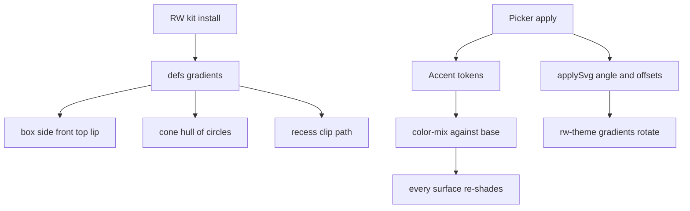
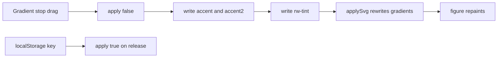

# 07 -- Lumen: the lit style is a shading kit, so the glow is geometry, not a filter

Lumen is the second look. ISO-GLOW draws a dark hairline with one accent colour that glows only on what is live. Lumen replaces that with solid, filled surfaces: olive-to-lime gradients for faces, a soft rim light on near edges, translucent glass, a contact shadow, and a lime pool of light under the object. The key idea is that the glow is no longer an SVG filter; it is drawn as geometry, with gradients built from the accent tokens by a shading kit.

## The shading kit

A `RW` module holds the whole look. It is an immediately invoked function expression (IIFE) that returns seven things: three colour mixers, a `defs` string of gradients, a `css` string of classes, a `kit` factory, and an `auto` helper that returns `mark()` for idle auto-play. The fast path installs the kit once, then every figure calls `RW.kit(K)`, where `K` comes from `api.iso.frame(...)`.

```js
const RW = (() => {
  const BASE = 'var(--rw-base, var(--bg))';
  const mix = (p, b = BASE) => `color-mix(in srgb, var(--accent) ${p}%, ${b})`;
  const B = 'var(--accent2, var(--accent))', mix2 = (p, b = BASE) => `color-mix(in srgb, ${B} ${p}%, ${b})`;
  const mixT = (p, b = BASE) => `color-mix(in srgb, var(--rw-tint, var(--accent)) ${p}%, ${b})`;
```

From `assets/lumen/kit.js` lines 6-12.

The three mixers are the whole colour model. `mix` shades with the start colour, `mix2` with the end colour of the gradient, and `mixT` with a body tint. Every gradient stop, fill, and stroke in the kit is a `color-mix` of one of these against `--rw-base`, the page background. This is why the picker only has to change three tokens and every surface re-shades.

## The gradients

The `defs` string defines the face gradients once. There are three face gradients, a glass gradient, a light pool, a contact shadow, and the shared theme gradient that the picker later drives.

```js
const defs = `<defs>
  ${lg('top', 1, 1, st(0, mixT(42)) + st(1, mix2(18)))}
  ${lg('corner', 0, 1, st(0, 'var(--accent-hi)', .9) + st(.45, 'var(--accent)', .3) + st(1, B, 0))}
  ${lg('front', 0, 1, st(0, mixT(20)) + st(1, mixT(8)))}
  ${lg('side', 0, 1, st(0, mixT(10)) + st(1, mixT(2)))}
```

From `assets/lumen/kit.js` lines 16-20.

The names match the faces of an isometric box: `rw-top` is the lightest, `rw-front` mid, `rw-side` dark. The `rw-corner` gradient is a thin strip that fades from the accent-high at the top to transparent, drawn on the near vertical corner. This is the rim light that makes the object read as solid, not flat.

The shared theme gradient uses a two-colour ramp from `--accent` to `--accent2`. It is a `linearGradient` with ids `rw-theme` and `rw-themehi`.

```js
<linearGradient id="rw-theme" x1="0" y1=".5" x2="1" y2=".5"><stop offset="0" style="stop-color:var(--accent)"/><stop offset="1" style="stop-color:${B}"/></linearGradient>
<linearGradient id="rw-themehi" x1="0" y1=".5" x2="1" y2=".5"><stop offset="0" style="stop-color:var(--accent-hi)"/><stop offset="1" style="stop-color:color-mix(in srgb, ${B} 60%, #ffffff)"/></linearGradient>
```

From `assets/lumen/kit.js` lines 34-35.

## The box

`kit.box` is the shaded rounded box. It draws a side face, a front face, an optional corner strip, a top face, and a lip line. Every face is a path computed in iso coordinates with the same kernel as [01-iso-figure-base.md](./01-iso-figure-base.md).

```js
function box(x, y, z, w, d, h, r = 0, c = '', topc = 'rw-top') {
  r = Math.min(r, w / 2, d / 2); const z1 = z + h, k = c ? ' ' + c : '';
  const ring = [...arc(x+w-r, y+r, r, -H, 0), ...arc(x+w-r, y+d-r, r, 0, H), ...arc(x+r, y+d-r, r, H, 2*H), ...arc(x+r, y+r, r, 2*H, 3*H)];
  const side = [...arc(x+w-r, y+r, r, -q, 0), ...arc(x+w-r, y+d-r, r, 0, q)];
  const front = [...arc(x+w-r, y+d-r, r, q, H), ...arc(x+r, y+d-r, r, H, 3*q)];
  const lip = [...arc(x+w-r, y+r, r, -q, 0), ...arc(x+w-r, y+d-r, r, 0, H), ...arc(x+r, y+d-r, r, H, 3*q)];
  const cx0 = x + w - r + r * Math.cos(q), cy0 = y + d - r + r * Math.sin(q), [tx, ty] = P(cx0, cy0, z1), [, by] = P(cx0, cy0, z);
  const hw = h > 8 ? .8 : 0, corner = hw ? `<path class="rw-corner" d="M${f(tx - hw)} ${f(ty)}H${f(tx + hw)}V${f(by)}H${f(tx - hw)}Z"/>` : '';
  return `<path class="rw-side${k}" d="${wall(side, z, z1)}"/><path class="rw-front${k}" d="${wall(front, z, z1)}"/>` + corner +
    `<path class="${topc}${k}" d="${d3(ring.map(([a, b]) => [a, b, z1]))}"/><path class="rw-lip" d="${d3(lip.map(([a, b]) => [a, b, z1]), false)}"/>`;
}
```

From `assets/lumen/kit.js` lines 99-110.

The corner strip only appears when the box is taller than eight units; a thin box does not need a visible rim. This small threshold is a lesson: a rim on a shallow part reads as noise, not light.

## The cone as a convex hull

A light cone is not a cone surface. It is the convex hull of the projected base circle and the projected top circle, a single path whose `d` attribute is the hull outline. The `hull` helper is a monotone chain: it sorts the points, walks the lower chain, then the upper chain, and joins them.

```js
const hull = pts => { pts = pts.slice().sort((a, b) => a[0] - b[0] || a[1] - b[1]);
  const cr = (o, a, b) => (a[0]-o[0])*(b[1]-o[1]) - (a[1]-o[1])*(b[0]-o[0]); const lo = [], up = [];
  for (const p of pts) { while (lo.length > 1 && cr(lo[lo.length-2], lo[lo.length-1], p) <= 0) lo.pop(); lo.push(p); }
  for (const p of pts.slice().reverse()) { while (up.length > 1 && cr(up[up.length-2], up[up.length-1], p) <= 0) up.pop(); up.push(p); }
  return 'M' + lo.slice(0, -1).concat(up.slice(0, -1)).map(p => p.map(f).join(' ')).join('L') + 'Z'; };
const cone = (cx, cy, z, r0, r1, h) => hull([...arc(cx, cy, r0, 0, 4*H, 48).map(([a, b]) => P(a, b, z)),
                                              ...arc(cx, cy, r1, 0, 4*H, 48).map(([a, b]) => P(a, b, z + h))]);
```

From `assets/lumen/kit.js` lines 138-144.

The trick is that the circles are projected first, then the hull is computed in screen space. This gives the exact silhouette of a cone in isometric view, with no hidden-line maths. The same `hull` also computes the visible side of `cylAx`, any-axis cylinders.

## A sunken pocket

A recess is a clip path. The opening is drawn in the wall colour, then a floor shape is drawn at the depth offset and clipped to the opening, so the far inner wall shows through.

```js
let rid = 0;
function recess(shape, tf0, tf1, wallCls = 'rw-wall', floorCls = 'rw-pit', extra = '') {
  const id = 'rwc' + (rid++) + Math.random().toString(36).slice(2, 6);
  return `<clipPath id="${id}">${shape('', tf0)}</clipPath>${shape(wallCls, tf0)}<g clip-path="url(#${id})">${shape(floorCls, tf1)}${extra}</g>`;
}
```

From `assets/lumen/kit.js` lines 132-136.

The `shape` callback draws the opening in three ways: empty to define the clip, with the wall class to draw the wall, and with the floor class plus a depth transform inside the clip. The random id keeps two recesses on one page from sharing a clip path.

## The gradient picker

The header gains one chip. Clicking it opens a Figma-style editor: eight presets, a gradient bar with two draggable stops, a colour picker, a hex field, a position field, an angle dial, reverse, and rotate. The picker drives the `--accent`, `--accent2`, `--rw-tint`, and `--accent-hi` tokens, then rewrites the `rw-theme` gradient geometry in the live figure.

```js
function apply(save = true) {
  const [s0, s1] = g.stops;
  root.style.setProperty('--accent', s0.c);
  root.style.setProperty('--accent2', s1.c);
  root.style.setProperty('--rw-tint', tintOf(s0.c, s1.c));
  root.style.setProperty('--accent-hi', `color-mix(in srgb, ${s0.c} 55%, #ffffff)`);
  root.style.setProperty('--accent-dim', `color-mix(in srgb, ${s0.c} 10%, transparent)`);
  root.style.setProperty('--glass-on', `color-mix(in srgb, ${s0.c} 9%, #101112)`);
  applySvg();
```

From `assets/lumen/picker.js` lines 116-124.

The body tint matters: orange, gold, and yellow turn muddy brown when darkened against a dark base. The picker computes the hue of each stop and picks the non-muddy one as the tint.

```js
const muddy = h => { const x = hue(h); return x >= 18 && x <= 70; };
const tintOf = (a, b) => !muddy(a) ? a : !muddy(b) ? b : (hue(a) < hue(b) ? a : b);
```

From `assets/lumen/picker.js` lines 21-22.

`applySvg` writes the angle into the `x1/y1/x2/y2` of the two theme gradients, so the lit parts and glass follow the rotation without re-declaring the gradient.

```js
function applySvg() {
  const a = g.angle * Math.PI / 180, dx = Math.sin(a), dy = -Math.cos(a);
  document.querySelectorAll('#rw-theme, #rw-themehi').forEach(el => {
    el.setAttribute('x1', (.5 - dx / 2).toFixed(3)); el.setAttribute('y1', (.5 - dy / 2).toFixed(3));
    el.setAttribute('x2', (.5 + dx / 2).toFixed(3)); el.setAttribute('y2', (.5 + dy / 2).toFixed(3));
    const st = el.querySelectorAll('stop');
    if (st[0]) st[0].setAttribute('offset', (g.stops[0].p / 100).toFixed(3));
    if (st[1]) st[1].setAttribute('offset', (g.stops[1].p / 100).toFixed(3));
  });
}
```

From `assets/lumen/picker.js` lines 106-115.

## Dark only

Lumen is dark-only. The picker locks the theme to dark and keeps it locked, whatever the system preference or a theme toggle says.

```js
const lockDark = () => { if (document.documentElement.dataset.theme !== 'dark') document.documentElement.dataset.theme = 'dark'; };
lockDark(); new MutationObserver(lockDark).observe(document.documentElement, { attributes: true, attributeFilter: ['data-theme'] });
```

From `assets/lumen/picker.js` lines 6-8.

The reason is in the look: a lime pool and a soft glow need a dark panel to read. The kit still defines light-theme rules for its flat surfaces through the `L()` helper, but those never run, because the theme stays dark.





## The Aha Moment

**Aha:** Lumen does not add a lighting engine; it shades the same isometric geometry with gradients, and the glow is just more geometry.

The base look in [02-glow.md](./02-glow.md) needs an SVG blur filter to glow. Lumen instead draws light: the rim is a thin gradient strip on the near corner, the pool is an ellipse with a radial gradient, and the cone is the convex hull of two projected circles. Because every colour is a `color-mix` against the background, the whole style collapses to three tokens, and the picker is just a stop editor that rewrites those tokens plus two gradient elements. The anatomy build in [08-anatomy-builds.md](./08-anatomy-builds.md) goes further in the other direction: it keeps the base hairline and adds a three.js toon material for the cut lens.

Continue to [08-anatomy-builds.md](08-anatomy-builds.md).
