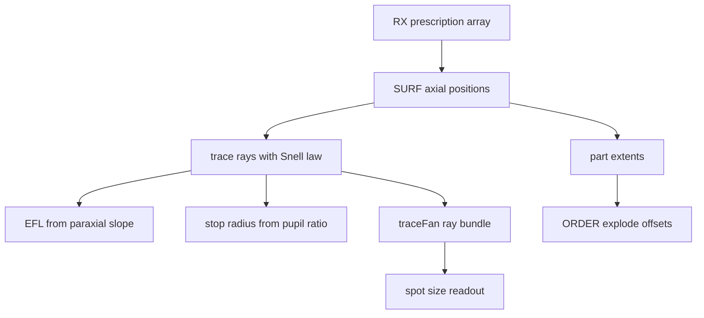
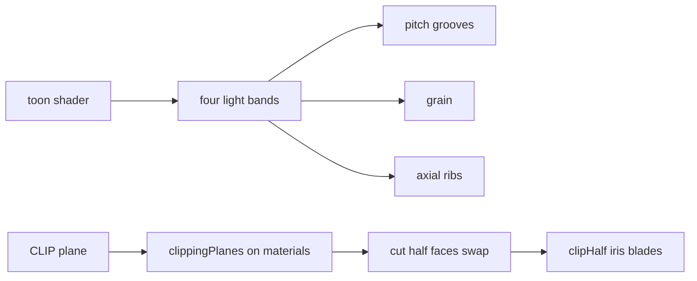

# 08 -- Anatomy builds: a lens prescription drives a real cutaway

The anatomy build is the third look, and the most ambitious reference figure in the skill. It is a cutaway of a 50 millimetre camera lens in the 3D page. Instead of drawing the glass by eye, the figure holds a real optical prescription, traces rays through it with Snell's law, and builds the geometry, the ray bundles, and the focus spots from those numbers. The key idea is that the diagram is not an illustration; it is a small optics simulation whose output is the illustration.

## The prescription

A lens prescription lists each surface: its radius, the distance to the next surface, the glass index after it, and the clear diameter. The anatomy figure stores the prescription as one array.

```js
const RX = [[34.30, 4.50, 1.62280, 30.99], [247.65, 2.40, 1, 30.99], [21.51, 4.35, 1.70154, 25.61], [40.31, 0.92, 1, 24.15],
  [78.44, 1.40, 1.67270, 25.61], [15.32, 6.75, 1, 19.97], [Infinity, 4.95, 1, 19.292], [-15.83, 1.10, 1.69895, 19.37],
  [135.97, 5.70, 1.79952, 23.76], [-21.24, 0.15, 1, 23.76], [162.15, 3.00, 1.72000, 23.60], [-49.97, 37.93, 1, 23.60]];
const STOP_I = 6, SURF = []; { let a = 0; RX.forEach(([R, t, n, D]) => { SURF.push({ a, R, n, h: D / 2 }); a += t; }); }
const A_IMG = SURF[11].a + 37.93, A_MOUNT = A_IMG - 44.0;   // sensor plane; EF flange focal distance 44.0 mm
```

From `assets/examples/lens-camera-3d.js` lines 17-21.

Each entry is `[radius, thickness, index, clearDiameter]`. A radius of `Infinity` is a flat surface. `SURF` accumulates the axial position `a` as the running sum of thicknesses, so the surface at index 6 (`STOP_I = 6`) is the aperture stop, and `A_IMG` is the sensor plane.

## Tracing a ray

The `trace` function marches a ray through every surface. For a sphere it solves the quadratic intersection, then applies Snell's law in vector form; for a flat surface it is a straight intersection. It rejects rays that hit the stop or any mount, and returns the full path plus the image height.

```js
function trace(a, h, da, dh, shift, stopR) {
  let n = 1; const pts = [[a, h]], L = Math.hypot(da, dh); da /= L; dh /= L; let stopH = 0;
  for (let i = 0; i < SURF.length; i++) {
    const s = SURF[i], va = s.a - shift; let t;
    if (s.R === Infinity) t = (va - a) / da;
    else { const ca = va + s.R, oa = a - ca, B = oa * da + h * dh, C = oa * oa + h * h - s.R * s.R, disc = B * B - C;
      if (disc < 0) return null; t = s.R > 0 ? -B - Math.sqrt(disc) : -B + Math.sqrt(disc); }
    a += t * da; h += t * dh; pts.push([a, h]);
    if (i === STOP_I) { stopH = h; if (Math.abs(h) > stopR + 1e-9) return null; continue; }
    if (Math.abs(h) > s.h + 0.05) return null;
    let na = -1, nh = 0; if (s.R !== Infinity) { na = (a - (va + s.R)) / s.R; nh = h / s.R; }
    const mu = n / s.n, ci = -(na * da + nh * dh), k = 1 - mu * mu * (1 - ci * ci); if (k < 0) return null;
    const ct = Math.sqrt(k); da = mu * da + (mu * ci - ct) * na; dh = mu * dh + (mu * ci - ct) * nh; n = s.n;
  }
  const t = (A_IMG - a) / da; pts.push([A_IMG, h + t * dh]);
  return { pts, stopH, hImg: h + t * dh };
}
```

From `assets/examples/lens-camera-3d.js` lines 23-39.

The effective focal length is then measured, not declared: the figure traces a near-paraxial ray and reads the slope of its final segment.

```js
const EFL = (() => { const r = trace(-20, 0.01, 1, 0, 0, 99), p = r.pts, [a1, h1] = p[p.length - 2], [a2, h2] = p[p.length - 1]; return 0.01 / -((h2 - h1) / (a2 - a1)); })();
```

From `assets/examples/lens-camera-3d.js` line 40.

The stop radius for each aperture is the same: the entrance-pupil radius times a measured constant. The stop positions and sizes in the diagram are therefore physically consistent, not placed by hand.

## The toon material

The glass and the metal are one shader: a toon material that bands the diffuse lighting into four steps, then adds grooves, grain, and axial ribs.

```js
function toon({ pitch = 0, amt = 0.5, glass = false, grain = 0, ribs = null } = {}) {
  const m = new THREE.ShaderMaterial({
    uniforms: { c0: { value: new THREE.Color() }, c1: { value: new THREE.Color() }, c2: { value: new THREE.Color() }, c3: { value: new THREE.Color() }, ink: { value: new THREE.Color() }, L: { value: LIGHT_DIR }, pitch: { value: pitch * S * TS }, amt: { value: amt }, acc: { value: accent }, lit: { value: 0 }, grain: { value: grain }, cell: { value: 0.9 * S * TS }, ribN: { value: ribs ? ribs.n : 0 }, ribZ0: { value: ribs ? AY(ribs.a1) * TS : 0 }, ribZ1: { value: ribs ? AY(ribs.a0) * TS : 0 }, ribAmt: { value: ribs ? ribs.amt ?? 0.6 : 0 }, axisY: { value: ZC * TS } },
    side: THREE.DoubleSide, polygonOffset: true, polygonOffsetFactor: 1, polygonOffsetUnits: 1, clipping: true,
    vertexShader: `varying vec3 vN; varying vec3 vP;
#include <clipping_planes_pars_vertex>
      void main() { vN = normalize((modelMatrix * vec4(normal, 0.0)).xyz); vP = position; vec4 mvPosition = modelViewMatrix * vec4(position, 1.0); gl_Position = projectionMatrix * mvPosition;
#include <clipping_planes_vertex>
      }`,
    fragmentShader: `uniform vec3 c0, c1, c2, c3, ink, L, acc; uniform float pitch, amt, lit, grain, cell, ribN, ribZ0, ribZ1, ribAmt, axisY; varying vec3 vN; varying vec3 vP;

#include <clipping_planes_pars_fragment>
      void main() {
#include <clipping_planes_fragment>

        vec3 n = normalize(vN); if (!gl_FrontFacing) n = -n;
        float d = dot(n, L);
        vec3 col = d > 0.6 ? c3 : d > 0.25 ? c2 : d > -0.15 ? c1 : c0;
```

From `assets/examples/lens-camera-3d.js` lines 83-100.

The shader gotcha is spelled out in the reference: every `#include <...>` must start on its own line, because three.js resolves `#include` directives by string substitution, so each must sit on its own line.

The four bands `c0` through `c3` are stepped by `dot(n, L)`, so the surface reads as lit from one direction with no gradient smoothing. Grooves, grain, and ribs are all screen-space anti-aliased features computed from `fwidth` in the fragment shader, so they stay crisp at any zoom.

## The cut plane

The cutaway is a clip plane, not a separate mesh. When the viewer toggles the cut, every glass and metal material receives the same `CLIP` plane, and the renderer enables local clipping.

```js
function setCut(on) {
  st.cut = on; parts.forEach(p => { p.w.visible = !on; p.h.visible = on; });
  IR.coverW.forEach(m => m.visible = !on); IR.coverH.visible = on; IR.baseW.forEach(m => m.visible = !on); IR.baseH.visible = on;
  irBase.children.forEach(m => { if (m.userData.pin !== undefined) m.visible = !on || inHalf(m.userData.pin); });
  clipMats.forEach(m => { m.clippingPlanes = on ? [CLIP] : []; m.needsUpdate = true; });
  buildBlades(st.rho, on); featureLines(st.ext * PSI, st.zeta, on); if (typeof sel !== 'undefined' && sel) applySel(sel); render();
}
```

From `assets/examples/lens-camera-3d.js` lines 528-534.

The cut half faces are prebuilt, and the whole part swaps its visible half when the cut toggles. The iris blades are rebuilt on the cut side only, using Sutherland-Hodgman clipping against one plane.

```js
function clipHalf(pts) {          // keep u ≤ 0 (Sutherland–Hodgman against one plane)
  const out = []; for (let i = 0; i < pts.length; i++) { const A = pts[i], B = pts[(i + 1) % pts.length], ia = A[0] <= 0, ib = B[0] <= 0;
    if (ia) out.push(A); if (ia !== ib) { const t = A[0] / (A[0] - B[0]); out.push([0, A[1] + (B[1] - A[1]) * t]); } } return out;
}
```

From `assets/examples/lens-camera-3d.js` lines 210-213.

## The explode layout

The parts stack front to back in the lens. The `ORDER` array lists their ids, and a running offset separates each part by a gap that is narrower between the glass groups.

```js
const ORDER = ['fb', 'fr', 'l1', 'l2', 'l3', 'ir', 'db', 'l6', 'tb', 'cm', 'ob', 'pcb', 'mt', 'rb'];
{ let cur = null; ORDER.forEach(k => { const p = P[k], gap = (['l1', 'l2', 'l3', 'db', 'l6'].includes(k) ? 9 : 11) + (k === 'l3' ? 12 : 0); if (cur === null) cur = p.amin; p.off = cur - p.amin; cur = p.amax + p.off + gap + (k === 'ir' ? 12 : 0); });
  const deep = Math.max(...ORDER.map(k => P[k].amax + P[k].off)) - P.rb.amax; ORDER.forEach(k => P[k].off -= deep); P.mo.off = P.cm.off; P.mo.radial = 26; }
```

From `assets/examples/lens-camera-3d.js` lines 520-522.

Each part knows its own axial extent, `amin` to `amax`, from the prescription. The offset shifts the part forward from its true position, so the assembled lens and the exploded lens are the same geometry under two different offsets, with a smooth animation between them.





## The Aha Moment

**Aha:** the diagram is a simulation, and correctness is a side effect of the model, not a property of the drawing.

Every other figure in [06-3d-figures.md](./06-3d-figures.md) is drawn to look right. The lens is computed to be right: the focal length is measured from a traced ray, the aperture stops follow the pupil ratio, the ray bundles bend through the real prescription, and the focus spot size is the spread of the traced image heights. When the viewer changes the aperture or the focus distance, the geometry changes because the optics changed, and the diagram cannot drift from the physics. This is the same inversion as [07-lumen.md](./07-lumen.md): there, light was drawn as geometry; here, geometry is derived from light.

Continue to [README.md](README.md).
