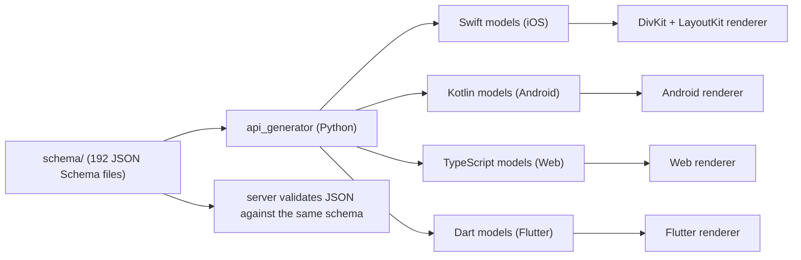
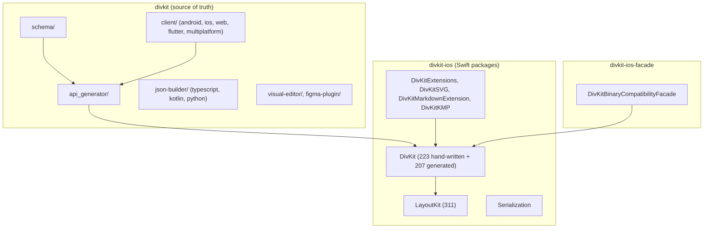

# 00 -- Overview: one JSON format, native views everywhere

DivKit is a Server-Driven UI (SDUI) framework. The server sends a card as a
JSON document; the client parses it into a tree of models and draws it with
native views. The same JSON renders on iOS, Android, Web, and Flutter, so a
layout is written once and shipped everywhere, and a server can change what an
app shows without an app-store release. This document gives the idea, the one
JSON shape, and the three repositories that make it work.

The word "server-driven" is the whole point. A normal mobile app compiles its
screens into the binary: to change a button's text you ship a new version and
wait for review. DivKit moves the screens out of the binary. The client ships
once, and every screen after that is a JSON card fetched at runtime. Yandex
runs most of its apps this way -- the README names Yandex Browser, Search,
Music, Market, Zen, and the Alice assistant among the clients -- because a
server that can change the UI can also roll it back, experiment on it, and
personalize it, all without touching the store.

The JSON is not free-form. It is a strict schema, and that schema is the
project's single source of truth.

# The one idea: the schema is the contract

A DivKit card is a small JSON document. Its top level has two keys:

```json
{
  "templates": { },
  "card": {
    "log_id": "sample_card",
    "states": [
      { "state_id": 0, "div": { "type": "text", "text": "Hello, DivKit!" } }
    ]
  }
}
```

`templates` holds reusable, parameterized sub-trees. `card` holds the
`div-data` object: an ordered list of `states`, a `log_id`, and optional
`variables`, `variable_triggers`, `timers`, and `functions`. A `div` is one of
seventeen element types chosen by its `type` field -- `text`, `container`,
`image`, `grid`, `gallery`, `pager`, and so on.

What makes DivKit different from a hand-rolled JSON-to-view mapper is that the
seventeen elements and every property on them are *defined by a JSON Schema*.
`divkit/schema/` holds 192 JSON Schema files. `div.json` is a discriminated
union (an `anyOf`) that names all seventeen elements:

```json
{
  "anyOf": [
    { "$ref": "div-image.json" },
    { "$ref": "div-gif-image.json" },
    { "$ref": "div-text.json" },
    { "$ref": "div-container.json" },
    ...
    { "$ref": "div-video.json" }
  ]
}
```

`div-base.json` holds the properties every element shares -- `id`, `width`,
`height`, `background`, `paddings`, `margins`, `alpha`, and alignment. Each
element's own file adds its specific properties. Because the schema is the
contract, a Python tool (`api_generator`) reads it and *generates* the Swift,
Kotlin, TypeScript, and Dart model types each client compiles against. The
clients are not hand-written against the format; they are generated from the
same file the server validates against.



# The three repositories

The source tree at `src.sdui` is a directory of three git repositories, not one.

| Repository | What it is |
|---|---|
| `divkit` | The source of truth. The 192-file schema, the `api_generator`, the four rendering clients (`client/android`, `client/ios`, `client/web`, `client/flutter`, `client/multiplatform`), the server-side `json-builder` libraries, and tooling (visual editor, Figma plugin). |
| `divkit-ios` | The reference Swift renderer. `DivKit` (223 hand-written + 207 generated Swift files) on top of `LayoutKit` (311 files), plus `DivKitExtensions`, `DivKitSVG`, `DivKitMarkdownExtension`, `DivKitKMP`, and `Serialization`. |
| `divkit-ios-facade` | `DivKitBinaryCompatibilityFacade`, a thin wrapper that gives a stable application binary interface (ABI) so a library can ship DivKit as a prebuilt binary. |

The main repository already contains an iOS client under `client/ios`, but the
standalone `divkit-ios` repository is where the Swift package lives, because
Swift Package Manager wants a repository with a `Package.swift` at its root.
The two are the same code at different versions. The facade exists for one
reason only: when a vendor distributes DivKit as a compiled framework, every
internal Swift type name would otherwise leak into the binary interface, so a
wrapper pins a public surface that does not change.



# The pipeline in one sentence

Server: build a card (by hand, or with `json-builder`) and send it. Client:
parse the JSON into generated models, resolve templates and expressions, and
hand the model tree to the renderer. iOS renderer: convert the models into
`LayoutKit` blocks, measure and lay them out, and produce native `UIView`s.
Interaction: a tap runs an `action`, which may change a variable or switch a
`state`, and the renderer updates in place.

The rest of this documentation follows that pipeline. [01-architecture.md](./01-architecture.md)
draws the full dependency map. [02-div-format.md](./02-div-format.md) teaches
the JSON in detail.

# The Aha Moment

**Aha:** DivKit does not have one renderer per platform with a shared *convention*;
it has one schema and four renderers *generated from it*. The `codegen` blocks
inside the schema files are not documentation -- they are compiler flags. When
a schema says `"generate_optional_arguments": false`, that changes the Swift
function signatures the generator emits. The schema is not a description of the
UI format; it is the executable definition of four platform APIs at once.

# Cross-References

- The full dependency map and pipeline: [01-architecture.md](./01-architecture.md).
- The JSON format in detail: [02-div-format.md](./02-div-format.md).
- How the schema becomes Swift/Kotlin/TypeScript/Dart: [08-codegen.md](./08-codegen.md).
- The iOS renderer this all feeds: [10-ios-architecture.md](./10-ios-architecture.md).

Continue to [01-architecture.md](./01-architecture.md).
