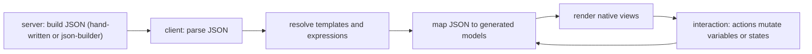
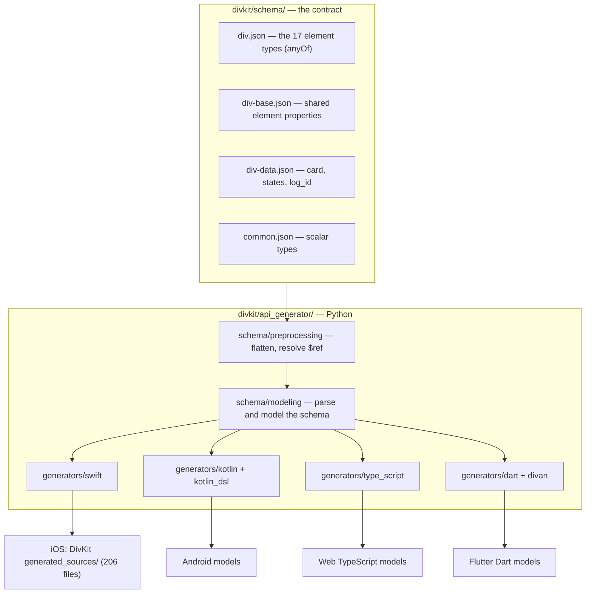
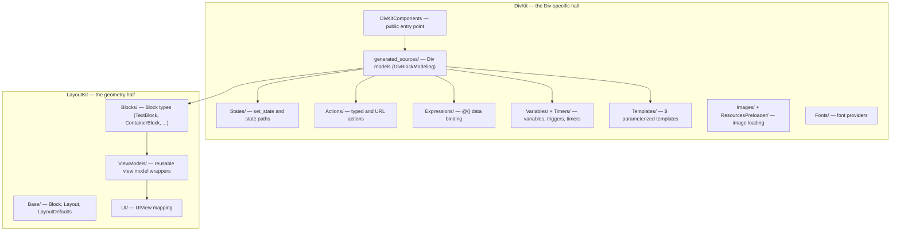

# 01 -- Architecture: one schema, one generator, many renderers

DivKit's architecture is a pipeline with one source and many sinks. The schema
(192 JSON Schema files) is the single source of truth. A Python generator
(`api_generator`) reads the schema and emits the model types for every
platform. Each client parses the same JSON into those generated models and
renders them with native views. This document draws the dependency map, names
every stage, and shows the one protocol that ties the iOS renderer together.

# The pipeline, top to bottom

A card's journey is always the same five stages, and only the last two differ
by platform:



The first three stages are identical on every platform because the *models*
are identical: they are generated from the same schema, so a `div-text` model
on iOS has the same fields as a `div-text` model on Android and Web. The
difference is only what a `div-text` model *becomes* -- a `UILabel` on iOS, a
`TextView` on Android, a DOM node on the web.

The stage that makes this possible is code generation, and it is the reason the
schema is more than documentation:



`api_generator` has two halves. `schema/modeling` and `schema/preprocessing`
turn the raw JSON Schema files into an internal model, flattening the `$ref`
links and reading the `codegen` blocks. `generators/` then walk that model and
emit code, one sub-package per target language: `swift`, `kotlin`,
`kotlin_dsl`, `type_script`, `dart`, `divan`, and `python`. Each generator has
its own reference fixtures under `api_generator/tests/references/`, so a
generator change is checked by diffing against expected output.

# The repositories and their dependencies

The three repositories form a dependency chain: the facade depends on the iOS
packages, which depend on the schema's generated output.

| Repository | Role | Depends on |
|---|---|---|
| `divkit` | Schema, generator, clients, builders, tooling | nothing |
| `divkit-ios` | Swift renderer (reference implementation) | `vgsl` (Yandex layout types), `swift-markdown` |
| `divkit-ios-facade` | Stable-ABI wrapper | `divkit-ios` |

The iOS repository is where the rendering actually happens, and its Swift
package manifest shows the module boundaries:

```swift
// divkit-ios/Package.swift (excerpt — the targets)
.target(name: "DivKit", dependencies: ["LayoutKit", .product(name: "VGSL", package: "vgsl"), "Serialization"], path: "DivKit"),
.target(name: "DivKitExtensions", dependencies: ["DivKit"], path: "DivKitExtensions"),
.target(name: "DivKitMarkdownExtension", dependencies: ["DivKit", "LayoutKit", ...], path: "DivKitMarkdownExtension"),
.target(name: "DivKitKMP", dependencies: ["DivKit", "DivKitExtensions", ...], path: "DivKitKMP"),
.target(name: "DivKitSVG", dependencies: ["DivKit", ...], path: "DivKitSVG"),
.target(name: "LayoutKit", dependencies: [.product(name: "VGSL", package: "vgsl"), "LayoutKitInterface"], path: "LayoutKit/LayoutKit"),
.target(name: "Serialization", dependencies: [.product(name: "VGSL", package: "vgsl")], path: "Serialization"),
```

Six modules, one dependency direction. `LayoutKit` is the geometry engine and
depends on nothing but `VGSL` (Yandex's shared layout types). `DivKit` sits on
top of `LayoutKit` and `Serialization`. The three extensions (`DivKitSVG`,
`DivKitMarkdownExtension`, `DivKitKMP`, `DivKitExtensions`) sit on top of
`DivKit`. Nothing points back down, so the layout engine has no idea DivKit
exists.

The core protocol that joins `DivKit` to `LayoutKit` is three members:

```swift
// divkit-ios/DivKit/DivBlockModeling.swift (verbatim — the whole protocol)
public protocol DivBlockModeling {
  var id: String? { get }
  static var type: String { get }
  func makeBlock(context: DivBlockModelingContext) throws -> Block
}
```

Every generated Div model conforms to `DivBlockModeling`. Its `type` is the
JSON `type` string (`"text"`, `"container"`, ...), its `id` is the JSON `id`,
and `makeBlock(context:)` is where a Div model becomes a `LayoutKit` `Block`.
This one method is the seam between "DivKit semantics" and "geometry": DivKit
decides *what* a text is (its content, its styles, its action), and `makeBlock`
translates that into a `Block` that only knows *where and how big* to draw.

# Where each concern lives

The renderer's job is split so that one half is reusable and the other is not.
`LayoutKit` is a general-purpose layout engine (blocks, view models, size and
position); `DivKit` is the Div-specific half (state, actions, expressions,
templates, variables, timers, images, resources).



The `generated_sources/` directory is the visible proof of the codegen step:
206 Swift files, one per generated type -- `DivTabs.swift`, `DivActionScrollTo.swift`,
`DivBackground.swift`, and so on. They are generated, so they are never edited
by hand; the generator is edited and the files regenerated.

# The Aha Moment

**Aha:** DivKit did not solve "render JSON on every platform" by writing four
renderers that agree by convention. It wrote one schema and a compiler whose
targets are four languages. The `codegen` blocks inside the schema are the
compile flags: `"generate_optional_arguments": false` changes a Swift factory
signature, `"forced_properties_order": ["log_id", "states"]` changes the
argument order of a Kotlin factory. A change to the UI format is a change to
one schema file, and the four platform APIs change together and can never drift.

# Cross-References

- The JSON format the schema defines: [02-div-format.md](./02-div-format.md).
- The generator in depth: [08-codegen.md](./08-codegen.md).
- The schema format and its `codegen` blocks: [09-schema.md](./09-schema.md).
- The iOS pipeline in detail: [10-ios-architecture.md](./10-ios-architecture.md).
- The layout engine: [11-layoutkit.md](./11-layoutkit.md).

Continue to [02-div-format.md](./02-div-format.md).
