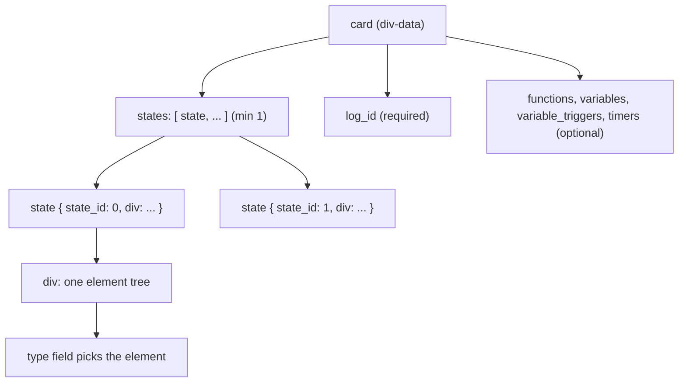
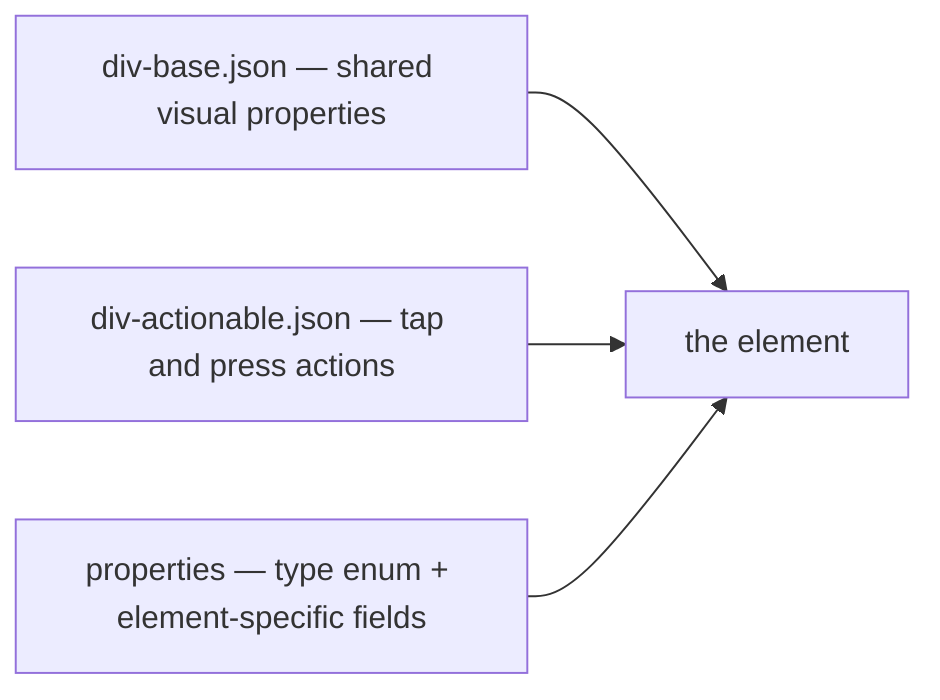
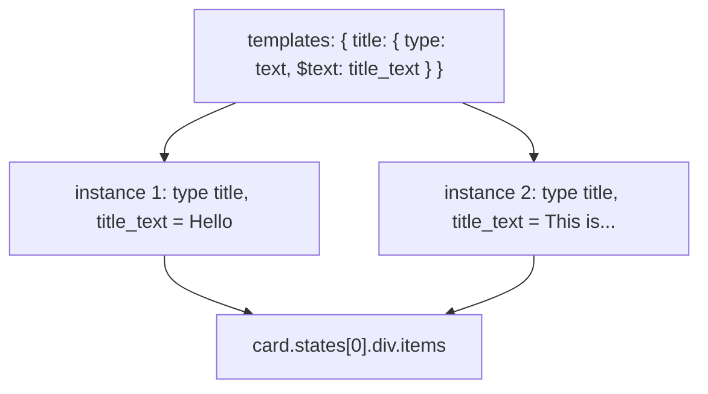

# 02 -- The Div Format: one card, states, templates, and a dispatch table

A DivKit card is a JSON document with exactly two top-level keys: `templates`
(optional) and `card` (required). `card` is a `div-data` object: an ordered
list of `states`, a `log_id`, and optional `functions`, `variables`,
`variable_triggers`, and `timers`. A `div` inside a state is one of seventeen
element types, chosen by a `type` field and dispatched by a single schema file.
This document teaches the shape, the dispatch, and the composition rule every
element follows.

# The card envelope: div-data

The schema file `div-data.json` defines the envelope. Reading it tells you
exactly what a server may send:

```json
{
  "type": "object",
  "properties": {
    "states": { "type": "array", "items": { "$ref": "#/definitions/state" }, "minItems": 1 },
    "log_id": { "$ref": "common.json#/id" },
    "transition_animation_selector": { "deprecated": true, "platforms": ["android", "ios"] },
    "functions": { "type": "array", "items": { "$ref": "div-function.json" } },
    "variables": { "type": "array", "items": { "$ref": "div-variable.json" } },
    "variable_triggers": { "type": "array", "items": { "$ref": "div-trigger.json" } },
    "timers": { "type": "array", "items": { "$ref": "div-timer.json" } }
  },
  "required": ["states", "log_id"]
}
```

Two fields are required: `states` (at least one) and `log_id`. Everything else
is optional. The `log_id` is an identifier for logging and analytics; it is the
one field every card carries so a server can tell which card a tap came from.
The four optional collections -- `functions`, `variables`, `variable_triggers`,
`timers` -- are the card-level data binding, covered in
[06-variables-expressions.md](./06-variables-expressions.md).

A `state` is the actual screen or screen-fragment. Its schema lives in
`#/definitions/state` of the same file:

```json
"state": {
  "type": "object",
  "properties": {
    "state_id": { "type": "integer", "supports_expressions": false },
    "div": { "$ref": "div.json" }
  },
  "required": ["state_id", "div"]
}
```

`state_id` is a plain integer (it is not an expression -- you cannot compute
it), and `div` is one element tree. A card can carry many states, which is how
a screen becomes interactive without a round-trip to the server: the server
sends all visual states, and a `set_state` action switches between them
locally. The full state machinery is [05-actions-and-state.md](./05-actions-and-state.md).



# The dispatch table: div.json

`div.json` is the root element dispatcher. It is a discriminated union, written
as an `anyOf` with one branch per element type. There are seventeen branches:

```json
{
  "anyOf": [
    { "$ref": "div-image.json" },
    { "$ref": "div-gif-image.json" },
    { "$ref": "div-text.json" },
    { "$ref": "div-separator.json" },
    { "$ref": "div-container.json" },
    { "$ref": "div-grid.json" },
    { "$ref": "div-gallery.json" },
    { "$ref": "div-pager.json" },
    { "$ref": "div-tabs.json" },
    { "$ref": "div-state.json" },
    { "$ref": "div-custom.json" },
    { "$ref": "div-indicator.json" },
    { "$ref": "div-slider.json" },
    { "$ref": "div-switch.json" },
    { "$ref": "div-input.json" },
    { "$ref": "div-select.json" },
    { "$ref": "div-video.json" }
  ]
}
```

The `type` field is what tells the parser which branch applies. Every element
file fixes `type` to a single string in an enum, so the dispatch is
unambiguous. A `div-container` file has `"type": { "enum": ["container"] }`;
a `div-text` file has `"type": { "enum": ["text"] }`. The parser reads `type`,
matches the branch, and validates the rest against that branch's schema.

# The composition rule: base + actionable + specifics

Every element is three things composed with `allOf`:



`div-base.json` carries what every element shares: `id`, `width`, `height`,
`background`, `paddings`, `margins`, `alpha`, vertical and horizontal
`alignment`, `row_span`/`column_span`, `visibility_action`/`visibility_actions`,
`disappear_actions`, `tooltips`, `accessibility`, `focus`, `transform`,
`animators`, and the transition fields. `div-actionable.json` carries the
interaction surface: `action` (deprecated), `actions`, `longtap_actions`,
`doubletap_actions`, `press_start_actions`, `press_end_actions`,
`hover_start_actions`, `hover_end_actions`, `action_animation`, and
`capture_focus_on_action`.

A concrete element adds its own fields on top. `div-container.json` is the
clearest example:

```json
{
  "allOf": [
    { "$ref": "div-base.json" },
    { "$ref": "div-actionable.json" },
    {
      "properties": {
        "type": { "type": "string", "enum": ["container"] },
        "orientation": { "type": "string", "enum": ["vertical", "horizontal", "overlap"], "default_value": "vertical" },
        "layout_mode": { "type": "string", "enum": ["no_wrap", "wrap"], "default_value": "no_wrap" },
        "content_alignment_vertical": { "$ref": "div-content-alignment-vertical.json", "default_value": "top" },
        "content_alignment_horizontal": { "$ref": "div-content-alignment-horizontal.json", "default_value": "start" },
        "items": { "type": "array", "items": { "$ref": "div.json" } },
        "item_builder": { "$ref": "div-collection-item-builder.json" },
        "aspect": { "$ref": "div-aspect.json" },
        "clip_to_bounds": { "$ref": "common.json#/boolean_int", "default_value": "true" }
      }
    }
  ],
  "required": ["type"]
}
```

This composition rule is the single most important structural fact about the
format: there is no inheritance in the JSON, only composition through `allOf`.
A `div-container` *is* a `div-base` plus a `div-actionable` plus its own
fields, all flattened into one object by the generator.

# Templates: write once, use with parameters

`templates` are reusable sub-trees. A template is defined once at the top level
and instantiated with a `type` equal to the template name. Parameters are
marked with a `$` prefix on the *property name*, not the value. The AGENTS.md
in the repository gives the canonical example:

```json
{
  "templates": {
    "title": {
      "type": "text",
      "font_size": 18,
      "$text": "title_text"
    }
  },
  "card": {
    "log_id": "sample_card",
    "states": [
      {
        "state_id": 0,
        "div": {
          "type": "container",
          "items": [
            { "type": "title", "title_text": "Hello, DivKit!" },
            { "type": "title", "title_text": "This is a DivKit card example" }
          ]
        }
      }
    ]
  }
}
```

The template `title` has a parameter `title_text`. At the definition, the
parameter is written as `"$text": "title_text"` -- the `$` marks it as a
placeholder whose value will be supplied at instantiation. At the use site,
`{ "type": "title", "title_text": "Hello, DivKit!" }` fills it in. One
template definition, two instances, zero duplication.



# The Aha Moment

**Aha:** The format does not use inheritance; it uses `allOf` composition, and
that is what makes code generation tractable. If elements inherited from each
other, the generator would have to model a class hierarchy and reconcile it
across four languages with different inheritance rules. Instead, every element
is *exactly* "base plus actionable plus my fields," flattened once at build
time. The schema's `allOf` is not JSON Schema pedantry -- it is the flattening
step that lets one internal model emit a Swift struct, a Kotlin data class, and
a TypeScript interface from the same three fragments.

# Cross-References

- The seventeen element types and their shared model: [03-elements.md](./03-elements.md).
- The size and box model behind `width`/`height`: [04-layout-and-size.md](./04-layout-and-size.md).
- Actions, the other half of `div-actionable`: [05-actions-and-state.md](./05-actions-and-state.md).
- The `variables`/`timers`/`functions` collections named here: [06-variables-expressions.md](./06-variables-expressions.md).
- The `codegen` blocks inside these files: [09-schema.md](./09-schema.md).

Continue to [03-elements.md](./03-elements.md).
