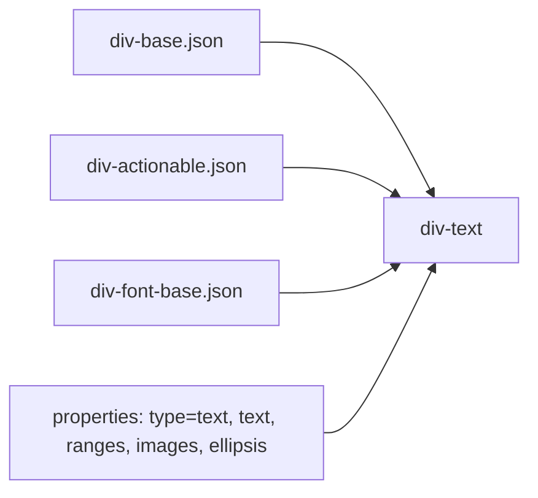

# 03 -- Elements: seventeen types, one shared base

A `div` is one of seventeen element types, selected by a `type` field. Every
element is the same three things composed together: a `div-base` (shared visual
properties), a `div-actionable` (tap and press behavior), and the element's own
fields. Two elements (`div-text` and `div-gif-image`) add a fourth fragment. This
document names all seventeen, gives each one's `type` discriminator, and reads
the shared base and the two most important elements in depth.

# The seventeen elements

The dispatcher `div.json` lists all seventeen. Each element's schema file fixes
its `type` field to one string. The table below gives the file, the JSON `type`
value, and the purpose, taken from the repository's own AGENTS.md descriptions.

| # | Schema file | JSON `type` | Purpose |
|---|---|---|---|
| 1 | `div-image.json` | `image` | Static image with scaling and alignment |
| 2 | `div-gif-image.json` | `gif` | Animated GIF image |
| 3 | `div-text.json` | `text` | Text with styles, embedded images, and styled ranges |
| 4 | `div-separator.json` | `separator` | A separating line |
| 5 | `div-container.json` | `container` | Lays out children vertically, horizontally, or overlaid |
| 6 | `div-grid.json` | `grid` | Grid with cell merging |
| 7 | `div-gallery.json` | `gallery` | Scrollable set of cards |
| 8 | `div-pager.json` | `pager` | Page-by-page horizontal set of cards |
| 9 | `div-tabs.json` | `tabs` | Tabbed content |
| 10 | `div-state.json` | `state` | Switches between visual states |
| 11 | `div-custom.json` | `custom` | Delegates to a host-app native element |
| 12 | `div-indicator.json` | `indicator` | Pager position indicator |
| 13 | `div-slider.json` | `slider` | Selects a value in a range |
| 14 | `div-switch.json` | `switch` | Two-state toggle |
| 15 | `div-input.json` | `input` | Text input with validation and masks |
| 16 | `div-select.json` | `select` | Single-choice list of options |
| 17 | `div-video.json` | `video` | Video playback |

One entry in that table hides a trap. The file is named `div-gif-image.json` and
the AGENTS.md calls the element "div-gif-image", but the JSON `type` value the
parser dispatches on is `"gif"`, not `"gif-image"`:

```json
// divkit/schema/div-gif-image.json (excerpt)
"properties": {
  "gif_url": { "$ref": "common.json#/url" },
  "type": { "type": "string", "enum": ["gif"] },
  "preview_url": { "$ref": "common.json#/url" }
}
```

The schema file name and the discriminator value are two different namespaces.
The generator uses the discriminator for dispatch, so a card must write
`"type": "gif"` even though the element is documented as "div-gif-image".

# The shared base: div-base

`div-base.json` is the fragment every element composes in. It is the box model
and the common chrome of every element:

```json
// divkit/schema/div-base.json (excerpt — the properties)
"id":            { "$ref": "common.json#/id" },
"border":        { "$ref": "div-border.json" },
"width":         { "$ref": "div-size.json", "default_value": "{\"type\": \"match_parent\"}" },
"height":        { "$ref": "div-size.json", "default_value": "{\"type\": \"wrap_content\"}" },
"background":    { "type": "array", "items": { "$ref": "div-background.json" } },
"paddings":      { "$ref": "div-edge-insets.json" },
"margins":       { "$ref": "div-edge-insets.json" },
"alpha":         { "type": "number", "default_value": "1.0" },
"alignment_vertical":   { "$ref": "div-alignment-vertical.json" },
"alignment_horizontal": { "$ref": "div-alignment-horizontal.json" },
"row_span":      { "$ref": "common.json#/non_negative_integer" },
"column_span":   { "$ref": "common.json#/non_negative_integer" },
"visibility_action":    { "$ref": "div-visibility-action.json" },
"visibility_actions":   { "type": "array", "items": { "$ref": "div-visibility-action.json" } },
"disappear_actions":    { "type": "array", "items": { "$ref": "div-disappear-action.json" } },
"tooltips":      { "type": "array", "items": { "$ref": "div-tooltip.json" } },
"accessibility": { "$ref": "div-accessibility.json" },
"focus":         { "$ref": "div-focus.json" },
"transform":     { "$ref": "div-transform.json" },
"animators":     { "type": "array", "items": { "$ref": "div-animator.json" } }
```

The two defaults are the core of the size system: `width` defaults to
`match_parent` (fill the parent) and `height` defaults to `wrap_content` (shrink
to fit the content). Every element therefore has a size by default, and only
overrides it when it needs to. The size system is the subject of
[04-layout-and-size.md](./04-layout-and-size.md).

The `div-base` also carries the interaction surface via `visibility_action`,
`visibility_actions`, and `disappear_actions` -- actions that run when an
element scrolls into view, and again when it leaves. These are the analytics
hooks an SDUI server needs to know what a user actually saw.

# The interaction surface: div-actionable

`div-actionable.json` is the fragment that makes an element tappable. It adds
one deprecated single action, a primary list, and the gesture variants:

```json
// divkit/schema/div-actionable.json (excerpt — the properties)
"action":             { "$ref": "div-action.json" },
"actions":            { "type": "array", "items": { "$ref": "div-action.json" } },
"longtap_actions":    { "type": "array", "items": { "$ref": "div-action.json" } },
"doubletap_actions":  { "type": "array", "items": { "$ref": "div-action.json" } },
"press_start_actions":{ "type": "array", "items": { "$ref": "div-action.json" } },
"press_end_actions":  { "type": "array", "items": { "$ref": "div-action.json" } },
"hover_start_actions":{ "type": "array", "items": { "$ref": "div-action.json" } },
"hover_end_actions":  { "type": "array", "items": { "$ref": "div-action.json" } },
"action_animation":   { "$ref": "div-animation.json" },
"capture_focus_on_action": { "type": "boolean", "default_value": "true" }
```

`action` (singular) is marked deprecated; the guidance is to use the plural
`actions` list. The actions themselves -- typed or URL -- are covered in
[05-actions-and-state.md](./05-actions-and-state.md).

# div-text: the workhorse

`div-text` is the largest element schema (about 18 kilobytes) because text is
the richest element: it can style sub-ranges, embed images inline, and truncate.
Its `allOf` composes four fragments instead of three:



The fourth fragment, `div-font-base.json`, is the font styling (font size,
family, weight) that text shares with a few other elements. The element's own
properties add the content:

```json
// divkit/schema/div-text.json (excerpt — the element's own properties)
"text":   { "type": "string" },
"underline": { "$ref": "div-line-style.json", "default_value": "none" },
"strike":   { "$ref": "div-line-style.json", "default_value": "none" },
"ranges":   { "type": "array", "items": { "$ref": "#/definitions/range" } },
"images":   { "type": "array", "items": { "$ref": "#/definitions/image" } },
"ellipsis": { "$ref": "#/definitions/ellipsis" },
"max_lines":      { "$ref": "common.json#/non_negative_integer" },
"auto_ellipsize": { "$ref": "common.json#/boolean_int" },
"text_alignment_horizontal": { "$ref": "div-alignment-horizontal.json", "default_value": "start" },
"text_alignment_vertical":   { "$ref": "div-alignment-vertical.json", "default_value": "top" }
```

A `range` styles a character span (`start`/`end`) with its own font size,
color, weight, underline, strike, background, border, shadow, and mask. An
`image` is an inline image at a character `start` position, with its own URL,
width, height, and tint. So one `div-text` can contain a sentence with three
differently-styled spans and an inline icon, all in one element -- a rich-text
system driven entirely by JSON, with no HTML or markup string.

`div-text` is also the clearest example of the "required" contract: the schema
declares `"required": ["type", "text"]`, so every text element must carry a
`text` string.

# div-container: the layout primitive

`div-container` is the second workhorse and the simplest layout primitive. Its
own properties are:

```json
// divkit/schema/div-container.json (excerpt — the element's own properties)
"orientation": { "type": "string", "enum": ["vertical", "horizontal", "overlap"], "default_value": "vertical" },
"layout_mode":  { "type": "string", "enum": ["no_wrap", "wrap"], "default_value": "no_wrap" },
"content_alignment_vertical":   { "$ref": "div-content-alignment-vertical.json", "default_value": "top" },
"content_alignment_horizontal": { "$ref": "div-content-alignment-horizontal.json", "default_value": "start" },
"items":        { "type": "array", "items": { "$ref": "div.json" } },
"item_builder": { "$ref": "div-collection-item-builder.json" },
"clip_to_bounds": { "$ref": "common.json#/boolean_int", "default_value": "true" }
```

`orientation` decides the axis: `vertical` stacks children top to bottom,
`horizontal` places them left to right, and `overlap` draws them on top of each
other (simulating a third dimension). `items` is a list of child elements;
`item_builder` is an alternative that generates children from a data list -- a
loop, so a container can repeat a template once per item. The two are mutually
exclusive, and the schema expresses that not with a constraint but with a
TypeScript codegen directive:

```json
// divkit/schema/div-container.json (codegen block, excerpt)
"typescript": {
  "union_interfaces": [
    { "required_params": ["items"] },
    { "required_params": ["item_builder"] }
  ]
}
```

This tells the TypeScript generator to emit two interfaces -- one where `items`
is required, one where `item_builder` is required -- so a TypeScript user can
never build a container with neither or both. The same "one or the other"
relationship is enforced by the generator differently per language; the schema
records the intent, and each generator translates it.

# The Aha Moment

**Aha:** The seventeen elements are not seventeen classes; they are seventeen
*names* for the same three fragments composed with `allOf`, and the discriminator
is a field, not a type. Because `type` is just an enum string in a `properties`
block, the parser does not need a registry mapping `"text"` to a Swift class. It
reads `type`, matches the `anyOf` branch, and validates -- and the code generator
has already flattened "base + actionable + my fields" into one concrete model per
element. Add an element: add a schema file, add one line to `div.json`, and four
platforms regenerate. There is no dispatch code to update.

# Cross-References

- The `allOf` composition rule and the `div.json` dispatcher: [02-div-format.md](./02-div-format.md).
- The size and box model behind `div-base`: [04-layout-and-size.md](./04-layout-and-size.md).
- The actions behind `div-actionable`: [05-actions-and-state.md](./05-actions-and-state.md).
- The `div-font-base` fragment and font providers: [10-ios-architecture.md](./10-ios-architecture.md).

Continue to [04-layout-and-size.md](./04-layout-and-size.md).
