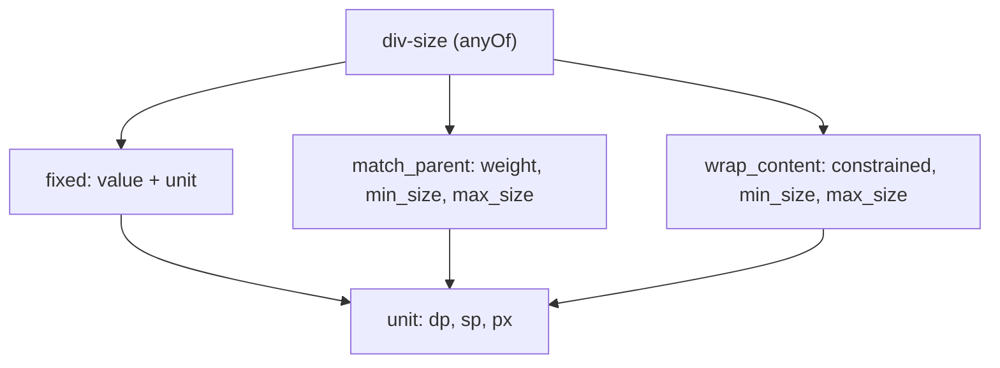
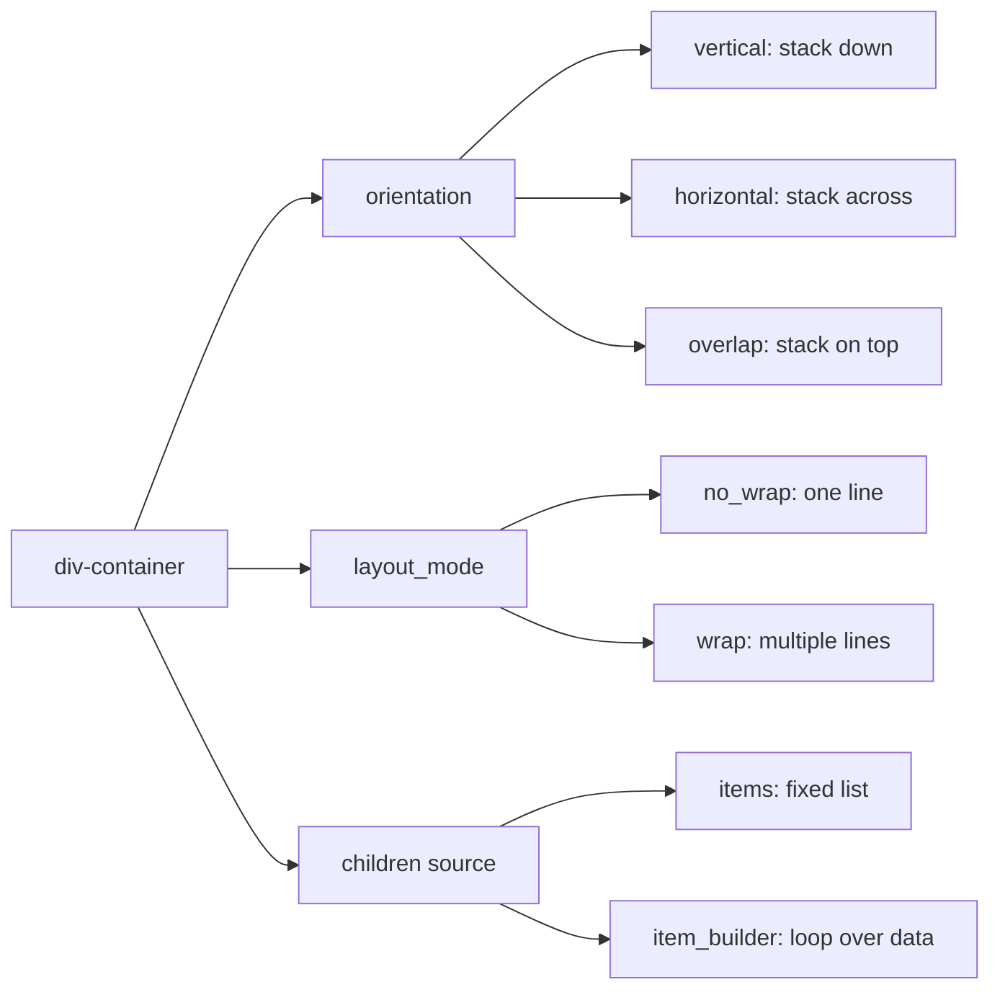
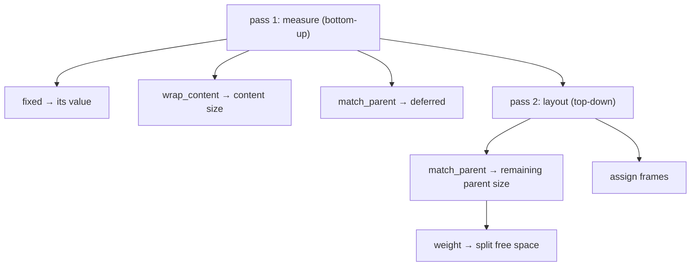

# 04 -- Layout and Size: the box model and the three-way size union

Every Div element has a size, and that size is always one of three things:
a fixed number, the parent's size, or the size of its own content. There is no
fourth option. Layout is then the work of combining those sizes: a container
measures each child, sums or distributes the results along an axis, and the
renderer assigns positions. This document teaches the size union, the box model
that wraps it, and how the five collection elements -- container, grid, gallery,
pager, tabs -- arrange children.

# The three-way size union

`div-base.json` gives every element a `width` and a `height`. Both are `div-size`,
which is an `anyOf` with exactly three branches:

```json
// divkit/schema/div-size.json (whole file)
{
  "anyOf": [
    { "$ref": "div-fixed-size.json" },
    { "$ref": "div-match-parent-size.json" },
    { "$ref": "div-wrap-content-size.json" }
  ]
}
```

The three branches and their meaning:

| Size type | Meaning | Required fields |
|---|---|---|
| `fixed` | A fixed number of units | `value`, `type` |
| `match_parent` | Take the parent's size (fill it) | `type` |
| `wrap_content` | Shrink to fit the content | `type` |

Each branch is its own schema file. `div-fixed-size.json` carries the number:

```json
// divkit/schema/div-fixed-size.json (excerpt)
"value": { "$ref": "common.json#/non_negative_integer" },
"unit":  { "$ref": "div-size-unit.json", "default_value": "dp" },
"type":  { "type": "string", "enum": ["fixed"] }
```

`div-base.json` wires the defaults so a bare element still has a size: `width`
defaults to `match_parent` (fill the parent horizontally) and `height` defaults
to `wrap_content` (grow to the content). A `div-text` with no size fields fills
the screen width and is exactly as tall as its text.

`match_parent` has two extras worth knowing. `weight` (a `positive_number`)
turns the element into a flex-style share: two siblings with `match_parent`
and weights 1 and 2 split the free space 1-to-2. `min_size` and `max_size`
bound the result and are each a `div-size-unit-value` -- a `value` plus a
`unit`, so a bound can be written in a different unit than the size itself.

`wrap_content` has one extra: `constrained`. When `constrained` is true, a
`wrap_content` element may still shrink below its natural content size if the
parent forces it to; when false (or absent) it keeps its natural size. This is
the one switch that decides whether a "wrap" is a promise or a preference.



# Units: dp, sp, px

`div-size-unit.json` is a three-value enum, and it is the one place the format
admits device pixels:

```json
// divkit/schema/div-size-unit.json (whole file)
{
  "type": "string",
  "enum": ["dp", "sp", "px"],
  "platforms": ["android", "ios"],
  "unsupported_platforms": {
    "web": "All sizes are set in dp or sp, controlled by integration code. There is no concept of device px."
  }
}
```

`dp` (density-independent pixel) is the default for sizes and insets; `sp`
(scale-independent pixel) is the default for font sizes (so text scales with
the system font setting); `px` is a raw device pixel, used rarely. The
`unsupported_platforms` note is the schema encoding a platform difference: the
web client has no concept of `px`, so the unit is Android- and iOS-only.

# The box model: edge insets and two kinds of alignment

Around every element's size sits a box: `paddings` (inside the border) and
`margins` (outside it). Both are `div-edge-insets`:

```json
// divkit/schema/div-edge-insets.json (excerpt)
"left":   { "$ref": "common.json#/non_negative_integer", "default_value": "0" },
"right":  { "$ref": "common.json#/non_negative_integer", "default_value": "0" },
"top":    { "$ref": "common.json#/non_negative_integer", "default_value": "0" },
"bottom": { "$ref": "common.json#/non_negative_integer", "default_value": "0" },
"start":  { "$ref": "common.json#/non_negative_integer" },
"end":    { "$ref": "common.json#/non_negative_integer" },
"unit":   { "$ref": "div-size-unit.json", "default_value": "dp" }
```

`start` and `end` are direction-aware: `start` means left in a left-to-right
locale and right in a right-to-left one. The four physical edges and the two
logical edges can both be set, which lets a card declare "16 units of padding
on the reading start edge" independent of locale.

Alignment is split into two enums because there are two different questions.
`div-alignment-vertical`/`div-alignment-horizontal` are the *self* alignment:
where this element sits inside its parent's cell. `div-content-alignment-*`
are the *content* alignment: where the children sit inside this element.
The content variants add three distribution values the self variants lack:

```json
// divkit/schema/div-alignment-horizontal.json (whole file — self alignment)
{ "enum": ["left", "center", "right", "start", "end"] }

// divkit/schema/div-content-alignment-horizontal.json (whole file — content alignment)
{ "enum": ["left", "center", "right", "start", "end", "space-between", "space-around", "space-evenly"] }
```

`space-between`, `space-around`, and `space-evenly` distribute leftover space
between children; they make no sense for a single element, which is why they
appear only in the content-alignment enum.

# div-container: the axis primitive

`div-container` is the general layout element. Its own fields, in full:

```json
// divkit/schema/div-container.json (excerpt — the element's own properties)
"orientation":   { "type": "string", "enum": ["vertical", "horizontal", "overlap"], "default_value": "vertical" },
"layout_mode":   { "type": "string", "enum": ["no_wrap", "wrap"], "default_value": "no_wrap" },
"content_alignment_vertical":   { "$ref": "div-content-alignment-vertical.json", "default_value": "top" },
"content_alignment_horizontal": { "$ref": "div-content-alignment-horizontal.json", "default_value": "start" },
"items":         { "type": "array", "items": { "$ref": "div.json" } },
"item_builder":  { "$ref": "div-collection-item-builder.json" },
"separator":     { "$ref": "#/definitions/separator" },
"item_spacing":  { "$ref": "common.json#/non_negative_integer", "default_value": "0" },
"line_spacing":  { "$ref": "common.json#/non_negative_integer", "default_value": "0" },
"line_separator":{ "$ref": "#/definitions/separator" },
"aspect":        { "$ref": "div-aspect.json" },
"clip_to_bounds":{ "$ref": "common.json#/boolean_int", "default_value": "true" }
```

`orientation` picks the main axis. `vertical` stacks children top to bottom;
`horizontal` places them left to right; `overlap` draws them on top of each
other (useful for a badge over an image). `layout_mode` is only meaningful for
`horizontal`: `wrap` lets children flow to a second line when the first is full,
and `line_spacing`/`line_separator` then control the gap and divider between
those lines. `item_spacing` is the gap between children, and `separator` is a
drawable line drawn between children (`show_between` defaults to true,
`show_at_start`/`show_at_end` to false).

`aspect` fixes the width-to-height ratio, so a container that must always be a
16:9 banner declares `"aspect": { "ratio": 1.778 }` and the renderer derives one
dimension from the other. `clip_to_bounds` (default true) clips children that
overflow.

The two modes of a container are best seen as a tree:



# The data-driven collections: grid, gallery, pager

Three elements lay out children from a list, and the difference between them is
what the parent does with the result.

`div-grid` places children into a fixed number of columns and lets each cell
merge rows and columns via the `row_span`/`column_span` fields inherited from
`div-base`:

```json
// divkit/schema/div-grid.json (excerpt)
"column_count": { "$ref": "common.json#/non_negative_integer" },
"content_alignment_vertical":   { "$ref": "div-alignment-vertical.json",   "default_value": "top" },
"content_alignment_horizontal": { "$ref": "div-alignment-horizontal.json", "default_value": "start" },
"items": { "type": "array", "items": { "$ref": "div.json" } }
```

`column_count` is required -- a grid must know how many columns before it can
place anything. Note that grid uses the *self* alignment enums
(`div-alignment-vertical`, not `div-content-alignment-vertical`), because cells
are fixed by the column count and only need to align their content, not
distribute it.

`div-gallery` is a scrolling strip. It inherits nothing from `div-actionable`
(it is not tappable itself), and its distinguishing field is the scroll
orientation and spacing:

```json
// divkit/schema/div-gallery.json (excerpt)
"orientation":   { "type": "string", "enum": ["horizontal", "vertical"], "default_value": "horizontal" },
"column_count":  { "$ref": "common.json#/positive_integer" },
"item_spacing":  { "$ref": "common.json#/non_negative_integer", "default_value": "8" },
"cross_spacing": { "$ref": "common.json#/non_negative_integer" },
"scroll_mode":   { "type": "string", "enum": ["paging", "default"], "default_value": "default" },
"default_item":  { "$ref": "common.json#/non_negative_integer", "default_value": "0" },
"scrollbar":     { "type": "string", "enum": ["none", "auto"], "default_value": "none" },
"items":         { "type": "array", "items": { "$ref": "div.json" } }
```

A gallery with `scroll_mode: "paging"` snaps to whole pages; a `column_count`
greater than one shows several columns per scroll step. `item_spacing` is the
gap along the scroll axis and `cross_spacing` the gap across it.

`div-pager` is a page-by-page collection, and it is the only element whose
*page width* is itself a size model. `layout_mode` is an `anyOf` of three page
kinds: a percentage of the pager width, a fixed neighbour-page width, or wrap
to the content:

```json
// divkit/schema/div-pager.json (excerpt)
"layout_mode": { "$ref": "div-pager-layout-mode.json" },
"orientation": { "type": "string", "enum": ["horizontal", "vertical"], "default_value": "horizontal" },
"item_spacing":{ "$ref": "div-fixed-size.json", "default_value": "{\"type\": \"fixed\",\"value\":0}" },
"default_item":{ "$ref": "common.json#/non_negative_integer", "default_value": "0" },
"infinite_scroll": { "$ref": "common.json#/boolean_int", "default_value": "false" },
"items": { "type": "array", "items": { "$ref": "div.json" } }
```

```json
// divkit/schema/div-pager-layout-mode.json (whole file)
{
  "anyOf": [
    { "$ref": "div-page-size.json" },          // type "percentage", page_width
    { "$ref": "div-neighbour-page-size.json" }, // type "fixed", neighbour_page_width
    { "$ref": "div-page-content-size.json" }    // type "wrap_content"
  ]
}
```

So a pager can be a carousel showing one-and-a-bit pages (`percentage` with
`page_width` just under 100), a cover-flow with fixed neighbour width, or a
simple wrap-to-content pager. `pager` is required to carry `layout_mode`, which
is why it appears in the `required` list alongside `type`.

# The measure-then-layout pass

None of this geometry is computed by the schema; it is computed by the
renderer's layout engine. On iOS that engine is `LayoutKit`, and it works in
two passes. First `measure` asks every block, bottom-up, how much space it
needs given a constraint; then `layout` assigns frames top-down. The size union
maps onto that pass directly: `fixed` and `wrap_content` answer during
`measure`, and `match_parent` (with its `weight`) resolves during `layout`,
when the parent's own size is known.



This two-pass structure is why a `match_parent` child inside a `wrap_content`
parent is a degenerate case: the parent waits for the child, the child waits
for the parent, and the engine must break the cycle with a convention. The
schema does not forbid it; the layout engine resolves it. The full engine is
[11-layoutkit.md](./11-layoutkit.md).

# The Aha Moment

**Aha:** The size system is *closed*. Every size is one of exactly three kinds,
and the closure is not a convention -- it is the schema's `anyOf` with three
branches, each a separate file. The same three-way union recurs everywhere
geometry appears: `div-size` for width and height, `div-pager-layout-mode` for
page width, `div-fixed-size` for a pager's item spacing, `div-percentage-size`
for a pager page, `div-size-unit-value` for a min/max bound. Because the union
is closed, the layout engine has a finite, enumerable set of cases to handle,
and the code generator can emit a Swift enum or a Kotlin sealed class for it
instead of a free-form string. A new size kind would be a new schema file, a new
branch, and a change to every renderer -- which is exactly the kind of
cross-platform drift the closed union prevents.

# Cross-References

- The shared `div-base` that carries `width`, `height`, `paddings`, and `margins`: [03-elements.md](./03-elements.md).
- The seventeen elements and which of them are collections: [03-elements.md](./03-elements.md).
- The iOS layout engine that runs the measure-then-layout pass: [11-layoutkit.md](./11-layoutkit.md).
- The `item_builder` loop and the variables that feed it: [06-variables-expressions.md](./06-variables-expressions.md).

Continue to [05-actions-and-state.md](./05-actions-and-state.md).
