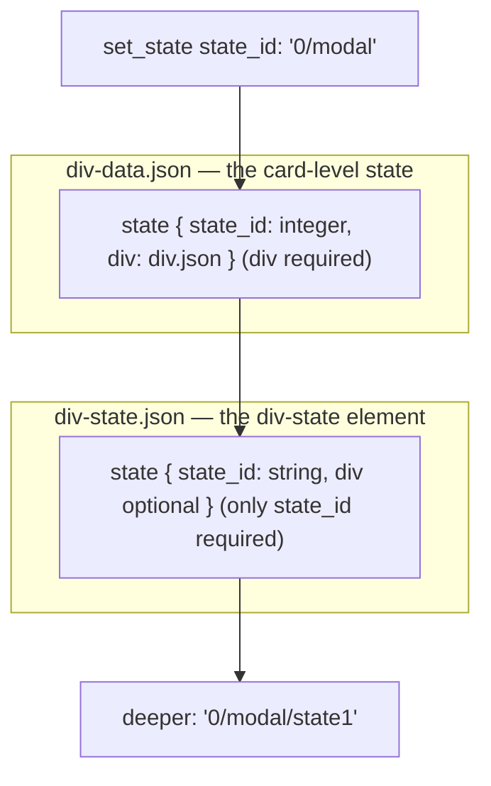
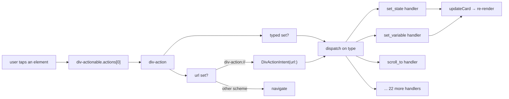

# 05 -- Actions and State: taps that move the card

An action is what a tap does, and state is how a card changes its look without
asking the server again. Every action is one object with a `url` (navigate or
run a `div-action://` command), a `typed` field (one of twenty-five built-in
actions), or both. The `set_state` action switches the visible subtree using a
slash-separated path. This document reads the action schema, the typed-action
list, and the state-path machinery on iOS.

# What an action is

`div-action.json` is the type of every tap, press, hover, and visibility hook.
It composes a base fragment with a menu fragment:

```json
// divkit/schema/div-action-base.json (excerpt — the properties)
"log_id":   { "type": "string" },
"scope_id": { "type": "string" },
"url":      { "$ref": "common.json#/url" },
"referer":  { "$ref": "common.json#/url" },
"payload":  { "type": "object", "additionalProperties": true },
"download_callbacks": { "$ref": "div-download-callbacks.json" },
"typed":    { "$ref": "div-action-typed.json" },
"is_enabled": { "$ref": "common.json#/boolean_int", "default_value": "true" }
```

```json
// divkit/schema/div-action.json (excerpt — the menu fragment)
"menu_items": { "type": "array", "items": { "$ref": "#/definitions/menu_item" } },
"log_url":    { "$ref": "common.json#/url" },
"target":     { "type": "string", "enum": ["_self", "_blank"] }
```

So an action is fundamentally three things it can *do*:

- **Navigate**: set `url` to any URL. The client opens it.
- **Run a built-in command**: set `typed`. The client dispatches on its `type`.
- **Both**: set `url` *and* `typed`; the client runs the typed command and, if
  it does not handle the navigation itself, then opens the URL.

The `url` field doubles as a command channel. A URL with the scheme
`div-action://` is not opened in a browser; it is parsed into a typed action.
The iOS renderer does this in `DivActionIntent.swift`, where the URL host is
the action name and the query parameters are the fields:

```swift
// divkit-ios/DivKit/Actions/DivActionIntent.swift (excerpt)
static let scheme = "div-action"

init?(url: URL) {
  guard url.scheme == Self.scheme else { return nil }
  switch url.host {
  case "set_state":
    guard let divStatePath = url.divStatePath else { return nil }
    self = .setState(divStatePath: divStatePath, lifetime: url.lifetime)
  case "set_variable":
    guard let variable = url.variableInfo else { return nil }
    self = .setVariable(name: variable.name, value: variable.value)
  ...
  }
}
```

So `div-action://set_state?state_id=0%2Fmodal` and a `typed` action
`{ "type": "set_state", "state_id": "0/modal" }` are the same command written
two ways. The URL form exists so a plain `url` field -- which the schema
already supports for navigation -- can carry a command without the card needing
a separate discriminator.

# The twenty-five typed actions

`div-action-typed.json` is an `anyOf` of twenty-five branches, each a separate
schema file, each fixing `type` to one string:

```json
// divkit/schema/div-action-typed.json (whole file — the branch list)
{ "anyOf": [
  { "$ref": "div-action-animator-start.json" },
  { "$ref": "div-action-animator-stop.json" },
  { "$ref": "div-action-array-insert-value.json" },
  { "$ref": "div-action-array-remove-value.json" },
  { "$ref": "div-action-array-set-value.json" },
  { "$ref": "div-action-clear-focus.json" },
  { "$ref": "div-action-copy-to-clipboard.json" },
  { "$ref": "div-action-dict-set-value.json" },
  { "$ref": "div-action-download.json" },
  { "$ref": "div-action-focus-element.json" },
  { "$ref": "div-action-haptic.json" },
  { "$ref": "div-action-hide-tooltip.json" },
  { "$ref": "div-action-scroll-by.json" },
  { "$ref": "div-action-scroll-to.json" },
  { "$ref": "div-action-set-state.json" },
  { "$ref": "div-action-set-stored-value.json" },
  { "$ref": "div-action-set-variable.json" },
  { "$ref": "div-action-show-tooltip.json" },
  { "$ref": "div-action-submit.json" },
  { "$ref": "div-action-timer.json" },
  { "$ref": "div-action-update-structure.json" },
  { "$ref": "div-action-video.json" },
  { "$ref": "div-action-custom.json" },
  { "$ref": "div-action-extension-action.json" },
  { "$ref": "div-action-set-cursor-position.json" }
] }
```

Grouped by what they touch:

| Group | Typed actions |
|---|---|
| State | `set_state` |
| Variables and data | `set_variable`, `array_insert_value`, `array_remove_value`, `array_set_value`, `dict_set_value`, `set_stored_value` |
| Scrolling | `scroll_to`, `scroll_by`, `focus_element`, `clear_focus` |
| Timers and media | `timer`, `video`, `animator_start`, `animator_stop` |
| Tools and feedback | `show_tooltip`, `hide_tooltip`, `copy_to_clipboard`, `haptic`, `download` |
| Networking | `submit` |
| Structure | `update_structure` |
| Host escape hatch | `custom`, `extension_action`, `set_cursor_position` |

Two of the twenty-five are the extension points. `div-action-custom.json` is a
bare object with only `"type": "custom"` -- the client's custom action handler
takes over and does whatever the host app registered. `div-action-extension-action`
is similar but passes a `params` dict to a registered extension handler. The
rest are built-in and shared across platforms.

`div-action-set-variable` is the smallest useful example, and it shows the
typed-value union that carries a value of any scalar or container kind:

```json
// divkit/schema/div-action-set-variable.json (whole file — the properties)
"type":          { "type": "string", "enum": ["set_variable"] },
"variable_name": { "type": "string" },
"value":         { "$ref": "div-typed-value.json" }
```

`div-typed-value.json` is an `anyOf` of eight value kinds -- `string`,
`integer`, `number`, `color`, `boolean`, `url`, `dict`, `array` -- each with a
`type` and a `value`. So a tap can store "the user typed this", or push a whole
array, or set a color, all through the same `value` field.

# set_state and the state path

The most important typed action is `set_state`. Its schema is tiny:

```json
// divkit/schema/div-action-set-state.json (whole file)
{
  "properties": {
    "type":     { "type": "string", "enum": ["set_state"] },
    "state_id": { "type": "string" },
    "temporary":{ "type": "boolean", "default_value": "true" }
  },
  "required": ["type", "state_id"]
}
```

`state_id` is not a number -- it is a *path*. The path is slash-separated. Its
first segment is the card-level state index (the integer `state_id` of a
`div-data` state), and each later segment is the `state_id` of a nested
`div-state` element. The iOS type definitions make the two kinds of identifier
explicit:

```swift
// divkit-ios/DivKit/DivStatePath.swift (excerpt — the two id types)
public typealias DivDataStateID = Tagged<DivDataStateIDTag, Int>      // card-level state: Int
public typealias DivStateID     = Tagged<DivStateIDTag, String>       // div-state element: String
public typealias DivStatePath   = Tagged<DivStatePathTag, UIElementPath>
```

So `0/modal` means "in card state 0, show the `div-state` whose nested
`state_id` is `modal`". A deeper path `0/div_state_in_main_card/state1` drills
two levels: card state 0, then the `div-state` with `state_id`
`div_state_in_main_card`, then within it the one with `state_id` `state1`.

There are two different `state` schemas in play, and they use different types
for `state_id` because they answer different questions:



The card-level `state` (in `div-data.json`) has `state_id` as an `integer` and
requires `div`. The `div-state` *element*'s inner `state` (in `div-state.json`)
has `state_id` as a string (`common.json#/id`) and requires only `state_id` --
the `div` is optional, so a state can be an empty placeholder.

`temporary` decides the *lifetime* of the switch. On iOS, `temporary: true`
(the default) maps to a short lifetime -- the switch is remembered only until
the card rebuilds -- and `temporary: false` maps to a long lifetime. The URL
form reads the same flag from a query parameter:

```swift
// divkit-ios/DivKit/Actions/DivActionIntent.swift (excerpt)
fileprivate var lifetime: DivStateLifetime {
  let isTemporary = queryParamValue(forName: "temporary").flatMap(Bool.init) ?? true
  return isTemporary ? .short : .long
}
```

# The full action flow

A tap travels from a gesture hook in `div-actionable` through one action object
to a command:



`set_variable`, `set_state`, and the other typed actions are handled in
`DivKit/Actions/` -- one handler per action, with `SetStateActionHandler` and
`DivActionIntent` the two entry points for the typed and URL forms. The
variable half of this picture (`set_variable`, `array_*`, `dict_set_value`,
`set_stored_value`) is covered with the variable machinery in
[06-variables-expressions.md](./06-variables-expressions.md).

# The Aha Moment

**Aha:** A URL is not the *opposite* of a typed action; it is the *serialization*
of one. The schema gives `div-action` a single `url` field that works for both
navigation and commands, and the command form is just a URL with the `div-action`
scheme and the action name as the host. This means the same action can be
written inline (as a `typed` object) or as a string URL, and the renderer has
only one "run a URL" path. When a server wants to change what a tap does, it can
change the `url` string without changing the action's structure -- which is the
whole point of server-driven UI applied to behavior, not just layout.

# Cross-References

- The `div-actionable` fragment that attaches actions to every element: [03-elements.md](./03-elements.md).
- The card-level `states` and `div-data` envelope: [02-div-format.md](./02-div-format.md).
- The `set_variable` half and the typed-value union: [06-variables-expressions.md](./06-variables-expressions.md).
- The iOS action handlers in code: [10-ios-architecture.md](./10-ios-architecture.md).

Continue to [06-variables-expressions.md](./06-variables-expressions.md).
