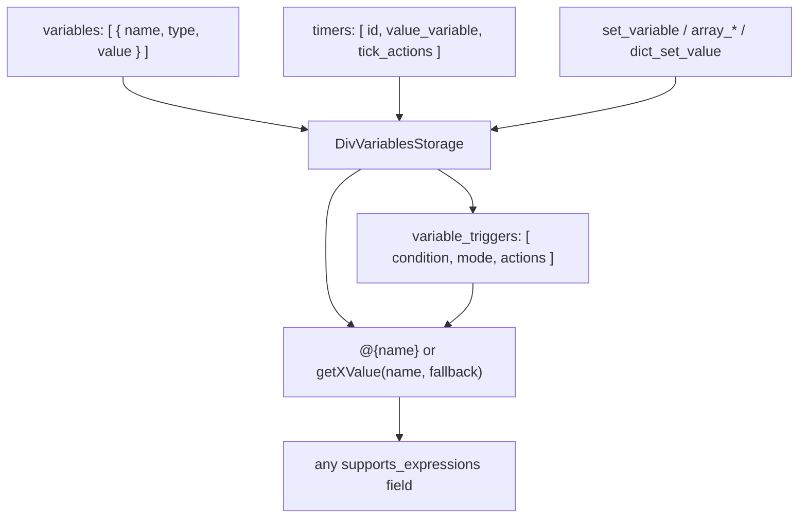

# 06 -- Variables and Expressions: the card's living data

A DivKit card is not a static tree; it has data that changes at runtime and
text that depends on that data. Variables hold the data. Expressions, written
as `@{...}`, splice it into any field. Triggers react when a variable changes,
timers change a variable on a clock, and functions let a card define reusable
computations in the same expression language. This document reads all four and
shows the expression parser that runs them.

# Variables: nine typed kinds

The card-level `variables` array is a list of `div-variable` objects.
`div-variable.json` is an `anyOf` of nine kinds, each with a `name`, a `type`,
and a `value`. Eight are plain data; the ninth is a special "property" binding:

```json
// divkit/schema/div-variable.json (excerpt — the anyOf branches)
{ "anyOf": [
  { "$ref": "#/definitions/string_variable" },
  { "$ref": "#/definitions/number_variable" },
  { "$ref": "#/definitions/integer_variable" },
  { "$ref": "#/definitions/boolean_variable" },
  { "$ref": "#/definitions/color_variable" },
  { "$ref": "#/definitions/url_variable" },
  { "$ref": "#/definitions/dict_variable" },
  { "$ref": "#/definitions/array_variable" },
  { "$ref": "#/definitions/property_variable" }
] }
```

Each data variable is just a name, a fixed `type`, and a value:

```json
// divkit/schema/div-variable.json (excerpt — one branch, the string variable)
"name":  { "$ref": "div-variable-name.json" },
"type":  { "type": "string", "enum": ["string"] },
"value": { "type": "string" }
```

`div-variable-name.json` is a plain string marked `"supports_expressions": false`
-- a variable *name* is never itself an expression. The nine types are `string`,
`number`, `integer`, `boolean`, `color`, `url`, `dict`, `array`, and `property`.
`property` is the odd one out: instead of a value, it declares a getter and a
setter, so reading it runs a computed `get` and writing it runs a list of
`set` actions. It binds a variable to an element property (a checkbox state, an
input value), and its `value_type` (a `div-evaluable-type`) names what the
property holds.

# Expressions: @{...}

Any field in the schema marked `supports_expressions` may contain an expression,
and an expression is written between `@{` and `}`. The iOS parser treats a
field as an expression only when the string contains the `@{` prefix:

```swift
// divkit-ios/DivKit/Expressions/ExpressionLink.swift (excerpt)
private let expressionPrefix = "@{"

init?(rawValue: String, ...) {
  guard rawValue.contains(expressionPrefix) else {
    return nil
  }
  ...
}
```

A string can mix literal text and expressions. The parser walks the string,
splitting it into three kinds of item: a literal string, a `CalcExpression`
(the text inside `@{...}`), or a nested `ExpressionLink` (an expression that
itself contains another expression). Resolution then concatenates the pieces:

```mermaid
flowchart LR
    RAW["'Hello @{name}, total @{getNumberValue(\"sum\", 0)}'"] --> P["ExpressionLink parse"]
    P --> S1["item: string 'Hello '"]
    P --> E1["item: calcExpression 'name'"]
    P --> S2["item: string ', total '"]
    P --> E2["item: calcExpression 'getNumberValue(\"sum\", 0)'"]
    S1 --> R["resolve: concatenate"]
    E1 --> R
    S2 --> R
    E2 --> R
    R --> OUT["'Hello Alice, total 42'"]
```

The expression language itself is a small calculator. A bare identifier reads a
variable; `getStringValue(name, fallback)`, `getNumberValue(name, fallback)`,
`getIntegerValue`, `getBooleanValue`, `getColorValue`, and `getUrlValue` read a
variable with a fallback and a type check; and there is a standard library of
math, string, date-time, color, array, dict, cast, and interval functions plus
infix operators for arithmetic, comparison, equality, and boolean logic:

```swift
// divkit-ios/DivKit/Expressions/FunctionsProvider.swift (excerpt — the registered groups)
MathFunctions.allCases.forEach { functions[$0.rawValue] = $0.function }
functions.addArrayFunctions()
functions.addCastFunctions()
functions.addColorFunctions()
functions.addDateTimeFunctions()
functions.addDictFunctions()
functions.addGetValueFunctions()
functions.addIntervalFunctions()
functions.addStringFunctions()
functions.addToStringFunctions()
functions.addTrigonometricFunctions()
functions.addDecimalFormatFunctions()
```

A variable reference that is `true` or `false` is a constant, not a lookup; the
provider maps those two names to constant functions and treats every other bare
identifier as a variable fetch from the current variable storage.

The generated models express "this field may be an expression" with an
`Expression<T>` wrapper -- either a plain `.value(T)` or a `.link` that is
resolved later:

```swift
// divkit-ios/DivKit/Expressions/Expression.swift (whole file)
public enum Expression<T> {
  case value(T)
  case link(ExpressionLink<T>)
}
```

That is why the generated `DivActionSetState` stores `stateId: Expression<String>`
rather than `String` (seen in [05-actions-and-state.md](./05-actions-and-state.md)):
the field can be a literal or a computed string, and resolution happens at run
time, not parse time.

# Triggers: react to a change

`div-variable.json` feeds the data; `div-trigger.json` reacts to it. A
`variable_triggers` entry watches a condition or a variable and runs actions:

```json
// divkit/schema/div-trigger.json (whole file)
{
  "properties": {
    "condition": { "$ref": "common.json#/boolean_int", "supports_expressions": true },
    "mode":      { "type": "string", "enum": ["on_condition", "on_variable"], "default_value": "on_condition" },
    "actions":   { "type": "array", "items": { "$ref": "div-action.json" }, "minItems": 1 }
  },
  "required": ["condition", "actions"]
}
```

`condition` is an expression that must evaluate to a boolean. In the default
`on_condition` mode, the trigger fires its `actions` when the condition becomes
true. In `on_variable` mode, the `condition` is read as the *name* of a
variable and the trigger fires whenever that variable's value changes. Either
way, the actions are the standard `div-action` list from
[05-actions-and-state.md](./05-actions-and-state.md), so a trigger can run a
`set_state`, `set_variable`, a `submit`, or a chain of them.

# Timers: change a variable on a clock

A `timers` entry drives a variable over time:

```json
// divkit/schema/div-timer.json (whole file)
{
  "properties": {
    "id":            { "$ref": "common.json#/id" },
    "duration":      { "$ref": "common.json#/non_negative_integer", "default_value": "0" },
    "tick_interval": { "$ref": "common.json#/positive_integer" },
    "value_variable":{ "$ref": "div-variable-name.json" },
    "tick_actions":  { "type": "array", "items": { "$ref": "div-action.json" } },
    "end_actions":   { "type": "array", "items": { "$ref": "div-action.json" } }
  },
  "required": ["id"]
}
```

A timer counts down (or up) from `duration`, writing its current value into
`value_variable` each time `tick_interval` elapses, running `tick_actions` per
tick and `end_actions` when it finishes. The `timer` typed action
(`start`/`stop`/`pause`/`resume`/`cancel`/`reset`, seen in
[05-actions-and-state.md](./05-actions-and-state.md)) is the control surface for
a timer by `id`.

# Functions: user-defined computation

`div-function.json` lets a card define a function in the expression language,
beyond the built-in library:

```json
// divkit/schema/div-function.json (excerpt)
"name":        { "type": "string", "pattern": "^[a-zA-Z_][a-zA-Z0-9_]*$", "supports_expressions": false },
"body":        { "type": "string", "supports_expressions": false },
"return_type": { "$ref": "div-evaluable-type.json", "supports_expressions": false },
"arguments":   { "type": "array", "items": { "$ref": "div-function-argument.json" } }
```

`name` must be an identifier (letters, digits, underscores, no leading digit);
`arguments` is a list of `name`/`type` pairs where `type` is a
`div-evaluable-type` (`string`, `integer`, `number`, `boolean`, `datetime`,
`color`, `url`, `dict`, `array`); `body` is the expression-language source; and
`return_type` declares the result type. The resolver exposes these through a
`DivFunctionsStorage`, and the `FunctionsProvider` tries a card-defined function
before falling back to the built-in library, so a card can shadow or extend
the standard functions.

The whole data flow of a variable is: define it, read it in an expression, and
mutate it with an action:



# The Aha Moment

**Aha:** Expressions are not a separate "template layer"; they are an *alternate
type* for ordinary fields. The schema marks a field `supports_expressions`, and
the generator types it as `Expression<T>` -- either a literal or a link. The
parser then treats a string as an expression only if it contains the `@{`
prefix. That is why a card can write `"text": "Hello"` or
`"text": "@{name}"` in the *same* field, and why escaping `\@{` produces a
literal `@{`. The binding system is not bolted on top of the format; it is
woven into the type of every field, generated for four platforms from the one
schema flag.

# Cross-References

- The card envelope that holds `variables`, `variable_triggers`, `timers`, and `functions`: [02-div-format.md](./02-div-format.md).
- The `set_variable` and other data-mutating typed actions: [05-actions-and-state.md](./05-actions-and-state.md).
- The `item_builder` loop that consumes variables to generate children: [04-layout-and-size.md](./04-layout-and-size.md).
- The code generation that turns `supports_expressions` into `Expression<T>`: [08-codegen.md](./08-codegen.md).

Continue to [07-styling-and-animation.md](./07-styling-and-animation.md).
