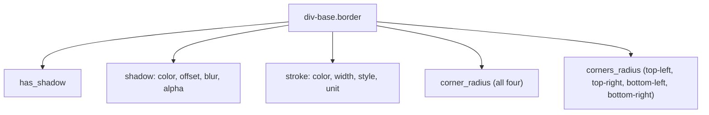
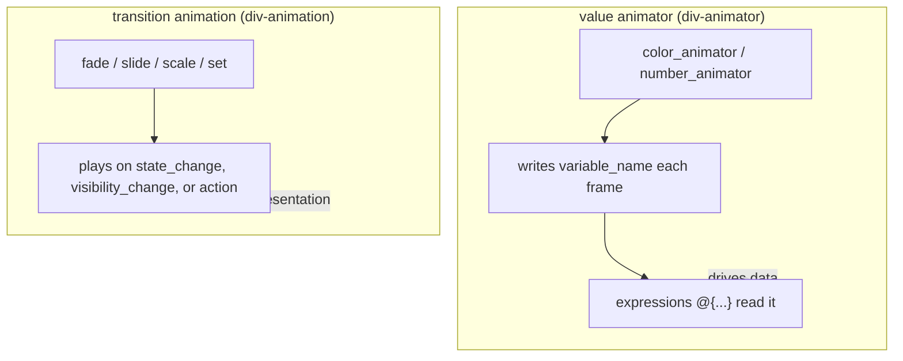

# 07 -- Styling and Animation: backgrounds, transforms, and motion

Styling is everything about how an element looks that is not its size:
backgrounds, borders, corners, shadows, transforms, and blend modes. Animation
is everything that changes those over time, and DivKit splits it into two
different mechanisms -- *value animators* that interpolate a variable, and
*transition animations* that play on a state or visibility change. This
document reads both, plus the background union that every element composes.

# The background union

`div-base` gives every element a `background` field, which is an array of
`div-background` objects. A background is one of five kinds:

```json
// divkit/schema/div-background.json (whole file — the branch list)
{ "anyOf": [
  { "$ref": "div-linear-gradient.json" },
  { "$ref": "div-radial-gradient.json" },
  { "$ref": "div-image-background.json" },
  { "$ref": "div-solid-background.json" },
  { "$ref": "div-nine-patch-background.json" }
] }
```

Because `background` is an *array*, an element can layer several: a gradient
underneath an image underneath a solid tint. The simplest kind is solid:

```json
// divkit/schema/div-solid-background.json (excerpt)
"color": { "$ref": "common.json#/color" },
"type":  { "type": "string", "enum": ["solid"] }
```

`common.json#/color` is a string with format `color` -- a hex or named color,
resolved by the client. A linear gradient (`type: "gradient"`) carries a list
of at least two colors, or a color map with per-stop positions, plus an angle:

```json
// divkit/schema/div-linear-gradient.json (excerpt)
"colors":     { "type": "array", "items": { "$ref": "common.json#/color" }, "minItems": 2 },
"color_map":  { "type": "array", "items": { "$ref": "#/definitions/color_point" }, "minItems": 2 },
"angle":      { "type": "integer", "constraint": "number >= 0 && number <= 360", "default_value": "0" },
"type":       { "type": "string", "enum": ["gradient"] }
```

A `color_point` pairs a `color` with a `position` between 0.0 and 1.0, so the
stops can be placed precisely instead of evenly. An image background
(`type: "image"`) carries the image URL, a scale, content alignment, an alpha,
and a `filters` array; a nine-patch background (`type: "nine_patch_image"`)
carries the image URL and an `insets` that says which part of the image is the
stretchable middle. The five kinds together cover solid fills, smooth
gradients, pictures, and the stretchable images that make resizable buttons.

# Border, corners, shadow, stroke

The `border` field is one object with four optional parts:

```json
// divkit/schema/div-border.json (whole file)
{
  "properties": {
    "has_shadow":    { "$ref": "common.json#/boolean_int", "default_value": "false" },
    "shadow":        { "$ref": "div-shadow.json" },
    "stroke":        { "$ref": "div-stroke.json" },
    "corner_radius": { "$ref": "common.json#/non_negative_integer" },
    "corners_radius":{ "$ref": "div-corners-radius.json" }
  }
}
```

`corner_radius` rounds all four corners the same amount; `corners_radius` sets
each corner independently (`top-left`, `top-right`, `bottom-left`,
`bottom-right`). A `shadow` needs only an `offset` and defaults the rest:

```json
// divkit/schema/div-shadow.json (excerpt)
"color":  { "$ref": "common.json#/color", "default_value": "#000000" },
"offset": { "$ref": "div-point.json" },
"blur":   { "$ref": "common.json#/non_negative_integer", "default_value": "2" },
"alpha":  { "type": "number", "default_value": "0.19" }
```

A `stroke` is the border line itself -- a `color` (required), a `width`
(default 1), a `style` (solid or dashed), and a `unit`.



# Transforms and blend modes

`transform` rotates an element around a pivot, and `blend_mode` changes how it
composites with what is behind it:

```json
// divkit/schema/div-transform.json (excerpt)
"rotation": { "type": "number" },
"pivot_x":  { "$ref": "div-pivot.json", "default_value": "{\"type\": \"pivot-percentage\",\"value\":50}" },
"pivot_y":  { "$ref": "div-pivot.json", "default_value": "{\"type\": \"pivot-percentage\",\"value\":50}" }
```

```json
// divkit/schema/div-blend-mode.json (whole file)
{ "enum": ["source_in", "source_atop", "darken", "lighten", "multiply", "screen"] }
```

The pivot defaults to the center (50 percent on each axis), so `rotation` spins
an element in place. `blend_mode` is the six Porter-Duff and color-blend modes
the platforms agree on. These are the "CSS effects" a server can request, kept
to a small, cross-platform set so a card renders identically everywhere.

# Value animators: interpolate a variable

The `animators` field on `div-base` is a list of `div-animator`, which is an
`anyOf` of two kinds -- `color_animator` and `number_animator`:

```json
// divkit/schema/div-animator.json (whole file)
{ "anyOf": [
  { "$ref": "div-color-animator.json" },
  { "$ref": "div-number-animator.json" }
] }
```

Both compose the same `div-animator-base`, which is where the shared clock
lives:

```json
// divkit/schema/div-animator-base.json (excerpt — the shared properties)
"id":            { "$ref": "common.json#/id" },
"variable_name": { "$ref": "div-variable-name.json" },
"duration":      { "$ref": "common.json#/non_negative_integer" },
"start_delay":   { "$ref": "common.json#/non_negative_integer", "default_value": "0" },
"interpolator":  { "$ref": "div-animation-interpolator.json", "default_value": "linear" },
"direction":     { "$ref": "div-animation-direction.json", "default_value": "normal" },
"repeat_count":  { "$ref": "div-count.json", "default_value": "{\"type\": \"fixed\", \"value\": 1}" },
"end_actions":   { "type": "array", "items": { "$ref": "div-action.json" } },
"cancel_actions":{ "type": "array", "items": { "$ref": "div-action.json" } }
```

The two concrete kinds add a `start_value` and an `end_value` -- a color pair
for `color_animator`, a number pair for `number_animator`:

```json
// divkit/schema/div-number-animator.json (excerpt)
"type":        { "type": "string", "enum": ["number_animator"] },
"start_value": { "type": "number" },
"end_value":   { "type": "number" }
```

The mechanic is the key: an animator does *not* draw anything itself. It
interpolates `variable_name` from `start_value` to `end_value` over `duration`,
writing the running value into that variable each frame. Whatever reads the
variable -- a text, a background color, a transform -- then updates
automatically. The animator is a value source, not a view; the
`animator_start` and `animator_stop` typed actions
([05-actions-and-state.md](./05-actions-and-state.md)) are its controls.

# Transition animations: play on a change

The second mechanism is `div-animation`, the transition animation. It is
attached to a change -- a visibility change, a state change, or an action's
`action_animation` -- and its `name` picks the effect:

```json
// divkit/schema/div-animation.json (excerpt)
"name":       { "type": "string", "enum": ["fade", "translate", "scale", "native", "set", "no_animation"] },
"duration":   { "$ref": "common.json#/non_negative_integer", "default_value": "300" },
"start_delay":{ "$ref": "common.json#/non_negative_integer", "default_value": "0" },
"start_value":{ "type": "number" },
"end_value":  { "type": "number" },
"repeat":     { "$ref": "div-count.json", "default_value": "{ \"type\": \"infinity\" }" },
"interpolator":{ "$ref": "div-animation-interpolator.json", "default_value": "spring" },
"items":      { "type": "array", "items": { "$ref": "div-animation.json" } }
```

`name: "set"` runs several sub-animations at once (the `items` list); the
others run one. The per-kind transitions are separate schema files, each
composing `div-transition-base` (which carries `start_delay`, `duration`
default 200, and `interpolator` default `ease_in_out`) plus its own fields:

```json
// divkit/schema/div-fade-transition.json (excerpt)
"alpha": { "type": "number", "default_value": "0.0" }

// divkit/schema/div-slide-transition.json (excerpt)
"edge":     { "type": "string", "enum": ["left", "top", "right", "bottom"], "default_value": "bottom" },
"distance": { "$ref": "div-dimension.json" }

// divkit/schema/div-scale-transition.json (excerpt)
"scale":  { "type": "number", "default_value": "0.0" },
"pivot_x":{ "type": "number", "default_value": "0.5" },
"pivot_y":{ "type": "number", "default_value": "0.5" }
```

A `transition_trigger` names *when* a transition runs -- `data_change`,
`state_change`, or `visibility_change` -- so the same fade can be attached to a
state switch or to an element scrolling into view.

The relationship between the two mechanisms is the thing to remember:



# The Aha Moment

**Aha:** DivKit separates *what is drawn* from *what changes it*. A background
is a value; an animator is a value source that writes a variable, and the
background reads that variable through an expression -- so an animator animates
a background *without knowing what a background is*. A transition animation is
the opposite: it animates a concrete visual change (fade, slide, scale) on a
trigger. The two never meet in the schema; they meet only through the
expression/variable layer, which is why a `number_animator` can drive a text,
a transform, a color, or anything else a variable can feed. The animator is a
producer of values, and every consumer is already value-driven.

# Cross-References

- The shared `div-base` that carries `background`, `border`, `transform`, `blend_mode`, and `animators`: [03-elements.md](./03-elements.md).
- The variable and expression layer that animators write to: [06-variables-expressions.md](./06-variables-expressions.md).
- The `animator_start`/`animator_stop` typed actions that control animators: [05-actions-and-state.md](./05-actions-and-state.md).
- The `div-font-base` fragment and font styling (font weight, size, family): [10-ios-architecture.md](./10-ios-architecture.md).

Continue to [08-codegen.md](./08-codegen.md).
