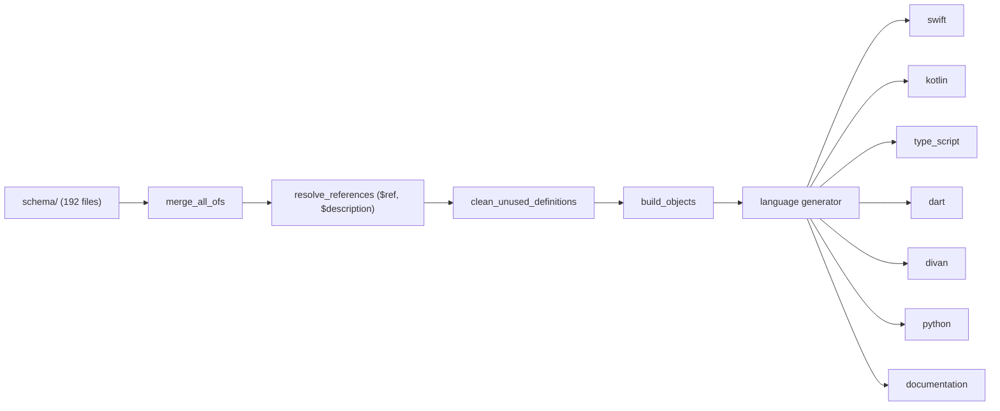
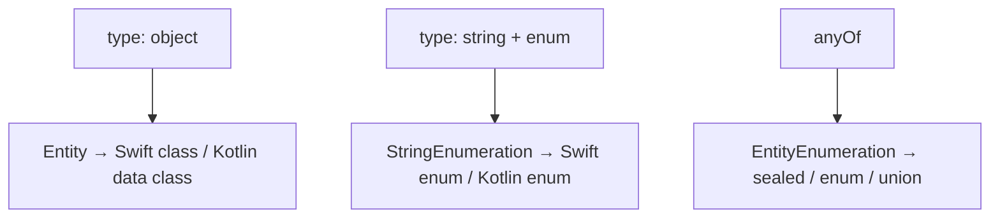

# 08 -- Code Generation: one schema compiled to four languages

The schema is not read by the clients at runtime; it is read by a Python
compiler (`api_generator`) that emits the model types each client compiles
against. The compiler has three stages -- preprocess, model, generate -- and
the schema steers each stage through `codegen` blocks. This document follows
one card type through the compiler and shows the flags that change the output.

# The three stages

The entry point is a small command-line driver, and the pipeline is three
calls:

```python
# api_generator/api_generator/generator.py (excerpt — the pipeline)
def generate_api(config, check_hash_files=False, save_hash_files=False):
    root_directory = schema_preprocessing(config)   # stage 1: flatten and resolve
    objects = build_objects(root_directory, config.generation)  # stage 2: model
    generator = __build_generator(config)           # stage 3: pick a language
    sorted_objects = sorted(objects, key=lambda obj: obj.name)
    generator.generate(sorted_objects)
```

Stage 1 is preprocessing, and it does three transformations in order:

```python
# api_generator/api_generator/schema/preprocessing/preprocessor.py (excerpt)
def schema_preprocessing(config):
    root_directory = resolve_structure(config)
    root_directory.merge_all_ofs(config.generation.lang)
    root_directory.resolve_references(config.generation.lang)
    root_directory.clean_unused_definitions()
    return root_directory
```

- `merge_all_ofs` flattens every `allOf` into one object, merging the shared
  `div-base`, `div-actionable`, and element-specific fragments (the composition
  rule from [02-div-format.md](./02-div-format.md)).
- `resolve_references` inlines every `$ref` to the referenced schema and turns
  every `$description` (`translations.json#/...`) into a resolved description.
- `clean_unused_definitions` drops `definitions` that nothing references, so
  dead sub-schemas do not become dead code.



Stage 2 is modeling. It walks the flattened files and classifies each one by
its shape:

```python
# api_generator/api_generator/schema/modeling/modeler.py (excerpt — the dispatch)
if type_value == 'object':
    return builders.entity_build(...)                 # → Entity
elif type_value == 'string' and contents.get('enum') is not None:
    return [StringEnumeration(...)]                    # → enum of strings
elif contents.get('anyOf') is not None:
    return builders.entity_enumeration_build(...)      # → discriminated union
return []
```

So the schema's three structural shapes map to the internal model's three
kinds: an `object` becomes an `Entity` (a class or struct), a `string` with an
`enum` becomes a `StringEnumeration` (a plain enum), and an `anyOf` becomes an
`EntityEnumeration` (a sealed class, Swift enum, or TypeScript union). The
internal model (`Declarable` and its subclasses in
`api_generator/api_generator/schema/modeling/entities.py`) is
language-neutral; the language generators translate it.



# The language generators

Stage 3 is a registry keyed by the config's `lang` string:

```python
# api_generator/api_generator/generator.py (excerpt — the registry)
generator_dict = {
    GeneratedLanguage.SWIFT: SwiftGenerator,
    GeneratedLanguage.KOTLIN: KotlinGenerator,
    GeneratedLanguage.DOCUMENTATION: DocumentationGenerator,
    GeneratedLanguage.TYPE_SCRIPT: TypeScriptGenerator,
    GeneratedLanguage.PYTHON: PythonGenerator,
    GeneratedLanguage.KOTLIN_DSL: KotlinDSLGenerator,
    GeneratedLanguage.DIVAN: DivanGenerator,
    GeneratedLanguage.DART: DartGenerator,
}
```

There are eight targets: Swift, Kotlin, Kotlin DSL, TypeScript, Python, Divan
(a JSON-builder DSL), Dart, and a documentation generator that emits human
docs from the same schema. Each lives in `api_generator/api_generator/generators/`
and has reference fixtures under `tests/references/`, so a generator change is
checked by diffing against expected output.

Each target is driven by the config file plus the schema's `codegen` blocks.
The config carries the language, the file header, and the generation modes:

```json
// api_generator/README.md (excerpt — the config format)
{
  "lang": "[kotlin|kotlinDsl|swift|typescript|python|documentation]",
  "header": "// Header of every generated file. Generated code. Do not modify.\nimport some.lib\nimport other.lib\n"
}
```

The `codegen` blocks are the per-type flags. Each language has its own
`GeneratorProperties` that reads its own keys. Swift reads four:

```python
# api_generator/api_generator/schema/modeling/entities.py (excerpt — Swift flags)
class SwiftGeneratorProperties(GeneratorProperties):
    self.generate_optional_args = specific_properties.get('generate_optional_arguments', True)
    self.super_protocol = specific_properties.get('super_protocol')
    self.public_default_values = specific_properties.get('public_default_values', False)
    self.template_is_public = specific_properties.get('template_is_public', True)
```

That is why `div-grid.json` carries
`"codegen": { "swift": { "generate_optional_arguments": false } }` -- it forces
the Swift factory to require every argument, because a grid without a
`column_count` is meaningless. The Divan generator reads a different set:
`forced_properties_order` (reorder the factory arguments), `factories`
(named convenience constructors such as `row`, `column`, `stack` on
`div-container`), `plus_operator`, `alias_factory`, and
`required_properties_at_factory`.

A schema-level `protocol_name` flag makes a fragment a Swift protocol instead
of a class. `div-animator-base.json` carries `"protocol_name": "div-animator-base"`,
so `div-color-animator` and `div-number-animator` conform to a `DivAnimatorBase`
protocol rather than subclass a base -- the schema expressing, for one language,
that the two animators share an interface but not an implementation.

# What generation emits

The output for one `object` schema is a model type plus, optionally, a template
and a serializer. The generation modes are `NORMAL_WITH_TEMPLATES`,
`NORMAL_WITHOUT_TEMPLATES`, `TEMPLATE`, and `SERIALIZER`, and the suffixes are
`_template` and `_json_parser`:

```python
# api_generator/api_generator/config.py (excerpt — the mode suffixes)
TEMPLATE_SUFFIX = '_template'
SERIALIZER_SUFFIX = '_json_parser'
```

A generated Swift model is a final class with a `static type`, stored
properties, a `dictionary` initializer, and a `Serializable` conformance. The
generated `DivActionSetState` seen in [05-actions-and-state.md](./05-actions-and-state.md)
shows all of it at once:

```swift
// divkit-ios/DivKit/generated_sources/DivActionSetState.swift (excerpt — generated)
public final class DivActionSetState: Sendable {
  public static let type: String = "set_state"
  public let stateId: Expression<String>
  public let temporary: Expression<Bool> // default value: true

  public convenience init(dictionary: [String: Any], context: ParsingContext) throws {
    self.init(
      stateId: try dictionary.getExpressionField("state_id", context: context),
      temporary: try dictionary.getOptionalExpressionField("temporary", context: context)
    )
  }
  ...
}
```

The `Expression<String>` type is the generator's answer to the schema's
`supports_expressions` flag (from [06-variables-expressions.md](./06-variables-expressions.md)):
a field that may contain `@{...}` is typed as an `Expression`, not a plain
`String`, so the parser knows to resolve it later.

Finally, generation is memoized by hash. The `--savehash` flag writes
`input_hash`, `output_hash`, `config_hash`, and `generator_hash` into the
output directory; `--checkhash` skips generation entirely when none of the four
changed:

```python
# api_generator/api_generator/generator.py (excerpt — the skip check)
if check_hash_files and config_not_changed():
    print('Input and output were not changed, won\'t write anything to the disk')
    return
```

That is the loop-closing guarantee: a schema edit regenerates exactly the files
that depend on it, and an unchanged schema costs nothing.

# The Aha Moment

**Aha:** The `codegen` blocks are the *escape hatch that keeps the schema a
contract instead of a straitjacket*. The schema describes the data; the `codegen`
blocks describe how *one* language should render that data -- `generate_optional_arguments:
false` for Swift, `factories` for Divan, `union_interfaces` for TypeScript. One
language can demand a required-argument factory while another emits a default-argument
one, and neither affects the JSON. The format stays single-sourced, but the four
platform APIs can still be shaped to each platform's idiom, because the compiler
reads two layers -- what the data is, and how to spell it here -- and merges them
at build time.

# Cross-References

- The schema structure the compiler reads, including `codegen` and `translations.json`: [09-schema.md](./09-schema.md).
- The `allOf` composition that `merge_all_ofs` flattens: [02-div-format.md](./02-div-format.md).
- The `supports_expressions` flag and the `Expression<T>` type it emits: [06-variables-expressions.md](./06-variables-expressions.md).
- The generated `DivActionSetState` class in context: [05-actions-and-state.md](./05-actions-and-state.md).

Continue to [09-schema.md](./09-schema.md).
