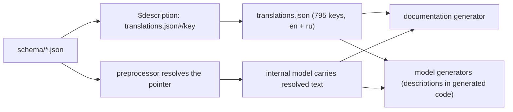

# 09 -- The Schema: a dialect of JSON Schema with platform metadata

The 192 files in `divkit/schema/` are JSON Schema, but they are JSON Schema
extended into a *contract language*. On top of the standard `$ref`, `allOf`,
and `anyOf`, the files carry platform scope, deprecation, expression support,
and code-generation flags -- plus a 795-key translation table that turns every
field into human text. This document reads the scalar library, the extension
keywords, and the translation machinery.

# The scalar library: common.json

The first file everything else references is `common.json`, which defines the
reusable scalar types. It is the smallest contract in the repo:

```json
// divkit/schema/common.json (whole file)
{
  "color":   { "type": "string", "format": "color" },
  "url":     { "type": "string", "format": "uri" },
  "positive_integer":     { "type": "integer", "constraint": "number > 0" },
  "non_negative_integer": { "type": "integer", "constraint": "number >= 0" },
  "non_negative_number":  { "type": "number",  "constraint": "number >= 0" },
  "positive_number":      { "type": "number",  "constraint": "number > 0" },
  "boolean_int": {
    "oneOf": [ { "type": "boolean" }, { "type": "integer", "enum": [0, 1] } ]
  },
  "id": { "type": "string", "supports_expressions": false }
}
```

Three facts matter here. `color` and `url` are `format`-annotated strings, so
the generator emits a `Color` or `URL` type, not a bare string. `boolean_int`
accepts either a real boolean or the integers `0`/`1` -- the one place the
format tolerates two spellings for one value, a legacy of early hand-written
cards. And `id` is the one scalar that *forbids* expressions, so an element
identifier is always a literal.

Every other file references these instead of redeclaring them, which is why
"a non-negative integer" means exactly one thing everywhere in the format.

# The extension keywords

The dialect adds roughly a dozen keywords on top of standard JSON Schema. They
fall into three groups. The first group is *platform scope*, which turns the
format into a cross-platform contract that knows its own differences:

```json
// divkit/schema/div-size-unit.json (whole file — platform scope)
{
  "type": "string",
  "enum": ["dp", "sp", "px"],
  "platforms": ["android", "ios"],
  "unsupported_platforms": {
    "web": "All sizes are set in dp or sp, controlled by integration code. There is no concept of device px."
  }
}
```

`platforms` says which targets a field applies to; `unsupported_platforms` is a
map from target to a *human explanation* of why it does not. The generator uses
`platforms` to omit a field from a platform's model, and the documentation
generator uses `unsupported_platforms` to explain the gap. The pair appears on
fields that differ by platform -- a `referer` on Android and iOS, but not on
the web, where the browser controls it.

The second group is *typing intent*, the keywords that steer what type the
generator emits:

| Keyword | Meaning |
|---|---|
| `supports_expressions` | The field may contain `@{...}`; emit `Expression<T>`. |
| `long_type` | The integer is 64-bit; emit `Int64`/`Long`. |
| `constraint` | A numeric bound like `"number >= 0.0 && number <= 1.0"`. |
| `force_enum_field` | Keep an enum as a field even when it has one case. |
| `protocol_name` | Emit the type as a protocol (Swift), not a class. |
| `deprecated` | Mark the field or type deprecated in generated code. |

The third group is *naming and codegen*, the per-language overrides:

| Keyword | Meaning |
|---|---|
| `alias_kotlin` / `alias_swift` / `alias_divan` | Rename the type or member in one language. |
| `suppress_inline` | Do not inline a `definition` into its parent. |
| `code_generation_disabled_swift` | Skip this field in the Swift output. |
| `typescript_templatable` | Control TypeScript template generation for a type. |

An example of the naming override: `div-variable.json` renames its `string`
variable to `str_variable` in Kotlin (via `alias_kotlin`) because `string` is
awkward in Kotlin, while the Swift type keeps the JSON name. The dialect is the
place where "the JSON name" and "the idiomatic name" diverge per language, once,
in the schema, rather than in four hand-written bindings.

# codegen blocks

The `codegen` block is a map from language to a set of language-specific flags.
`div-container.json` uses it three ways at once:

```json
// divkit/schema/div-container.json (excerpt — the codegen block)
"codegen": {
  "divan": {
    "forced_properties_order": ["orientation"],
    "factories": {
      "row":    { "vararg_property": "items", "inlines": { "orientation": "horizontal" } },
      "column": { "vararg_property": "items", "inlines": { "orientation": "vertical" } },
      "stack":  { "vararg_property": "items", "inlines": { "orientation": "overlap" } }
    }
  },
  "swift":      { "generate_optional_arguments": false },
  "typescript": {
    "union_interfaces": [
      { "required_params": ["items"] },
      { "required_params": ["item_builder"] }
    ]
  }
}
```

For Divan it generates three named constructors (`row`, `column`, `stack`) that
fix `orientation` and take `items` as a variadic argument. For Swift it forces
a required-argument factory. For TypeScript it emits two interfaces, one where
`items` is required and one where `item_builder` is required, enforcing the
"exactly one of these" rule at the type level. The JSON is the same; only the
surface differs. The full flag set is described in [08-codegen.md](./08-codegen.md).

# The translation table

Every `$description` in the schema is a pointer into `translations.json`, not
a literal string. The preprocessor resolves it during `resolve_references`:

```json
// divkit/schema/div-fixed-size.json (excerpt — a description pointer)
"value": { "$ref": "common.json#/non_negative_integer",
           "$description": "translations.json#/div_fixed_size_value" }
```

`translations.json` is a flat map of 795 keys, each holding the text in two
languages:

```json
{
  "div_fixed_size_value": {
    "en": "The fixed size of the element.",
    "ru": "Фиксированный размер элемента."
  }
}
```

One key, two translations, and the documentation generator picks the language
it is building for. This is why the schema files themselves contain no prose:
all human text lives in `translations.json`, so a field's description exists
once and is translated for every target. The documentation generator
(`GeneratedLanguage.DOCUMENTATION`, from
[08-codegen.md](./08-codegen.md)) is the consumer of this table -- it walks the
same internal model and emits reference pages, turning the contract into the
human documentation that ships alongside the SDK.



# The Aha Moment

**Aha:** The schema is a *data-contract language*, not a validator. JSON Schema
validates a document; this dialect *defines a product*. `platforms` and
`unsupported_platforms` record where a feature exists and why it does not;
`supports_expressions` decides whether a field is a value or a binding;
`deprecated` records a migration; `alias_*` records a naming judgment; `codegen`
records how each language should spell the thing. A validator would throw these
away; the code generator and the documentation generator read them and build
four APIs and a manual from them. The schema does not describe the UI format --
it is the source file the UI format is compiled from.

# Cross-References

- How the compiler reads this schema and its `codegen` blocks: [08-codegen.md](./08-codegen.md).
- The `div.json` dispatcher and the `allOf` composition rule: [02-div-format.md](./02-div-format.md).
- The `supports_expressions` flag and the `Expression<T>` type it produces: [06-variables-expressions.md](./06-variables-expressions.md).
- The `common.json` scalars in use across elements and sizes: [04-layout-and-size.md](./04-layout-and-size.md).

Continue to [10-ios-architecture.md](./10-ios-architecture.md).
