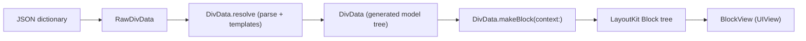
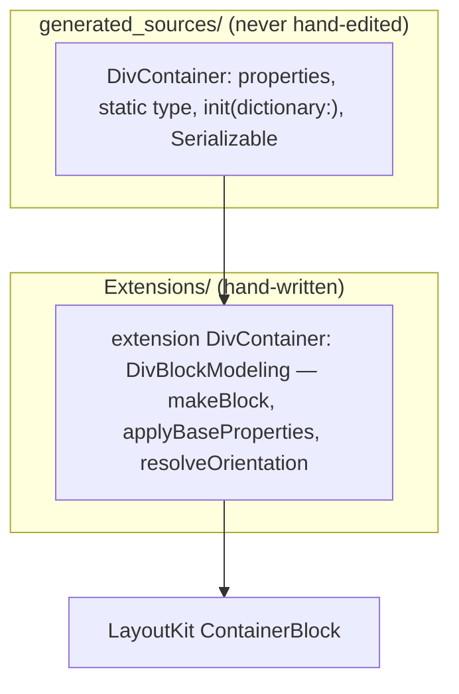
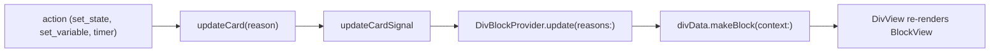

# 10 -- iOS Architecture: DivKitComponents and the modeling pipeline

The iOS renderer is a pipeline that turns a JSON dictionary into a `UIView`.
The public entry point is `DivKitComponents`, a composition root that owns
every subsystem; `DivView` feeds it a card and displays the result; and the
whole thing hangs on one protocol, `DivBlockModeling`, that joins the generated
models to the hand-written rendering. This document traces the pipeline end to
end and reads the seam.

# The pipeline

A card's journey through the iOS code is four stages, each a conversion:



The `DivView` class orchestrates the last two stages. It holds a
`DivBlockProvider`, which parses JSON into `DivData` and then calls
`divData.makeBlock(context:)` to produce a `Block`. When the block changes, the
provider re-renders it into a `BlockView`:

```swift
// divkit-ios/DivKit/Views/DivView.swift (excerpt — the update path)
private func update(block: Block) {
  let renderingDelegate: RenderingDelegate? = if let divCardId = blockProvider?.cardId {
    divKitComponents.renderingDelegate(for: divCardId)
  } else {
    nil
  }
  if let blockView, block.canConfigureBlockView(blockView) {
    block.configureBlockView(blockView, observer: self, ...)
  } else {
    blockView = block.makeBlockView(observer: self, renderingDelegate: renderingDelegate)
  }
  invalidateIntrinsicContentSize()
  setNeedsLayout()
}
```

The `Block` and `BlockView` types come from `LayoutKit`, the geometry engine
(the subject of [11-layoutkit.md](./11-layoutkit.md)). `DivKit`'s job is
everything up to that point: parse, resolve, model, and turn each Div model
into a `Block`.

# DivKitComponents: the composition root

`DivKitComponents` is one object that owns every subsystem a card needs. Its
properties name the whole surface:

```swift
// divkit-ios/DivKit/DivKitComponents.swift (excerpt — the owned subsystems)
public final class DivKitComponents {
  public let actionHandler: DivActionHandler
  public let blockStateStorage = DivBlockStateStorage()
  public let stateManagement: DivStateManagement
  public let variablesStorage: DivVariablesStorage
  public let triggersStorage: DivTriggersStorage
  public let fontProvider: DivFontProvider
  public let imageHolderFactory: DivImageHolderFactory
  public let patchProvider: DivPatchProvider
  public let submitter: DivSubmitter
  public let tooltipManager: TooltipManager
  public let urlHandler: DivUrlHandler
  ...
}
```

The initializer wires them together. Each is a separate concern -- actions,
state, variables, triggers, timers, fonts, images, patches, submission,
tooltips, URL handling -- and the initializer is where the dependencies are
joined: the `DivActionHandler` receives the `variablesStorage`, the
`stateManagement`, the `patchProvider`, the `submitter`, and an `updateCard`
closure, so a `set_state` action can change state and trigger a re-render.

`DivKitComponents` also makes the *context*. Every modeling pass needs an
ambient environment -- the variables, the fonts, the image cache, the current
path -- and `makeContext` bundles it:

```swift
// divkit-ios/DivKit/DivKitComponents.swift (excerpt — the context factory)
func makeContext(
  viewId: DivViewId,
  cachedImageHolders: [ImageHolder],
  debugParams: DebugParams = DebugParams(),
  parentScrollView: ScrollView? = nil
) -> DivBlockModelingContext {
  ...
  return DivBlockModelingContext(
    viewId: viewId,
    stateManager: stateManagement.getStateManagerForCard(cardId: cardId),
    actionHandler: actionHandler,
    blockStateStorage: blockStateStorage,
    imageHolderFactory: imageHolderFactory.withCache(cachedImageHolders),
    fontProvider: fontProvider,
    variablesStorage: variablesStorage,
    triggersStorage: triggersStorage,
    ...
  )
}
```

# The seam: DivBlockModeling

The one protocol that joins the generated models to the layout engine is three
members:

```swift
// divkit-ios/DivKit/DivBlockModeling.swift (whole file)
public protocol DivBlockModeling {
  var id: String? { get }
  static var type: String { get }
  func makeBlock(context: DivBlockModelingContext) throws -> Block
}
```

Every generated Div model conforms. Its `type` is the JSON discriminator, its
`id` is the JSON `id`, and `makeBlock(context:)` is where a Div model becomes a
`LayoutKit` `Block`. `DivData` itself conforms, so the top of the card is
treated exactly like any element.

# The generated/hand-written split

The 206 files in `generated_sources/` are data and parsing only. They carry the
properties, the `static type`, the dictionary initializer, and the
`Serializable` conformance -- but *no* `makeBlock`. The rendering lives in
hand-written extensions under `DivKit/Extensions/`, one per element:

```swift
// divkit-ios/DivKit/Extensions/DivContainer/DivContainerExtensions.swift (excerpt)
extension DivContainer: DivBlockModeling {
  public func makeBlock(context: DivBlockModelingContext) throws -> Block {
    let context = modifiedContextParentPath(context)
    return try applyBaseProperties(
      to: { try makeBaseBlock(context: context) },
      context: context,
      actionsHolder: self,
      applyPaddings: false,
      clipToBounds: resolveClipToBounds(context.expressionResolver)
    )
  }
  ...
}
```

So `DivContainer` (the generated class, with `items`, `orientation`, and the
rest) is extended by hand to add `makeBlock`. The generated code knows *what a
container is*; the hand-written code knows *how to draw one*. This split is the
whole design in miniature:



`applyBaseProperties` is the shared helper every element calls to apply the
`div-base` chrome -- size, paddings, margins, alignment, transforms, actions --
so the base fragment is implemented once, not per element. The extension files
also hold the per-element expression resolution: `resolveOrientation`,
`resolveClipToBounds`, and so on, each reading the context's `expressionResolver`
to turn an `Expression<T>` into a concrete value.

# The context: dependency injection by value

`DivBlockModelingContext` is the ambient environment, passed down as the tree
is walked. It is a value type, and `modifying(...)` returns a child context for
a child element:

```swift
// divkit-ios/DivKit/DivBlockModelingContext.swift (excerpt — the child context)
func modifying(
  overridenId: String? = nil,
  cardLogId: String? = nil,
  currentDivId: String? = nil,
  currentDivType: String? = nil,
  pathSuffix: String? = nil,
  parentDivStatePath: DivStatePath? = nil,
  ...
) -> Self {
  var context = self
  ...
  if let pathSuffix {
    context.path = context.path + pathSuffix
  }
  context.expressionResolver = makeExpressionResolver(...)
  return context
}
```

A child element gets the same variables, fonts, and image factory, but a new
`path` (its position in the element tree) and a new `expressionResolver` bound
to that path. The `path` is what makes variables scoped: a variable lookup is
`variablesStorage.getVariableValue(path: path, name:)`, so the same name can
resolve differently at different points in the tree.

The `DivData` top-level `makeBlock` uses this to pick the current state and
walk into it:

```swift
// divkit-ios/DivKit/Extensions/DivData/DivDataExtensions.swift (excerpt)
public func makeBlock(context: DivBlockModelingContext) throws -> Block {
  guard let state = getCurrentState(context: context) else {
    throw DivBlockModelingError("DivData has no states", path: context.path)
  }
  ...
  let div = state.div
  stateManager.updateBlockIdsWithStateChangeTransition(statePath: statePath, div: div)
  let block = try div.value.makeBlock(context: divContext)
  stateManager.setState(stateBlockPath: stateBlockPath, stateID: DivStateID(rawValue: stateId))
  return block
    .addingStateBlock(ids: stateManager.getVisibleIds(statePath: statePath))
    .addingDebugInfo(context: divContext)
}
```

`getCurrentState` asks the `stateManager` which state is active (returning the
first state on first render), then `div.value.makeBlock` walks that state's
element tree. The result is wrapped with state and debug decorations.

# Re-render on change

When an action changes a variable or a state, the change flows back through a
signal. `DivKitComponents` exposes `updateCardSignal`, and `DivBlockProvider`
subscribes to it; a change posts a `DivCardUpdateReason`, the provider rebuilds
the block, and the view updates in place:



The reasons are `patch`, `timer`, `state`, `variable`, and `external` -- the
five things that can invalidate a card -- and the provider rebuilds only when
the reason touches its own card.

# The Aha Moment

**Aha:** DivKit's iOS renderer is two halves with a clean seam: *generated data*
and *hand-written behavior*. The generator emits `DivContainer` with its
properties and a dictionary parser, but it does not know how to draw a
container; the hand-written `extension DivContainer: DivBlockModeling` does,
using a `DivBlockModelingContext` passed down the tree. That is why a schema
change regenerates the data model without ever touching the renderer, and a
rendering change never touches the generated files. The `makeBlock(context:)`
method is the single point where "what this element is" becomes "how to draw
it", and the context is the dependency injection: instead of globals or
singletons, every subsystem is a value carried down with each child's path.

# Cross-References

- The generated models and how they are produced: [08-codegen.md](./08-codegen.md).
- The `LayoutKit` `Block`/`BlockView` types this feeds: [11-layoutkit.md](./11-layoutkit.md).
- The action and state machinery behind `updateCard`: [05-actions-and-state.md](./05-actions-and-state.md).
- The variable and expression layer the context's resolver serves: [06-variables-expressions.md](./06-variables-expressions.md).

Continue to [11-layoutkit.md](./11-layoutkit.md).
