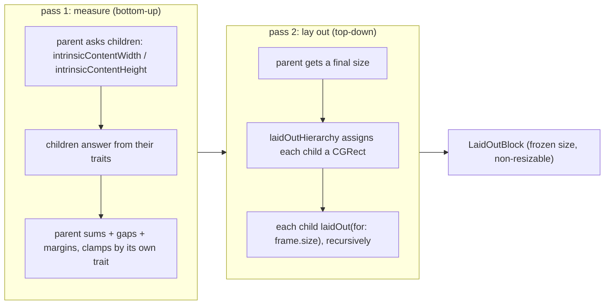
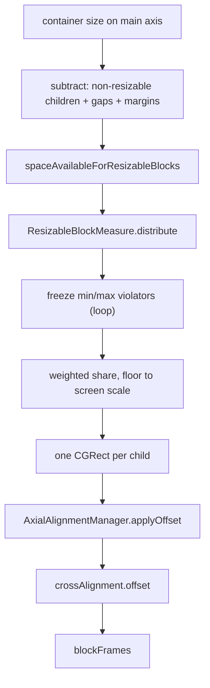

# 11 -- LayoutKit: the measure-then-layout geometry engine

`LayoutKit` is the geometry half of the iOS renderer. `DivKit` turns JSON into
`Block` objects; `LayoutKit` turns a `Block` tree into a set of frames (an
`x`, a `y`, a width, and a height for every element), and then into `UIView`
objects. The engine rests on one idea: a block never picks its own size. It
answers questions about itself, and the parent block that contains it does the
arithmetic. This document reads the `Block` contract, the two passes that turn
a tree into frames, and the container that does most of the work.

# The Block contract: questions, not sizes

`Block` is a protocol. A block does not have a `size` property that it sets.
It has a set of queries that a parent asks, and the parent computes sizes from
the answers. The protocol is a long list of such queries:

```swift
// divkit-ios/LayoutKit/LayoutKit/Blocks/Block.swift (excerpt)
public protocol Block: AnyObject, ... {
  var isVerticallyResizable: Bool { get }
  var isHorizontallyResizable: Bool { get }

  var isVerticallyConstrained: Bool { get }
  var isHorizontallyConstrained: Bool { get }

  var widthOfHorizontallyNonResizableBlock: CGFloat { get }
  var heightOfVerticallyNonResizableBlock: CGFloat { get }

  var calculateWidthFirst: Bool { get }
  var intrinsicContentWidth: CGFloat { get }
  func intrinsicContentHeight(forWidth: CGFloat) -> CGFloat

  var weightOfHorizontallyResizableBlock: LayoutTrait.Weight { get }
  var weightOfVerticallyResizableBlock: LayoutTrait.Weight { get }

  var minWidth: CGFloat { get }
  var minHeight: CGFloat { get }
  var maxWidth: CGFloat { get }
  var maxHeight: CGFloat { get }
  ...
}
```

Every one of these is a question. "Are you stretchable in the vertical
direction?" (`isVerticallyResizable`). "What is your natural width?"
(`intrinsicContentWidth`). "What is your share of the leftover space?"
(`weightOfHorizontallyResizableBlock`). "What are your hard limits?"
(`minWidth`, `maxWidth`). A block answers; it never assigns.

The one method that looks like it computes a size, `sizeFor`, still computes it
*from the answers*, and it is shared by every block through a protocol
extension. Its logic is the whole box model in one place:

```swift
// divkit-ios/LayoutKit/LayoutKit/Blocks/Block.swift (excerpt — the shared size solver)
public func sizeFor(
  widthOfHorizontallyResizableBlock: CGFloat,
  heightOfVerticallyResizableBlock: CGFloat,
  constrainedWidth: CGFloat,
  constrainedHeight: CGFloat
) -> CGSize {
  if calculateWidthFirst {
    let width: CGFloat
    if isHorizontallyResizable {
      width = clamp(widthOfHorizontallyResizableBlock, min: minWidth, max: maxWidth)
    } else {
      let intrinsicWidth = widthOfHorizontallyNonResizableBlock
      let constrainedWidth = isHorizontallyConstrained ? min(intrinsicWidth, constrainedWidth) :
        intrinsicWidth
      width = max(minWidth, constrainedWidth)
    }
    ...
  }
  ...
}
```

Read it as a decision table. A resizable block takes the offered size and
clamps it by its own min and max. A non-resizable block takes its intrinsic
size, but if it is *constrained* (the Div `wrap_content` with `constrained:
true`), it shrinks to fit the offered size first. Either way the final width is
at least the block's `minWidth`. The three Div size concepts from
[04-layout-and-size.md](./04-layout-and-size.md) collapse into three booleans
here: `match_parent` is "resizable", `wrap_content` is "not resizable",
"constrained" is the extra clamp.

# The trait: three kinds of size

The answers are not stored as loose booleans. They are derived from one enum,
`LayoutTrait`, which every container carries for each axis:

```swift
// divkit-ios/LayoutKit/LayoutKit/Blocks/LayoutTrait.swift (whole file, trimmed)
public enum LayoutTrait: Equatable {
  case fixed(CGFloat)
  case intrinsic(constrained: Bool, minSize: CGFloat, maxSize: CGFloat)
  case weighted(Weight, minSize: CGFloat = 0, maxSize: CGFloat = .infinity)

  public struct Weight: ... {
    public static let `default`: Weight = 1
    public let rawValue: CGFloat
    // rawValue must be > 0 and finite
  }
}
```

`fixed` is a literal size. `intrinsic` is "measure my content, then clamp by
min and max"; its `constrained` flag is the shrink-to-fit behavior. `weighted`
is "I take a share of the leftover space, proportioned by my `Weight`". The
mapping from Div is exact: `div-fixed-size` becomes `fixed`, `div-wrap-content-size`
becomes `intrinsic`, and `div-match-parent-size` (with its `weight`, `min_size`,
`max_size`) becomes `weighted`.

The `BlockWithTraits` protocols turn the trait into the protocol's answers:

```swift
// divkit-ios/LayoutKit/LayoutKit/Blocks/BlockWithTraits.swift (excerpt)
extension BlockWithWidthTrait {
  public var isHorizontallyResizable: Bool { widthTrait.isResizable }
  public var isHorizontallyConstrained: Bool { widthTrait.isConstrained }
  public var minWidth: CGFloat {
    switch widthTrait {
    case let .fixed(size): size
    case let .intrinsic(_, minSize, _),
         let .weighted(_, minSize, _): minSize
    }
  }
  ...
}
```

So a block does not implement the protocol getters by hand. It stores
one `widthTrait` and one `heightTrait`, and `BlockWithTraits` derives every
answer. That is the key simplification: the entire box model is two enum
values, and everything else is a function of them.

# Two passes: measure, then lay out

A block tree goes through two passes. The first pass measures: the parent asks
its children for their intrinsic sizes and traits, sums them, and returns its
own intrinsic size. The second pass lays out: given a final size, the parent
assigns each child a `CGRect` and asks it to lay out its own subtree at that
size. The seam between the passes is `BlockWithLayout`:

```swift
// divkit-ios/LayoutKit/LayoutKit/Blocks/BlockWithLayout.swift (whole file, trimmed)
protocol BlockWithLayout: Block, BlockWithLayoutRenderingImpl {
  func laidOutHierarchy(for size: CGSize) -> (Self, Layout)
}

extension BlockWithLayout {
  public func laidOut(for width: CGFloat) -> Block {
    LaidOutBlock(block: self, width: width)
  }
  public func laidOut(for size: CGSize) -> Block {
    LaidOutBlock(block: self, size: size)
  }
}
```

`laidOutHierarchy(for:)` is the whole layout pass: it takes the final size,
computes a `Layout` (the child frames), and returns a new block whose children
have already been laid out. The result is wrapped in a `LaidOutBlock`, a thin
immutable shell that freezes the size and stops further layout:

```swift
// divkit-ios/LayoutKit/LayoutKit/Blocks/LaidOutBlock.swift (excerpt)
final class LaidOutBlock<T: BlockWithLayout>: Block {
  let block: T
  let layout: T.Layout
  let isVerticallyResizable = false
  let isHorizontallyResizable = false
  private let size: CGSize
  ...
  init(block: T, size: CGSize) {
    self.size = size
    (self.block, layout) = block.laidOutHierarchy(for: size)
  }
}
```

A `LaidOutBlock` is non-resizable and reports its fixed `size` for every
intrinsic query, so it is a leaf in any further measure pass. The measure
queries (`intrinsicContentWidth`, `intrinsicContentHeight`) and the layout call
(`laidOutHierarchy`) are the two directions of the same traversal:



The two passes are separate because a block's height often depends on its width
(a text line wraps), so width is measured first, then height, then frames are
assigned. The `calculateWidthFirst` flag records the one case where the order
reverses: a vertical `wrap` container with an intrinsic width measures height
first.

# The container: distributing space

`ContainerBlock` is where the arithmetic happens. It has a `layoutDirection`
(`horizontal` or `vertical`), a `layoutMode` (`wrap` or `noWrap`), and two
alignment axes. The **axial** alignment positions children along the main
direction (`leading`, `center`, `trailing`, `spaceBetween`, `spaceAround`,
`spaceEvenly`); the **cross** alignment positions them across it (`leading`,
`center`, `trailing`, `baseline`). This is the Div `content_alignment` split
from [04-layout-and-size.md](./04-layout-and-size.md): axial maps to the
main-axis `space-*` values, cross maps to the cross-axis values.

The no-wrap layout algorithm is four steps, in
`ContainerBlockLayout.calculateNoWrapLayoutFrames`:

```swift
// divkit-ios/LayoutKit/LayoutKit/Blocks/Container/ContainerBlockLayout.swift (excerpt)
let gapsSize = gaps.reduce(0, +)

let resizableBlocksData = blocks
  .filter { $0.isResizable(in: layoutDirection) }
  .reduce(into: ...) { ... totalWeight, margins ... }

let sizeOfNonResizableBlocks = ... // sum of the non-resizable children

let spaceAvailableForResizableBlocks = (
  sizeInDirection
    - sizeOfNonResizableBlocks
    - gapsSize
    - resizableBlocksData.marginsSize
)
```

Step one: add the gaps. Step two: subtract the non-resizable children (they
keep their intrinsic size) and the margins. Step three: what is left is the
space the resizable children share, by weight. Step four: walk the children and
assign each a frame, adding the axial and cross alignment offsets.

The weighted distribution is not a simple `space / weight` division, because a
child may have a `min_size` or `max_size` that it cannot violate. The
distribution is done by `ResizableBlockMeasure`, which uses the same algorithm
as web flexbox, called "resolve flexible lengths": freeze any child that hits
its min or max, then redistribute among the rest:

```swift
// divkit-ios/LayoutKit/LayoutKit/Blocks/ResizableBlockMeasure.swift (excerpt)
var didFreeze = true
while didFreeze, totalActiveWeight > 0 {
  didFreeze = false
  let perWeight = availableSpace / totalActiveWeight

  var totalViolation: CGFloat = 0
  for i in measures.indices where !frozen[i] {
    guard case let .resizable(weight, minSize, maxSize, _) = measures[i] else { continue }
    let base = weight.rawValue * perWeight
    totalViolation += clamp(base, min: minSize, max: maxSize) - base
  }

  for i in measures.indices where !frozen[i] {
    guard case let .resizable(weight, minSize, maxSize, _) = measures[i] else { continue }
    let base = weight.rawValue * perWeight
    if base < minSize, totalViolation >= 0 { sizes[i] = minSize; frozen[i] = true; ... }
    else if base > maxSize, totalViolation <= 0 { sizes[i] = maxSize; frozen[i] = true; ... }
  }
}
```

The comment in the source calls this out directly: it is the web flexbox
"resolve flexible lengths" step, reimplemented because Div's `weight`,
`min_size`, and `max_size` are the same three knobs. A child that would get
less than its minimum is pinned at the minimum; a child that would get more
than its maximum is pinned at the maximum; the loop repeats until no child
violates a bound. The final pass then rounds each share to the screen scale,
giving the last child the rounding remainder so the total is exact.



The `AxialAlignmentManager` is the last piece. It turns the `space-*` alignment
names into offsets:

```swift
// divkit-ios/LayoutKit/LayoutKit/Blocks/Container/AxialAlignmentManager.swift (excerpt)
case .spaceBetween:
  let spaceBetweenItems = totalSpace / CGFloat(max(numberOfItems - 1, 1))
  return .array((0..<numberOfItems).map { CGFloat($0) * spaceBetweenItems })
case .spaceAround:
  let spaceBetweenItems = totalSpace / CGFloat(numberOfItems)
  let offset = spaceBetweenItems * 0.5
  return .array((0..<numberOfItems).map { CGFloat($0) * spaceBetweenItems + offset })
case .spaceEvenly:
  let spaceBetweenItems = totalSpace / CGFloat(numberOfItems + 1)
  return .array((0..<numberOfItems).map { CGFloat($0 + 1) * spaceBetweenItems })
```

`spaceBetween` puts zero space at the ends and equal space between. `spaceAround`
puts half a gap at each end. `spaceEvenly` puts a full gap at each end. The
`wrap` mode runs the same steps but first groups children into lines with
`WrapLayoutGroups`, then aligns each line.

# Grid and stack: two more containers

`GridBlock` generalizes the container to two dimensions. It holds a `columnCount`
and a list of items, each with a `span` (rows and columns it occupies) and a
`weight` (separate column and row weights). A `Grid` value is computed once
from the spans: it places each item into the next free cell, recording which
cells it covers:

```swift
// divkit-ios/LayoutKit/LayoutKit/Blocks/Grid/Grid.swift (excerpt)
init(spans: [GridBlock.Span], columnCount: Int) throws {
  ...
  for (index, span) in spans.enumerated() {
    while result[iterator.current] != nil { reserveRowsUpTo(iterator.next().row) }
    guard iterator.current.column + span.columns <= columnCount else { throw noSpaceError }
    reserveRowsUpTo(iterator.current.row + span.rows - 1)
    for rowOffset in 0..<span.rows {
      for columnOffset in 0..<span.columns {
        result[iterator.current + (rowOffset, columnOffset)] = index
      }
    }
  }
  itemsIndices = result
}
```

Then `GridBlock.Layout` measures twice: first column widths (distributing the
horizontal space by column weight), then row heights (distributing the vertical
space by row weight), each using the same `calculateSizes` helper. The frames
are read back out of the partial sums of those column and row sizes.

`LayeredBlock` is the third container, the one for `div-container` with
`orientation: overlap`. It has no main direction: every child gets a frame over
the same origin, and its `alignment` is a two-dimensional `BlockAlignment2D`
(leading/center/trailing on each axis). The `fillsWidth` and `fillsHeight`
flags handle the one hard case, a `match_parent` child inside a `wrap_content`
stack: such a child is measured as constrained wrap-content so the stack can
shrink to its content, then stretched back to fill the stack's resolved size on
the matched axis. This is the `overlap` mode of a Div container, the third
orientation after `horizontal` and `vertical`.

# The Aha Moment

**Aha:** LayoutKit is a *question-and-answer* system, not an imperative one. A
block has no "lay me out" method that mutates itself. It stores two `LayoutTrait`
values and answers queries (`resizable?`, `intrinsic width?`, `weight?`,
`min/max?`); the parent — `ContainerBlock`, `GridBlock`, `LayeredBlock` — asks
the questions and does the arithmetic. That is why the two passes are clean:
the measure pass asks every child a question and sums the answers, and the
layout pass tells every child its final frame. There is no global layout state,
no view, no "engine" object; a block tree is a pure function from a size to a
set of frames, and `LaidOutBlock` is the memoization of that function for one
size. Div's `match_parent`, `wrap_content`, and fixed sizes never appear as
strings in this engine — they are three cases of one enum, `LayoutTrait`, and
every behavior (stretch, shrink, clamp, distribute) is a consequence of which
case a container carries on which axis.

# Cross-References

- The Div size system (`match_parent` / `wrap_content` / fixed) that maps to `LayoutTrait`: [04-layout-and-size.md](./04-layout-and-size.md).
- The `DivBlockModeling.makeBlock` seam that produces these `Block` objects: [10-ios-architecture.md](./10-ios-architecture.md).
- The `div-container` element (orientation, content alignment) that `ContainerBlock` renders: [03-elements.md](./03-elements.md).
- The `BlockView`/`UIView` side of this engine: [12-ios-rendering.md](./12-ios-rendering.md).

Continue to [12-ios-rendering.md](./12-ios-rendering.md).
