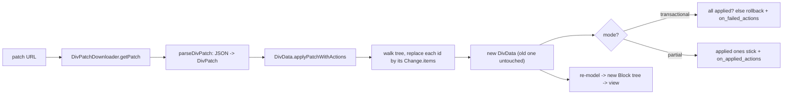
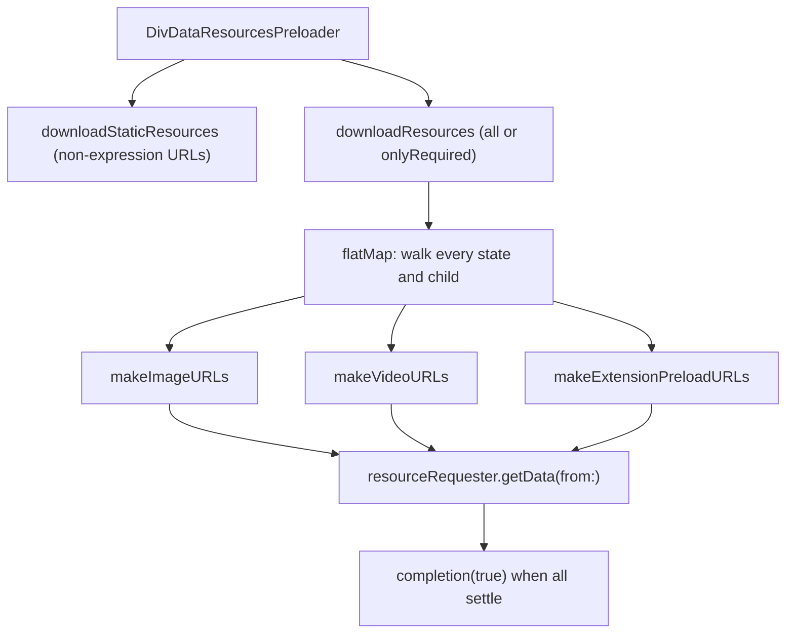

# 12 -- iOS Rendering: serialization, patches, images, and preloading

The architecture in [10-ios-architecture.md](./10-ios-architecture.md) ends
where a `Block` is made. This document covers what sits around that pipeline:
how JSON becomes a model tree and back again (serialization), how a card is
changed after it is on screen (patches and update reasons), and how the images
and other resources a card needs are loaded and preloaded. The unifying rule is
one line: **a card is immutable data; every change is a new `DivData`, and the
renderer is a pure function from `DivData` to a view.**

# Serialization: parse in, serialize out

The generated models have two directions. Parsing (JSON in) goes through two
protocols in the `Serialization` framework. `Deserializable` is the simple
one; `ContextDeserializable` is the one the generated code uses, because it
carries a `ParsingContext`:

```swift
// divkit-ios/Serialization/Deserializable.swift (whole file, trimmed)
public protocol Deserializable {
  init(dictionary: [String: Any]) throws
}

public protocol ContextDeserializable {
  init(dictionary: [String: Any], context: ParsingContext) throws
}

extension Deserializable {
  public init(JSONData: Data) throws {
    guard let dict = try JSONSerialization.jsonObject(with: JSONData) as? [String: Any] else {
      throw DeserializationError.invalidJSONData(data: JSONData)
    }
    try self.init(dictionary: dict)
  }
}
```

The `ParsingContext` is the per-parse state: it accumulates `errors` and
`warnings` instead of throwing on the first bad field, tracks a `path` (which
field failed), and holds a `templateResolver` so a `@`-template reference is
expanded during parse. A whole-card parse returns a `DeserializationResult`,
which bundles the value with any collected errors and warnings. That is why a
card with one bad field still renders: the field is dropped, a warning is
recorded, and the rest of the tree is built.

The entry point is `RawDivData`, which just separates the two top-level keys:

```swift
// divkit-ios/DivKit/RawDivData.swift (whole file)
public struct RawDivData: Deserializable, @unchecked Sendable {
  public let card: [String: Any]
  public let templates: [String: Any]

  public init(dictionary: [String: Any]) throws {
    card = try dictionary.getField("card")
    templates = try dictionary.getOptionalField("templates") ?? [:]
  }
}
```

`DivData.resolve(card:templates:)` then runs the real parse, applying the
`templates` through the resolver and producing the `DivData` tree from
[02-div-format.md](./02-div-format.md).

The other direction — model out — is `Serializable`, one method:

```swift
// divkit-ios/Serialization/Serializable.swift (whole file)
public protocol ValidSerializationValue {}
// Int, String, Bool, CGFloat, Double, Array, Dictionary, NSNumber, ... conform

public protocol Serializable {
  func toDictionary() -> [String: ValidSerializationValue]
}
```

Every generated model conforms, and the method is a mirror of the parser. For
`DivPatch`, the parse reads `changes`, `mode`, `on_applied_actions`,
`on_failed_actions`; the serializer writes the same four keys back:

```swift
// divkit-ios/DivKit/generated_sources/DivPatch.swift (excerpt — generated, round-trip)
public func toDictionary() -> [String: ValidSerializationValue] {
  var result: [String: ValidSerializationValue] = [:]
  result["changes"] = changes.map { $0.toDictionary() }
  result["mode"] = mode.toValidSerializationValue()
  result["on_applied_actions"] = onAppliedActions?.map { $0.toDictionary() }
  result["on_failed_actions"] = onFailedActions?.map { $0.toDictionary() }
  return result
}
```

The round-trip matters for two reasons. First, `toDictionary` is how the
*action* layer serializes a typed action into a `div-action://` URL (the
`DivActionIntent` mechanism from
[05-actions-and-state.md](./05-actions-and-state.md)). Second, it is how the
visual editor and the debugging tools turn a live model tree back into the JSON
a server would send.

# Patches: change a card without a full reload

A patch is a server-sent list of subtree replacements. It does not diff the old
tree against a new one; it names elements by `id` and replaces each named
subtree. The download side is the `DivPatchProvider` protocol, and the built-in
`DivPatchDownloader` fetches and parses one over the network:

```swift
// divkit-ios/DivKit/Patches/DivPatchDownloader.swift (excerpt)
public func getPatch(url: URL, completion: @escaping DivPatchProviderCompletion) {
  var request: NetworkTask?
  request = requestPerformer.performRequest(URLRequest(url: url)) { [weak self] result in
    ...
    parseResult(result, completion: completion)  // JSON -> DivPatch
  }
  requests.append(request!)
}
```

The patch itself is generated data. `DivPatch` has `changes` (each a `Change`
with an `id` and optional `items`, the replacement children), a `mode`
(`transactional` or `partial`), and two action lists, `on_applied_actions` and
`on_failed_actions`:

```swift
// divkit-ios/DivKit/generated_sources/DivPatch.swift (excerpt)
public final class DivPatch: Sendable {
  public enum Mode: String { case transactional, partial }
  public let changes: [Change]        // at least 1 element
  public let mode: Expression<Mode>   // default: partial
  public let onAppliedActions: [DivAction]?
  public let onFailedActions: [DivAction]?
}
```

Applying a patch walks the tree. For each element with an `id`, if the patch
has a change for that `id`, the element is replaced by the change's `items`;
otherwise the walk descends into the element's children. The result is a *new*
`DivData` — the old one is never mutated:

```swift
// divkit-ios/DivKit/Extensions/DivData/DivDataPatchExtensions.swift (excerpt)
func applyPatch(_ patch: DivPatch, callbacks: DivPatchCallbacks) -> DivData {
  let states = states.map {
    State(div: $0.div.applySingleItemPatch(patch, callbacks: callbacks), stateId: $0.stateId)
  }
  return DivData(functions: functions, logId: logId, states: states, ...)
}
```

The `mode` decides what happens when some changes fail. In `transactional`
mode, the patch applies only if *every* change finds its target; otherwise the
old `DivData` is returned and `on_failed_actions` runs. In `partial` mode, the
changes that applied stick, and `on_applied_actions` runs. Either way the
callback records which element ids actually changed, so their triggers can be
reset.



# Update reasons: batching one re-render per run loop

A patch is one way a card changes. The others are a timer tick, a state change,
a variable write, or an external signal. Each is a `DivCardUpdateReason`, and
the view layer does not re-render on every one. `RunLoopCardUpdateAggregator`
collects reasons and flushes them once per main-run-loop turn:

```swift
// divkit-ios/DivKit/RunLoopCardUpdateAggregator.swift (excerpt)
func aggregate(_ reason: DivCardUpdateReason) {
  let notScheduled = lock.withLock {
    guard enabled else { return false }
    let notScheduled = batch.isEmpty
    batch.append(reason)
    return notScheduled
  }
  if notScheduled {
    mainThreadAsyncRunner { [weak self] in self?.flushUpdateActions() }
  }
}
```

The merge step collapses *many* variable writes into one reason. Ten
`set_variable` actions for the same card in one frame become a single
`.variable` reason with a set of variable names, so the card re-renders once,
not ten times. A patch, timer, or state reason passes through unchanged:

```swift
// divkit-ios/DivKit/RunLoopCardUpdateAggregator.swift (excerpt — the merge)
case let .variable(affectedCards):
  for (key, value) in affectedCards {
    cards[key] = cards[key]?.union(value) ?? value
  }
  return nil                 // dropped here, re-emitted once below
case .patch, .timer, .state, .external:
  return $0
```

The batch then feeds `updateCardSignal`, which `DivBlockProvider`
subscribes to and re-runs `divData.makeBlock(context:)`. Because `LayoutKit`
blocks compare by value (the `equals` methods from
[11-layoutkit.md](./11-layoutkit.md)), an unchanged subtree reuses its old
block and view, and only the changed parts re-lay-out.

# Images: a holder factory with caching layers

Images are the one resource the renderer never owns directly. It asks a
`DivImageHolderFactory` for an `ImageHolder`, and the factory decides how to
load it:

```swift
// divkit-ios/DivKit/Images/DivImageHolderFactory.swift (excerpt)
public protocol DivImageHolderFactory {
  func make(_ url: URL?, _ placeholder: ImagePlaceholder?) -> ImageHolder
}
```

The default factory turns a URL into a `RemoteImageHolder`, which fetches the
bytes over the network and decodes them on a background queue. A `nil` URL
yields the placeholder (a color, an image, or even a lazily-built view), or a
`NilImageHolder` that draws nothing. Because it is a protocol, the host app can
swap in its own loader — its image cache, its CDN, its asset catalog — without
touching the renderer.

The factory itself is composable, and the convenience methods wrap it in
layers. `withAssets()` adds a local-asset layer: a `divkit-asset://` URL is
resolved against the app bundle, with a `divkit.` prefix guard so a card can
only reach its own declared assets:

```swift
// divkit-ios/DivKit/Images/DivImageHolderFactory.swift (excerpt — the asset layer)
if let url, url.scheme == "divkit-asset", let name = url.host {
  let bundle = URLComponents(url: url, resolvingAgainstBaseURL: false)?
    .queryItems?.first { $0.name == "bundle" }?.value
    .flatMap { Bundle(identifier: $0) }
  // all divkit asset images must start with the 'divkit.' prefix
  localImage = Image(named: "divkit.\(name)", in: bundle)
}
```

`withCache(_:)` reuses holders already created for a previous render, so a
re-render that touches the same image does not re-fetch it. `withInMemoryCache(_:)`
memoizes the holder by URL so the same URL maps to one shared holder across the
card. `withBackgroundModeling()` makes the factory safe to call on a background
thread, deferring the real holder creation to the main thread — the flag that
lets the whole modeling pass run off the main thread.

# Resource preloading

Because a card's images are URLs, they can be fetched before the view needs
them. `DivDataResourcesPreloader` walks the model tree, collects every URL it
can resolve, and warms the cache:

```swift
// divkit-ios/DivKit/ResourcesPreloader/DivDataResourcesPreloader.swift (excerpt)
public func downloadResources(
  for divData: DivData,
  filter: ResourcePreloadFilter,
  context: DivBlockModelingContext,
  completion: @escaping (Bool) -> Void
) {
  let validURLs = divData.flatMap(
    {
      let extensionURLs = $0.makeExtensionPreloadURLs(...)
      let imageURLs = $0.makeImageURLs(with: $1.expressionResolver, filter: filter)
      let videoURLs = $0.makeVideoURLs(with: $1.expressionResolver, filter: filter)
      return extensionURLs + imageURLs + videoURLs
    },
    context: context
  ).flatMap { $0 }.filter { $0.host != nil }
  ...
}
```

The `filter` is `all` (fetch every resolvable URL) or `onlyRequired` (fetch
only the ones an element marks as required for its layout). The URL collection
is per-element and per-resource-type: `DivImage` contributes its `image_url`,
`DivGifImage` its `gif_url`, `DivVideo` its video sources, and each background
and extension contributes its own. A separate `downloadStaticResources` pass
collects only the *static* (non-expression) image URLs, which is safe to run
before any expression context exists.



The preloader reuses the same `flatMap` traversal as the renderer, descending
through `div-container` `item_builder` loops and `div-state` trees, so it
discovers the URLs a dynamically-generated subtree will need. Preloading is the
answer to SDUI's latency problem: the JSON arrives first, the images are
resolved from it, and they are already in the cache when the first frame asks
for them.

# The Aha Moment

**Aha:** Every path into this layer ends in the same place — a new `DivData`.
A patch is not a diff applied to a live view; it is a set of id-keyed subtree
replacements that build a *new* `DivData`, which re-enters the ordinary
`makeBlock` pipeline. A variable write is not "moved into a text field"; it is
a reason that says "rebuild this card", batched with every other reason in the
same run-loop turn. And the renderer never owns an image — it asks a composable
factory for a holder, and the factory (with its asset, cache, and
background-modeling layers) decides where the bytes come from. The card is
immutable data, the view is recomputed from it, and everything expensive —
networking, decoding, re-layout — is either batched, cached, or injected. That
is why the same code that renders a card can patch it, re-serialize it, and
preload its resources without a separate path for any of them.

# Cross-References

- The `DivData`/`makeBlock` pipeline this layer feeds and re-runs: [10-ios-architecture.md](./10-ios-architecture.md).
- The `div-action://` URL that `toDictionary` serializes: [05-actions-and-state.md](./05-actions-and-state.md).
- The `LayoutKit` block equality that makes re-renders incremental: [11-layoutkit.md](./11-layoutkit.md).
- The `div-data` envelope, `templates`, and `states` that parsing reconstructs: [02-div-format.md](./02-div-format.md).

Continue to [13-web-client.md](./13-web-client.md).
