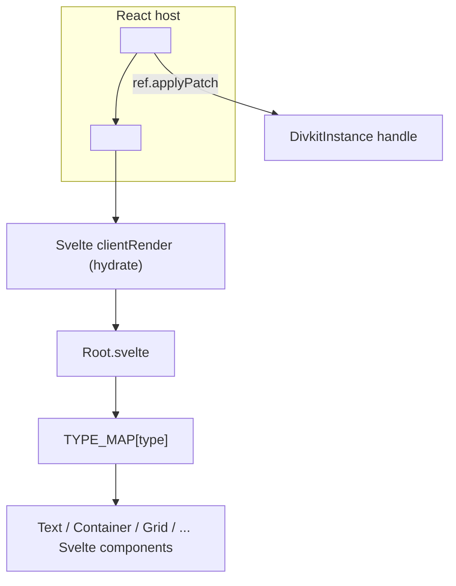

# 13 -- The Web Client: Svelte renderer and the React wrapper

The web client is the third renderer of the same JSON contract, but it is
built on a different idea than the iOS one. Where `LayoutKit` hand-writes a
measure-then-layout engine, the web client hands geometry to the browser: Div's
size and alignment fields compile to Cascading Style Sheets (CSS) flexbox, and
Svelte's reactivity is the variable and expression system. The renderer is one
Svelte component, `Root.svelte`, which dispatches to one Svelte component per
element type. A thin `divkit-react` package then embeds that Svelte renderer
inside a React tree, so React hosts get the same renderer without a rewrite.

# One renderer, three entry points

The core package is `@divkitframework/divkit`, written in TypeScript against
Svelte. It has three entry points for three runtimes. `client.ts` is the
browser entry; `server.ts` is the server-side-rendering (SSR) entry; and a
`client-hydratable` build is the entry that reuses server markup. The browser
entry returns a small handle, not a view object:

```ts
// divkit/client/web/divkit/src/client.ts (excerpt — the public entry)
export function render(opts: { target: HTMLElement; json: DivJson; id: string; ... }): DivkitInstance {
  const { target, hydrate, ...rest } = opts;
  const instance = new Root({ target, props: rest, hydrate });
  return {
    $destroy() { instance.$destroy(); },
    execAction(action) { instance.execAction(action); },
    setTheme(theme) { instance.setTheme(theme); },
    setData(newJson) { instance.setData(newJson); },
    applyPatch(patch) { return instance.applyPatch(patch); }
  };
}
```

The handle exposes exactly the operations a host needs: destroy, run an action,
switch theme, replace the whole card (`setData`), and apply a patch. `applyPatch`
is the same id-keyed subtree replacement seen in
[12-ios-rendering.md](./12-ios-rendering.md) — the contract is shared even
where the engine is not. The server entry is one line of indirection into
Svelte's server render:

```ts
// divkit/client/web/divkit/src/server.ts (excerpt — SSR)
export function render(opts: {...}) {
  return (Root as any).render(opts).html;   // Svelte server render -> HTML string
}
```

# The type map: one Svelte component per element

The dispatcher is a map from the JSON `type` discriminator to a Svelte
component. Every element type has its own component file, and the map is the
whole switch statement:

```ts
// divkit/client/web/divkit/src/components/typeMap.ts (whole file, trimmed)
import Text from './text/Text.svelte';
import Container from './container/Container.svelte';
import Image from './image/Image.svelte';
import Grid from './grid/Grid.svelte';
import Gallery from './gallery/Gallery.svelte';
import Tabs from './tabs/Tabs.svelte';
import State from './state/State.svelte';
// ... pager, indicator, slider, input, select, video, switch, custom, separator ...

export const TYPE_MAP: Record<string, ComponentType> = {
  text: Text, container: Container, separator: Separator, image: Image,
  gif: Image, grid: Grid, gallery: Gallery, tabs: Tabs, state: State,
  pager: Pager, indicator: Indicator, slider: Slider, input: Input,
  select: Select, video: Video, switch: Switch, custom: Custom
};
```

Two details matter. First, the map has 17 keys for the 17 element
discriminators from [03-elements.md](./03-elements.md), but `gif` maps to the
*same* `Image` component as `image` — the `gif` trap from that document shows
up here as an alias, not a separate component. Second, the map is a plain
object keyed by the JSON string, so adding a component is a matter of one line;
the renderer is a registry, not a switch statement baked into a core.

`Root.svelte` is the component that owns everything else. It is the largest
file in the package (over 100 kilobytes), because it is the composition root:
it holds the variable store, applies templates, processes variable triggers,
resolves expressions, and for each child looks up `TYPE_MAP[child.type]` and
renders it with the current context. The per-element components are small; the
shared behavior lives in `Root` and in the context it passes down.

# State and variables: Svelte stores and context

There is no `DivKitComponents` equivalent that passes dependencies by value.
The web client uses two Svelte mechanisms: **stores** (reactive values) for
variables, and **context** (a `setContext`/`getContext` pair keyed by symbols)
for the ambient services. The context is typed by a `RootCtxValue` interface
that lists every capability the components need:

```ts
// divkit/client/web/divkit/src/context/root.ts (excerpt — the context surface)
export interface RootCtxValue {
  genId(key: string): string;
  genClass(key: string): string;
  processVariableTriggers(...): (() => void) | undefined;
  registerInstance<T>(id: string, block: T, ...): void;
  registerId(id: string, getter: NodeGetter): () => void;
  getExtension(id: string, params: object | undefined): DivExtension | undefined;
  awaitGlobalVariable(variableName: string, variableType: VariableType, value: unknown): Variable;
  isPointerFocus: Readable<boolean>;
  direction: Readable<Direction>;
  ...
}
```

Variables are `Variable` objects, and the global set is a
`GlobalVariablesController` that the host can own and inject:

```ts
// divkit/client/web/divkit/src/expressions/globalVariablesController.ts (excerpt)
export class GlobalVariablesController {
  private _vars: Map<string, Variable> = new Map();
  setVariable(variable: Variable): void { ... }
  getVariable(variableName: string): Variable | undefined { ... }
  getVariables(): Map<string, Variable> { ... }
}
```

A `Variable` is a reactive store backed by Svelte's `writable`, so when an
action or a trigger writes a variable, every expression that reads it re-runs
through Svelte's reactivity. That is the web answer to the iOS
`DivVariablesStorage` + `updateCardSignal` pair: instead of rebuilding the
whole card, only the Svelte expressions that depend on a changed variable
re-evaluate. `divkit-react` lets a React host drive these through the same
controller, so external state (for example a server value) can flow into a card
without a full re-render.

# Expressions and actions

The expression language is the same `@{...}` syntax from
[06-variables-expressions.md](./06-variables-expressions.md), but it is
implemented as a PEG grammar compiled by Peggy (a parser generator), then
evaluated by a hand-written evaluator:

```mermaid
flowchart LR
    SRC["'@{getNumberValue(\"sum\", 0)}'"] --> PEG["expressions.peggy (PEG grammar)"]
    PEG --> PARSE["Peggy-compiled parser"]
    PARSE --> AST["AST node"]
    AST --> EVAL["eval.ts"]
    EVAL --> FUNCS["funcs/ (math, string, color, ...)"]
    FUNCS --> OUT["resolved value"]
```

The grammar file `expressions.peggy` defines the syntax; `eval.ts` walks the
abstract syntax tree and calls the built-in functions in `funcs/`. The same
split exists in the iOS client (parser in `ExpressionLink.swift`, functions in
`FunctionsProvider.swift`), so the two renderers agree on the language even
though the implementation language differs.

The data-mutating typed actions from
[05-actions-and-state.md](./05-actions-and-state.md) are implemented as small
modules. `array.ts` holds `array_insert_value`, `array_remove_value`, and
`array_set_value`; `dict.ts` holds `dict_set_value`; `copyToClipboard.ts` and
`updateStructure.ts` hold their namesakes. Each mutates the relevant `Variable`
store, and Svelte's reactivity propagates the change to the components.

# The React wrapper: embed, don't rewrite

`divkit-react` is not a React re-implementation of the renderer. It wraps the
Svelte instance in a single React component and bridges the small handle
through a ref:

```tsx
// divkit/client/web/divkit-react/src/divkit-client.tsx (whole file, trimmed)
export const DivKit = React.forwardRef<DivKitHandle, DivKitProps>(function DivKit(props, ref) {
  const containerRef = React.useRef<HTMLDivElement>(null);
  const instanceRef = React.useRef<ReturnType<typeof clientRender> | null>(null);
  const { id, json } = props;

  React.useImperativeHandle(ref, () => ({
    applyPatch(patch) { return instanceRef.current?.applyPatch(patch) ?? false; }
  }));

  React.useEffect(() => {
    const instance = clientRender({ ...propsRef.current, target: containerRef.current!, hydrate: true });
    instanceRef.current = instance;
    return () => { instance.$destroy(); instanceRef.current = null; };
  }, [id, json]);

  return <div ref={containerRef} suppressHydrationWarning dangerouslySetInnerHTML={{ __html: '' }} />;
});
```

The React component owns a plain `<div>`, mounts the Svelte renderer inside it
(the `clientRender` call), and forwards `applyPatch` through
`useImperativeHandle`. It re-creates the Svelte instance only when `id` or
`json` change, and it sets an empty `dangerouslySetInnerHTML` so React's own
reconciliation does not wipe the Svelte-managed DOM. The server counterpart is
even smaller: it renders the card to an HTML string on the server and drops it
into the div, so React and Svelte split the work — React owns the tree shape,
Svelte owns the card's DOM.



# The Aha Moment

**Aha:** The web client is a *host for the browser*, not a re-implementation of
the layout engine. On iOS, Div's `match_parent`, `wrap_content`, weights, and
alignment become `LayoutTrait`, `ResizableBlockMeasure`, and a hand-written
flexbox in [11-layoutkit.md](./11-layoutkit.md). On the web, those same fields
compile to CSS flexbox and the browser does the arithmetic; variables and
expressions become Svelte stores and a Peggy grammar, and re-renders become
Svelte's fine-grained reactivity instead of a whole-card rebuild. The proof is
the React package: it does not port the renderer to React — it embeds the
Svelte instance in a `<div>` and bridges `applyPatch` through a ref. One JSON
schema compiles to four renderers, and each renderer is free to use whatever
engine its platform already provides, because the *contract* — element types,
actions, expressions — is what must match, not the machinery.

# Cross-References

- The 17 element discriminators this `TYPE_MAP` dispatches, including the `gif` alias: [03-elements.md](./03-elements.md).
- The expression language and `getXValue` functions the Peggy grammar implements: [06-variables-expressions.md](./06-variables-expressions.md).
- The typed actions (`array_*`, `dict_set_value`, `copy_to_clipboard`, `update_structure`): [05-actions-and-state.md](./05-actions-and-state.md).
- The patch format this `applyPatch` shares with the iOS renderer: [12-ios-rendering.md](./12-ios-rendering.md).
- The `LayoutKit` engine this client deliberately does not replicate: [11-layoutkit.md](./11-layoutkit.md).

Continue to [14-android-client.md](./14-android-client.md).
