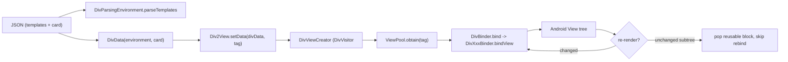
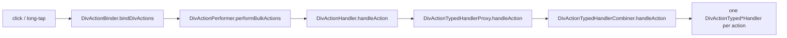

# 14 -- The Android Client: a binder over recycled views

The Android client is the Kotlin renderer, and it follows the same contract as
the iOS and web clients, but with a third piece of machinery: instead of a
measure engine (`LayoutKit`) or the browser (CSS), it uses the plain Android
View system, plus its own view recycling. The pipeline is `JSON -> DivData ->
Android View`, and the whole renderer is organized around one split: *create a
view once, then bind data to it many times*. This document reads the entry
point, the create/bind split, and the view pool that makes re-renders cheap.

# The entry point: configuration, parse, view

The host app uses four types. A `DivConfiguration` carries the pluggable parts
(the one required piece is a `DivImageLoader`); a `DivParsingEnvironment` holds
the parsed templates; a `DivData` is the parsed card; and a `Div2View` renders
it. The Android README states the flow in three steps:

```kotlin
// divkit/client/android/README.md (excerpt — the quick start)
fun JSONObject.asDiv2DataWithTemplates(): DivData {
    val templates = getJSONObject("templates")
    val card = getJSONObject("card")
    val environment = DivParsingEnvironment(ParsingErrorLogger.LOG)
    environment.parseTemplates(templates)
    return DivData(environment, card)
}

val div2View = Div2View(Div2Context(baseContext = this, configuration = config))
yourViewGroup.addView(div2View)
div2View.setData(divData, DivDataTag("your_unique_tag_here"))
```

The two halves of a card are `templates` and `card`, exactly as in
[02-div-format.md](./02-div-format.md). Parsing separates them: templates go
into the shared `DivParsingEnvironment`, and the card becomes a `DivData`
resolved against that environment. `setData` then renders the `DivData` into
the `Div2View` (a `View`), tagged with a `DivDataTag` so logging can tell two
cards apart.

# The create/bind split

The renderer has two jobs: turn a Div element into an Android `View`, and copy
the element's data onto that view. Those jobs are two objects. `DivViewCreator`
creates; `DivBinder` binds. The pipeline is explicit in `Div2Builder`:

```kotlin
// divkit/client/android/div/.../core/view2/Div2Builder.kt (whole file, trimmed)
internal class Div2Builder @Inject constructor(
    private val viewCreator: DivViewCreator,
    private val viewBinder: DivBinder,
) {
    fun buildView(divBlock: DivBlock, divView: Div2View): View {
        return createView(divBlock.div, divBlock.expressionResolver, divBlock.path, divView).also {
            viewBinder.bind(it, divBlock, divView)
        }
    }
}
```

`DivViewCreator` is a `DivVisitor<View>` — the visitor pattern over the `Div`
sealed hierarchy. Its `visit` for each element type returns the matching
Android widget; the base `defaultVisit` asks a `ViewPool` for a recycled view
by a per-type tag. `DivBinder` is the mirror: it switches on the `DivBlock`
subtype and calls the matching per-element binder's `bindView`. The two halves
cover the same 17 element types, but in different directions:

```kotlin
// divkit/client/android/div/.../core/view2/DivBinder.kt (excerpt — the dispatch)
return when (divBlock) {
    is DivBlock.Text -> bindText(view, divBlock, divView)
    is DivBlock.Image -> bindImage(view, divBlock, divView)
    is DivBlock.GifImage -> bindGifImage(view, divBlock, divView)
    is DivBlock.Separator -> bindSeparator(view, divBlock, divView)
    is DivBlock.Container -> bindContainer(view, divBlock, divView)
    is DivBlock.Grid -> bindGrid(view, divBlock, divView)
    is DivBlock.Gallery -> bindGallery(view, divBlock, divView)
    is DivBlock.Pager -> bindPager(view, divBlock, divView)
    is DivBlock.Tabs -> bindTabs(view, divBlock, divView)
    is DivBlock.State -> bindState(view, divBlock, divView)
    is DivBlock.Custom -> bindCustom(view, divBlock, divView)
    is DivBlock.Indicator -> bindIndicator(view, divBlock, divView)
    is DivBlock.Slider -> bindSlider(view, divBlock, divView)
    is DivBlock.Input -> bindInput(view, divBlock, divView)
    is DivBlock.Select -> bindSelect(view, divBlock, divView)
    is DivBlock.Video -> bindVideo(view, divBlock, divView)
    is DivBlock.Switch -> bindSwitch(view, divBlock, divView)
}.also { ... }
```

The `when` is exhaustive over 17 `DivBlock` subtypes, matching the 17 element
discriminators from [03-elements.md](./03-elements.md) — including `GifImage`
as its own case, not an alias of `Image` as it is on the web. Each `bindText`,
`bindContainer`, and so on is a small private method that casts the view to the
expected widget and delegates to a `DivTextBinder`, `DivContainerBinder`, and
so on. Those binders live in `core/view2/divs/`, one file per element.

The mapping from element to widget is a second table, in `DivViewCreator`:

| Div element | Android widget |
|---|---|
| `text` | `DivLineHeightTextView` |
| `image` | `DivImageView` |
| `gif` | `DivGifImageView` |
| `separator` | `DivSeparatorView` |
| `container` (overlap) | `DivFrameLayout` |
| `container` (linear) | `DivLinearLayout` |
| `container` (wrap) | `DivWrapLayout` |
| `grid` | `DivGridLayout` |
| `gallery` | `DivRecyclerView` |
| `pager` | `DivPagerView` |
| `tabs` | `DivTabsLayout` |
| `state` | `DivStateLayout` |
| `custom` | `DivCustomWrapper` |
| `indicator` | `DivPagerIndicatorView` |
| `slider` | `DivSliderView` |
| `input` | `DivInputView` |
| `select` | `DivSelectView` |
| `video` | `DivVideoView` |
| `switch` | `DivSwitchView` |

The interesting row is `container`. One Div element maps to *three* widgets,
chosen by the container's orientation and layout mode:

```kotlin
// divkit/client/android/div/.../core/view2/DivViewCreator.kt (excerpt — the container split)
internal fun viewTag(div: Div, resolver: ExpressionResolver): String =
    when (div) {
        is Div.Container -> when {
            div.value.isWrapContainer(resolver) -> TAG_WRAP_CONTAINER
            div.value.orientation.evaluate(resolver) == Orientation.OVERLAP -> TAG_OVERLAP_CONTAINER
            else -> TAG_LINEAR_CONTAINER
        }
        ...
    }
```

`overlap` uses a `FrameLayout` (children stacked), the linear orientations use a
`LinearLayout`, and the `wrap` mode uses a `DivWrapLayout`. So Android hands the
geometry to the platform's own `ViewGroup`/`LayoutParams` system — there is no
custom measure-then-layout engine like `LayoutKit`; the custom widgets are for
the elements Android has no built-in for (a grid layout, a pager, a line-height
text view).

# The view pool: recycle, don't rebuild

Because views are expensive, `DivViewCreator` never calls `new` directly for the
pooled types. It asks a `ViewPool`, which pre-allocates a capacity per type and
recycles views as they scroll off or re-render:

```kotlin
// divkit/client/android/div/.../core/view2/DivViewCreator.kt (excerpt — the pool)
init {
    with(viewPool) {
        register(TAG_TEXT, { DivLineHeightTextView(context) }, text.capacity)
        register(TAG_IMAGE, { DivImageView(context) }, image.capacity)
        register(TAG_GIF_IMAGE, { DivGifImageView(context) }, gifImage.capacity)
        register(TAG_GRID, { DivGridLayout(context) }, grid.capacity)
        register(TAG_GALLERY, { DivRecyclerView(context) }, gallery.capacity)
        // ... one register per element type ...
    }
}
```

The capacities come from a `viewPreCreationProfile`, which the host can tune, so
a card that is mostly images allocates more image views up front. On a re-render,
`DivBinder.bind` first checks a reusable list and *pops* an already-bound block
instead of re-binding, so an unchanged subtree reuses its existing view:

```kotlin
// divkit/client/android/div/.../core/view2/DivBinder.kt (excerpt — reuse fast path)
fun bind(view: View, divBlock: DivBlock, divView: Div2View) = suppressExpressionErrors {
    divView.currentRebindReusableList?.pop(divBlock.div)?.let {
        return@suppressExpressionErrors
    }
    ...
}
```

The `gallery` element is a `RecyclerView`, which brings its own recycling on top
of the `ViewPool`, so a long list of cards scrolls without allocating a view per
item.



# Actions and dependency injection

`DivActionBinder` attaches the action lists to view gestures (click, long-tap,
double-tap). Running a typed action goes through `DivActionHandler.handleAction`,
which passes it via `DivActionTypedHandlerProxy` to `DivActionTypedHandlerCombiner`,
a set of `DivActionTyped*Handler` classes under `core/actions/` matching the 25
typed actions from [05-actions-and-state.md](./05-actions-and-state.md):
`DivActionTypedSetStateHandler`, `DivActionTypedSetVariableHandler`,
`DivActionTypedArrayMutationHandler`, `DivActionTypedDictSetValueHandler`,
`DivActionTypedScrollHandler`, and so on. The host implements `DivActionHandler`
to catch the actions it cares about and must call `super.handleAction` for the
ones DivKit handles itself (URL open, `set_state`, the data mutations).



The composition of all these objects is done by Dagger, the dependency
injection framework. The annotations on the classes show the scopes:
`@DivScope` on the per-view objects (`DivBinder`, `DivViewCreator`) and
`@DivDataScope` on the per-card objects (the `DivDataViewConnector` that
attaches a `Div2View` to the card's runtime store). The `compose` module adds a
second rendering path on Jetpack Compose, and the integration modules (`coil`,
`glide`, `div-lottie`, `div-svg`, `div-rive`, `div-markdown`, `div-shimmer`,
`div-shine`) each contribute one pluggable piece, the largest of which are the image loaders
(`CoilDivImageLoader`, `GlideDivImageLoader`).

# The Aha Moment

**Aha:** The Android renderer's core is not a layout algorithm; it is a *view
pool plus a binder*. On iOS, geometry is a hand-written `LayoutKit` engine; on
the web, it is CSS; on Android, it is the platform's own `ViewGroup` and
`LayoutParams`. What DivKit adds on Android is the mapping (which Div element
becomes which widget), the recycling (a `ViewPool` keyed by element type), and
the binding (`DivViewCreator` makes a view, `DivBinder` writes data onto it).
That split is why a variable change is cheap: the view is not recreated, it is
re-bound — and an unchanged subtree is skipped entirely by popping its reusable
block. The three clients all honor one JSON contract, but each hands the hard
geometry problem to whatever its platform already has, and spends its own code
on the part the platform lacks: on Android, that part is recycling and binding.

# Cross-References

- The 17 element discriminators this `when` dispatches, including `gif`: [03-elements.md](./03-elements.md).
- The 25 typed actions the `DivActionTyped*Handler` classes implement: [05-actions-and-state.md](./05-actions-and-state.md).
- The `templates` + `card` envelope the parsing step reconstructs: [02-div-format.md](./02-div-format.md).
- The iOS `LayoutKit` engine Android deliberately does not replicate: [11-layoutkit.md](./11-layoutkit.md).
- The web renderer's own platform-leaning approach: [13-web-client.md](./13-web-client.md).

Continue to [15-flutter-kmp.md](./15-flutter-kmp.md).
